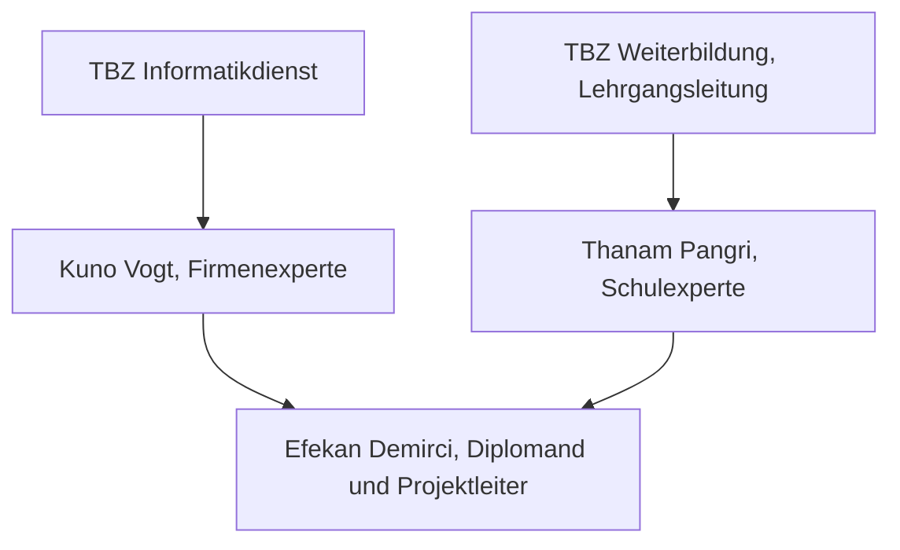
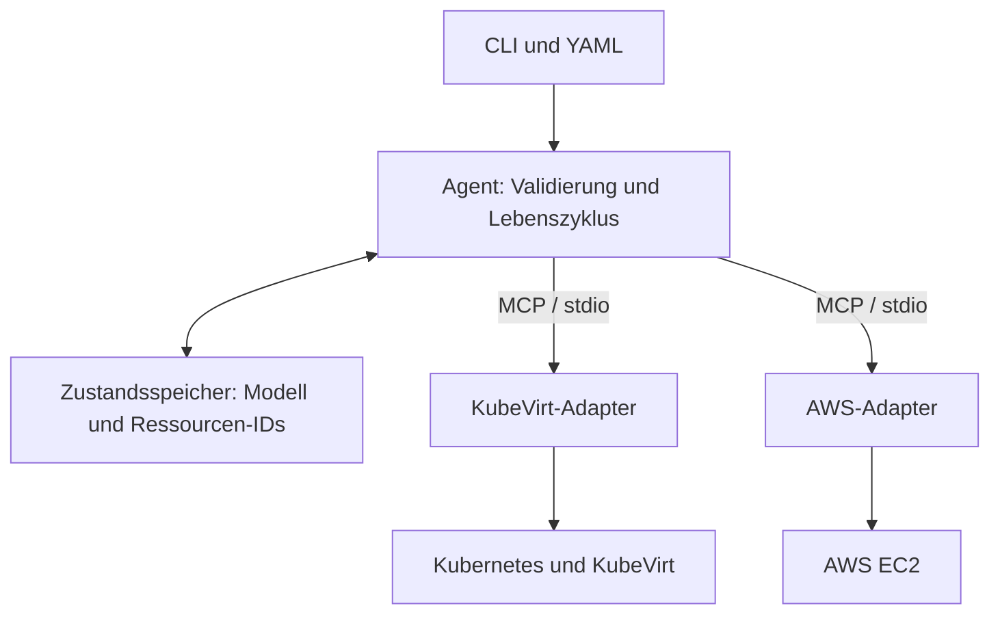

# Diplomarbeit: Agentenbasierte Hybrid-Cloud-Bereitstellung von Lernumgebungen mit Kubernetes, KubeVirt und MCP

!!! info "Arbeitsstand vom 15.10.2026"
    KubeVirt-Referenzlauf, drei LernMAAS-Basisläufe und der AWS-Smoke-Test sind abgeschlossen. Das Fachmodell mit Schema-Validierung liegt im Repository. Agent, MCP-Adapter und die sechs formalen PoC-Läufe folgen in Sprint 2 und 3. Die bisherigen Tests und ihre Grenzen stehen in Kapitel 5.

| | |
| --- | --- |
| Diplomand | Efekan Demirci, ITCNE24, TBZ Höhere Fachschule |
| Auftraggeber | Technische Berufsschule Zürich, Informatikdienst |
| Firmenexperte | Kuno Vogt, Leiter Informatikdienst TBZ |
| Schulexperte | Thanam Pangri, HF-Lehrgangsleitung |
| Bewilligter Zeitraum | 11.09.2026 bis 18.12.2026 |
| Arbeitsplanung | 14.09.2026 bis 18.12.2026 |
| Version | 0.5, Arbeitsstand |
| Grundlage | Bewilligte Projektbeschreibung vom 10.09.2026; schulische Vorgaben gemäss gültigem Merkblatt |

---

## Management Summary

> Wird am Projektende verfasst und zusätzlich als separates Dokument mit unterschriebenem Ehrenwort abgegeben. Grundlage ist das Management Summary aus der bewilligten Projektbeschreibung vom 10.09.2026.

---

## 1 Einleitung

### 1.1 Ausgangslage

Die Technische Berufsschule Zürich stellt für den Unterricht digitale Übungsumgebungen bereit, in denen Lernende praktische technische Aufgaben durchführen. Diese Lernumgebungen werden heute auf einer lokalen Plattform mit MAAS, LernMAAS, Konfigurationsdateien und Shellskripten bereitgestellt. Das Verfahren ist im Betrieb etabliert und bleibt während der gesamten Diplomarbeit unverändert verfügbar.

Die fachliche Beschreibung einer Lernumgebung und ihre technische Bereitstellung sind dabei eng mit dieser Plattform verbunden. Soll dieselbe Lernumgebung auf einer anderen Infrastruktur entstehen, müssen Abläufe, Schnittstellen und Skripte separat angepasst oder neu entwickelt werden. Daraus ergeben sich zusätzlicher manueller Aufwand, eine stärkere Abhängigkeit von spezifischem Wissen einzelner Personen und eine eingeschränkte Wiederverwendbarkeit der bestehenden Beschreibungen.

### 1.2 Problemstellung

Es fehlt ein einheitliches Modell, mit dem eine Lernumgebung unabhängig von der gewählten Plattform beschrieben und über einen gemeinsamen Ablauf verwaltet werden kann. Ohne ein solches Modell bleibt die fachliche Beschreibung an eine einzelne technische Umsetzung gebunden.

Vor einer möglichen späteren Weiterentwicklung der lokalen Lernplattform soll deshalb geklärt werden, ob ein plattformübergreifender Ansatz technisch machbar ist und gegenüber dem heutigen Vorgehen einen nachvollziehbaren Mehrwert bietet.

### 1.3 Zielbild

Eine Lernumgebung wird einmal fachlich beschrieben und über denselben Lebenszyklus entweder lokal oder in der Public Cloud verwaltet. Die Bedienlogik bleibt auf beiden Zielplattformen gleich, während die plattformspezifische Umsetzung davon getrennt ist. Der Ablauf soll reproduzierbar und messbar sein und ohne manuelle technische Entscheidungen auskommen.

Der Proof of Concept liefert damit eine Entscheidungsgrundlage für eine mögliche spätere Weiterentwicklung, ohne die bestehende produktive Umgebung zu verändern.

### 1.4 Zielsetzungen und Erfolgskriterien

Die fünf Teilziele aus der bewilligten Projektbeschreibung bestimmen den Umfang. Im Review wird ihr Nachweisstand geprüft.

| ID | Ziel | Messkriterium | Zielwert | Nachweis | Status |
| --- | --- | --- | --- | --- | --- |
| Z1 | Plattformneutrales Modell für Lernumgebungen | Versioniertes YAML-Modell mit JSON-Schema, gültige Definition wird akzeptiert, ungültige abgewiesen | 1 Modell, 1 Schema, je 1 positiver und 1 negativer Testfall bestehen | Repository, Testprotokoll | Versioniert; lokale Tests und CI erfolgreich, siehe Kapitel 4.2 |
| Z2 | Zentraler Agent mit Zustandsführung | create, status, reset und delete laufen über festgelegte Zustandsübergänge, Zustand ist persistent | 4 Operationen funktionsfähig, reset erzeugt aus derselben Definition neu | Quellcode, Zustandsdiagramm, Testprotokoll | Offen |
| Z3 | On-Prem-Backend mit Kubernetes und KubeVirt | Test-Lernumgebung wird automatisiert bereitgestellt und vollständig entfernt | 3 vollständige Durchläufe ohne manuelle Korrektur | Laufprotokolle, Screenshots | Offen |
| Z4 | Bewertung der MCP-basierten Adapterarchitektur | Dieselbe Definition läuft lokal und auf genau einer Public Cloud, Bewertung gegen direkte API-Anbindung | 3 vollständige Durchläufe in der Cloud, Bewertung nach 5 Kriterien dokumentiert | Laufprotokolle, Bewertungstabelle | Offen |
| Z5 | Messbarer Vergleich mit dem heutigen Vorgehen | Bereitstellungszeit, manuelle Eingriffe, Reproduzierbarkeit, vollständiger Abbau | Vorher- und Nachher-Werte für denselben Testfall protokolliert | Messprotokoll, Vergleichstabelle | Offen |

Die vorhandenen Machbarkeitsversuche erfüllen diese Ziele noch nicht vollständig.

### 1.5 Erfolgskriterien des Proof of Concept

Der Proof of Concept gilt als erfolgreich, wenn die folgenden Kriterien des verbindlichen Kernumfangs nachgewiesen sind. Sie konkretisieren die Ziele der bewilligten Projektbeschreibung und bilden die projektweite Definition of Done.

- Das YAML-Modell und das zugehörige JSON-Schema sind versioniert. Das Modell deckt die ausgewählten Konfigurationsmerkmale der LernMAAS-Profile m239, m254 und m426 ab. Eine gültige Definition wird akzeptiert, eine bewusst ungültige wird abgewiesen, und die technisch reduzierte Test-Lernumgebung ist festgelegt.
- Der Agent validiert die Definition, speichert den Zustand persistent und führt create, status, reset und delete über festgelegte Zustandsübergänge aus. reset löscht die Umgebung und erstellt sie aus derselben Definition neu.
- Die gemeinsame Definition wird über die MCP-basierten Adapter lokal auf einem Kubernetes-Cluster mit KubeVirt und auf genau einer Public-Cloud-Plattform bereitgestellt. Auf beiden Zielplattformen erreicht die VM den festgelegten Zustand und der definierte Testdienst besteht den Readiness-Check.
- Auf jeder Zielplattform werden drei aufeinanderfolgende vollständige Durchläufe durchgeführt, insgesamt sechs. Alle Durchläufe funktionieren ohne manuelle Korrektur.
- Nach jedem delete sind keine dem Testlauf zugeordneten Ressourcen mehr vorhanden.
- Bereitstellungszeit und manuelle Eingriffe sind für das heutige Vorgehen und den Proof of Concept protokolliert. Der Vorher-Nachher-Vergleich sowie die Bewertung der MCP-basierten Architektur gegenüber einer direkten API-Anbindung sind dokumentiert.
- Die gewonnenen Erkenntnisse und die erarbeiteten technischen Komponenten sind hinsichtlich ihrer Übertragbarkeit auf eine mögliche zukünftige produktive Umgebung beurteilt und dokumentiert.

### 1.6 Abgrenzung

Der Umfang ist bewusst so festgelegt, dass der vollständige und messbare Nachweis innerhalb der verfügbaren Projektzeit möglich bleibt. Nicht Teil dieser Arbeit sind:

| Nicht im Umfang | Begründung |
| --- | --- |
| Migration oder Abschaltung der bestehenden MAAS-Umgebung | Die produktive Umgebung bleibt unverändert in Betrieb und dient als Vergleichsbasis |
| Produktiver Betrieb der neuen Infrastruktur | Der Nachweis erfolgt als Proof of Concept, nicht als Einführung |
| Vollständige Umsetzung aller Unterrichtsmodule | Eine technisch reduzierte Test-Lernumgebung genügt für den Nachweis des Lebenszyklus |
| Sprachmodellbasierte Entscheidungslogik | Der Agent arbeitet nach festgelegten Regeln, um Abläufe und Fehlerfälle eindeutig prüfen zu können |
| Bedienoberfläche | Der Nachweis erfolgt über die Kommandozeile, eine Oberfläche liefert für die Fragestellung keinen zusätzlichen Erkenntnisgewinn |
| Zweite Public Cloud | Eine Plattform genügt, um die Austauschbarkeit über die Adapterschicht zu zeigen |
| GitOps oder Argo CD | Wird in dieser Arbeit nicht behandelt |
| Hochverfügbarkeit, verteilter Storage, produktive Skalierung | Betriebsthemen, die erst bei einer produktiven Einführung relevant werden |
| Hardwarebeschaffung und betriebliche Netzwerkumstellungen | Es wird ausschliesslich vorhandene, freigegebene Hardware verwendet |

Diese Punkte werden im Ausblick behandelt.

### 1.7 Zielgruppe und Lesehinweise

Die Dokumentation richtet sich an die beiden Experten, an den Informatikdienst der TBZ und an die HF-Lehrgangsleitung. Sie ist so geschrieben, dass ein fachlich versierter Leser ohne Vorwissen über die TBZ-Umgebung folgen kann. Fachbegriffe werden beim ersten Vorkommen kurz erläutert und zusätzlich im Glossar am Ende der Arbeit erklärt.

### 1.8 Themenfeldabdeckung

Der Schwerpunkt liegt auf Cloud Engineering und Automatisierung. Das Fachmodell und die Adapterschicht betreffen das Schnittstellendesign, KubeVirt die cloud-native Virtualisierung. Projektführung, Wirtschaftlichkeit und Runbook ergänzen die technische Umsetzung. Die Bewertung verbindet diese Bereiche mit der Frage, ob sich der Ansatz für eine spätere Weiterentwicklung der Lernplattform eignet.

## 2 Projektmanagement

### 2.1 Vorgehensmodell

Ich arbeite in drei Iterationen, die in der Planung als Sprints bezeichnet werden. Am Ende steht jeweils ein vorführbarer Zwischenstand. Neue Erkenntnisse aus den Tests fliessen in den nächsten Sprint ein. Ziele, Abgabetermin und Kostenrahmen bleiben durch den bewilligten Antrag vorgegeben.

Das Vorgehen übernimmt Backlog, Review und Retrospektive aus Scrum. Es ist kein vollständiger Scrum-Prozess: Ich arbeite allein, die Abschnitte dauern vier beziehungsweise fünf Wochen, und die Abstimmung mit den Experten findet an vereinbarten Terminen statt. Der Scrum Guide sieht dagegen Sprints von höchstens einem Monat vor. [Scrum Guide](https://scrumguides.org/scrum-guide.html)

Bei Zeitdruck kürze ich zusätzliche Ausarbeitung und Grafiken. Die sechs PoC-Läufe, beide Plattformen, MCP-Bewertung und die vier Inhalte des Runbooks bleiben verbindlich. Änderungen an diesen Zusagen werden mit beiden Experten abgestimmt.

### 2.2 Organisation und Zusammenarbeit



<small><em>Abbildung 1: Projektorganisation und Berichtswege</em></small>

Ich übernehme Planung, Umsetzung, Tests und Dokumentation. Kuno Vogt vertritt den Auftraggeber und wird bei Priorisierung und betrieblichen Fragen einbezogen. Thanam Pangri begleitet die Arbeit als Schulexperte. Beide Experten beurteilen die Ergebnisse und werden bei Änderungen an Zielen oder Fokus einbezogen.

Kuno Vogt ist zugleich mein direkter Vorgesetzter im Informatikdienst. Thanam Pangri begleitet die Arbeit im schulischen Rahmen.

Dozierende sind die späteren Nutzenden der Lernumgebungen, Lernende deren indirekte Nutzende. Ihr Interesse betrifft vor allem einen verständlichen Ablauf und eine zuverlässig nutzbare Umgebung. Der PoC liefert noch keine produktive Einführung.

Die laufende Abstimmung ist über den vereinbarten Teams-Kanal vorgesehen. Beschlüsse und Rückmeldungen werden mit Datum und Bezug zum betroffenen Issue dokumentiert. Ein geplanter Termin oder ein vorbereitetes Dokument gilt noch nicht als durchgeführtes Gespräch.

### 2.3 Termine und Meilensteine

Der bewilligte Projektzeitraum beginnt am 11.09.2026. Die operative Wochenplanung beginnt am Montag, 14.09.2026, und umfasst 14 Wochen bis zur Abgabe am 18.12.2026. Die Reviewwochen sind Plantermine; konkrete Uhrzeiten und der Kolloquiumstermin werden mit den Experten bestätigt.

| Abschnitt | Zeitraum | Ergebnis am Ende |
| --- | --- | --- |
| Sprint 1 | 14.09. bis 18.10.2026 | Ausgangsmessungen, lokaler Referenzlauf, AWS-Smoke-Test und Architekturentwurf |
| Sprint 2 | 19.10. bis 15.11.2026 | Modell und Agent, vollständiger lokaler Lebenszyklus sowie automatisiertes create, status und delete auf AWS |
| Sprint 3 | 16.11. bis 18.12.2026 | AWS-Reset und Wiederaufnahme, sechs formale PoC-Läufe, Bewertung und Abgabe |

| ID | Meilenstein | Plantermin | Erforderlicher Stand |
| --- | --- | --- | --- |
| M0 | Arbeitsbeginn | 14.09.2026 | Die Experten haben den Antrag geprüft; Projektstart ohne separates Kickoff-Meeting |
| M1 | Erstes Review | Woche vom 19.10.2026 | Vergleichsbasis, lokale Machbarkeit, AWS-Smoke-Test und Architektur liegen vor |
| M2 | Zweites Review | Woche vom 16.11.2026 | Vollständiger lokaler Durchlauf und automatisierter AWS-Durchstich demonstrierbar |
| M3 | Scope-Freeze | 04.12.2026 | Kernfunktionen stehen; danach Fehlerkorrekturen, Messungen und Abschluss |
| M4 | Drittes Review | Woche vom 14.12.2026 | Sechs erfolgreiche PoC-Läufe und Bewertung dokumentiert |
| M5 | Abgabe | 18.12.2026 | Dokumentation, Management Summary, Ehrenwort und vereinbarte Abgabeunterlagen fertig |
| M6 | Kolloquium | Mit Schule bestätigen | Präsentation, kurze Demo und vorbereitete Ersatznachweise verfügbar |

Diese sieben Meilensteine sind Planung. Erreichte Termine werden erst mit einem Nachweis als abgeschlossen geführt. Die Abschlussphase ab 04.12.2026 ist für Tests und Dokumentation vorgesehen und daher kein freier Zeitpuffer.

Für das Kolloquium war auf der bisherigen Einstiegsseite die Woche vom 04.01.2027 vorgemerkt. Diese Angabe ist eine Planannahme; ein verbindlicher Termin ist in den vorliegenden Nachweisen noch nicht belegt.

### 2.4 Backlog und Prioritäten

Der Backlog enthält 38 Stories mit 111 Story Points. Der AWS-Durchstich US39 umfasst drei Punkte in Sprint 2, die Vervollständigung US25 fünf Punkte in Sprint 3. Readiness und Abbauprüfung entstehen bereits mit dem ersten lokalen Durchlauf; US26 und US29 prüfen sie später auf beiden Plattformen formal.

Die Planung liegt in `scripts/backlog.json`; der aktuelle Bearbeitungsstand wird in den GitHub-Issues geführt. Hilfsskripte unterstützen den Abgleich. Manuell angepasste Issue-Texte, etwa bei US10, werden vor einem erneuten Abgleich geprüft. US05 wird gemäss [Entscheid im Issue](https://github.com/Cancani/diplomarbeit/issues/5) nur bei ausdrücklichem Bedarf weitergeführt. Die folgenden Tabellen halten die ursprüngliche Sprintplanung mit 111 Punkten fest.

Die Epics bündeln Initialisierung (E1), IST-Aufnahme (E2), lokale Plattform (E3), AWS-Vorbereitung (E4), Fachmodell (E5), Agent (E6), Adapter (E7), Validierung (E8), Bewertung (E9), Betrieb und Schulung (E10) sowie Architektur und Abschluss (E11).

#### Sprint 1

16 Stories, 38 Story Points.

| ID | Aufgabe | Epic | SP | Priorität |
| --- | --- | --- | --- | --- |
| US01 | Repository mit klarer Struktur | E1 | 2 | Must |
| US02 | Öffentlich einsehbares Project Board | E1 | 2 | Must |
| US03 | Vorlagen, Labels, Milestones und Regeln | E1 | 1 | Must |
| US04 | Dokumentation über GitHub Pages | E1 | 2 | Must |
| US05 | Wöchentlicher Statusbericht am Wochenende | E1 | 1 | Must |
| US07 | IST-Analyse der heutigen Bereitstellung | E2 | 2 | Must |
| US08 | Test-Lernumgebung aus m239, m254 und m426 ableiten | E2 | 3 | Must |
| US09 | Messkonzept mit identischen Start- und Endkriterien | E2 | 3 | Must |
| US10 | Ausgangsmessung am heutigen Vorgehen | E2 | 5 | Must |
| US11 | Hardware betriebsbereit und dokumentiert | E3 | 2 | Must |
| US12 | Kubernetes-Cluster verifizieren und dokumentieren | E3 | 2 | Must |
| US13 | KubeVirt verifizieren und Storage klären | E3 | 2 | Must |
| US38 | Referenz-VM manuell erstellen und wieder abbauen | E3 | 3 | Must |
| US14 | AWS-Entscheid und Kontobedingungen begründen | E4 | 2 | Must |
| US15 | Cloud-Smoke-Test mit Budgetwarnung und Quotas | E4 | 3 | Must |
| US16 | Zielarchitektur, ADRs und Zwischenpräsentation 1 | E11 | 3 | Must |

#### Sprint 2

9 Stories, 35 Story Points.

| ID | Aufgabe | Epic | SP | Priorität |
| --- | --- | --- | --- | --- |
| US17 | Plattformneutrales YAML-Modell für Lernumgebungen | E5 | 5 | Must |
| US18 | JSON-Schema mit positiver und negativer Validierung | E5 | 3 | Must |
| US19 | Agent-Grundgerüst mit Kommandozeilenschnittstelle | E6 | 3 | Must |
| US20 | Persistenter Zustandsspeicher mit Zustandsübergängen | E6 | 5 | Must |
| US21 | create und status | E6 | 5 | Must |
| US22 | reset und delete | E6 | 3 | Must |
| US23 | Einheitliches Funktionsset über MCP | E7 | 3 | Must |
| US24 | MCP-Adapter für KubeVirt, erster End-to-End-Durchlauf | E7 | 5 | Must |
| US39 | Automatisierter AWS-Durchstich create, status und delete | E7 | 3 | Must |

#### Sprint 3

13 Stories, 38 Story Points.

| ID | Aufgabe | Epic | SP | Priorität |
| --- | --- | --- | --- | --- |
| US25 | AWS-Adapter um Reset und Wiederaufnahme vervollständigen | E7 | 5 | Must |
| US26 | Readiness auf beiden Plattformen validieren | E8 | 2 | Must |
| US27 | Drei vollständige Durchläufe auf der lokalen Plattform | E8 | 2 | Must |
| US28 | Drei vollständige Durchläufe in der Public Cloud | E8 | 3 | Must |
| US29 | Nachweis des vollständigen Abbaus | E8 | 3 | Must |
| US30 | Vorher-Nachher-Vergleich | E9 | 3 | Must |
| US31 | Bewertung der MCP-Architektur gegen eine direkte API-Anbindung | E9 | 3 | Must |
| US32 | Wirtschaftlichkeitsbetrachtung | E9 | 3 | Must |
| US33 | Beurteilung der Übertragbarkeit in den Produktivbetrieb | E9 | 3 | Must |
| US34 | Runbook für Aufbau, Bedienung, Fehleranalyse und Abbau | E10 | 2 | Must |
| US35 | Schulungsunterlage und Einführung | E10 | 3 | Should |
| US36 | Dokumentation finalisieren, Management Summary, Ehrenwort | E11 | 3 | Must |
| US37 | Kolloquiumspräsentation und Demo-Skript | E11 | 3 | Must |


Must bezeichnet die verbindlichen Ergebnisse und ihre notwendigen Arbeitsschritte. US35 ist als ergänzende Einführung ein Should. Das Runbook bleibt auch bei Zeitdruck vollständig und enthält Aufbau, Bedienung, Fehleranalyse und Abbau. Eine knappe Beurteilung der Produktivübertragbarkeit bleibt ebenfalls bestehen. Zusätzliche Workshops, doppelte Grafiken und ausführliche Wiederholungen werden zuerst gekürzt. Änderungen an verbindlichen Ergebnissen werden mit den Experten abgestimmt.

### 2.5 Aufwand und Kapazität

Die Planung nimmt etwa 14 Stunden pro Woche neben Beruf und Unterricht an. Über 14 Wochen ergeben sich rund 196 Stunden. Das ist eine Kapazitätsannahme, kein gemessener Aufwand. Story Points beschreiben relativ Aufwand und Unsicherheit; sie werden nicht fest in Stunden umgerechnet.

Als erste Orientierung dienen acht Story Points pro Woche. Sprint 2 umfasst den lokalen Lebenszyklus und den AWS-Durchstich und liegt mit 35 Story Points über dem Richtwert von 32.

| Sprint | Wochen | Orientierungsbudget | Backlog | Differenz |
| --- | --- | --- | --- | --- |
| 1 | 5 | 40 SP | 38 SP | -2 SP |
| 2 | 4 | 32 SP | 35 SP | +3 SP |
| 3 | 5 | 40 SP | 38 SP | -2 SP |
| Gesamt | 14 | 112 SP | 111 SP | -1 SP |

Sprint 2 ist überplant. Vor seinem Beginn wird anhand der tatsächlichen Ergebnisse entschieden, welche Vorbereitung vorgezogen werden kann. Priorität haben Modellvalidierung, der lokale Lebenszyklus und der AWS-Durchstich. Die zusätzliche Einführung aus US35 ist die erste verzichtbare Ausarbeitung. Die Schätzung wird anhand der Umsetzungserfahrungen überprüft.

Für die Schätzung verwende ich 1, 2, 3, 5 und 8 Punkte. US01 dient mit zwei Punkten als Bezug. Grössere Stories werden in überprüfbare Ergebnisse zerlegt. Nach jedem Sprint werden abgeschlossene Punkte und tatsächliche Stunden gegenübergestellt. Offene Stories zählen nicht anteilig als fertig. Bisher liegen keine abgeschlossenen Sprintwerte vor.

### 2.6 Arbeitsweise und Qualität

#### Ablagestruktur {#ordner}

Die fachliche Dokumentation steht in dieser Datei. Code, Testdaten und Originalprotokolle liegen separat im Repository:

| Ablage | Inhalt |
| --- | --- |
| `docs/dokumentation.md` | Planung, Entscheidungen, Umsetzung, Messungen und später das Runbook |
| `docs/nachweise/`, `docs/messungen/` | Systemausgaben, Laufprotokolle und verwendete Manifeste |
| `modell/` | JSON-Schema, YAML-Beispiele und Validierung |
| `scripts/` | Hilfswerkzeuge für Messungen, Issues und Repository-Prüfungen |
| `tests/` | Automatisierte Tests des vorhandenen Codes |
| `.github/`, `mkdocs.yml`, `requirements-docs.txt` | Vorlagen und Veröffentlichung der Dokumentation |
| `requirements.txt` | Direkte Abhängigkeiten der Modellvalidierung |

README und Einstiegsseite verweisen auf diese Dokumentation.

#### Vorgehen und Prüfungen

Ich arbeite direkt auf main und fasse zusammengehörige Änderungen in kleinen Commits zusammen. Vor einem Commit prüfe ich den Diff sowie die zur Änderung passenden Tests. Die Pipeline führt die automatisierten Tests und den strikten MkDocs-Build aus und veröffentlicht die Dokumentation nach erfolgreicher Prüfung.

Eine Story ist abgeschlossen, wenn ihre Akzeptanzkriterien erfüllt und die Ergebnisse dokumentiert sind. Für Infrastrukturarbeiten gehören dazu Protokolle vom Zielsystem. Die lokalen Tests prüfen dagegen den Code ohne Bereitstellung einer VM.

Die späteren Agententests sollen auch Timeouts, unterbrochene Operationen und verbleibende Ressourcen abdecken. Die sechs vollständigen PoC-Läufe werden anschliessend auf den Zielplattformen protokolliert. Vor einem Review bereite ich eine kurze Demo vor und halte Rückmeldungen sowie daraus folgende Aufgaben fest.

### 2.7 Projektstand und Berichte

Die vorhandenen [Statusberichte](#statusberichte) bleiben als Verlauf erhalten. Eine feste wöchentliche Berichtspflicht wird nicht weitergeführt, solange sie nicht ausdrücklich verlangt wird; dies ist in [US05](https://github.com/Cancani/diplomarbeit/issues/5) festgehalten. Ergebnisse, Probleme und Entscheidungen ergänze ich weiterhin in den betroffenen Kapiteln.

### 2.8 Änderungen und Risiken

Technische Details und die Reihenfolge innerhalb des bewilligten Umfangs werden im Statusbericht oder als Architekturentscheid festgehalten. Ein geänderter Projektfokus oder der Wegfall eines zugesagten Ergebnisses wird mit Anlass, Auswirkungen und Alternativen beiden Experten vorgelegt. Ein Entscheid gilt erst nach tatsächlicher Rückmeldung als abgestimmt.

Die folgende Risikobewertung ist eine Planungseinschätzung. Eintrittswahrscheinlichkeit (EW) und Auswirkung (AW) liegen auf einer Skala von 1 bis 5; ihr Produkt hilft bei der Priorisierung. Die Werte sind keine gemessenen Wahrscheinlichkeiten. Hohe Werte ab 12 werden wöchentlich besonders geprüft.

| ID | Risiko | EW | AW | Wert | Strategie | Frühwarnindikator | Massnahme |
| --- | --- | --- | --- | --- | --- | --- | --- |
| R01 | Technische Komplexität der Kombination aus Kubernetes, KubeVirt, Zustandsführung, MCP und Public Cloud | 4 | 4 | 16 | Vermindern | Eine Story aus E6 oder E7 überschreitet ihre Schätzung um mehr als das Doppelte | Frühe Smoke-Tests auf beiden Zielplattformen, Verzicht auf optionale Erweiterungen zugunsten des vollständigen Lebenszyklus, Zeitbox von zwei Arbeitseinheiten pro Blockade mit anschliessendem Entscheid über einen Alternativweg |
| R02 | Cloud-Ressourcen und Kosten: ungenügende Quotas, eingeschränkte Dienstverfügbarkeit oder unerwartete Kosten | 3 | 3 | 9 | Vermindern | Quota-Fehlermeldung beim Smoke-Test, Budgetwarnung über 50 Prozent | Quotas und Dienste im Cloud-Smoke-Test in Sprint 1 prüfen, Warnschwellen seit 15.10.2026 bei USD 25 und USD 40 gemäss Kapitel 3.6; privates CHF-50-Limit separat beachten, Ressourcen minimal halten, nach jedem Test sofort löschen |
| R03 | Zeitmanagement: der Umfang überschreitet die verfügbare Projektzeit | 4 | 5 | 20 | Vermindern | Kritischer Durchstich bleibt offen oder die nächste Meilensteinprognose verschiebt sich | Verbindlich begrenzter Kernumfang, eine technisch reduzierte Test-Lernumgebung, Scope-Freeze am 04.12.2026, festgelegte Reihenfolge der Umfangsreduktion, Abschlusszeit ab Scope-Freeze, deren tatsächliche Verfügbarkeit wöchentlich geprüft wird |
| R05 | Unvollständiger Teardown und Zustandsabweichungen: nach delete bleiben Ressourcen zurück oder der gespeicherte Zustand weicht vom tatsächlichen ab | 3 | 3 | 9 | Vermindern | Ein Lauf findet nach delete noch zugeordnete Ressourcen | Wiederholbare Operationen, Statusprüfung vor und nach jeder Aktion, Ressourceninventar mit IDs und ergänzender Laufkennzeichnung, automatisierter Cleanup-Test mit Warten auf den Endzustand |
| R06 | Hardwareausfall im HF-Labor | 2 | 3 | 6 | Vermindern | Ein Knoten erscheint nach einem Neustart nicht mehr | Clusteraufbau und Konfiguration reproduzierbar dokumentiert, kvcontrol als möglicher Ersatz; Referenztest vor Nutzung erforderlich |
| R07 | Verfügbarkeit der Experten: Termine für Zwischenpräsentationen lassen sich nicht rechtzeitig vereinbaren | 2 | 3 | 6 | Vermindern | Keine Terminbestätigung 10 Arbeitstage vor dem geplanten Termin | Alle drei Termine direkt mit den Experten abstimmen und in die Kalender legen, Ersatztermin in derselben Woche vorschlagen |
| R08 | Dokumentationsrückstand: die Dokumentation wird erst am Projektende nachgezogen | 3 | 4 | 12 | Vermeiden | Ein Issue erreicht Done ohne zugehörigen Dokumentationsabschnitt | Ergebnisse bei der jeweiligen Story dokumentieren und den Dokumentationsstand vor jedem Review prüfen |
| R09 | Reifegrad und Änderungen im MCP-Umfeld | 3 | 3 | 9 | Vermindern | Ein verwendetes Werkzeug meldet inkompatible Änderungen | Verwendete Versionen früh festschreiben, Adapterschnittstelle schmal halten, direkte API-Anbindung als Vergleich verwenden; ein Wegfall von MCP wäre eine Änderung des bewilligten Kerns |
| R10 | Persönliche Kapazität: Krankheit oder beruflicher Engpass reduziert die verfügbare Zeit | 3 | 4 | 12 | Vermindern | Zwei aufeinanderfolgende Wochen unter 8 Stunden Projektzeit | Verfügbare Wochenkapazität prüfen; bei Unterschreitung optionale Ausarbeitung kürzen, Planung aktualisieren und den Firmenexperten informieren |
| R11 | Verlust des Remote-Zugangs zu den Zielsystemen nach Neustart oder Netzwerkänderung | 3 | 4 | 12 | Vermeiden | Eine Maschine ist nach einem Neustart über WireGuard nicht mehr erreichbar | Netzwerk- und WireGuard-Konfiguration vor Änderungen sichern und die Erreichbarkeit nach Neustarts prüfen |

Der mögliche Ersatz auf kvcontrol senkt das Ausfallrisiko erst dann wirksam, wenn ein eigener Referenzlauf bestanden ist. Änderungen der Risikobewertung werden mit Datum und Anlass im Statusbericht geführt.

### 2.9 Wirtschaftlichkeit und frühere Erfahrungen

Die spätere Kosten-Nutzen-Betrachtung verwendet aktive Bedienzeit, Zahl manueller Handlungen, Cloud-Verbrauch und tatsächlich erfassten Projektaufwand. Wartezeit wird separat ausgewiesen. Eine Semesterhochrechnung nennt die angenommene Zahl von Umgebungen und bleibt ein Szenario, solange kein belegter Nutzungswert vorliegt. Aus dem Einzel-VM-PoC werden keine Energieeinsparung oder Produktivskalierung abgeleitet.

Aus den Semesterarbeiten übernehme ich vor allem drei Verbesserungen: Demos früh vorbereiten, Tests verständlich erklären und tatsächliche Rückmeldungen sichtbar verarbeiten. Dazu kommen ein früh zugängliches Board und eine laufende Dokumentation. Ob diese Massnahmen geholfen haben, wird am Projektende anhand des tatsächlichen Verlaufs beurteilt.

## 3 Analyse und Konzept

### 3.1 Ausgangslage der Infrastruktur

Vor der Umsetzung wurde erhoben, welche Infrastruktur tatsächlich zur Verfügung steht. Die Erhebung erfolgte am 14.09.2026, dem ersten Projekttag, mit einem rein lesenden Auditlauf über beide freigegebenen Systeme. Die verfügbaren Ausgaben liegen unter [Nachweise](#nachweise). Der vollständige Auditexport der fünf MAAS-Racks fehlt noch. Die für die späteren Läufe verwendete Konfiguration und das installierte `createvms` sind seit dem 30.09.2026 gesichert.

#### 3.1.1 Freigegebene Hardware

Für die Diplomarbeit habe ich vollen Zugang zur Hardware und darf den DL380 sowie die Terra-Rechner vollumfänglich nutzen. Es besteht keine ausstehende Nutzungsfreigabe für diese Maschinen.

Die Systemaufnahme vom 14.09.2026 ergab folgende Werte:

| System | Hostname | CPU | Arbeitsspeicher | Datenträger | Rolle im Projekt |
| --- | --- | --- | --- | --- | --- |
| HP DL380 | `dl380-01` | Intel Xeon E5-2620 v3, 24 logische Kerne | 125 GB, davon 121 GB frei | 1,7 TB, davon 1,6 TB frei | Zielplattform für die Umsetzung |
| Terra | `kvcontrol` | Intel Core i7-9700T, 8 Kerne | 15 GB, davon 12 GB frei | 238 GB NVMe, davon 184 GB frei | Zweitsystem und Ausweichumgebung |
| Terra, vier weitere | noch nicht in Betrieb genommen | | | | Reserve, im Proof of Concept nicht benötigt |

Beide Systeme liefen bei der Erhebung unter Ubuntu 24.04.4 LTS. Die Werte beschreiben diesen Zeitpunkt. Für die reduzierte einzelne VM sind die Ressourcen beider Systeme grundsätzlich plausibel; der praktische Nachweis erfolgt auf dl380-01.

#### 3.1.2 Zugang und Netzwerk

Der Zugriff erfolgt über eine WireGuard-Verbindung in das HF-Labor-Netz und anschliessend über SSH mit dem lerncloud-Schlüssel. Beide Systeme sind WireGuard-Clients mit je einem Peer, dem Gateway. Die drei Interfaces bilden die drei Klassennetze des HF-Labors ab.

Die Haupt-Netzwerkkarte hängt im allgemeinen Netz 10.0.21.0/24, die Verwaltung erfolgt über 10.1.24.5. Die Schnittstellen `eno2` bis `eno4` sind vorhanden, aber nicht aktiv. Der freigegebene Switch im Netz 10.0.26.0/24 ist zum Zeitpunkt der Erhebung noch nicht angebunden.

Daraus ergibt sich ein Risiko: Der Fernzugriff auf beide Systeme hängt an der WireGuard-Verbindung, die auf denselben Maschinen terminiert. Ein Neustart oder eine Änderung der Netzwerkkonfiguration kann den eigenen Zugang unterbrechen. Dieser Sachverhalt ist als Risiko R11 erfasst.

#### 3.1.3 Vorgefundener Zustand auf dl380-01

Auf dem Zielsystem lief bei Projektbeginn bereits eine vollständige Plattform.

| Komponente | Zustand |
| --- | --- |
| MicroK8s | v1.35.6, Einzelknoten, nicht hochverfügbar, eingerichtet am 25.08.2026 |
| Netzwerk im Cluster | Calico |
| Aktivierte Erweiterungen | dns, ha-cluster, helm, helm3, hostpath-storage, metrics-server, rbac, cert-manager |
| KubeVirt | v1.9.0, Zustand `Deployed`, inklusive Export-Proxy und Vorlagenverwaltung |
| CDI, Containerized Data Importer | vorhanden, vier Komponenten aktiv |
| Kommandozeilenwerkzeug | `virtctl` unter `/usr/local/bin/virtctl` |
| Virtualisierung auf dem Host | `vmx` vorhanden, Kernelmodul `kvm_intel` geladen, keine aktive Nutzung |
| Laufende virtuelle Maschinen | keine |
| Fachliche Arbeitslasten | keine Test-VMs; die bestehende PVC `default/data-claim` mit PV `rwm-volume` gehört zur Basis und wird nicht entfernt |

Nicht vorhanden sind ein Ingress-Controller und ein Load-Balancer. Die Erreichbarkeit von Diensten muss deshalb über andere Mechanismen gelöst werden, siehe ADR-002.

#### 3.1.4 Zweitsystem kvcontrol

Auf `kvcontrol` läuft ein eigenständiges, vom Zielsystem getrenntes MicroK8s derselben Version, eingerichtet am 28.07.2026, ebenfalls mit KubeVirt und CDI, jedoch ohne cert-manager, Export-Proxy und Vorlagenverwaltung. Es wurden keine Test-VMs erfasst. Vorhandene Infrastrukturressourcen sind dadurch nicht ausgeschlossen.

`kvcontrol` dient als möglicher Ersatz. Vor seiner Nutzung ist ein eigener Referenzlauf einschliesslich Abbau erforderlich.

#### 3.1.5 Einordnung der übernommenen Vorarbeit

Der Kubernetes-Cluster und die KubeVirt-Installation auf beiden Systemen waren bei Projektbeginn bereits vorhanden und sind nicht Eigenleistung dieser Arbeit. Die Einrichtungsdaten, 28.07.2026 und 25.08.2026, liegen vor dem Projektstart am 14.09.2026 und sind im Cluster nachvollziehbar.

Die Eigenleistung dieser Arbeit beginnt oberhalb dieser Plattform und umfasst:

- die Verifikation und Dokumentation des vorgefundenen Zustands
- das plattformneutrale Fachmodell und dessen Validierung
- den Agenten mit Zustandsführung
- die MCP-basierte Adapterschicht für beide Zielplattformen
- die Messung, den Vergleich und die Bewertung

Der Umstand, dass die Plattform bereitstand, verändert den Umfang der Arbeit gegenüber der bewilligten Projektbeschreibung nicht. Er verschiebt lediglich Aufwand von der Einrichtung zur Verifikation. US12 und US13 umfassen jeweils zwei Story Points für Verifikation und Dokumentation. US38 deckt den vollständigen Referenzlauf ab.

#### 3.1.6 Architekturentscheide aus der Erhebung

Aus dem vorgefundenen Zustand ergeben sich drei Entscheide, die vor der Umsetzung getroffen werden mussten.

**ADR-001: dl380-01 als Zielplattform**

| | |
| --- | --- |
| Status | Entschieden am 14.09.2026 |
| Kontext | Zwei gleichwertig eingerichtete KubeVirt-Umgebungen stehen zur Verfügung |
| Entscheid | Die Umsetzung erfolgt auf `dl380-01`, `kvcontrol` dient als Ausweichumgebung |

Begründung: Auf dl380-01 steht die benötigte Plattform bereits bereit und der erste VM-Versuch wurde dort durchgeführt. Die vorhandenen Reserven sind ausreichend. Die sechs PoC-Läufe erfolgen nacheinander mit vollständigem Abbau; ihr Speicherbedarf summiert sich deshalb nicht über alle Läufe. Für die Auswahl ist kein Mehrmaschinenbetrieb erforderlich.

Verworfene Alternative: Zusammenschluss beider Systeme zu einem Cluster mit zwei Knoten. Ein Mehrknoten-Cluster ist in der bewilligten Projektbeschreibung ausdrücklich dem Ausblick zugeordnet und nicht Teil des Umfangs. Zudem würde der Zusammenschluss Eingriffe in die Netzwerkkonfiguration erfordern, die den Fernzugriff gefährden.

**ADR-002: NodePort für die Erreichbarkeit des Testdienstes**

| | |
| --- | --- |
| Status | Entschieden am 14.09.2026 |
| Kontext | Der Readiness-Check muss den Testdienst in der virtuellen Maschine automatisiert erreichen. Auf dem Cluster sind weder ein Ingress-Controller noch ein Load-Balancer vorhanden |
| Entscheid | Der Testdienst wird über einen Service vom Typ NodePort erreichbar gemacht |

Geprüfte Alternativen:

| Weg | Bewertung |
| --- | --- |
| NodePort | Gewählt. Standardmittel von Kubernetes, keine Änderung an der Plattform nötig, aus dem Verwaltungsnetz direkt erreichbar, vom Adapter mit wenigen Zeilen erzeugbar |
| Weiterleitung über `virtctl port-forward` | Verworfen. Für manuelle Arbeit geeignet, für einen automatisierten Check jedoch umständlich, weil der Agent einen Prozess offen halten müsste |
| Multus mit Netzwerkbrücke, Maschine erhält eine Adresse im Labornetz | Verworfen für den Proof of Concept. Am nächsten an einer produktiven Lernumgebung, erfordert aber Eingriffe in die Netzwerkkonfiguration des Systems, das den Fernzugriff trägt. Wird im Ausblick als produktionsnaher Weg behandelt |

**ADR-003: microk8s-hostpath als Speicherklasse**

| | |
| --- | --- |
| Status | Entschieden am 14.09.2026 |
| Kontext | Zwei Speicherklassen stehen zur Verfügung |
| Entscheid | Virtuelle Maschinen verwenden `microk8s-hostpath` |

Begründung: `local-storage` verwendet den Provisioner `kubernetes.io/no-provisioner` und legt keine Datenträger selbst an. Jede virtuelle Maschine würde damit ein von Hand erstelltes PersistentVolume benötigen. Solche manuellen Schritte sollen durch diese Arbeit entfallen. `microk8s-hostpath` ist die Standardklasse des Clusters, legt Datenträger bei Bedarf an. Die beobachtete Speicherklasse hat die Reclaim Policy Delete; ob der zugehörige PV tatsächlich entfernt wird, muss nach jedem Lauf geprüft werden.

Einschränkung, die bewusst in Kauf genommen wird: `microk8s-hostpath` bindet Daten an einen einzelnen Knoten. Auch im Einzelknotenbetrieb bleiben Hostausfall und lokaler Datenverlust relevant. In einem Mehrknotenbetrieb wäre lokaler Storage weiterhin möglich, würde aber Platzierung und Ausfallsicherheit begrenzen. Ein verteilter Speicher wäre eine mögliche spätere Lösung.

#### 3.1.7 Umgebung der Ausgangsmessung

Die heutige Bereitstellung über LernMAAS läuft nicht auf `dl380-01`, sondern auf einer eigenen, davon vollständig getrennten Anlage. Diese wurde am 14.09.2026 lesend erhoben.

**Aufbau der Anlage**

Fünf Racks, je ein eigenes Netz und ein eigener MAAS-Controller:

| Rack | Netz | MAAS-Controller | KVM-Hosts |
| --- | --- | --- | --- |
| rack-au-01 | 10.0.41.0/24 | `cloud-au-2` | `cloud-au-03` bis `cloud-au-08` |
| rack-au-02 | 10.0.42.0/24 | `cloud-au-09` | `cloud-au-10` bis `cloud-au-15` |
| rack-au-03 | 10.0.43.0/24 | `cloud-au-16` | `cloud-au-17` bis `cloud-au-22` |
| rack-au-04 | 10.0.44.0/24 | `cloud-au-23` | `cloud-au-24` bis `cloud-au-29` |
| rack-au-05 | 10.0.45.0/24 | `cloud-au-30` | `cloud-au-31` bis `cloud-au-36` |

Je Rack sieben Maschinen, ein Controller und sechs Virtualisierungshosts. Die Controller-Namen wurden auf allen fünf Racks direkt abgefragt, die Zuordnung der Hosts ist für Rack 5 geprüft und für die übrigen aus dem durchgehenden Siebenerabstand abgeleitet.

Insgesamt bestehen damit fünf eigenständige MAAS-Installationen, 30 Virtualisierungshosts und 20 VPN-Umgebungen. In der Aufnahme wurde keine übergeordnete Steuerung über die Racks dokumentiert.

**Hardware**

Stellvertretend `cloud-au-31`:

| Merkmal | Wert |
| --- | --- |
| Modell | HP ProDesk 600 G1 SFF |
| CPU | Intel Core i7-4790, 8 logische Kerne |
| Arbeitsspeicher | 32 GiB |
| Datenträger | 1 TB, ein Datenträger |
| Betriebssystem | Ubuntu 22.04 LTS |
| Firmware | L01 v02.77 vom 17.04.2019, Boot-Modus PXE |
| Stromsteuerung in MAAS | Manual |

Der letzte Punkt ist für die Bewertung des heutigen Verfahrens wesentlich: MAAS kann diese Maschinen nicht selbst ein- und ausschalten. Für die virtuellen Maschinen gilt das nicht, sie werden über `Virsh` gesteuert. Automatisiert steuerbar sind damit die virtuellen Maschinen, nicht aber die physischen Systeme, auf denen sie laufen.

**Netz- und Zonenmodell**

Je Rack existiert in MAAS genau ein Subnetz, für Rack 5 also `10.0.45.0/24` mit MAAS-eigenem DHCP und 62 Prozent freien Adressen. Die vier VPN-Umgebungen eines Racks sind keine eigenen Subnetze, sondern Availability Zones nach dem Namensschema `10-<VPN>-<Rack>-0`. Alle Maschinen liegen im selben Subnetz; die Trennung nach VPN erfolgt ausserhalb von MAAS auf dem Gateway.

Belegung in Rack 5 zum Erhebungszeitpunkt:

| Zone | Maschinen |
| --- | --- |
| `10-1-45-0` | 0 |
| `10-2-45-0` | 0 |
| `10-3-45-0` | 0 |
| `10-4-45-0` | 24 |
| `default` | 6 Hosts, 1 Controller |

Für die Ausgangsmessung ist die Zone `10-1-45-0` vorgesehen. Bei der Aufnahme war sie ohne Testmaschinen. Vor jedem neuen Lauf wird der Bestand erneut geprüft und die Zuordnung der eigenen Ressourcen gesichert.

**Abweichung zwischen Reservationsliste und Systemzustand**

Die zentrale Reservationsliste weist für Rack 5 alle vier Umgebungen als frei aus. In MAAS stehen jedoch 24 bereitgestellte Maschinen des Moduls m437 mit dem Merkmal `m437-ICT23d` in der Zone `10-4-45-0`, die meisten davon eingeschaltet, mit Ubuntu 24.04 LTS und Adressen von 10.0.45.75 aufwärts.

Ob diese Umgebung derzeit im Unterricht verwendet wird, ist für diesen Befund nicht massgeblich. Massgeblich ist, dass die Liste sie in keinem der beiden Fälle führt: weder als belegt noch als abgeräumt. Die Belegung der Umgebungen wird damit ausserhalb des Systems geführt, und der geführte Stand weicht vom tatsächlichen ab. Die vollständige Aufnahme ist vor der abschliessenden Bewertung als Rohbeleg zu ergänzen.

**Umgang mit Zugangsdaten**

Die WireGuard-Konfigurationen der Umgebungen liegen als base64-kodiertes Archiv im Beschreibungsfeld der jeweiligen Availability Zone und enthalten private Schlüssel. Diese Dokumentation beschreibt den Mechanismus, gibt aber keine Inhalte wieder. Gleiches gilt für Anmeldedaten der Oberfläche und für die Klartextangaben in den cloud-init-Vorlagen des öffentlichen lerncloud-Projekts.

**Gegenüberstellung**

| Merkmal | LernMAAS-Umgebung | Zielplattform dieser Arbeit |
| --- | --- | --- |
| Hardware | HP ProDesk 600 G1, i7-4790, 8 logische Kerne, 32 GiB | HP DL380, Xeon E5-2620 v3, 24 Kerne, 125 GB |
| Bereitstellung | MAAS mit `createvms`, Konfigurationsdatei, Shellskripte, Oberfläche | Kubernetes mit KubeVirt |
| Steuerung | fünf getrennte Controller | ein Cluster |
| Netzzuordnung | Availability Zones je VPN | Namensraum und Label |

Der Unterschied in der Hardware ist erheblich und begründet die Trennung der Messgrössen im Messkonzept.

### 3.2 IST-Analyse der heutigen Bereitstellung

#### 3.2.1 Beteiligte Komponenten

| Komponente | Aufgabe |
| --- | --- |
| MAAS | Verwaltung der Maschinen, DHCP, PXE, Installation des Betriebssystems |
| `config.yaml` | Zentrale Beschreibung aller Modulprofile, Grösse und Dienste der virtuellen Maschinen |
| `createvms` | Legt Resource Pool und virtuelle Maschinen anhand eines Profils an |
| `updateaz` | Erzeugt WireGuard-Schlüssel und legt sie in der Availability Zone ab |
| cloud-init | Erstkonfiguration beim ersten Start, bindet Dienste und Modul-Repositories ein |
| Modul-Repositories | Je Modul ein eigenes Repository mit Installationsskripten und Anleitung |
| Reservationsliste | Tabelle, in der die Belegung der VPN-Umgebungen von Hand geführt wird |

#### 3.2.2 Die zentrale Konfigurationsdatei

Die am 30.09.2026 gesicherte [Originalkonfiguration](messungen/laeufe/lernmaas-basis-20260930/config-original.yaml) enthält 28 Modulprofile. Sie beschreibt VM-Grössen, Anzahl, Dienste und Modul-Repositories. Die drei ausgewählten Profile enthalten folgende Werte:

Die drei für diese Arbeit massgeblichen Profile:

| Feld | m239 | m254 | m426 |
| --- | --- | --- | --- |
| `vm.storage` | 8 | 12 | 8 |
| `vm.memory` | 2048 | 2048 | 3584 |
| `vm.cores` | 2 | 2 | 2 |
| `vm.count` | 24 | 20 | 6 |
| `services.nfs` | true | true | true |
| `services.docker` | false | false | true |
| `services.k8s` | leer | k3s | minimal |
| `services.wireguard` | use | use | use |
| `services.ssh` | generate | generate | generate |
| `services.samba` | true | false | false |
| `services.firewall` | false | false | false |
| `repositories` | tbz-it/M239 | tbz-it/M254 | tbz-it/M426 |

Daraus lässt sich die fachliche Struktur der heutigen Beschreibung ablesen: Grösse der Maschine, Anzahl, ein Satz von Diensten als Schalter und ein Verweis auf ein Modul-Repository.

Für die Einordnung ist wesentlich, dass eine deklarative Beschreibung der Lernumgebungen heute bereits existiert. Die vorliegende Arbeit erfindet sie nicht, sondern setzt an ihren Grenzen an. Diese sind:

| Merkmal | Bestehende Beschreibung | Fachmodell und geplanter Lebenszyklus |
| --- | --- | --- |
| Deklarativ | ja | ja |
| Schema-Validierung | Im gesicherten `createvms` keine Schema-Prüfung | JSON Schema, lokal implementiert |
| Plattformneutral | nein, die Felder zielen auf `maas pod compose` | ja |
| Dienste | boolesche Schalter, umgesetzt in Shellskripten | fachlich beschriebener Zielzustand mit prüfbarem Readiness-Kriterium |
| Gemeinsamer Lebenszyklus | Im beobachteten Hilfsskript nicht vollständig enthalten; MAAS besitzt eigene Maschinenzustände | create, status, reset, delete über festgelegte Zustandsübergänge |
| Abbau | nicht Teil der Beschreibung | Teil des Lebenszyklus, mit Nachweis |

#### 3.2.3 Verteilung der Konfiguration

Die Aufnahme vom 14.09.2026 nennt getrennte Git-Arbeitsverzeichnisse auf fünf Controllern. Der vollständige Vergleichsoutput fehlt. Für die Messungen auf `cloud-au-30` ist der Stand vom 30.09.2026 über den [Repository-Commit](messungen/laeufe/lernmaas-basis-20260930/lernmaas-commit.txt) und die gesicherten Dateien nachvollziehbar. Daraus lässt sich keine Aussage über den damaligen Inhalt aller fünf Controller ableiten.

#### 3.2.4 Das Skript `createvms`

Der Aufruf `createvms <config.yaml> <Modul> <Anzahl> <Suffix> <Offset>` erzeugt einen Resource Pool und legt darin virtuelle Maschinen an. In den beobachteten Läufen folgten Commissioning und ein getrenntes Deployment über die MAAS-Oberfläche.

Die [gesicherte installierte Skriptversion](messungen/laeufe/lernmaas-basis-20260930/createvms-original.sh) liest die VM-Werte aus YAML in Shellvariablen ein. Sie prüft die Mindestzahl der Argumente und das Vorhandensein der Datei; eine Schema-Validierung ist darin nicht enthalten. Weitere Werkzeuge des bestehenden Systems wurden dafür nicht vollständig untersucht.

Die Verteilung verwendet die ganzzahlige Division der angeforderten VM-Zahl durch die Zahl der Hosts, mindestens jedoch eine VM je durchlaufenem Host. Bei einer nicht teilbaren Anzahl kann die Zielzahl unterschritten werden: Bei 20 VMs und sechs Hosts ergibt die Rechnung drei VMs pro Host, insgesamt 18. Dies ist ein Befund aus dem Quellcode, kein zusätzlich durchgeführter Lasttest. Die Ein-VM-Basisläufe sind davon nicht betroffen.

Der Parallelversuch zeigte ausserdem einen Teilaufbau nach einem I/O-Fehler. Der neue Agent muss deshalb angeforderte und tatsächlich erzeugte Ressourcen vergleichen und einen unvollständigen Aufbau als Fehler melden.

#### 3.2.5 Ablauf und Zählung der manuellen Schritte

Die folgende Aufstellung ist nicht aus der Anleitung abgeleitet, sondern an einem vollständigen Durchlauf beobachtet. Dieser Lernlauf wurde am 16.09.2026 auf `cloud-au-30` in der Zone `10-1-45-0` durchgeführt, mit dem Profil m254 und einer Maschine. Er diente ausdrücklich der Ermittlung des Ablaufs und ist nicht Teil der Ausgangsmessung. Das Protokoll liegt als `docs/nachweise/lernlauf-lernmaas-00-20260916.txt` im Repository.

| Nr | Schritt | Art |
| --- | --- | --- |
| 1 | WireGuard-Verbindung zum Rack aufbauen | manuell |
| 2 | Per SSH auf den MAAS-Controller verbinden | manuell |
| 3 | `createvms` mit Profil und Anzahl aufrufen | manuell |
| 4 | Commissioning abwarten | automatisch |
| 5 | Zone in der Oberfläche setzen | manuell |
| 6 | Deploy-Dialog öffnen | manuell |
| 7 | Betriebssystem wählen | manuell |
| 8 | Erstkonfiguration in das Textfeld einfügen | manuell |
| 9 | Bereitstellung bestätigen | manuell |
| 10 | Bereitstellung abwarten | automatisch |
| 11 | Adresse der Maschine ermitteln | manuell |
| 12 | Testdienst prüfen | manuell |
| 13 | Maschine freigeben | manuell |
| 14 | Maschine löschen | manuell |
| 15 | Resource Pool löschen | manuell |

Die Liste enthält zehn manuelle Schritte für Zugang, Aufbau und Prüfung sowie drei für den Abbau. Zwei technische Wartephasen sind keine Bedienhandlungen. Die Aufstellung umfasst auch VPN und SSH. Im Plattformvergleich gelten diese beiden Schritte als vorbereiteter Zugang und liegen ausserhalb der Messgrenze. Für den Vergleich werden die Bedienhandlungen innerhalb derselben Phasen gezählt.

Im Lernlauf vergingen 569 Sekunden vom Start von `createvms` bis zum MAAS-Zustand `Deployed`. Für die erste erfolgreiche HTTP-Antwort fehlt ein Zeitstempel. Die aktive Bedienzeit wurde in diesem Lernlauf nicht separat erfasst. Sie lässt sich weder aus der Befehlsdauer noch aus der verstrichenen Zeit in der Oberfläche ableiten.

Drei Beobachtungen aus diesem Lauf waren in der Anleitung nicht beschrieben:

Das Commissioning läuft nach `createvms` selbsttätig an und dauerte 157 Sekunden. Der Zustand `Ready` wird also nicht unmittelbar erreicht, und die Bereitstellung kann erst danach ausgelöst werden.

Die Adresse der Maschine wechselt. Während des Commissionings lautete sie `10.0.45.250`, nach der Bereitstellung `10.0.45.56`. Eine automatisierte Prüfung darf die Adresse deshalb nicht annehmen, sondern muss sie aus der Plattform auslesen.

Die Erstkonfiguration wird bei jedem Lauf von Hand eingefügt. Der Bereitstellungsdialog enthält ein Textfeld für cloud-init. Der im beobachteten Dialog eingefügte Inhalt wird dadurch nicht automatisch zusammen mit dem Modulprofil versioniert oder geprüft. Ein Tippfehler wird deshalb erst erkennbar, wenn die Maschine später nicht das erwartete Verhalten zeigt.

Der Lauf belegt zugleich, dass sich über dieses Textfeld derselbe prüfbare Dienst einrichten lässt wie auf der Zielplattform dieser Arbeit. Damit ist das einheitliche Endkriterium des Messkonzepts auf beiden Seiten herstellbar. Die Prüfung ergab die erwartete Antwort des Testdienstes über Port 8080. Für die Vergleichsläufe ist `lernumgebung bereit` als gemeinsamer Antwortinhalt festgelegt. Der erste KubeVirt-Versuch vom 14.09.2026 verwendete `testvm bereit`; der Referenzlauf vom 22.09.2026 lieferte bereits `lernumgebung bereit`.

#### 3.2.6 Abbau

Ein dem Aufbau entsprechender Abbaubefehl existiert nicht. Der Abbau wurde im selben Lauf beobachtet und besteht aus drei getrennten Vorgängen.

| Vorgang | Wirkung | Dauer |
| --- | --- | --- |
| Freigeben | Die Maschine wechselt zurück nach `Ready`. Sie bleibt bestehen | 5 s |
| Maschine löschen | Die Maschine verschwindet, die Ressourcen des Hosts werden freigegeben | 6 s |
| Resource Pool löschen | Der beim Aufbau angelegte Pool wird entfernt | eigener Vorgang |

Der wesentliche Befund lautet, dass das Freigeben keinen Abbau darstellt. Nach dem Freigeben war die Maschine weiterhin vorhanden, die Gesamtzahl unverändert bei 31, und der beim Aufbau angelegte Resource Pool `m254-da01` bestand weiter. Erst das Löschen der Maschine gab die Ressourcen des Virtualisierungshosts zurück, nachweisbar an den Werten von 10 auf 8 Kernen, von 10240 auf 8192 MB und von 60 auf 48 GB. Der Resource Pool blieb auch danach bestehen und musste getrennt entfernt werden.

Im protokollierten Ablauf wurde der Abbau über getrennte Aktionen vorgenommen. Ein abschliessender automatisierter Ressourcenabgleich ist darin nicht nachgewiesen.

Eine weitere Beobachtung betrifft die Nachweisführung selbst: Die Ereignisabfrage von MAAS löst über den Hostnamen auf. Nach dem Löschen der Maschine lieferte sie keine Daten mehr. Nachweise müssen deshalb erhoben werden, solange die Objekte bestehen. Diese Regel wurde in die Messprotokollvorlage übernommen.

#### 3.2.7 Zusammenfassung der Befunde

| Befund | Grundlage | Konsequenz für den PoC |
| --- | --- | --- |
| Eine deklarative Profilbeschreibung besteht bereits | Gesicherte `config-original.yaml` mit 28 Profilen | Ausgewählte Felder übernehmen und formal validieren |
| Zwischen Maschinenanlage und nutzbarem Dienst liegen weitere Schritte | Lernlauf und mess01 | Lebenszyklus bis zur tatsächlichen Readiness steuern |
| Die IP-Adresse kann sich zwischen Commissioning und Deployment ändern | Lernlauf | Endpunkt von der Plattform auslesen |
| Freigeben, Maschine löschen und Pool löschen sind getrennte Schritte | Lernlauf | Abbau vollständig ausführen und prüfen |
| Eine Umgebung kann teilweise entstehen | parallel01 | Ressourcen sofort erfassen und Teilfehler bereinigbar halten |
| Die manuelle Reservationsliste und der erfasste Bestand wichen voneinander ab | Eigene Aufnahme, vollständiger Auditexport offen | Grenzen der bestehenden Organisation benennen |

Die Aussagen zur Skriptlogik beziehen sich auf den gesicherten Stand vom 30.09.2026; der I/O-Fehler ist davon getrennt zu betrachten.

#### 3.2.8 Quellen und Umgang mit internen Unterlagen

| Quelle | Art | Verwendung |
| --- | --- | --- |
| `mc-b/lernmaas`, insbesondere `helper/README.md` und `config.yaml` | öffentlich, GitHub | Ablauf, Aufrufsyntax, Einschränkungen der Hilfsskripte |
| `mc-b/lerncloud` | öffentlich, GitHub | Dienste und Erstkonfiguration der Lernumgebungen |
| Kurzanleitung TBZ-Cloud, Marcel Bernet, V1.0 | intern | Aufbau der Netze und des WireGuard-Zugangs |
| Erhebung auf den fünf MAAS-Controllern am 14.09.2026 | eigene Aufnahme | Zustand, Profile, Prüfsummen, Zonenbelegung |
| Reservationsliste LernMAAS TBZ | intern | Belegung der VPN-Umgebungen |
| Betriebsunterlagen in Teams, SharePoint und dem internen GitLab | intern | Hintergrund zu Betrieb und Upgrade-Planung |

Die LernMAAS-Umgebung wurde für die Versuche freigegeben. Interne Unterlagen und Zugangsdaten werden im öffentlichen Repository nicht wiedergegeben.

Zur Einordnung dieser Befunde: Das heutige Verfahren ist seit Jahren im Einsatz und erfüllt den Zweck, für den es gebaut wurde, nämlich die wiederkehrende Bereitstellung von Übungsumgebungen auf einer bekannten Anlage durch Personen, die diese Anlage kennen. Die Befunde beschreiben Grenzen dieses Verfahrens gemessen an einer anderen Anforderung, der plattformübergreifenden und nachvollziehbaren Bereitstellung, und nicht Mängel in dessen Umsetzung.

Für interne Unterlagen gilt in dieser Arbeit eine feste Regel: Sie werden benannt und mit Ablageort referenziert, aber nicht wiedergegeben. Weder Bildschirmfotos ihrer Inhalte noch kopierte Adress- oder Schlüsseltabellen sind Teil dieser Dokumentation. Grund ist, dass das Repository dieser Arbeit öffentlich ist. Aussagen aus internen Quellen werden in eigenen Worten formuliert und, wo möglich, durch eine eigene Erhebung belegt.

### 3.3 Ableitung der Test-Lernumgebung

Die Testumgebung übernimmt ausgewählte Merkmale aus m239, m254 und m426. Sie bildet keine vollständigen Unterrichtsmodule nach. Eine einzelne VM genügt, um den gemeinsamen Lebenszyklus auf beiden Plattformen zu prüfen.

| Merkmal | Festlegung für neue Läufe | Herleitung und Grenze |
| --- | --- | --- |
| Anzahl und Rolle | 1 Server | Gemeinsamer reduzierter Testfall |
| CPU | mindestens 2 vCPU | An den zwei Kernen der drei Profile orientiert |
| Arbeitsspeicher | mindestens 2048 MiB | Explizite Einheit; Profilwerte ohne Einheit werden nicht stillschweigend umgedeutet |
| Systemdatenträger | mindestens 12 GiB | Bewusst vereinheitlichte Zielgrösse; MAAS-Eingabe in Bytes beziehungsweise GB passend aufrunden und tatsächliche Grösse protokollieren |
| Betriebssystem | Ubuntu 24.04, x86_64 | Konkrete Abbildversion, URL beziehungsweise AMI-ID je Plattform festhalten |
| Zugang | SSH mit öffentlichem Schlüssel | Anmeldung getrennt vom HTTP-Check nachweisen |
| Dienst | HTTP, Gastport 8080 | Status 200 und Antwort `lernumgebung bereit`, abschliessender Zeilenumbruch zulässig |
| Nutzbarkeit | VM läuft und Dienstprüfung erfolgreich | Externe Adresse und Port sind plattformspezifisch |

Der erste KubeVirt-Versuch vom 14.09.2026 verwendete 2 GiB RAM und 10 GiB Datenträger. Der erfolgreiche Referenzlauf vom 22.09.2026 verwendete bereits 12 GiB und den gemeinsamen HTTP-Antwortinhalt `lernumgebung bereit`. Die Vergleichsläufe verwenden ebenfalls den festgelegten Systemdatenträger von 12 GiB. Bei EC2 sind CPU und RAM an Instanztypen gebunden. Der Adapter ordnet die Mindestanforderung einem unterstützten Typ zu und protokolliert dessen tatsächliche Kapazitäten. Für MAAS werden die Einheiten des verwendeten API-Aufrufs vor der Messung geprüft. Ungültige oder nicht unterstützte Anforderungen werden vor der Bereitstellung abgewiesen.

NFS, Samba, Docker, Kubernetes innerhalb der Gast-VM und die Modul-Repositories werden nicht übernommen. Ihre bestehende Einbindung würde zusätzlichen Konfigurationsaufwand erzeugen, der für den Lebenszyklusnachweis nicht nötig ist. Diese Dienste wären grundsätzlich auch in der Cloud möglich.

Die festgelegte Spezifikation bildet die Grundlage der Basis- und PoC-Läufe. Für jede Messserie werden die verwendete Definition und der Abbildstand versioniert und unverändert verwendet.

### 3.4 Messkonzept

Das Messkonzept legt die gemeinsamen Bedingungen für den Plattformvergleich fest. Der [Messplan](#messplan) beschreibt Vorbereitung, Ablauf und erforderliche Nachweise.

#### 3.4.1 Vergleich und Messgrenzen

LernMAAS, KubeVirt und AWS verwenden unterschiedliche Hardware und teilweise unterschiedliche Abbildwege. Verglichen werden deshalb vor allem die notwendigen Bedienhandlungen und die aktive Bedienzeit. Gesamtdauer, technische Wartezeit, Fehler und Ressourcenreste werden zusätzlich ausgewiesen. Laufzeiten erlauben keine isolierte Aussage über den Nutzen der Automatisierung.

Vor einem Lauf sind Zugang, Werkzeuge, Berechtigungen und die dokumentierte Basisinfrastruktur vorbereitet. Die nötige Reservation ist erledigt. Einmaliger Einrichtungsaufwand und Reservation werden separat erfasst und auf keiner Seite in die Laufzeit eingerechnet. Es bestehen noch keine Ressourcen der konkreten Lernumgebung. Abbildcache und Hintergrundlast werden notiert und während einer Serie möglichst gleich gehalten.

Die Zeitnahme beginnt unmittelbar vor der ersten wiederkehrenden Bedienhandlung zur Bereitstellung, also gegebenenfalls bereits vor dem Eingeben des Befehls. Sie endet bei der ersten automatisch protokollierten erfolgreichen Dienstprüfung. Der Beobachter prüft alle zwei Sekunden; Verbindungs- und HTTP-Timeouts sind begrenzt. Erfasst wird der Zeitpunkt der Antwort. Tatsächliche Dienstbereitschaft kann bis zum nächsten Prüfversuch früher eingetreten sein.

Gastport 8080 und erreichbarer Endpunkt werden getrennt geführt. KubeVirt kann beispielsweise NodePort 30080 verwenden. Gleich ist das fachliche Endkriterium: Die VM läuft, HTTP liefert Status 200 und den vereinbarten Inhalt.

#### 3.4.2 Bedienhandlungen und Zeit

Eine Bedienhandlung ist eine bewusste Aktion der Person: einen vollständigen Befehl eingeben und ausführen, einen Dialog öffnen, ein Feld beziehungsweise zusammengehörige Werte setzen, eine Auswahl bestätigen oder eine manuelle Prüfung starten. Automatische API-Aufrufe, Polling und interne Skriptschritte zählen nicht als menschliche Handlungen. Ein Befehlsblock wird nicht künstlich in einzelne Tastendrücke zerlegt. Zusammengefasste GUI-Aktionen werden nach derselben Regel gezählt.

Jede Handlung erhält Beginn, Ende, Zweck und Lifecycle-Phase. Aktive Bedienzeit wird mit einem eigenen Zeitmesser oder anhand einer zeitgestempelten Aufzeichnung erfasst. Warten nach einem Befehl zählt nicht als aktive Arbeit. Überlappende technische Phasen werden nicht addiert. Aufbau, Reset und Abbau werden getrennt ausgewertet. Zusätzliche Eingriffe zur Fehlerkorrektur erhalten eine eigene Kennzeichnung.

Die Handlungsliste ist weitgehend unabhängig von der Rechenleistung. Erfolg, Readiness und Abbau können durch Hardware, Netzwerk und Berechtigungen beeinflusst werden. Diese Einflüsse werden als Kontext erfasst.

**Abweichende Erfassung in der Basisserie vom 07.10.2026:** Für b01 wurden Stoppuhrwerte vom Diplomanden gemeldet. Bei b02 und b03 wurde derselbe Bedienzeitansatz von insgesamt 55 s übernommen und in den CSV-Dateien als solcher gekennzeichnet. Die Anzahl der Bedienhandlungen und eine zeitgestempelte Handlungsliste fehlen. Die übernommenen Werte werden bei der Auswertung nicht als unabhängige Messungen behandelt; die verstrichenen Aufbau- und Abbauzeiten stammen für jeden Lauf aus eigenen UTC-Zeitstempeln.

#### 3.4.3 Umfang der Serien

Drei LernMAAS-Basisläufe mit Aufbau, Dienstprüfung und geprüftem MAAS-Ressourcenabschluss wurden am 07.10.2026 durchgeführt, siehe [Basisserie](#lernmaas-basisserie-20261007). Die Bedienzeit von b01 wurde bei b02 und b03 übernommen; die Handlungszahl ist offen. Hinzu kommen die sechs im Antrag geforderten PoC-Läufe: drei auf KubeVirt und drei auf AWS. Ein PoC-Lauf umfasst create, status, Readiness, reset, status, erneute Readiness, delete und Ressourcenprüfung. Reset enthält einen vollständigen Abbau und eine Neuerstellung aus demselben gespeicherten Modell.

Die drei aufeinanderfolgenden PoC-Läufe pro Plattform müssen ohne korrigierenden manuellen Eingriff bestehen. Ein fehlgeschlagener Versuch bleibt dokumentiert. Nach einer Fehlerkorrektur beginnt die Serie für die betroffene Plattform erneut; Fehlversuche werden nicht gelöscht. Smoke-Tests, Referenzversuche und Lernläufe zählen nicht zu diesen neun Vergleichsläufen.

Für den Vorher-Nachher-Vergleich werden die gemeinsamen Phasen Aufbau bis Readiness und endgültiger Abbau verwendet. Der PoC-Reset wird zusätzlich als Funktionsnachweis ausgewertet und nicht mit einer fehlenden MAAS-Reset-Messung verrechnet. Bei drei Läufen sind Minimum, Median und Maximum sinnvoll. Allgemeine Zuverlässigkeit oder statistische Signifikanz lassen sich daraus nicht ableiten.

#### 3.4.4 Vollständiger Abbau

Vor dem Löschen wird ein Inventar der erzeugten Ressourcen gesichert. Es enthält Typ, Name oder ID, Plattform, Laufkennung, Besitz und gegebenenfalls abhängige Ressourcen. Gemeinsame Basisressourcen werden ausdrücklich getrennt ausgewiesen.

Auf KubeVirt werden VM, VMI, DataVolume, PVC, Service und laufbezogene Folgeobjekte geprüft. Der Name des gebundenen PV wird vor dem PVC-Abbau aus `spec.volumeName` gesichert. PVs sind clusterweit und brauchen eine getrennte Abfrage. `kubectl get all` und eine Labelabfrage erfassen nicht automatisch alles. [Kubernetes Persistent Volumes](https://kubernetes.io/docs/concepts/storage/persistent-volumes/)

Auf AWS werden alle im Lauf erzeugten Ressourcentypen über die gespeicherten IDs und ergänzende Suchabfragen geprüft. Eine terminierte EC2-Instanz kann noch in API-Antworten erscheinen; der dokumentierte Endzustand ist dort `terminated`. Zugeordnete laufbezogene Volumes, Adressen und weitere erzeugte Objekte müssen entfernt beziehungsweise freigegeben sein. Tags helfen bei der Zuordnung, ersetzen das Inventar aber nicht. Die Tagging API erfasst keine ungetaggten Ressourcen. [AWS GetResources](https://docs.aws.amazon.com/resourcegroupstagging/latest/APIReference/API_GetResources.html)

Auf MAAS werden Maschine und laufbezogener Resource Pool geprüft. Bei allen Plattformen gilt: Eine fehlgeschlagene Abfrage, fehlende Berechtigung oder ein Timeout ist kein Nachweis für Abwesenheit. Die konkrete Zeitgrenze wird vor der Messserie festgelegt. Nach Überschreitung werden Restressourcen protokolliert und der Lauf als fehlgeschlagen gewertet.

### 3.5 Ausgangsaufnahme des heutigen Verfahrens

Die vorhandenen Protokolle dienen der Ablaufanalyse. Für einen Zeitvergleich fehlen durchgängige HTTP-Prüfungen, separat erfasste Bedienzeiten und vollständige Abbaunachweise.

| Versuch | Was belegt ist | Was fehlt |
| --- | --- | --- |
| LernMAAS `lernmaas-00`, 16.09.2026 | Ablauf und 569 Sekunden bis `Deployed` | Zeitstempel der ersten HTTP-Bereitschaft, gemessene aktive Arbeit, vollständiger Ressourcenabschluss |
| LernMAAS `mess01`, 16.09.2026 | 673 Sekunden bis `Deployed`; erfolgreiche HTTP-Prüfung nach 797 Sekunden dokumentiert | Laufendes Polling; damit kein genauer Zeitpunkt der ersten Bereitschaft, aktive Bedienzeit und vollständiger Abbaunachweis |
| LernMAAS `parallel01`, 16.09.2026 | Teilaufbau: eine von zwei Maschinen, I/O-Fehler auf cloud-au-36 | Abschliessendes Ressourceninventar und Bereinigungsnachweis |
| KubeVirt `testlauf-01`, 14.09.2026 | Laufende VM und erreichbarer HTTP-Dienst | Eindeutige Zeitgrenzen, unveränderte Laufdefinition, SSH-Nachweis und vollständiger Abbaunachweis |

Bei `mess01` liegt der Start bei 14:52:11, `Deployed` bei 15:03:24 und die protokollierte HTTP-Prüfung bei 15:05:28. Die 797 Sekunden bezeichnen den Abstand bis zu dieser Prüfung. Der Dienst kann früher bereit gewesen sein. Beim Lernlauf fehlt der entsprechende HTTP-Zeitstempel ganz.

Die Dauer von `createvms` ist keine aktive Bedienzeit. Commissioning begann in beiden Versuchen vor dem Ende des Befehls, weshalb eine Summe der technischen Phasen die Gesamtdauer überschreitet. Die Phasen lassen sich deshalb nicht als unabhängige Anteile der Gesamtdauer auswerten. Aus den einzelnen Versuchen lässt sich auch keine stabile Laufzeit ableiten.

Der Parallelversuch zeigt einen teilweise erfolgreichen Aufbau. Im Protokoll steht beim zweiten Host ein I/O-Fehler während der Anlage eines Datenträgers. Daraus folgt die Anforderung, Teilressourcen zu erfassen, einen Fehler zurückzugeben und einen erneuten Abbau zu ermöglichen. Der Versuch belegt weder einen Fehler der Eingabevalidierung noch eine erfolgreiche Bereinigung.

Eine unveränderte Zahl manueller Schritte bei 24 Maschinen ist bisher nur eine Vermutung aus dem Sammelablauf. Einzelprüfungen und Teilfehler können zusätzlichen Aufwand verursachen. Ein Klassengrössenversuch wird für den vereinbarten Einzel-VM-PoC nicht zusätzlich eingeplant.

Die Rohprotokolle dokumentieren die beobachteten Versuche. Ihre Aussagegrenzen sind im [Nachweisverzeichnis](#nachweise) und im [Messplan](#messplan) festgehalten.

### 3.6 Auswahl der Public-Cloud-Plattform

#### 3.6.1 Entscheid für AWS

Ich verwende AWS als zweite Zielplattform, weil das Learner Lab verfügbar ist und ich AWS aus dem Lehrgang kenne. EC2 bietet die benötigten Operationen über eine API; der spätere Adapter soll Boto3 verwenden. Der [Smoke-Test vom 13.10.2026](#aws-smoke-20261013) bestätigt Zugang, Erstellung, Zustandsabfrage und Abbau einer Referenz-VM.

**ADR-004: AWS als zweite Zielplattform**

| Aspekt | Entscheid und Prüfstand vom 13.10.2026 |
| --- | --- |
| Technische Umsetzung | EC2 unterstützt die reduzierte Referenz-VM. Die benötigten CLI-Aufrufe für Erstellung, Abfragen und Abbau waren erfolgreich. Boto3-, Agenten- und MCP-Anbindung folgen in der Umsetzung. |
| Zugang und Einarbeitung | AWS Academy Learner Lab ist verfügbar; Anmeldung mit temporären Zugangsdaten und Rolle `voclabs` geprüft. Eigene AWS-Vorkenntnisse erleichtern die Einarbeitung. |
| Kostenrahmen | Das Lab zeigt ein Guthaben von USD 50. Das private Limit von CHF 50 aus dem Antrag bleibt ein separater Rahmen; Lab-Guthaben und private Ausgaben werden nicht gleichgesetzt. |
| Vollständiger Abbau | VM, EBS-Datenträger, Netzwerkinterface und eigene Security Group wurden über ihre gespeicherten IDs geprüft. |

Der Antrag nennt einen Student-Account. Konkret wird das AWS Academy Learner Lab als Ausbildungszugang genutzt. Seine Dienst-, Sitzungs- und Budgetbeschränkungen unterscheiden sich von einem regulären AWS-Konto. Das ändert die ausgewählte Zielplattform nicht; der Zugang und seine Grenzen werden deshalb ausdrücklich ausgewiesen.

#### 3.6.2 Kontobedingungen und Kostenkontrolle

Die folgenden Grenzen stammen aus der im Lab bereitgestellten Readme, Stand 24.06.2025, eingesehen am 13.10.2026. Der erfolgreiche Einzel-VM-Test bestätigt die benötigten Operationen, nicht die Ausschöpfung sämtlicher Quotas.

| Bedingung | Stand im verwendeten Learner Lab |
| --- | --- |
| Region | Erlaubt sind `us-east-1` und `us-west-2`; der Test verwendet `us-east-1`. |
| EC2 | On-Demand, Grössen nano bis large; höchstens neun gleichzeitig laufende Instanzen und 32 vCPU je unterstützter Region laut Lab-Anleitung. |
| Datenträger | Bis 100 GiB; unter anderem `gp2` und `gp3` erlaubt. Der Test nutzt 12 GiB `gp3`. |
| Abbild und Zugriff | Offizielles Ubuntu-24.04-Abbild von Canonical, vorhandenes Schlüsselpaar `vockey`; die tatsächlich verwendete Identität ist protokolliert. |
| Sitzung | Beim Start zeigte der Timer 03:59; eine Sitzung ist auf ungefähr vier Stunden begrenzt und kann über Start Lab verlängert werden. |
| Ressourcen zwischen Sitzungen | Ressourcen bleiben erhalten. EC2-Instanzen werden beim Sitzungsende gestoppt und können beim nächsten Start wieder anlaufen. End Lab ersetzt den vollständigen Abbau nicht. |
| Guthaben und Verbrauch | Anzeige USD 50 Gesamtbudget, nach dem Test angezeigter Verbrauch USD 0. Laut Lab-Anleitung wird die Anzeige typischerweise alle acht bis zwölf Stunden aktualisiert. |

Die erste CLI-Abfrage verwendete die Infrastrukturrolle des Webterminals statt des Lab-Kontos. Ein eigenes Zugangsprofil und die Prüfung der Konto-ID vor Änderungen stellten anschliessend den richtigen Zugang sicher. Die temporären Zugangsdaten und privaten SSH-Schlüssel liegen ausserhalb der Nachweisablage.

Die Anzeige USD 0 unmittelbar nach dem Test belegt keine kostenlosen Ressourcen und keine tatsächlichen Gesamtkosten von null. Die spätere Kostenansicht vom 15.10.2026 zeigt USD 0,92 für den historischen Zeitraum 29.06. bis 15.10.2026. Dieser Betrag ist dem Smoke-Test nicht eindeutig zuzuordnen. Eine Preisabschätzung für EC2, EBS und öffentliche IPv4-Adresse, die Umrechnung zum privaten CHF-Limit sowie das Ablaufdatum des Lab-Guthabens sind noch offen. Eine Budgetwarnung ist keine harte Kostensperre. Die Lab-Anleitung nennt dagegen eine Deaktivierung des Kontos bei Überschreitung des Guthabens.

Der technische Smoke-Test ist abgeschlossen. Er ersetzt weder den automatisierten AWS-Durchstich in Sprint 2 noch die drei formalen AWS-Läufe. US14 und US15 besitzen damit einen praktischen Nachweis; ihre noch offenen Kosten- und Guthabenbedingungen bleiben vor dem vollständigen Story-Abschluss zu klären.

#### 3.6.3 Budgetwarnungen und Kostenstand vom 15.10.2026 {#aws-budget-20261015}

Am 15.10.2026 habe ich das Kostenbudget `diplomarbeit-gesamt` eingerichtet. Der [CSV-Export](nachweise/aws-budget-20261015/budgets.csv) bestätigt Betrag, Zeitraum und Status `HEALTHY`. Die Warnschwellen wurden in der Konsole kontrolliert.

| Einstellung | Stand |
| --- | --- |
| Budget | USD 50 für den Zeitraum 15.10.2026 bis 01.02.2027 gemäss Export |
| Warnungen | 50 und 80 Prozent der tatsächlichen Kosten, entsprechend USD 25 und USD 40 |
| Benachrichtigung | Eigene E-Mail-Adresse hinterlegt; Bestätigung und Zustellung noch nicht geprüft |
| Aktionen | Keine automatische Abschaltung eingerichtet |
| Kostenanzeige | Historisch USD 0,92 für 29.06. bis 15.10.2026; aktuelle Budgetkosten im CSV noch ohne Betrag |

Das Budget beginnt nach dem Smoke-Test und gilt über das geplante Projektende hinaus. Seine Laufzeit sagt nichts über das Ablaufdatum des Lab-Zugangs aus. Die USD-Warnungen und das private Limit von CHF 50 werden getrennt betrachtet.

Die USD 0,92 lassen sich dem einzelnen Smoke-Test nicht zuordnen. Auch die gespeicherten Kostenfilter sind im Export nicht erkennbar (`undefined: undefined`). Diese Punkte sowie der ausstehende E-Mail-Nachweis sind in der [Auswertungsnotiz](nachweise/aws-budget-20261015/auswertung.txt) festgehalten.

### 3.7 Zielarchitektur

Der folgende Entwurf konkretisiert die geplante Umsetzung. Das Fachmodell und seine Schema-Validierung sind lokal implementiert. Agent und Adapter sind noch offen.



<small><em>Abbildung 2: Geplanter Aufbau von CLI, Agent und Adaptern</em></small>

Die CLI nimmt eine versionierte YAML-Definition und die Zielplattform entgegen. Der Agent validiert das Modell, erzeugt eine Laufkennung und speichert einen unveränderlichen Snapshot mit Hash. Er steuert create, status, reset und delete. Der Adapter übersetzt die gemeinsamen Operationen in die Aufrufe seiner Plattform.

Für den PoC sind Python und eine lokale SQLite-Datei als überschaubarer Entwurf vorgesehen. Pro Umgebung ist nur eine schreibende Operation gleichzeitig erlaubt. Eine Operationskennung unterscheidet die Wiederaufnahme nach einem Abbruch von einem neuen Auftrag. Nach jedem erfolgreichen API-Schritt werden IDs gespeichert. Für das Fenster zwischen API-Erfolg und lokalem Speichern muss der Adapter Ressourcen über eine vorher festgelegte Kennung wiederfinden können.

| Zustand | Bedeutung | Nächster Schritt |
| --- | --- | --- |
| Nicht vorhanden | Keine laufbezogenen Ressourcen vorhanden | create |
| Wird erstellt | Aufbau begonnen, Readiness noch nicht erreicht | status, fortsetzen oder delete |
| Bereit | Plattformzustand und Dienstprüfung erfolgreich | status, reset oder delete |
| Wird gelöscht | Abbau begonnen, Ressourcenprüfung noch offen | status oder Abbau fortsetzen |
| Fehler | Aufbau, Readiness oder Abbau fehlgeschlagen | Ursache und Restressourcen anzeigen, gezielt fortsetzen oder löschen |

create darf bei Wiederholung keine zweite Umgebung erzeugen. delete auf einer bereits entfernten Umgebung bleibt erfolgreich ohne weitere Wirkung. reset verwendet denselben gespeicherten Modell-Snapshot und besteht aus vollständigem Löschen und erneutem Erstellen. Scheitert der Abbau, wird die Neuerstellung nicht begonnen.

Für lokal gestartete MCP-Adapter ist stdio vorgesehen. Protokollnachrichten gehen über stdout, Diagnoseausgaben über stderr. Der genaue SDK- und Protokollstand wird mit dem ersten Durchstich festgeschrieben. [MCP-Transporte](https://modelcontextprotocol.io/specification/2025-06-18/basic/transports)

Die spätere MCP-Bewertung vergleicht denselben Provider-Code einmal über eine direkte Schnittstelle und einmal über MCP. Untersucht werden Kopplung, Aufwand, Testbarkeit, Fehlerbehandlung und Erweiterbarkeit. Die Adaptertrennung allein wird nicht als Protokollvorteil gezählt. Für diesen kleinen PoC kann der zusätzliche MCP-Aufwand den Nutzen überwiegen; die Bewertung bleibt ergebnisoffen.

## 4 Umsetzung

### 4.1 Referenz-Lernumgebung auf KubeVirt

Am 22.09.2026 habe ich auf `dl380-01` den Referenzlauf `kv-ref-20260922-01` durchgeführt. Die VM erreichte den Zustand `Running/Ready`, der HTTP-Testdienst lieferte den erwarteten Inhalt und die SSH-Anmeldung mit einem eigenen Schlüssel war erfolgreich. Nach dem Abbau waren die laufbezogenen Kubernetes-Ressourcen, der zugehörige PersistentVolume und sein Datenverzeichnis entfernt. Das [Laufprotokoll](#kv-ref-20260922-01) enthält die Zeitstempel und Nachweise.

Das [ausgeführte Manifest](messungen/laeufe/kv-ref-20260922-01/manifest.yaml) beschreibt einen eigenen Namespace, eine VirtualMachine mit DataVolume-Vorlage und einen NodePort-Service für SSH und HTTP. Es verwendet zwei vCPU, 2 GiB RAM, einen Systemdatenträger von 12 GiB und das Ubuntu-24.04-Abbild vom 11.09.2026. cloud-init hinterlegt den öffentlichen SSH-Schlüssel, deaktiviert die Passwortanmeldung und startet den HTTP-Testdienst. Der private Schlüssel liegt ausserhalb der Nachweisdateien.

Der Speicher wird über `microk8s-hostpath` mit `WaitForFirstConsumer` und der Reclaim-Policy `Delete` bereitgestellt. Die Zuordnung vom PVC zum clusterweiten PV wird vor dem Abbau gesichert. Im Lauf wechselte der PV nach der Namespace-Löschung zunächst auf `Released`; erst die Nachkontrolle bestätigte seine Entfernung sowie das fehlende Datenverzeichnis. Der spätere Adapter muss deshalb die Ressourcenprüfung bis zum tatsächlichen Endzustand fortsetzen.

Für das Fachmodell werden Name, VM-Rolle, Mindestkapazitäten, Betriebssystem, Testdienst und öffentliche Zugangsschlüssel von den Plattformdetails getrennt. Abbild-URL, StorageClass, NodePorts, Namespace und Ressourcen-IDs gehören zur Umsetzung im Adapter. Der Referenzlauf wurde manuell über das Manifest gesteuert. Agent, MCP und Reset sind noch nicht Bestandteil dieses Nachweises.

### 4.2 Plattformneutrales Fachmodell

Für US17 und US18 liegen die Modellversion `1.0`, das zugehörige JSON-Schema und eine lokale Validierung vor. Eine erfolgreiche Modellprüfung erzeugt keine VM und belegt noch keine Bereitstellung.

#### Dateien und Beispiel

| Datei | Aufgabe |
| --- | --- |
| `modell/lernumgebung-v1.schema.json` | JSON-Schema nach Draft 2020-12 für Modellversion 1.0 |
| `modell/beispiele/referenz.yaml` | Vollständige fachliche Definition der reduzierten Referenzumgebung |
| `modell/beispiele/ungueltig-ram.yaml` | Bewusst ungültige Variante mit 1024 statt mindestens 2048 MiB RAM |
| `modell/validierung.py` | YAML einlesen und gegen das lokale Schema prüfen; später vom Agenten wiederverwendbar |
| `scripts/modell-pruefen.py` | Eigenständiger Aufruf der Modellprüfung |
| `tests/test_modell.py` | Automatisierte positive und negative Validierungsfälle |

Die folgende Definition ist vollständig hier abgedruckt und entspricht der ausführbaren Datei `modell/beispiele/referenz.yaml`:

```yaml
modelVersion: "1.0"
name: referenzumgebung
vm:
  role: server
  resources:
    minVcpus: 2
    minMemoryMiB: 2048
    minDiskGiB: 12
  os:
    distribution: ubuntu
    release: "24.04"
    architecture: x86_64
  ssh:
    username: ubuntu
    publicKeys:
      - ssh-ed25519 AAAAC3NzaC1lZDI1NTE5AAAAICDeni6OPrsYaCfeayWMiGPRKbpcOZf+4Q6T+lFv9tAz diplomarbeit-referenz
  testService:
    protocol: http
    port: 8080
    path: /
    expectedStatus: 200
    expectedBody: lernumgebung bereit
```

Der öffentliche Ed25519-Schlüssel im Beispiel stammt aus dem versionierten Referenzmanifest vom 22.09.2026. Er enthält keinen privaten Schlüssel. Vor einem neuen Infrastrukturversuch muss ein öffentlicher Schlüssel verwendet werden, dessen zugehöriger privater Schlüssel auf dem vorgesehenen Zugangsrechner verfügbar ist. Die lokale Modellprüfung weist weder den Schlüsselbesitz noch eine erfolgreiche SSH-Anmeldung nach.

#### Fachliche Festlegungen

| Feld | Bedeutung und Grenze |
| --- | --- |
| `modelVersion` | Zeichenkette `1.0`; unbekannte Modellversionen werden abgewiesen |
| `name` | Name der Lernumgebung aus Kleinbuchstaben, Ziffern und einzelnen Bindestrichen, beginnend mit einem Buchstaben; höchstens 63 Zeichen |
| `vm.role` | `server`; Version 1.0 beschreibt genau eine VM |
| `vm.resources` | Ganzzahlige Mindestkapazitäten: mindestens 2 vCPU, 2048 MiB RAM und 12 GiB Systemdatenträger |
| `vm.os` | Ubuntu `24.04` auf `x86_64`; die Release-Angabe bleibt eine Zeichenkette |
| `vm.ssh` | Benutzer `ubuntu` und mindestens ein öffentlicher Ed25519-Schlüssel im OpenSSH-Format |
| `vm.testService` | HTTP auf Gastport 8080, Pfad `/`, Status 200 und Antwort `lernumgebung bereit` |

Ein abschliessender Zeilenumbruch in der tatsächlichen HTTP-Antwort bleibt gemäss Messkonzept zulässig. Der spätere Readiness-Check muss zusätzlich den laufenden VM-Zustand prüfen. Externe Adresse und Port werden vom Adapter ermittelt und stehen nicht in der fachlichen Definition.

Die Mindestwerte übernehmen die Festlegung aus Kapitel 3.3. Höhere Werte sind im Modell zulässig; der spätere Adapter muss vor einer Bereitstellung prüfen, ob er sie erfüllen kann, und die tatsächlich zugeteilte Kapazität protokollieren. Die Freigabe einer Definition durch das Schema ist noch kein Nachweis für Kontorechte, Quotas oder verfügbare Instanztypen.

AMI-ID, Abbild-URL und Abbild-Prüfsumme, Namespace, StorageClass, NodePorts sowie Ressourcen-IDs gehören zur Plattformkonfiguration beziehungsweise zum späteren Ressourceninventar. Das Schema erlaubt an keiner Ebene unbekannte Felder. Damit werden auch plattformspezifische Ergänzungen und Schreibfehler zurückgewiesen. Änderungen des Testfalls, weitere Betriebssysteme oder mehrere VMs erfordern eine bewusste Weiterentwicklung des Modells und seiner Tests.

#### Lokale Validierung

Die direkten Abhängigkeiten sind in `requirements.txt` festgeschrieben: PyYAML 6.0.3 und jsonschema 4.26.0. Die Validierung verwendet ein lokales Schema und benötigt nach der Installation keinen Netzwerkzugriff. Die explizite Auswahl von `Draft202012Validator` und die zusätzliche Formatprüfung folgen der [jsonschema-Dokumentation](https://python-jsonschema.readthedocs.io/en/stable/validate/).

Im aktivierten Python-Umfeld, aus dem Repository-Verzeichnis:

```bash
python -m pip install -r requirements.txt
python scripts/modell-pruefen.py modell/beispiele/referenz.yaml
python scripts/modell-pruefen.py modell/beispiele/ungueltig-ram.yaml
```

Die gültige Definition liefert Exitcode 0 und `Gültig: referenzumgebung (Modellversion 1.0)`. Die ungültige Definition muss Exitcode 1 und `Ungültig: $.vm.resources.minMemoryMiB: Muss mindestens 2048 sein.` liefern. Die Angabe bezeichnet den betroffenen Feldpfad und die verletzte Mindestanforderung.

Der YAML-Lader weist doppelte oder nicht textuelle Feldnamen, Alias-Verweise, mehrere YAML-Dokumente und nicht JSON-kompatible Werte zurück. Die Schlüsselprüfung kontrolliert zusätzlich zum Textformat den Aufbau des öffentlichen Ed25519-Schlüssels. Fehlermeldungen geben keine eingegebenen Feldwerte oder YAML-Zeilen wieder. Das Prüfskript unterstützt weder create, status, reset noch delete und ist deshalb noch kein Agent im Sinn von US19.

Die Pipeline berücksichtigt auch Modellpfade und `requirements.txt`. Die Modellvalidierung ist seit Commit [`8b96ab1`](https://github.com/Cancani/diplomarbeit/commit/8b96ab108b46b0a8c1b67799cebf7e4ec93a8bf3) vom 23.09.2026 versioniert. Der [CI-Lauf für den Budgetstand vom 15.10.2026](https://github.com/Cancani/diplomarbeit/actions/runs/38718165704) war erfolgreich und enthält diese Tests.

**Prüfstand vom 15.10.2026:** Alle 35 automatisierten Tests bestanden unter Python 3.12, darunter zehn Testmethoden für das Fachmodell. Geprüft werden die gültige Referenz, der ungültige RAM-Wert, Pflichtfelder, Modellversion, Plattformfelder, Ressourcentypen, SSH-Schlüssel und fehlerhafte YAML-Eingaben. Die CLI-Beispiele werden zusätzlich als eigene Prozesse aus einem anderen Arbeitsverzeichnis ausgeführt. Repository-Prüfung und strikter Dokumentationsbuild waren ebenfalls erfolgreich. Diese Prüfungen greifen nicht auf die Zielplattformen zu.

Die lokalen Aufrufe lauten:

```bash
python -m unittest discover -s tests -v
python scripts/check-repository.py
python -m mkdocs build --strict
```

Für den Build werden die Abhängigkeiten aus `requirements-docs.txt` benötigt. US17 und US18 sind technisch umgesetzt; ihre GitHub-Issues waren beim Abgleich vom 15.10.2026 noch offen.

### 4.3 Agent mit Zustandsführung

Noch offen, US19 bis US22. Umzusetzen sind CLI, persistenter Modell-Snapshot, Zustandsübergänge, erste Readiness-Prüfung, Reset, Abbau und Wiederaufnahme. Der Architekturentwurf beschreibt das geplante Verhalten; ein Funktionsnachweis liegt noch nicht vor.

### 4.4 MCP-Schnittstelle

Noch offen, US23. Zu erstellen sind gemeinsamer Werkzeugvertrag, Fehlerantworten und ein Testadapter für kontrollierte Erfolgs- und Fehlerfälle. Die Schnittstelle muss Ressourcen-IDs und erreichte Zustände nachvollziehbar zurückgeben.

### 4.5 Adapter für KubeVirt

Noch offen, US24. Der Adapter setzt das Modell auf der bestehenden Plattform um. Zum ersten vollständigen Durchlauf gehören bereits Readiness, Reset und inventargestützter Abbau.

### 4.6 Adapter für die Public Cloud

Noch offen, US39 in Sprint 2 und US25 in Sprint 3. Zuerst wird der automatisierte AWS-Durchstich für create, status und delete umgesetzt. Danach folgen Reset, Fehlerbehandlung und Wiederaufnahme für die formalen Messläufe.

### 4.7 Protokollierung und Nachvollziehbarkeit

Noch offen als Bestandteil von US20 bis US25 sowie US39. Protokolle müssen Zeitstempel, Lauf- und Operationskennung, Plattform, aufgerufene Operation, Ergebnis und bekannte Ressourcen enthalten. Geheimnisse gehören nicht in die Ausgabe. US27 und US28 liefern später die tatsächlichen Laufprotokolle.

## 5 Tests und Messungen

Die formalen Vergleichsläufe auf den Zielplattformen sind noch nicht durchgeführt. Der lokale Prüfstand des Fachmodells ist in Kapitel 4.2 ausgewiesen. Der [Messplan](#messplan) legt Reihenfolge, Voraussetzungen und Abnahmekriterien fest. Für jeden Infrastrukturversuch wird die [Messprotokollvorlage](#messprotokollvorlage) unter [Messläufe](#messlaeufe) ausgefüllt und mit Rohdaten belegt.

Die lokale Modellvalidierung prüft gültige und ungültige Definitionen. Zustandsübergänge und Fehlerfälle der späteren Agentenlösung, etwa nicht erreichbarer Dienst, falscher Antwortinhalt, unterbrochener Aufbau und verbleibende Ressource beim Abbau, sind noch offen. Die sechs erfolgreichen PoC-Läufe erfolgen erst auf einer festgeschriebenen Version. Ergebnisse werden hier nachgetragen, sobald die entsprechenden Protokolle vorliegen.

### 5.1 Messplan {#messplan}

Die drei LernMAAS-Basisläufe dienen als Ausgangswerte. Nach der Implementierung folgen je drei vollständige PoC-Läufe auf KubeVirt und AWS. Jeder PoC-Lauf umfasst create, status, Readiness, reset, erneute Readiness, delete und die abschliessende Ressourcenprüfung. Die gemeinsamen Zeitgrenzen und Zählregeln stehen in Kapitel 3.4.

| Schritt | Durchführung |
| --- | --- |
| Vorbereitung | Neue Laufkennung vergeben; Codeversion, Definition, Cloud-init und konkretes Abbild festhalten. Zugang, Werkzeuge und Basisinfrastruktur sind vorbereitet. Es bestehen noch keine Ressourcen des neuen Laufs. |
| Aufbau | Start vor der ersten wiederkehrenden Bedienhandlung markieren. Erstellung auslösen und den ermittelten Endpunkt automatisch prüfen. Ende ist die erste erfolgreiche HTTP-Antwort mit Status 200 und dem erwarteten Inhalt. |
| Status und SSH | Laufenden VM-Zustand und tatsächlich zugeteilte Kapazitäten prüfen. SSH-Anmeldung und aktiven Testdienst kontrollieren. |
| Reset, nur PoC | Vorheriges Ressourceninventar sichern, vollständig abbauen und dieselbe gespeicherte Definition neu erstellen. Neue Ressourcen-IDs und erneute Dienstbereitschaft protokollieren. |
| Endgültiger Abbau | Löschung auslösen und anhand der vorher gesicherten IDs bis zum Endzustand prüfen. Gemeinsame Basisressourcen bleiben bestehen. |
| Bedienaufwand | Aktive Zeit und bewusste Bedienhandlungen für Aufbau, Reset und Abbau getrennt erfassen. Technisches Warten pausieren; zusätzliche Fehlerkorrekturen eigens notieren. |
| Auswertung | Aufbau und endgültigen Abbau vergleichen; Reset separat auswerten. Minimum, Median und Maximum nennen und Unterschiede bei Hardware, Abbild und Messmethode berücksichtigen. |

Zeitstempel werden in UTC geführt. Für die formalen Serien werden Pollingintervall, Request-Timeout und Gesamtgrenzen vorab festgelegt. Der HTTP-Beobachter `scripts/probe-http.py` verwendet standardmässig zwei Sekunden Intervall und zwei Sekunden Request-Timeout. Seine eigene Laufzeit ist nur die Beobachtungsdauer; die Aufbaudauer beginnt beim getrennten Startmarker.

Vor dem Abbau werden auf KubeVirt auch die Zuordnungen von PVC zu PV gesichert. Auf AWS werden Instanz und erzeugte abhängige Ressourcen erfasst. Auf LernMAAS werden Maschinen-ID, Pool und Hostzuteilung festgehalten. Fehlgeschlagene Abfragen oder Timeouts werden als Fehler protokolliert.

Bei einem Teilaufbau bleiben Protokoll und Ressourceninventar erhalten. Nach einer Korrektur beginnt die formale Serie der betroffenen Plattform erneut. Reset darf erst nach vollständig bestätigtem Abbau neu erstellen.

#### Durchführung der LernMAAS-Basisserie {#lernmaas-messserie-anleitung}

Die Serie wurde am 30.09.2026 vorbereitet und am 07.10.2026 durchgeführt. Zwei SSH-Terminals auf `cloud-au-30` trennten die Bedienung von der Beobachtung. Die drei Kennungen `maas-b01-20260930` bis `maas-b03-20260930` blieben aus der Vorbereitung bestehen.

Das Hilfswerkzeug `scripts/maas-beobachten.py` prüfte vor jedem Lauf Namen, Pool, SSH-Schlüssel, Zeitsynchronisation und Abbildstand. Es beobachtete MAAS und den HTTP-Dienst, erstellte aber keine VM. Der Aufbau erfolgte mit dem gesicherten `createvms`; Zone, Betriebssystem und Cloud-init wurden anschliessend in der MAAS-Oberfläche gesetzt. Sobald der Deployment-Endpunkt bekannt war, begann das HTTP-Polling.

Nach HTTP und SSH wurden die Testmaschine und der leere Testpool gezielt gelöscht. Die Kontrolle verglich Maschinenbestand, Poolliste und Hostzuteilung mit dem Zustand vor dem Lauf. Für den Aufbau galt eine Gesamtgrenze von 1800 Sekunden, für HTTP höchstens 900 Sekunden innerhalb dieser Gesamtzeit. Die [Ergebnisse](#lernmaas-basisserie-20261007) nennen die tatsächlichen Zeiten und die abweichende Bedienzeiterfassung.

### 5.2 Messprotokollvorlage {#messprotokollvorlage}

Für jeden formalen Lauf werden die folgenden Angaben ausgefüllt. Fehlende Werte bleiben als fehlend gekennzeichnet.

| Bereich | Zu erfassende Angaben |
| --- | --- |
| Identität | Laufkennung, Plattform, Datum, Person, Serien- und Versuchsnummer |
| Eingaben | Git-Commit, verwendete YAML-Definition, Cloud-init und Abbild-ID beziehungsweise datierte URL |
| Umgebung | Host oder Region, tatsächliche vCPU, RAM und Datenträgergrösse; Cache und Hintergrundlast, soweit bekannt |
| Voraussetzungen | Vorbereiteter Zugang und freie Testumgebung; vorhandene gemeinsame Basisressourcen |
| Zeitgrenzen | HTTP-Endpunkt, Pollingintervall, Request-Timeout, Grenzen für Aufbau und Abbau |
| Eingriffe | Aktive Bedienzeit und Zahl der Handlungen je Phase; zusätzliche Fehlerkorrekturen |
| Abschluss | Ergebnis, Restressourcen, Abweichungen, Kosten soweit verfügbar und Links zu Rohprotokollen |

| Ereignis | UTC-Zeitstempel | Ergebnis und Protokoll |
| --- | --- | --- |
| Aufbaustart vor erster Bedienhandlung | | |
| create angefordert und zurückgekehrt | | |
| Laufender VM-Zustand und erste erfolgreiche HTTP-Antwort | | |
| SSH-Prüfung | | |
| Reset angefordert, gespeicherte Definition zugeordnet | | |
| Interner Abbau bestätigt, Neuerstellung begonnen | | |
| Erste erfolgreiche HTTP-Antwort nach Reset | | |
| Endgültiger Abbaustart und delete | | |
| Ressourcenprüfung abgeschlossen oder Timeout | | |

Die Ressourcen der ersten und der zweiten Erstellung werden getrennt erfasst:

| Erstellung | Ressourcentyp | Name oder ID | Abhängige Ressource | Endzustand und Nachweis |
| --- | --- | --- | --- | --- |
| Vor Reset | | | | |
| Nach Reset | | | | |

Im Ergebnis stehen für Aufbau, Reset und endgültigen Abbau jeweils die verstrichene Dauer, aktive Bedienzeit, Zahl der Handlungen und das erreichte Endkriterium. Für LernMAAS entfällt Reset. Codeversion und zugehörige Laufdateien ermöglichen den späteren Nachvollzug.

### 5.3 Messläufe {#messlaeufe}

Die drei LernMAAS-Basisläufe wurden am 07.10.2026 technisch erfolgreich durchgeführt. Aufbau- und Abbauzeiten sind je Lauf protokolliert; die Bedienzeit von b01 wurde für b02 und b03 übernommen, die Handlungszahl bleibt offen. Die sechs formalen PoC-Läufe auf KubeVirt und AWS stehen noch aus. Der KubeVirt-Referenzlauf und der AWS-Smoke-Test vom 13.10.2026 belegen die Machbarkeit der jeweiligen Einzel-VM-Bereitstellung. Der LernMAAS-Lauf vom 30.09.2026 bleibt als eigener Versuch mit seinen Messgrenzen und Abweichungen ausgewiesen.

#### KubeVirt-Referenzlauf vom 22.09.2026 {#kv-ref-20260922-01}

Der manuelle Referenzlauf `kv-ref-20260922-01` auf `dl380-01` war erfolgreich. VM, HTTP-Dienst und SSH funktionierten. Nach dem Löschen waren die Testressourcen einschliesslich PersistentVolume und Datenverzeichnis entfernt. US38 ist abgeschlossen.

| Merkmal | Konfiguration |
| --- | --- |
| Plattform | MicroK8s v1.35.6, KubeVirt und CDI; Einzelknoten `dl380-01` |
| Definition | [Ausgeführtes Manifest](messungen/laeufe/kv-ref-20260922-01/manifest.yaml), eigener Namespace `da-kv-ref-20260922-01` |
| VM | 2 vCPU, 2 GiB RAM, 12 GiB Systemdatenträger; Ubuntu 24.04 amd64, Build `20260911` |
| Dienst und SSH | NodePorts 31946 für HTTP und 30526 für SSH; Prüfungen vom Clusterhost aus |
| Speicher | `microk8s-hostpath`, `WaitForFirstConsumer`, Reclaim-Policy `Delete` |

| Zeitpunkt, UTC | Ergebnis |
| --- | --- |
| 18:22:35 | Erstellung gestartet |
| 18:27:37,922 | HTTP 200 und Antwort `lernumgebung bereit`; 302,922 s ab Startmarker |
| Nach HTTP | VM und VMI `Running/Ready`, DataVolume erfolgreich, PVC gebunden |
| 18:39:35 | SSH erfolgreich, Dienst aktiv, Gastdatenträger 12 GiB |
| 18:50:32 | Namespace-Löschung gestartet |
| 18:51:20 | Namespace entfernt; Test-PV noch `Released` |
| Nachkontrolle ab 18:53:15 | Test-PV nicht mehr vorhanden und zugeordnetes Datenverzeichnis entfernt |

Die Namespace-Löschung allein genügte noch nicht als Abschluss: Der PV verschwand erst danach. Die Kontrolle bezog sich auf den zuvor gesicherten PV `pvc-af106e61-e080-46c8-8b38-4ba46f59b092` und seinen gespeicherten HostPath. Der bestehende PV `rwm-volume` blieb erhalten.

Das HTTP-Polling begann erst nach dem Erstellen und lief selbst 234,367 Sekunden. Die 302,922 Sekunden sind deshalb eine beobachtete Aufbaudauer. Der Storage-Abschluss wurde erst bei der Nachkontrolle rund 163 Sekunden nach Abbaustart festgestellt. Aktive Bedienzeit und Handlungszahl wurden nicht gemessen; ein Zugriff vom Laptop über WireGuard und ein Reset waren nicht Teil dieses Referenzlaufs.

Die wichtigsten Rohbelege sind [HTTP-Protokoll](messungen/laeufe/kv-ref-20260922-01/http-create.jsonl), [SSH-Prüfung](messungen/laeufe/kv-ref-20260922-01/ssh-pruefung.txt), [Ressourcen vor Abbau](messungen/laeufe/kv-ref-20260922-01/inventar-vor-abbau.json), [PV-Zuordnung](messungen/laeufe/kv-ref-20260922-01/pv-vor-abbau.json), [Löschprotokoll](messungen/laeufe/kv-ref-20260922-01/abbau.txt) und [Storage-Nachkontrolle](messungen/laeufe/kv-ref-20260922-01/storage-nachkontrolle.txt). Sie sind im Repository unter der Laufkennung abgelegt.

#### LernMAAS-Lauf vom 30.09.2026 {#lernmaas-20260930-01}

Dieser Versuch erprobte die spätere Ausgangsmessung. Aufbau, HTTP und SSH waren erfolgreich; Maschine und Pool wurden entfernt. Wegen abweichender Cloud-init-Eingabe und unvollständiger Bedienzeiterfassung bleibt er von der Basisserie getrennt.

| Merkmal | Stand |
| --- | --- |
| Lauf | `lernmaas-20260930-01`, Ablage `lernmaas-basis-20260930/lauf-01` |
| Controller und Host | `cloud-au-30`, KVM-Host `cloud-au-32`, MAAS-Pod 7 |
| Maschine und Pool | `daref-01-da20260930a`, System-ID `rf376m`; Pool `daref-da20260930a`, ID 16 |
| Kapazitäten | 2 vCPU, 2048 MiB RAM, 13 GB Datenträger; 13 000 000 000 Bytes im Gast bestätigt |
| Abbild | Ubuntu 24.04, amd64, Kernel `ga-24.04`; MAAS-Abbildsatz `20260223` |
| Endpunkt | `http://10.0.45.66:8080/`, HTTP 200 mit `lernumgebung bereit` |

Das installierte `createvms` und die Konfiguration wurden separat gesichert. Der LernMAAS-Repository-Stand war `1f105a74cd0684286379fe4dc539d58331bc62e8`. Die 13 GB aus der MAAS-Eingabe erfüllen die Mindestgrösse von 12 GiB, sind aber nicht exakt gleich gross wie der KubeVirt-Datenträger.

| Ereignis am 30.09.2026 | UTC |
| --- | --- |
| Startmarker unmittelbar vor `createvms` | 09:44:32,436 |
| `Ready` erstmals beobachtet | 09:47:22,703 |
| `Deploying` erstmals beobachtet | 09:48:27,088 |
| `Deployed` erstmals beobachtet | 09:55:16,436 |
| Erste erfolgreiche HTTP-Antwort | 09:55:24,497 |
| VM-Abbaustart | 10:21:41,790 |
| Erste Nachkontrolle | 10:21:50,535 |
| Poolentfernung bestätigt | 10:22:59,386 |

Die beobachtete Aufbaudauer beträgt 652,061 Sekunden. HTTP wurde erst nach `Deployed` geprüft. Vom VM-Abbaustart bis zur bestätigten Poolentfernung vergingen 77,596 Sekunden; darin sind 65,672 Sekunden Abstand vor dem Pool-Löschaufruf enthalten. Das ist keine gemessene reine Löschzeit.

Beim Deployment wurde statt der vorbereiteten vollständigen Cloud-init-Datei eine kürzere HTTP-Vorlage verwendet. Die später ausgelesene systemd-Unit enthielt keinen Dienstbenutzer und lief damit als root. Die nachträglich [rekonstruierte Eingabe](messungen/laeufe/lernmaas-basis-20260930/lauf-01/cloud-init-verwendet-rekonstruiert.yaml) ist als Rekonstruktion gekennzeichnet. SSH gelang vom Controller mit einem vorhandenen Standardschlüssel; der Laptop-Schlüssel wurde abgewiesen.

Für einzelne GUI-Schritte wurde ungefähr eine Minute aktive Arbeit angegeben. Eine vollständige Bedienzeit und die Zahl der Handlungen fehlen. Für die Basisserie wurden daher die vollständige Cloud-init-Datei, der passende SSH-Schlüssel und gemeinsame Zeitgrenzen festgelegt.

Nach dem Abbau fehlten Testmaschine und Pool in MAAS. Die Hostzuteilung ging von 10 auf 8 vCPU, von 10 240 auf 8192 MiB RAM und von 61 auf 48 Milliarden Bytes Speicher zurück. Die zuvor bestehenden 30 Maschinen waren weiterhin erfasst. Eine direkte Prüfung der libvirt-Domänen und Datenträgerdateien auf dem Host erfolgte nicht.

Nachweise: [Referenzprofil](messungen/laeufe/lernmaas-basis-20260930/config-referenz.yaml), [installiertes Erstellungsskript](messungen/laeufe/lernmaas-basis-20260930/createvms-original.sh), [Abbildstand](messungen/laeufe/lernmaas-basis-20260930/ubuntu-noble-ga24.04.json), [HTTP](messungen/laeufe/lernmaas-basis-20260930/lauf-01/http-create.jsonl), [SSH](messungen/laeufe/lernmaas-basis-20260930/lauf-01/ssh-pruefung-02.txt), [ausgelesene Unit](messungen/laeufe/lernmaas-basis-20260930/lauf-01/testdienst-tatsaechlich.txt), [Maschinen nach Abbau](messungen/laeufe/lernmaas-basis-20260930/lauf-01/maschinen-abschluss.json) und [Pools nach Abbau](messungen/laeufe/lernmaas-basis-20260930/lauf-01/pools-abschluss.json).

Die veröffentlichten Inventarauszüge enthalten bei Zonen nur ID und Namen. Eingebettete private VPN-Konfigurationen wurden aus den öffentlichen Auszügen entfernt; die [Aufbereitung](messungen/laeufe/lernmaas-basis-20260930/aufbereitung.json) hält dies fest.

#### LernMAAS-Basisserie vom 07.10.2026 {#lernmaas-basisserie-20261007}

Am 07.10.2026 wurden drei LernMAAS-Basisläufe mit derselben Referenzdefinition durchgeführt. Jeder Lauf umfasst das Erstellen einer VM, das manuelle Deployment, die HTTP- und SSH-Prüfung sowie das Löschen mit anschliessender MAAS-Ressourcenprüfung. Alle drei technischen Abläufe waren erfolgreich. Die aktive Bedienzeit wurde für b01 mit einer Stoppuhr erfasst und vom Diplomanden gemeldet. Für b02 und b03 wurden diese Werte übernommen. Die Zahl der Bedienhandlungen wurde nicht erfasst.

**Identität und gemeinsame Voraussetzungen**

Die Laufkennungen enden weiterhin auf `20260930`, weil die am 30.09.2026 vorbereitete Serie diese Namen festlegt. Das Durchführungsdatum ist bei allen drei Läufen der 07.10.2026. Die Rohdateien liegen unter `docs/messungen/laeufe/lernmaas-basis-20260930/maas-b01-20260930/` bis `maas-b03-20260930/`.

| Merkmal | Gemeinsamer Stand |
| --- | --- |
| Controller und MAAS-Profil | `cloud-au-30`, CLI-Profil `ubuntu` |
| KVM-Host | `cloud-au-32`, MAAS-Pod 7 |
| Referenzprofil | `daref`, eine VM, 2 vCPU, 2048 MiB RAM, 13 GB Datenträger |
| Gastabbild | Ubuntu 24.04 LTS, `noble`, amd64, Kernel `ga-24.04`; identischer gesicherter MAAS-Abbildstand |
| Zone | `10-1-45-0`; Deployment-Adresse im Netz `10.0.45.0/24` |
| Aufbau | Gesichertes `createvms-original.sh`, danach Zone und Deployment manuell in MAAS |
| Cloud-init | Identische vollständige `cloud-init-referenz.yaml` mit öffentlichem SSH-Schlüssel und HTTP-Testdienst |
| Readiness | HTTP 200 auf Gastport 8080 und Inhalt `lernumgebung bereit` |
| SSH | Benutzer `ubuntu`; Dienst aktiv, `User=nobody`, `Group=nogroup`, Datenträger `vda` mit 13 000 000 000 Bytes |
| Zeitführung | UTC mit Millisekunden; vor jedem Lauf `NTPSynchronized=yes` |
| Beobachtungsgrenzen | 1800 s ab Aufbaustart, HTTP-Polling maximal 900 s innerhalb dieser Gesamtgrenze; Sollintervall 2 s, Request-Timeout 2 s |
| Abbaugrenzen | Je Löschaufruf maximal 300 s, je MAAS-Inventarabfrage maximal 30 s |
| Reset | Nicht Teil eines LernMAAS-Basislaufs |

Cloud-init, Referenzprofil, Erstellungsskript, öffentlicher Schlüssel und Beobachter sind in allen drei Laufordnern identisch. Auch Name, Architektur und Abbildsätze des gesicherten MAAS-Abbilds stimmen überein. Das veränderliche Nutzungsfeld `last_deployed` gehört nicht zur Abbildversion. Cache und Hintergrundlast wurden während der Läufe nicht separat gemessen.

| Lauf | VM-Name | Maschinen-ID | Pool-ID | Deployment-IP |
| --- | --- | --- | ---: | --- |
| b01 | `daref-01-da20260930b01` | `ggnhct` | 17 | `10.0.45.52` |
| b02 | `daref-01-da20260930b02` | `83md8a` | 18 | `10.0.45.65` |
| b03 | `daref-01-da20260930b03` | `rbggst` | 19 | `10.0.45.73` |

Die Poolnamen lauten entsprechend `daref-da20260930b01`, `daref-da20260930b02` und `daref-da20260930b03`. Der Beobachter prüft vor dem Messstart, dass Zielmaschine und Testpool noch nicht vorhanden sind. Vor dem nächsten Lauf darf kein Testpool der Serie verbleiben.

**Zeitmessung und Ergebnisse**

Die Aufbaudauer reicht vom Startmarker in `start-utc.txt` vor dem Ausführen von `createvms` bis zum ersten Ereignis `ready_observed` in `http-create.jsonl`. Sie enthält die Zeit bis zur Anlage der Maschine, Commissioning, Tests, den manuellen Zonenwechsel und das Deployment sowie die Zeit bis zur erfolgreichen Dienstantwort. Der HTTP-Prüfer wird beim erkannten Deployment-Endpunkt gestartet; seine eigene Laufzeit ist deshalb nicht die gesamte Aufbaudauer.

Die Abbaudauer reicht von `abbau-start-utc.txt` bis `abbau-kontrolle-utc.txt`. Dazwischen liegen Identitätsprüfung, VM-Löschaufruf, Kontrolle der Maschinenliste, Pool-Löschaufruf und Kontrolle von Pools und Hostzuteilung. Die Auswertung verwendet dieselben Grenzen für alle drei Läufe.

| Lauf | Aufbau bis HTTP in s | Abbau mit Nachkontrolle in s | Dienstprüfung | Ressourcenabschluss |
| --- | ---: | ---: | --- | --- |
| [b01](messungen/laeufe/lernmaas-basis-20260930/maas-b01-20260930/http-create.jsonl) | 568,332 | 26,043 | HTTP 200 und Inhalt passend; SSH bestanden | Maschine und Pool entfernt; Hostzuteilung wiederhergestellt |
| [b02](messungen/laeufe/lernmaas-basis-20260930/maas-b02-20260930/http-create.jsonl) | 692,909 | 17,077 | HTTP 200 und Inhalt passend; SSH bestanden | Maschine und Pool entfernt; Hostzuteilung wiederhergestellt |
| [b03](messungen/laeufe/lernmaas-basis-20260930/maas-b03-20260930/http-create.jsonl) | 919,463 | 16,756 | HTTP 200 und Inhalt passend; SSH bestanden | Maschine und Pool entfernt; Hostzuteilung wiederhergestellt |

Alle folgenden Uhrzeiten sind UTC am 07.10.2026. Die Zustandswechsel geben den ersten protokollierten Beobachtungszeitpunkt an, nicht den exakten internen Zustandswechsel von MAAS. Die Vorbereitungszeit und die nachgelagerte SSH-Prüfung sind nicht Teil der Aufbaudauer.

| Ereignis | b01 | b02 | b03 |
| --- | --- | --- | --- |
| Aufbaustart | 09:42:22.468 | 10:01:21.946 | 11:05:38.523 |
| Commissioning erstmals beobachtet | 09:42:40.964 | 10:01:40.028 | 11:05:56.606 |
| Testing erstmals beobachtet | 09:45:01.370 | 10:04:04.701 | 11:08:19.148 |
| Ready erstmals beobachtet | 09:45:08.778 | 10:04:14.947 | 11:08:24.357 |
| Deploying erstmals beobachtet | 09:46:12.381 | 10:06:28.390 | 11:15:23.574 |
| HTTP-Polling gestartet | 09:46:12.429 | 10:06:28.432 | 11:15:23.620 |
| HTTP-Bereitschaft beobachtet | 09:51:50.800 | 10:12:54.855 | 11:20:57.986 |
| Abbaustartmarker | 09:56:39.450 | 10:17:33.867 | 11:25:01.290 |
| VM-Löschaufruf begonnen | 09:56:51.152 | 10:17:37.077 | 11:25:03.656 |
| VM-Löschaufruf beendet | 09:56:56.227 | 10:17:41.643 | 11:25:08.625 |
| MAAS-Nachkontrolle abgeschlossen | 09:57:05.493 | 10:17:50.944 | 11:25:18.046 |

Für den Abbau werden zusätzlich die Zeit vor dem eigentlichen Löschaufruf und die anschliessende Zeit bis zum MAAS-Abschluss ausgewiesen. Die Zeit vor dem Löschaufruf enthält auch die vorgelagerte Inventar- und Identitätsprüfung; sie ist keine reine Löschzeit und kein eigener Messwert für aktive Bedienung.

| Lauf | Startmarker bis VM-Löschaufruf in s | VM-Löschaufruf bis Nachkontrolle in s | Gesamter Abbau in s |
| --- | ---: | ---: | ---: |
| b01 | 11,702 | 14,341 | 26,043 |
| b02 | 3,210 | 13,867 | 17,077 |
| b03 | 2,366 | 14,390 | 16,756 |

**Bedienzeit und Aussagegrenzen**

Für b01 wurden folgende Stoppuhrwerte vom Diplomanden gemeldet. Die beiden Aufbauabschnitte wurden jeweils gemeinsam erfasst. Für b02 und b03 wurde auf Anweisung des Diplomanden derselbe Bedienzeitansatz verwendet; die jeweilige `bedienung.csv` kennzeichnet die Übernahme ausdrücklich.

| Abschnitt | b01 in s | b02 in s | b03 in s |
| --- | ---: | ---: | ---: |
| YAML kopieren und CLI bedienen | 15 | 15 | 15 |
| Zonenwechsel und Deployment | 25 | 25 | 25 |
| SSH-Prüfung | 5 | 5 | 5 |
| Löschen und Nachkontrolle | 10 | 10 | 10 |
| Gesamt | 55 | 55 | 55 |
| Herkunft | Stoppuhrwerte vom Diplomanden gemeldet | Von b01 übernommen | Von b01 übernommen |

Der Ansatz ergibt 40 s Aufbau, 5 s SSH-Prüfung und 10 s Abbau. Eine Handlungsliste und die Zahl der Bedienhandlungen fehlen. Beobachterbedienung und Messnotizen wurden nicht separat gemessen.

Die 55 s von b02 und b03 sind übernommene Werte. Sie erlauben keine Aussage über die Streuung der aktiven Arbeit und müssen bei einem späteren Einsparungsvergleich entsprechend gekennzeichnet bleiben.

**Ressourcenabschluss**

Vor dem Abbau wurden Maschinen-ID, Host, Pool, CPU und RAM der Testmaschine gesichert und geprüft. Nach dem Abbau zeigen die MAAS-Abfragen, dass die jeweilige Maschinen-ID, der VM-Name und die Pool-ID nicht mehr vorhanden sind. Alle Maschinen aus dem Vorher-Inventar sind weiterhin in der Nachher-Liste enthalten. Der gesamte `used`-Wert von Pod 7 ist in allen drei Vorher-Nachher-Vergleichen identisch: 8 zugeteilte Kerne, 8192 MiB RAM und 48 000 000 000 Bytes lokaler Speicher.

Damit ist der Ressourcenabschluss über MAAS-Inventare und die gemeldete Hostzuteilung belegt. Eine direkte Prüfung der libvirt-Domänen oder Datenträgerdateien auf `cloud-au-32` wurde nicht durchgeführt. Die leeren Dateien der Löschaufrufe sind allein kein Löschbeleg; entscheidend sind die anschliessenden Inventarabfragen und der Ressourcenvergleich.

**Einordnung der Gesamtdauer**

Die längere Aufbaudauer von b03 wird unverändert übernommen. Zwischen dem erstmals beobachteten Zustand `Ready` und `Deploying` liegen folgende Zeiten:

| Lauf | Beobachtetes Ready bis Deploying in s |
| --- | ---: |
| b01 | 63,603 |
| b02 | 133,443 |
| b03 | 419,217 |

Dieser Abstand enthält den manuellen Deployment-Schritt sowie mögliche Zeit bis zu dessen Ausführung und zur erneuten Statusbeobachtung. Er ist nicht ausschliesslich technische Provisionierungszeit und nicht mit aktiver Bedienzeit gleichzusetzen. Der genaue Grund der unterschiedlichen Abstände wurde nicht separat protokolliert. Insbesondere bei b03 lässt sich die längere Gesamtdauer deshalb nicht allein der Plattformleistung zuschreiben. Der Lauf bleibt innerhalb der Gesamtgrenze von 1800 s; die 900-s-Grenze betrifft das später gestartete HTTP-Polling.

**Nachweise**

Die [Auswertung der drei Basisläufe](messungen/laeufe/lernmaas-basis-20260930/auswertung-b01-b03-20261007.json) fasst Eingaben, Zeitberechnung und Ressourcenprüfungen zusammen. Die Laufdateien bleiben unter ihren ursprünglichen Kennungen erhalten.

| Lauf | Definition | HTTP | SSH | Ressourcen nach Abbau | Bedienzeit |
| --- | --- | --- | --- | --- | --- |
| b01 | [Plan](messungen/laeufe/lernmaas-basis-20260930/maas-b01-20260930/plan.json) | [Protokoll](messungen/laeufe/lernmaas-basis-20260930/maas-b01-20260930/http-create.jsonl) | [Prüfung](messungen/laeufe/lernmaas-basis-20260930/maas-b01-20260930/ssh-pruefung.txt) | [Maschinen](messungen/laeufe/lernmaas-basis-20260930/maas-b01-20260930/maschinen-nachher.json), [Pools](messungen/laeufe/lernmaas-basis-20260930/maas-b01-20260930/pools-nachher.json), [Hostzuteilung](messungen/laeufe/lernmaas-basis-20260930/maas-b01-20260930/hosts-nachher.json) | [CSV](messungen/laeufe/lernmaas-basis-20260930/maas-b01-20260930/bedienung.csv) |
| b02 | [Plan](messungen/laeufe/lernmaas-basis-20260930/maas-b02-20260930/plan.json) | [Protokoll](messungen/laeufe/lernmaas-basis-20260930/maas-b02-20260930/http-create.jsonl) | [Prüfung](messungen/laeufe/lernmaas-basis-20260930/maas-b02-20260930/ssh-pruefung.txt) | [Maschinen](messungen/laeufe/lernmaas-basis-20260930/maas-b02-20260930/maschinen-nachher.json), [Pools](messungen/laeufe/lernmaas-basis-20260930/maas-b02-20260930/pools-nachher.json), [Hostzuteilung](messungen/laeufe/lernmaas-basis-20260930/maas-b02-20260930/hosts-nachher.json) | [CSV](messungen/laeufe/lernmaas-basis-20260930/maas-b02-20260930/bedienung.csv) |
| b03 | [Plan](messungen/laeufe/lernmaas-basis-20260930/maas-b03-20260930/plan.json) | [Protokoll](messungen/laeufe/lernmaas-basis-20260930/maas-b03-20260930/http-create.jsonl) | [Prüfung](messungen/laeufe/lernmaas-basis-20260930/maas-b03-20260930/ssh-pruefung.txt) | [Maschinen](messungen/laeufe/lernmaas-basis-20260930/maas-b03-20260930/maschinen-nachher.json), [Pools](messungen/laeufe/lernmaas-basis-20260930/maas-b03-20260930/pools-nachher.json), [Hostzuteilung](messungen/laeufe/lernmaas-basis-20260930/maas-b03-20260930/hosts-nachher.json) | [CSV](messungen/laeufe/lernmaas-basis-20260930/maas-b03-20260930/bedienung.csv) |

Die Serie liefert die Ausgangswerte für den späteren Plattformvergleich. Reset und Agentensteuerung werden erst mit den PoC-Läufen geprüft.

#### AWS-Smoke-Test vom 13.10.2026 {#aws-smoke-20261013}

**Zweck:** Früher Machbarkeitsnachweis für US14 und US15. Geprüft wurden eine einzelne Referenz-VM, SSH, der erwartete HTTP-Inhalt und der Abbau. Agent, MCP und Reset waren nicht Bestandteil dieses Tests.

| Merkmal | Verwendete Konfiguration |
| --- | --- |
| Plattform | AWS Academy Learner Lab, `us-east-1`, Availability Zone `us-east-1a` |
| VM | `t3.small`, zwei vCPU und 2048 MiB zugewiesener RAM; im Gast 1905 MiB sichtbar |
| Betriebssystem | Ubuntu 24.04.5 LTS; AMI `ami-0fa5967347d08d2df`, Canonical-Abbild vom 04.10.2026 |
| Speicher | 12 GiB EBS `gp3`, automatische Löschung bei Terminierung aktiviert |
| Netzwerk | Vorhandene Default-VPC, Subnetz und Internet-Gateway; automatische öffentliche IPv4-Adresse, keine Elastic IP angelegt |
| Zugang und Dienst | Benutzer `ubuntu`, Schlüsselpaar `vockey`; HTTP auf Port 8080, Inhalt `lernumgebung bereit` |

Die [Cloud-init-Konfiguration](messungen/laeufe/aws-smoke-20261013/cloud-init-aws.yaml) übernimmt HTML-Datei, systemd-Unit und Dienststart unverändert aus der LernMAAS-Basisserie. Der SSH-Zugang verwendet den Ubuntu-Standardbenutzer und den AWS-Schlüssel. Der Dienst läuft auf beiden Plattformen als `nobody:nogroup`; Paketaktualisierungen sind deaktiviert. Die Abbildwege und Infrastruktur unterscheiden sich weiterhin.

| Ereignis | Zeitpunkt in UTC beziehungsweise Ergebnis |
| --- | --- |
| Startmarker vor dem Erstellungsaufruf | 13:22:13 |
| Erste erfolgreiche HTTP-Prüfung | 13:22:40,634; HTTP 200 und erwarteter Inhalt |
| Aufbau bis beobachteter HTTP-Bereitschaft | 27,634 s |
| SSH-Prüfung | 13:36:05; Ubuntu, CPU-Zahl, Datenträger und Dienst geprüft; Cloud-init ohne Fehler abgeschlossen |
| Abbaustart | 13:38:59,167 |
| Abbau bis abschliessender Nachkontrolle | 30,656 s |

Beim ersten SSH-Versuch hatte das Lab-Terminal nach einem Hostwechsel eine andere öffentliche Quelladresse. Die Security Group erlaubte noch die bisherige Adresse; die Hostschlüssel-Abfrage blieb leer. Nach der Anpassung auf die aktuelle Quelladresse war SSH erfolgreich. Port 22 und 8080 waren jeweils auf eine einzelne Quelladresse beschränkt. Der spätere Ablauf muss einen Wechsel des Aufzeichnungsrechners berücksichtigen.

**Ressourcenabschluss**

| Ressource | Gespeicherte ID | Nachkontrolle |
| --- | --- | --- |
| EC2-Instanz | `i-0a0774aadaba3d3f8` | Zustand `terminated` |
| EBS-Datenträger | `vol-081d7155d44444f52` | ID-Abfrage ohne Treffer |
| Netzwerkinterface | `eni-0e285a28037829c01` | ID-Abfrage ohne Treffer |
| Eigene Security Group | `sg-0bb906f137fcbca0c` | ID-Abfrage ohne Treffer |

VPC, Subnetz, Internet-Gateway und Schlüsselpaar gehörten zur vorhandenen Lab-Basis und blieben bestehen. Für den anschliessenden Nachweistransfer wurde separat ein privater S3-Bucket verwendet. Die Nachweise wurden heruntergeladen. Die Löschung des Transfer-Buckets ist im Laufarchiv nicht separat belegt; bestätigt wurde die Beendigung der Lab-Sitzung.

**Einordnung und Nachweise**

Das [HTTP-Protokoll](messungen/laeufe/aws-smoke-20261013/http-create.jsonl), die [SSH-Prüfung](messungen/laeufe/aws-smoke-20261013/ssh-pruefung.txt), das [Instanzinventar](messungen/laeufe/aws-smoke-20261013/instanz-vor-abbau.json), die [Datenträgerprüfung](messungen/laeufe/aws-smoke-20261013/datentraeger-pruefung.json) und das [Abbauergebnis](messungen/laeufe/aws-smoke-20261013/abbau-ergebnis.json) belegen den Ablauf.

Die Zeiten gehören zu einem einzelnen Smoke-Test. HTTP wurde im Abstand von fünf Sekunden geprüft; Anfragezeiten kommen hinzu, und der Startmarker hat Sekundenauflösung. Die Nachkommastellen bedeuten deshalb keine entsprechende Messgenauigkeit. Aktive Bedienzeit und Handlungszahl wurden nicht gemessen. Wegen des manuellen Eingriffs bei SSH, des fehlenden Resets und der direkten CLI-Bedienung zählt der Test nicht als formaler PoC-Lauf und erlaubt keinen Leistungsvergleich mit LernMAAS. Die [Budgetaufnahme](messungen/laeufe/aws-smoke-20261013/budget-nach-test.txt) dokumentiert die verzögerte Anzeige, keine tatsächlichen Einzelkosten.

## 6 Bewertung und Vergleich

Die [LernMAAS-Basisserie vom 07.10.2026](#lernmaas-basisserie-20261007) liefert die ersten protokollierten Ausgangswerte. Für die drei technisch erfolgreichen Läufe ergeben sich folgende verstrichene Zeiten:

| Phase | Minimum in s | Median in s | Maximum in s |
| --- | ---: | ---: | ---: |
| Aufbau bis HTTP-Bereitschaft | 568,332 | 692,909 | 919,463 |
| Endgültiger Abbau mit MAAS-Nachkontrolle | 16,756 | 17,077 | 26,043 |

Die Aufbaudauer umfasst den manuellen Bereitstellungsablauf ab Startmarker bis zur beobachteten HTTP-Bereitschaft. Insbesondere der Abstand zwischen `Ready` und `Deploying` unterscheidet sich; die Gesamtdauer misst damit nicht isoliert die technische Plattformleistung. Der Ressourcenabschluss ist für alle drei Läufe durch MAAS-Inventare und die wiederhergestellte Hostzuteilung belegt.

Für die Bedienzeit wird ein gemeinsamer Ansatz von 40 s Aufbau, 5 s SSH-Prüfung und 10 s Abbau, insgesamt 55 s, verwendet. Die Werte stammen aus der gemeldeten Stoppuhrmessung von b01 und wurden bei b02 und b03 übernommen. Daraus wird keine statistische Auswertung dreier unabhängiger Bedienzeitmessungen abgeleitet. Die Anzahl der Bedienhandlungen ist nicht erfasst.

Der AWS-Smoke-Test belegt inzwischen die Cloud-Machbarkeit. Seine Einzelzeiten werden wegen des abweichenden Ablaufs und der fehlenden Bedienzeitmessung nicht in die Basisserie oder den späteren PoC-Vergleich eingerechnet. Der Plattformvergleich bleibt offen, bis die drei vollständigen PoC-Läufe je Plattform vorliegen. Ausgewertet werden dann gemeinsame Aufbau- und endgültige Abbauphasen, ergänzt um Reset, Fehlerverhalten und Ressourcenabschluss. Ein Vergleich der aktiven Arbeit weist die abweichende Erfassung der Basisserie ausdrücklich aus. Die MCP-Bewertung und Wirtschaftlichkeitsbetrachtung folgen den festgelegten Grenzen. Aus diesen drei Basisläufen allein werden keine Automatisierungsersparnis, allgemeine Zuverlässigkeit oder statistische Signifikanz abgeleitet.

## 7 Betrieb und Schulung

Noch offen, Sprint 3. Verbindlich ist das Runbook für Aufbau, Bedienung, Fehleranalyse und vollständigen Abbau. Eine zusätzliche Schulungsunterlage und durchgeführte Einführung sind als ergänzende Ausarbeitung vorgesehen, soweit die Kapazität reicht.

## 8 Projektverlauf

Hier werden die tatsächlich durchgeführten Sprintplanungen, Reviews und Retrospektiven dokumentiert. Zu jedem Review gehören Datum, gezeigter Stand, Rückmeldungen und daraus abgeleitete Aufgaben. Bisher liegen in diesem Arbeitsstand keine abgeschlossenen Reviews vor. Wöchentliche Entwicklung: [Statusberichte](#statusberichte).

### 8.1 Statusberichte {#statusberichte}

Die folgenden Berichte halten frühere Arbeitsstände fest. Seit dem in US05 festgehaltenen Entscheid werden zusätzliche Wochenberichte nur bei ausdrücklichem Bedarf erstellt. Der aktuelle Stand steht in der Übersicht vom 15.10.2026; fehlende Wochen werden nicht nachträglich als damals verfasste Berichte ergänzt.

| Stand | Bericht |
| --- | --- |
| 19.09.2026 | [KW38: Projektstart und Grundlagen](#statusbericht-kw38) |
| 23.09.2026 | [KW39: Zwischenstand](#statusbericht-kw39) |
| 15.10.2026 | [Abgleich mit Repository und Issues](#projektstand-20261015) |

#### KW 38: Projektstart und Grundlagen {#statusbericht-kw38}

**Datum:** 19.09.2026  
**Berichtszeitraum:** 14.09. bis 19.09.2026  
**Sprint:** 1, 14.09. bis 18.10.2026

**Aktueller Stand**

In der ersten Projektwoche habe ich die Projektorganisation eingerichtet, die vorhandene Infrastruktur untersucht und die Grundlagen für die Umsetzung und den späteren Vergleich ausgearbeitet. Erste Versuche mit LernMAAS und KubeVirt liegen vor. Der vollständige automatisierte Lebenszyklus mit Agent und Adaptern sowie die formalen Vergleichsmessungen sind noch offen.

**Vergangene Woche**

| Bereich | Erledigte Arbeiten und vorliegende Ergebnisse |
| --- | --- |
| Projektorganisation | Repository strukturiert und das öffentliche Project Board eingerichtet. User Stories, Akzeptanzkriterien, Prioritäten und Sprintzuordnung sind erfasst. Das Board zeigt Story Points sowie geplante Start- und Enddaten. |
| Dokumentation | Die zentrale Dokumentation mit Projektplanung, Analyse, Architekturentwurf und Messkonzept aufgebaut. Die Veröffentlichung über GitHub Pages ist eingerichtet; US04 steht weiterhin auf In Progress. Alle Wochenberichte werden direkt in dieser Datei geführt. |
| IST-Analyse | Die heutige Bereitstellung mit MAAS, LernMAAS, Profilen und Shellskripten untersucht. Aufbau, manuelle Bedienhandlungen, Abbau und mögliche Teilfehler sind beschrieben. |
| Lokale Infrastruktur | Voller Zugang zum DL380 und den Terra-Rechnern sowie deren vollumfängliche Nutzung für die Diplomarbeit sind bestätigt. Die vorhandenen Systeme sowie den Kubernetes-Cluster und KubeVirt untersucht und dokumentiert. Die Storage-Eigenschaften und die nötige gesonderte Prüfung der PersistentVolumes sind erfasst. |
| Erste praktische Versuche | LernMAAS-Abläufe protokolliert. Auf KubeVirt wurde eine Referenz-VM gestartet und eine erfolgreiche HTTP-Antwort nachgewiesen. Für einen vollständigen Referenznachweis fehlen noch der SSH-Nachweis und die lückenlose Prüfung des Abbaus. |
| Test-Lernumgebung | Eine reduzierte Testumgebung aus den Merkmalen von m239, m254 und m426 beschrieben. Die Spezifikation umfasst eine Ubuntu-VM, festgelegte Mindestressourcen, SSH-Zugang und einen HTTP-Testdienst. |
| Messkonzept | Gemeinsame Start- und Endkriterien, getrennte Erfassung von aktiver Bedienzeit und Wartezeit sowie die Ressourcenprüfung nach dem Abbau festgelegt. Messplan und Protokollvorlage sind vorbereitet. |
| Architektur und AWS | Den Entwurf für YAML-Modell, Agent, Zustandsführung und MCP-Adapter beschrieben. AWS ist als zweite Zielplattform vorgesehen; Kontobedingungen, Berechtigungen, Quotas und der praktische Smoke-Test sind noch zu prüfen. |
| Hilfswerkzeuge | Skripte für Repository-Prüfungen, HTTP-Beobachtung und den Abgleich von Issues und Project-Feldern ergänzt. Der Board-Abgleich übernimmt Sprinttermine und Story Points und berücksichtigt abgeschlossene Issues. |

Die ausführlichen Ergebnisse und ihre Nachweise stehen in der [Infrastrukturaufnahme](#31-ausgangslage-der-infrastruktur), der [IST-Analyse](#32-ist-analyse-der-heutigen-bereitstellung), dem [Messplan](#messplan) und dem [Nachweisverzeichnis](#nachweise).

**Stand der User Stories**

Der zuletzt abgeglichene Board-Stand umfasst 38 aktive Stories mit insgesamt 111 Story Points.

| Status | Anzahl |
| --- | ---: |
| Done | 7 |
| In Progress | 1 |
| Ready | 3 |
| Backlog | 27 |

Abgeschlossen sind US01 (Repository), US02 (Project Board), US03 (Vorlagen und Regeln), US07 (IST-Analyse), US09 (Messkonzept), US12 (Kubernetes-Prüfung) und US13 (KubeVirt und Storage). US04 ist in Bearbeitung. Die Anzahl abgeschlossener Stories beschreibt den Aufgabenstand und ist keine Aussage über den prozentualen Fertigstellungsgrad der Diplomarbeit.

**Nächste Woche, 21.09. bis 27.09.2026**

1. Die ausführbare Testdefinition auf Grundlage der dokumentierten Spezifikation vorbereiten und versionieren (US08).
2. Den vollständigen KubeVirt-Referenzlauf durchführen: VM erstellen, SSH und HTTP prüfen, Ressourcen inventarisieren und nach dem Löschen einschliesslich PersistentVolume kontrollieren (US38).
3. Die drei LernMAAS-Basisläufe mit der versionierten Testdefinition durchführen. Dabei aktive Bedienzeit, Aufbaudauer, Bedienhandlungen und vollständigen Abbau getrennt protokollieren (US10).
4. Die AWS-Kontobedingungen, Berechtigungen, Quotas und Kostenkontrolle prüfen und den Smoke-Test vorbereiten (US14, US15).
5. Ergebnisse und Rückmeldungen direkt in dieser Dokumentation ergänzen und die betroffenen Issues aktualisieren.

**Offene Punkte und Abhängigkeiten**

- Die bisherigen Versuche liefern noch keine vollständige Vergleichsserie. Insbesondere fehlen durchgängige Readiness-Zeitpunkte, belastbar gemessene aktive Bedienzeiten und vollständige Abbaunachweise.
- Agent, JSON-Schema und MCP-Adapter sind noch zu implementieren. Die drei formalen PoC-Läufe je Zielplattform folgen nach der Umsetzung.
- Die Roadmap-Ansicht benötigt noch die Zuordnung der vorhandenen Datumsfelder, damit die geplanten Zeiträume als Balken angezeigt werden.

#### KW 39: Zwischenstand und Abgleich vom 23.09.2026 {#statusbericht-kw39}

**Datum:** 23.09.2026

**Berichtszeitraum:** 21.09. bis 23.09.2026

**Sprint:** 1, 14.09. bis 18.10.2026

**Stand:** Zwischenbericht; der Wochenabschluss folgt am Wochenende.

**Belegte Ergebnisse**

Der manuelle KubeVirt-Referenzlauf `kv-ref-20260922-01` vom 22.09.2026 ist erfolgreich abgeschlossen. HTTP, SSH und der vollständige Abbau einschliesslich PersistentVolume und Datenverzeichnis sind belegt. Die Dokumentation und Rohdateien liegen in den Commits `533bafe` und `309ac4e` vor. Der Nachweis ersetzt weder Reset noch Agent, MCP-Adapter oder formale Vergleichsläufe.

Am 23.09.2026 wurden die GitHub-Issues mit `scripts/backlog.json`, der Dokumentation und den vorhandenen Nachweisen abgeglichen. Alle 38 aktiven Stories sind vorhanden; Titel, Anforderungen, Story Points im Issue, Sprintzuordnung, Epic und Priorität stimmen überein. US06 bleibt als nicht geplant geschlossen und ausserhalb des aktiven Boards. Die belegten Teilkriterien von US04, US05, US08, US11, US14 und US16 wurden nachgeführt. US38 ist geschlossen und im öffentlichen Board auf Done.

| Board-Status am 23.09.2026 nach dem Abgleich | Anzahl |
| --- | ---: |
| Done | 8 |
| In Progress | 2 |
| Ready | 5 |
| Backlog | 23 |

Abgeschlossen sind US01, US02, US03, US07, US09, US12, US13 und US38. US04 und US05 stehen auf In Progress. Die Zahlen aus KW38 bleiben als damaliger Stand erhalten.

Die Veröffentlichung der Dokumentation ist erreichbar. Der [Dokumentationslauf vom 22.09.2026](https://github.com/Cancani/diplomarbeit/actions/runs/35772702901) für Commit `309ac4e` war erfolgreich. Der Versand des Links an beide Experten und der geforderte negative Build-Nachweis sind noch nicht abschliessend belegt; US04 bleibt offen.

**Offene Arbeiten und nächste Schritte**

- US08: Die reduzierte Testumgebung ist beschrieben; die Abstimmung mit dem Firmenexperten ist noch zu dokumentieren. Originalprofile und ausgeführten LernMAAS-Skriptstand für die Vergleichsläufe sichern.
- US11: Voller Zugriff auf DL380 und Terra ist bestätigt. Die ausdrückliche Aussage zur bestehenden Nutzung und zur fehlenden Unterrichtskollision bleibt als Nachweis offen. Ein Terra-Referenzlauf ist erst vor seiner Nutzung als nachgewiesener Ersatz nötig.
- US14 und US15: Die konkreten Bedingungen des AWS Academy Learner Labs prüfen und den Smoke-Test anhand der gemeinsamen Referenzspezifikation vorbereiten. Allgemeine AWS-Kontobedingungen ersetzen diesen Nachweis nicht.
- US17 und US18: Das plattformneutrale YAML-Modell, JSON-Schema und die lokale Validierung wurden nach dem Issue-Abgleich vorgezogen. Der in Kapitel 4.2 dokumentierte lokale Testlauf ist erfolgreich; Commit, Push und erster Pipeline-Lauf dieses Stands sind noch offen. Agent und Adapter sind weiterhin offen.
- US10 sowie US27 und US28: Drei LernMAAS-Basisläufe und sechs vollständige PoC-Läufe bleiben offen.

Der Stand vor der Modellimplementierung ist in Commit `19ae849` festgehalten. Modell und Validierung sind lokal umgesetzt und geprüft; ihre Veröffentlichung ist noch offen.

### 8.2 Projektstand vom 15.10.2026 {#projektstand-20261015}

Dieser Abgleich fasst die vorhandenen Laufprotokolle und den aktuellen Repository-Stand zusammen. Er ersetzt keine damals nicht verfassten Wochenberichte.

| Bereich | Stand |
| --- | --- |
| Lokale Machbarkeit | KubeVirt-Referenzlauf vom 22.09.2026 erfolgreich; US38 abgeschlossen |
| Vergleichsbasis | Drei LernMAAS-Läufe vom 07.10.2026 technisch erfolgreich; US10 geschlossen. Übernommene Bedienzeit und fehlende Handlungszählung bleiben als Messgrenzen bestehen. |
| AWS | Smoke-Test vom 13.10.2026 erfolgreich, Budget am 15.10.2026 eingerichtet. Preisabschätzung, Guthabenlaufzeit, E-Mail-Nachweis und Transfer-Bucket-Nachkontrolle bleiben offen. |
| Fachmodell | Schema, Beispiele und Validierung versioniert; 35 automatisierte Tests erfolgreich. US17 und US18 sind auf GitHub noch offen. |
| Umsetzung | Agent, Zustandsspeicher und MCP-Adapter noch nicht implementiert |
| Formale Versuche | Je drei vollständige PoC-Läufe auf KubeVirt und AWS noch offen |
| Projektführung | US05 geschlossen: zusätzliche Wochenberichte nur bei ausdrücklichem Bedarf. Ein erstes durchgeführtes Review ist noch nicht dokumentiert. |

Die nächsten Umsetzungsschritte sind Agent und Zustandsführung, der lokale Lebenszyklus und der AWS-Durchstich für create, status und delete. Die offenen AWS-Kostenangaben werden ergänzend geklärt. US11 benötigt noch die Bestätigung zur bestehenden Nutzung und Unterrichtskollision des Testhosts.

### 8.3 Vorlage für einen zusätzlichen Statusbericht {#statusvorlage}

Bei Bedarf werden Datum, erledigte Arbeiten, nächste Schritte und aktuelle Hindernisse in einem kurzen Bericht festgehalten. Ergebnisse verweisen auf das zugehörige Kapitel oder Issue.

## 9 Reflexion

> Wird am Projektende verfasst. Gliederung: fachliche Reflexion, methodische Reflexion zur Projektführung, persönliche Reflexion, Lessons Learned.

## 10 Fazit und Ausblick

> Wird am Projektende verfasst. Enthält: Zielerreichung im Detail gegen die Zieltabelle, Gesamtfazit, Ausblick auf mögliche Weiterentwicklungen.

---

## Verzeichnisse

### Glossar

| Begriff | Bedeutung |
| --- | --- |
| KubeVirt | Erweiterung für Kubernetes, die den Betrieb virtueller Maschinen als Kubernetes-Ressourcen ermöglicht |
| MCP | Model Context Protocol, hier als einheitliches Kommunikationsprotokoll zwischen Agent und plattformspezifischen Adaptern eingesetzt |
| MAAS | Metal as a Service, Grundlage der heutigen Bereitstellung von Lernumgebungen an der TBZ |
| LernMAAS | Die TBZ-eigene Umsetzung der Lernumgebungen auf Basis von MAAS |
| Readiness-Check | Automatisierte Prüfung, ob die virtuelle Maschine läuft und der festgelegte Testdienst erreichbar ist |
| Teardown | Vollständiges Entfernen aller einem Testlauf zugeordneten Ressourcen |
| Story Point | Relative Schätzgrösse für Aufwand, Komplexität und Unsicherheit einer User Story |
| Velocity | Anzahl der in einem Sprint tatsächlich abgeschlossenen Story Points |

### Quellenverzeichnis

| Quelle | Verwendung und Stand |
| --- | --- |
| Bewilligte Projektbeschreibung, Efekan Demirci, 10.09.2026 | Verbindlicher Umfang, Ziele, Lieferobjekte und Budget; als separate Originaldatei bereitgestellt |
| TBZ, Experteninformation 2026 | Hinweise zur Begleitung und Abgabe; konkrete Termine und gültiges Merkblatt mit der Schule abgleichen |
| Bewertungsblatt Semesterarbeit 5 | Rückmeldungen zu Demo, Testerklärung und Nachweisführung |
| [LernMAAS](https://github.com/mc-b/lernmaas) | Profilstruktur und Hilfsskripte; Repository-Commit, installiertes `createvms` und Konfigurationsdatei am 30.09.2026 gesichert, siehe [Laufnachweis](#lernmaas-20260930-01) |
| [Lerncloud](https://github.com/mc-b/lerncloud) | Bestehende Erstkonfiguration und Dienste |
| [Kubernetes: Persistent Volumes](https://kubernetes.io/docs/concepts/storage/persistent-volumes/) | Clusterweiter PV und Reclaim-Verhalten; geprüft am 18.09.2026 |
| [Botocore Stubber](https://docs.aws.amazon.com/botocore/latest/reference/stubber.html) | Isolierte Tests direkter API-Clients; geprüft am 18.09.2026 |
| [MCP: Transports, Version 2025-06-18](https://modelcontextprotocol.io/specification/2025-06-18/basic/transports) | stdio und Trennung von Protokoll und Diagnose; geprüft am 18.09.2026 |
| [AWS Academy Learner Lab](https://awsacademy.instructure.com/courses/182558/modules/items/18005637), Readme Stand 24.06.2025 | Konkrete Lab-Bedingungen zu Regionen, Ressourcen, Sitzungen und Budget; eingesehen am 13.10.2026, siehe Kapitel 3.6 |
| [AWS Free Tier FAQ](https://aws.amazon.com/free/free-tier-faqs/) | Allgemeine Kontopläne; kein Beleg für die konkreten Learner-Lab-Bedingungen |
| [AWS: GetResources](https://docs.aws.amazon.com/resourcegroupstagging/latest/APIReference/API_GetResources.html) | Grenze der Tagging-Abfragen; geprüft am 18.09.2026 |
| [Scrum Guide](https://scrumguides.org/scrum-guide.html) | Abgrenzung des angepassten Vorgehens; geprüft am 18.09.2026 |

Interne Betriebsunterlagen und die Reservationsliste sind in der IST-Analyse benannt. Die Rohprotokolle sind eigene Erhebungen des Diplomanden.

### Nachweise und Aussagegrenzen {#nachweise}

Die Dateien dokumentieren die Infrastrukturaufnahme, die Versuche vom 14., 16., 22. und 30.09.2026, die drei LernMAAS-Basisläufe vom 07.10.2026 und den AWS-Smoke-Test vom 13.10.2026 sowie die Budgeteinrichtung vom 15.10.2026. Die Tabelle ordnet ein, welche Aussagen die jeweiligen Belege stützen und welche Nachweise noch fehlen.

| Datei | Nutzbarer Inhalt | Grenze |
| --- | --- | --- |
| [AWS-Budget, 15.10.2026](#aws-budget-20261015) | CSV-Export des erstellten USD-50-Budgets; Warnschwellen bei 50 und 80 Prozent in der Konsole geprüft | Empfang der Warnung und gespeicherte Kostenfilter nicht bestätigt; Zeitraum beginnt nach dem Smoke-Test; historische USD 0,92 nicht dem einzelnen Test zugeordnet |
| [AWS-Smoke-Test, 13.10.2026](#aws-smoke-20261013) | Referenz-VM mit HTTP und SSH; Instanz terminiert, Datenträger, Netzwerkinterface und eigene Security Group über IDs entfernt; 48 Rohdateien im Laufordner abgelegt | Einzelner Machbarkeitstest mit manueller SSH-Firewallkorrektur, ohne Agent, MCP, Reset und Bedienzeitmessung; Kosten- und Guthabenangaben teilweise offen; Transfer-Bucket-Löschung nicht separat belegt |
| [LernMAAS-Basisserie b01 bis b03, 07.10.2026](#lernmaas-basisserie-20261007) | Drei identische Laufdefinitionen; Aufbau- und Abbauzeiten je Lauf; HTTP und SSH erfolgreich; Maschine und Pool entfernt; MAAS-Hostzuteilung wiederhergestellt | Bedienzeit bei b01 vom Diplomanden gemeldet, bei b02/b03 übernommen; Handlungszahl offen; keine direkte libvirt- oder Datenträgerprüfung |
| [LernMAAS-Lauf lernmaas-20260930-01](#lernmaas-20260930-01) | HTTP nach 652,061 s beobachtet, SSH erfolgreich, Testmaschine und Pool entfernt, Hostbelegung auf Ausgangsstand | Bedienzeit unvollständig, Cloud-init abweichend, kein formaler Vergleichslauf; veröffentlichte Inventare um private Zoneninhalte bereinigt |
| [Referenzlauf kv-ref-20260922-01](#kv-ref-20260922-01) | VM läuft, HTTP und SSH erfolgreich, Namespace, PV und Datenverzeichnis entfernt | Manueller Referenzlauf; keine aktive Bedienzeit, kein Reset, keine formale Vergleichsserie |
| [Lernlauf](nachweise/lernlauf-lernmaas-00-20260916.txt) | Heutiger Ablauf, Commissioning, IP-Wechsel, einzelne Abbauaktionen | Kein Zeitstempel der ersten HTTP-Bereitschaft; aktive Zeiten sind nicht belastbar gemessen |
| [mess01](messungen/messprotokoll-mess01.txt) | Zeitpunkte bis Deployed und späterer HTTP-Check | 673 s endet bei Deployed, 797 s bei beobachtetem HTTP-Erfolg; kein lückenloser Vollnachweis |
| [parallel01](messungen/messprotokoll-parallel01.txt) | Teilaufbau und I/O-Fehler | Kein abschliessender Bereinigungsnachweis; keine Evidenz für fehlende Eingabevalidierung |
| [KubeVirt-Test](nachweise/nachweis-testvm-20260914.txt) | Laufende VM, Antwort `testvm bereit` | 324 s nicht eindeutig rekonstruierbar; Released/entfernter PV nicht protokolliert |
| [Manifest des Referenzversuchs](nachweise/testvm.yaml) | Aufbau des damaligen Referenzversuchs | Bearbeitet, Passwort entfernt, HTTP-Inhalt inzwischen geändert; kein durchgängiges Labeling und kein SSH-Schlüssel |
| [dl380-01](nachweise/recon-dl380-01-20260914.txt), [kvcontrol](nachweise/recon-kvcontrol-20260914.txt) | Systemaufnahme vom 14.09.2026 | Zustand zum Zeitpunkt der Aufnahme |
| [Kubernetes](nachweise/recon-k8s-20260914.txt), [Details](nachweise/recon-detail-20260914.txt), [Cluster](nachweise/recon-cluster-20260914.txt) | Vorgefundene Plattform | Übernommene Vorarbeit; bestehende Infrastrukturressourcen nicht als Testreste behandeln |
| [cloud-init des Referenzversuchs](messungen/cloud-init-messlauf.yaml) | Minimaler HTTP-Dienst | Kein vollständiges SSH-Setup, keine festgeschriebene Abbildversion; nicht allein als neue Laufdefinition verwenden |

Die Rohprotokolle liegen unter den jeweiligen Laufkennungen im Repository. Dort vorhandene Prüfsummenlisten stammen aus der Übertragung und bleiben als Archivdateien erhalten; sie sind keine zusätzliche fachliche Abgabeanforderung.

### Abbildungsverzeichnis

| Nr. | Abbildung | Stand |
| --- | --- | --- |
| 1 | Projektorganisation und Berichtswege | Vorhanden |
| 2 | Geplanter Aufbau von CLI, Agent und Adaptern | Entwurf, noch keine implementierte Architektur |

## Ehrenwort

> Wird unterschrieben dem Management Summary beigelegt.

## Kontakt

Efekan Demirci, ITCNE24, TBZ Höhere Fachschule
efekan.demirci@tbz.ch
