# Diplomarbeit: Agentenbasierte Hybrid-Cloud-Bereitstellung von Lernumgebungen mit Kubernetes, KubeVirt und MCP

| | |
| --- | --- |
| Diplomand | Efekan Demirci, ITCNE24, TBZ Höhere Fachschule |
| Auftraggeber | Technische Berufsschule Zürich, Informatikdienst |
| Firmenexperte | Kuno Vogt, Leiter Informatikdienst TBZ |
| Schulexperte | Thanam Pangri, HF-Lehrgangsleitung |
| Bewilligter Zeitraum | 11.09.2026 bis 18.12.2026 |
| Arbeitsplanung | 14.09.2026 bis 18.12.2026 |
| Version | 0.25 |
| Grundlage | Bewilligte Projektbeschreibung vom 10.09.2026; schulische Vorgaben gemäss gültigem Merkblatt |

---

## Zusammenfassung des bisherigen Projektstands

Ich habe eine Referenzumgebung mit derselben YAML-Datei auf KubeVirt und AWS EC2 bereitgestellt. Der Python-Agent prüft die Datei mit einem JSON-Schema und speichert die Definition sowie die Ressourcen-IDs in SQLite. Er spricht die Plattformadapter über MCP an. Auf beiden Plattformen habe ich die VM erstellt, den HTTP-Testdienst geprüft, die Umgebung aus der gespeicherten Definition neu aufgebaut und die Testressourcen entfernt.

Auf KubeVirt habe ich unter anderem geprüft, wie sich ein hart beendeter Agentenprozess und eine verzögerte Adapterantwort auf einen Reset auswirken. Im AWS Learner Lab habe ich einen Reset nach Ctrl+C mit derselben Operationskennung fortgesetzt. Die Nachweise stehen bei den jeweiligen [KubeVirt-](#55-funktionsprufung-des-lokalen-agenten) und [AWS-Funktionsprüfungen](#56-funktionsprufung-des-aws-agenten).

Für LernMAAS habe ich drei Basisläufe erfasst. Der Median vom Start des Aufbaus bis zur ersten erfolgreichen HTTP-Antwort betrug 692,909 s. Die [Diskussion](#6-diskussion-des-bisherigen-ergebnisses) ordnet die Funktionsnachweise und die Grenzen des Vergleichs ein.

---

## 1 Einleitung

### 1.1 Ausgangslage

Die Technische Berufsschule Zürich stellt für den Unterricht virtuelle Übungsumgebungen bereit. Auf der bestehenden Anlage übernimmt MAAS die Maschinenverwaltung und Betriebssysteminstallation. LernMAAS ergänzt Modulprofile und Hilfsskripte. Eine Bedienperson wählt ein Profil, erstellt die benötigten Maschinen und löst deren Deployment aus.

Das Verfahren ist auf die bekannte lokale Infrastruktur abgestimmt. Für eine Bereitstellung auf einer anderen Plattform müssten sowohl die technischen Aufrufe als auch Teile der Konfiguration angepasst werden. Diese Bindung ist der Ausgangspunkt der Diplomarbeit.

### 1.2 Problemstellung

Im untersuchten LernMAAS-Ablauf legt `createvms` die Maschinen anhand eines Modulprofils an. Danach löst die Bedienperson das Deployment separat aus. Auch der Abbau umfasst mehrere Bedienhandlungen. Die Diplomarbeit untersucht zwei Fragen.

1. Lässt sich eine reduzierte Lernumgebung mit derselben Definition auf KubeVirt und AWS bereitstellen?
2. Welchen Nutzen und welchen zusätzlichen Aufwand bringt MCP gegenüber direkten Aufrufen der Plattformadapter?

### 1.3 Zielbild

Die Bedienperson übergibt dem Agenten eine YAML-Datei und wählt die Zielplattform. Der Agent prüft das Modell. Die Adapter setzen es in die Ressourcen der jeweiligen Plattform um. Im Referenztest gilt die Umgebung als bereit, wenn die VM läuft und der HTTP-Testdienst mit dem erwarteten Inhalt antwortet. Beim Abbau prüft der Agent, ob die zum Lauf gehörenden Ressourcen ihren Endzustand erreicht haben.

### 1.4 Zielsetzungen und Erfolgskriterien

Die Tabelle nennt die fünf Teilziele aus der bewilligten Projektbeschreibung und den zugehörigen Nachweisstand.

| ID | Ziel | Messkriterium | Zielwert | Nachweis | Status |
| --- | --- | --- | --- | --- | --- |
| Z1 | Plattformneutrales Modell für Lernumgebungen | Versioniertes YAML-Modell mit JSON-Schema, gültige Definition wird akzeptiert, ungültige abgewiesen | 1 Modell, 1 Schema, je 1 positiver und 1 negativer Testfall bestehen | Repository, Testprotokoll | Versioniert; lokale Tests und CI erfolgreich, siehe Kapitel 4.2 |
| Z2 | Zentraler Agent mit Zustandsführung | create, status, reset und delete laufen über festgelegte Zustandsübergänge, Zustand ist persistent | 4 Operationen funktionsfähig, reset erzeugt aus derselben Definition neu | Quellcode, Zustandsdiagramm, Testprotokoll | Auf KubeVirt und AWS funktionsfähig; geprüfte Fehlerfälle und Grenzen in Kapitel 5.5 und 5.6 |
| Z3 | On-Prem-Backend mit Kubernetes und KubeVirt | Test-Lernumgebung wird automatisiert bereitgestellt und vollständig entfernt | 3 vollständige Durchläufe ohne manuelle Korrektur | Laufprotokolle, Screenshots | Lokaler Funktionsdurchstich erfolgreich; drei formale Durchläufe noch offen |
| Z4 | Bewertung der MCP-basierten Adapterarchitektur | Dieselbe Definition läuft lokal und auf genau einer Public Cloud, Bewertung gegen direkte API-Anbindung | 3 vollständige Durchläufe in der Cloud, Bewertung nach 5 Kriterien dokumentiert | Laufprotokolle, Bewertungstabelle | Funktionsläufe mit derselben Definition auf AWS erfolgreich, siehe Kapitel 5.6; drei formale Durchläufe und Bewertung offen |
| Z5 | Messbarer Vergleich mit dem heutigen Vorgehen | Bereitstellungszeit, manuelle Eingriffe, Reproduzierbarkeit, vollständiger Abbau | Vorher- und Nachher-Werte für denselben Testfall protokolliert | Messprotokoll, Vergleichstabelle | Offen |

### 1.5 Erfolgskriterien des Proof of Concept

Die Zieltabelle wird durch folgende Prüfkriterien konkretisiert:

- Das versionierte Modell beschreibt den festgelegten Testfall. Die Validierung akzeptiert eine gültige Definition und weist eine bewusst ungültige Definition verständlich zurück.
- create, status, reset und delete verwenden einen persistent gespeicherten Zustand. Ein Reset besteht aus vollständigem Abbau und Neuerstellung aus derselben gespeicherten Definition.
- Auf KubeVirt und AWS bestehen jeweils drei aufeinanderfolgende vollständige Läufe ohne korrigierenden manuellen Eingriff. Jeder Lauf enthält die erste Bereitstellung, Status- und Dienstprüfung, Reset mit erneuter Prüfung sowie den endgültigen Abbau.
- Der Ressourcenabschluss wird mit einem vor dem Löschen gesicherten Inventar geprüft. Vorhandene gemeinsame Basisressourcen bleiben bestehen; laufbezogene Ressourcen müssen ihren festgelegten Endzustand erreicht haben.
- Der Vergleich mit LernMAAS wertet Bereitstellungszeit und Bedienaufwand aus. Infrastrukturunterschiede und Abweichungen in der Erfassung werden berücksichtigt. Hinzu kommen die Bewertung von MCP gegenüber direkter API-Anbindung und die Beurteilung einer möglichen späteren produktiven Nutzung.

Das [Messkonzept](#34-messkonzept) legt die Zeitgrenzen fest. Die tatsächlichen Ergebnisse werden in Kapitel 5 ausgewertet.

### 1.6 Abgrenzung

Das Modell beschreibt eine Ubuntu-VM mit einem HTTP-Testdienst. Pro Lauf wählt die Bedienperson KubeVirt oder AWS. Damit prüft der PoC denselben technischen Testfall auf zwei Plattformen.

| Nicht im Umfang | Begründung |
| --- | --- |
| Migration oder Abschaltung der bestehenden MAAS-Umgebung | Die produktive Umgebung bleibt unverändert in Betrieb und dient als Vergleichsbasis |
| Produktiver Betrieb der neuen Infrastruktur | Der Nachweis erfolgt als Proof of Concept, nicht als Einführung |
| Vollständige Umsetzung aller Unterrichtsmodule | Eine technisch reduzierte Test-Lernumgebung genügt für den Nachweis des Lebenszyklus |
| Sprachmodellbasierte Entscheidungslogik | Der Agent arbeitet nach festgelegten Regeln, um Abläufe und Fehlerfälle eindeutig prüfen zu können |
| Produktive Bedienoberfläche | Die CLI steuert den Lebenszyklus. Das lokale Dashboard zeigt gespeicherte Läufe und bietet eine lesende Statusabfrage. |
| Zweite Public Cloud | Eine Plattform genügt, um die Austauschbarkeit über die Adapterschicht zu zeigen |
| GitOps oder Argo CD | Wird in dieser Arbeit nicht behandelt |
| Hochverfügbarkeit, verteilter Storage, produktive Skalierung | Betriebsthemen, die erst bei einer produktiven Einführung relevant werden |
| Hardwarebeschaffung und betriebliche Netzwerkumstellungen | Es wird ausschliesslich vorhandene, freigegebene Hardware verwendet |

### 1.7 Zielgruppe und Lesehinweise

Die Dokumentation richtet sich an die Experten, den Informatikdienst und die HF-Lehrgangsleitung. Die technischen Entscheide stehen in Kapitel 3, die Umsetzung in Kapitel 4. Kapitel 5 enthält die Prüfungen und verlinkt die Laufprotokolle. Kapitel 6 diskutiert die Ergebnisse anhand der Forschungsfragen.

### 1.8 Themenfeldabdeckung

Die Arbeit behandelt Cloud Engineering und Automatisierung anhand von VM-Bereitstellung, Modellvalidierung, Zustandsführung und Plattformadaptern. Die Betriebsbetrachtung bezieht sich auf die verwendete Laborhardware und das AWS Learner Lab.

## 2 Projektmanagement

### 2.1 Vorgehensmodell

Ich teile die Arbeit in drei Abschnitte. Sprint 1 umfasste die LernMAAS-Basisläufe, die manuellen Referenzversuche und den Architekturentwurf. In Sprint 2 setzte ich den Agenten und die Plattformadapter um. Sprint 3 umfasst die Messung und Bewertung.

Ich führe die Aufgaben im GitHub Project Board. Im Review bespreche ich mit den Experten die gezeigten Ergebnisse und die Prioritäten. In der Retrospektive halte ich fest, was ich an meiner Arbeitsweise ändere. Backlog, Review und Retrospektive lehnen sich an den [Scrum Guide](https://scrumguides.org/scrum-guide.html) an. Die längeren Zeitabschnitte und die Durchführung als Einzelprojekt sind Anpassungen an diese Arbeit.

### 2.2 Organisation und Zusammenarbeit

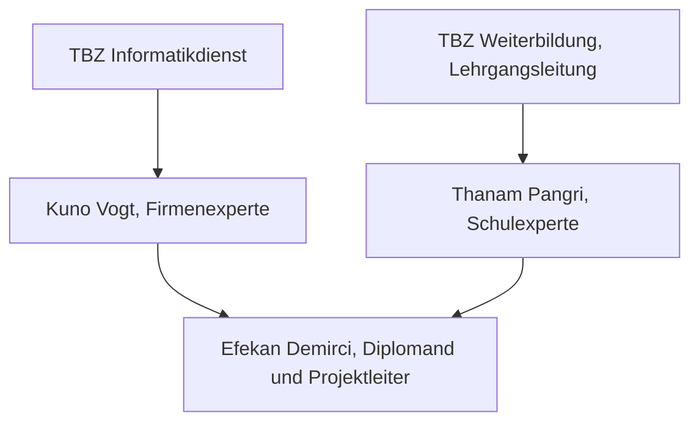

<small id="abb-01"><em>Abbildung 1: Projektorganisation und Berichtswege</em></small>

Die Arbeit wird als Einzelprojekt durchgeführt. Die bewilligte Projektbeschreibung überträgt mir die technischen Entscheide und die Umsetzung. Die folgende Tabelle ordnet die Aufgaben und Entscheidungsbefugnisse zu.

| Person und Rolle | Aufgaben | Entscheidungsbefugnisse und Abstimmung |
| --- | --- | --- |
| Efekan Demirci, Diplomand und Projektleiter | Planung, Priorisierung des Backlogs, technische Auswahl, Umsetzung, Tests und Dokumentation | Technische Entscheide innerhalb des bewilligten Umfangs selbst treffen und begründen. Ergebnisse anhand der Akzeptanzkriterien prüfen und zur Beurteilung im Review vorlegen. |
| Kuno Vogt, Firmenexperte und Leiter Informatikdienst | Auftraggeberinteressen vertreten, fachliche und betriebliche Anforderungen einbringen, Ergebnisse beurteilen | Betriebliche Rahmenbedingungen und Prioritäten aus Sicht des Auftraggebers klären. Auswirkungen auf den Auftrag und offene Fragen gemeinsam mit dem Diplomanden und dem Schulexperten abstimmen. |
| Thanam Pangri, Schulexperte | Einhaltung der schulischen Vorgaben begleiten, Projektfortschritt und Ergebnisse beurteilen | Schulische Anforderungen und Vorgaben zur Prüfungsleistung klären. Änderungen am bewilligten Kernumfang gemeinsam mit dem Firmenexperten und dem Diplomanden abstimmen. |

Planung, Priorisierung und Ablaufsteuerung liegen im Einzelprojekt bei mir. Eine getrennte Besetzung der Rollen Product Owner und Scrum Master besteht nicht. Änderungen an Zielen oder zugesagten Ergebnissen werden mit beiden Experten abgestimmt.

#### Ergebnisprüfung und Abnahme

Ich prüfe die Akzeptanzkriterien und dokumentiere den fachlichen Abschluss einer Story mit den zugehörigen Nachweisen. Der Status Done bezeichnet diesen Bearbeitungsstand. Die Beurteilung durch die Experten wird beim Review separat festgehalten.

Für die formale Abnahme sind Zuständigkeit und Form mit Kuno Vogt und Thanam Pangri noch zu klären.

Mit Kuno Vogt bespreche ich den Projektstand im wöchentlichen 1:1. Für Fragen und Ergebnisse, die beide Experten betreffen, haben wir den gemeinsamen Teams-Kanal vereinbart.

### 2.3 Termine und Meilensteine

Der bewilligte Projektzeitraum beginnt am 11.09.2026. Die operative Wochenplanung beginnt am Montag, 14.09.2026, und umfasst 14 Wochen bis zur Abgabe am 18.12.2026. Für die drei Reviews liegen konkrete Termine vor. Der Kolloquiumstermin ist noch mit der Schule zu bestätigen.

Die GitHub-Milestones bündeln die User Stories nach Sprint. Die folgende Übersicht zeigt diese Gliederung. Die Bearbeitungsstände werden in den jeweiligen Sprintkapiteln erläutert.

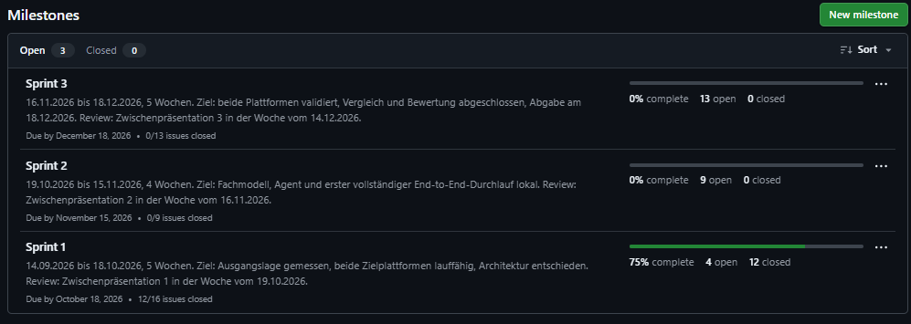

<small id="abb-02"><em>Abbildung 2: Milestone-Übersicht der drei Sprints</em></small>

| Abschnitt | Zeitraum | Ergebnis am Ende |
| --- | --- | --- |
| Sprint 1 | 14.09. bis 18.10.2026 | Ausgangsmessungen, lokaler Referenzlauf, AWS-Smoke-Test und Architekturentwurf |
| Sprint 2 | 19.10. bis 15.11.2026 | Modell und Agent, vollständiger lokaler Lebenszyklus sowie automatisiertes create, status und delete auf AWS |
| Sprint 3 | 16.11. bis 18.12.2026 | AWS-Reset und Wiederaufnahme, sechs formale PoC-Läufe, Bewertung und Abgabe |

| ID | Meilenstein | Plantermin | Erforderlicher Stand |
| --- | --- | --- | --- |
| M0 | Arbeitsbeginn | 14.09.2026 | Die Experten haben den Antrag geprüft; Projektstart ohne separates Kickoff-Meeting |
| M1 | Erstes Review | 23.10.2026 | Durchgeführt; positive Rückmeldung und Priorität für den lokalen Lebenszyklus festgehalten |
| M2 | Zweites Review | 18.11.2026 | Vollständiger lokaler Durchlauf und automatisierter AWS-Durchstich demonstrierbar |
| M3 | Scope-Freeze | 04.12.2026 | Kernfunktionen stehen; danach Fehlerkorrekturen, Messungen und Abschluss |
| M4 | Drittes Review | 16.12.2026 | Sechs erfolgreiche PoC-Läufe und Bewertung dokumentiert |
| M5 | Abgabe | 18.12.2026 | Dokumentation, Management Summary, Ehrenwort und vereinbarte Abgabeunterlagen fertig |
| M6 | Kolloquium | Mit Schule bestätigen | Präsentation, kurze Demo und vorbereitete Ersatznachweise verfügbar |

Die Reviewtermine sind fest vereinbart. Alle Uhrzeiten gelten für Zürich. Die Aufgaben mit ihren Start- und Enddaten stehen im [GitHub-Zeitplan](https://github.com/users/Cancani/projects/7/views/2). Die Sprintplanungen stehen in Kapitel 2.10 bis 2.12.

| Review | Termin | Durchführung |
| --- | --- | --- |
| 1 | Freitag, 23.10.2026, 11:30 bis 12:00 Uhr | Vor Ort, durchgeführt |
| 2 | Mittwoch, 18.11.2026, 15:00 Uhr | Online |
| 3 | Mittwoch, 16.12.2026, 15:00 Uhr | Online |

Die Sprintzeiträume geben die ursprüngliche Planung wieder. Das erste Review fand nach dem Ende von Sprint 1 statt.

### 2.4 Backlog und Prioritäten

Das öffentliche [Project Board](https://github.com/users/Cancani/projects/7) dient der laufenden Aufgabensteuerung. Die [Milestones](https://github.com/Cancani/diplomarbeit/milestones) bündeln die Issues nach Sprint und führen die jeweiligen Endtermine. Die Karten enthalten Sprint, Story Points, Priorität, Epic sowie Start- und Enddatum. Die Statusspalten werden wie folgt verwendet:

| Status | Bedeutung und Übergang |
| --- | --- |
| Backlog | Geplante Aufgabe, deren Bearbeitung noch nicht begonnen hat. |
| Ready | Aufgabe ist für die Bearbeitung vorbereitet: Ziel, prüfbare Kriterien, Zuordnung und notwendige Voraussetzungen sind geklärt. |
| In Progress | Aufgabe wird aktiv bearbeitet. Offene Fragen und Hindernisse werden im Issue sichtbar gehalten. |
| Done | Akzeptanzkriterien und Abschlussnachweise sind erfüllt, Änderungen geprüft und Dokumentation nachgeführt. Issue-Abschluss und Boardstatus müssen zusammenpassen. |

Die Backlog-Ansicht zeigt die Aufgaben vor ihrer Einordnung in die Bearbeitung. Sprint, Story Points und weitere Merkmale sind auf den Karten sichtbar.

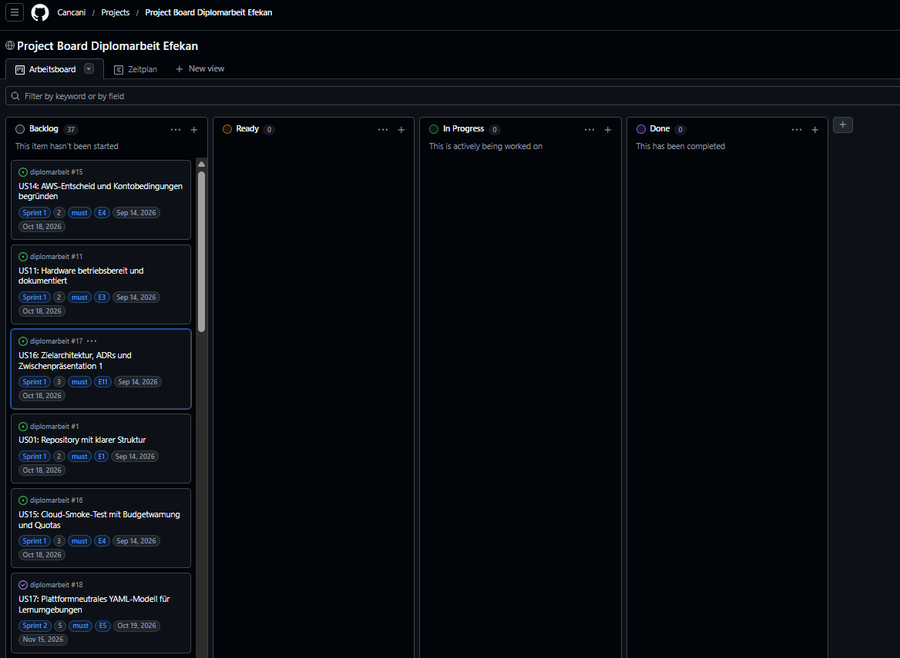

<small id="abb-03"><em>Abbildung 3: Project Board mit Aufgaben im Backlog</em></small>

Die [User-Story-Vorlage](https://github.com/Cancani/diplomarbeit/blob/main/.github/ISSUE_TEMPLATE/01_user_story.yml) enthält die Definition of Ready und die Definition of Done. Eine entfallene Aufgabe wird mit Begründung geschlossen und in der Sprintbilanz separat ausgewiesen. Ein geschlossener Issue zählt dadurch nicht automatisch als fachlich erbrachtes Ergebnis.

Die Tabellen zeigen die ursprüngliche Sprintzuordnung. Die Ergebnisse stehen in den jeweiligen Sprintabschnitten.

Die ursprüngliche Planung umfasst 38 Stories mit 111 Story Points. US05 ist gemäss [Entscheid im Issue](https://github.com/Cancani/diplomarbeit/issues/5) entfallen; zusätzliche Wochenberichte werden nur bei ausdrücklichem Bedarf erstellt. Der Eintrag bleibt hier zur Nachvollziehbarkeit der ursprünglichen Planung erhalten.

Die Epics bündeln Initialisierung (E1), IST-Aufnahme (E2), lokale Plattform (E3), AWS-Vorbereitung (E4), Fachmodell (E5), Agent (E6), Adapter (E7), Validierung (E8), Bewertung (E9), Betrieb und Schulung (E10) sowie Architektur und Abschluss (E11).

#### Sprint 1

16 Stories, 38 Story Points.

| ID | Aufgabe | Epic | SP | Priorität |
| --- | --- | --- | --- | --- |
| US01 | Repository mit klarer Struktur | E1 | 2 | Must |
| US02 | Öffentlich einsehbares Project Board | E1 | 2 | Must |
| US03 | Vorlagen, Labels, Milestones und Regeln | E1 | 1 | Must |
| US04 | Dokumentation über GitHub Pages | E1 | 2 | Must |
| US05 | Wöchentlicher Statusbericht am Wochenende | E1 | 1 | Must |
| US07 | IST-Analyse der heutigen Bereitstellung | E2 | 2 | Must |
| US08 | Test-Lernumgebung aus m239, m254 und m426 ableiten | E2 | 3 | Must |
| US09 | Messkonzept mit identischen Start- und Endkriterien | E2 | 3 | Must |
| US10 | Ausgangsmessung am heutigen Vorgehen | E2 | 5 | Must |
| US11 | Hardware betriebsbereit und dokumentiert | E3 | 2 | Must |
| US12 | Kubernetes-Cluster verifizieren und dokumentieren | E3 | 2 | Must |
| US13 | KubeVirt verifizieren und Storage klären | E3 | 2 | Must |
| US38 | Referenz-VM manuell erstellen und wieder abbauen | E3 | 3 | Must |
| US14 | AWS-Entscheid und Kontobedingungen begründen | E4 | 2 | Must |
| US15 | Cloud-Smoke-Test mit Budgetwarnung und Quotas | E4 | 3 | Must |
| US16 | Zielarchitektur, ADRs und Zwischenpräsentation 1 | E11 | 3 | Must |

#### Sprint 2

9 Stories, 35 Story Points.

| ID | Aufgabe | Epic | SP | Priorität |
| --- | --- | --- | --- | --- |
| US17 | Plattformneutrales YAML-Modell für Lernumgebungen | E5 | 5 | Must |
| US18 | JSON-Schema mit positiver und negativer Validierung | E5 | 3 | Must |
| US19 | Agent-Grundgerüst mit Kommandozeilenschnittstelle | E6 | 3 | Must |
| US20 | Persistenter Zustandsspeicher mit Zustandsübergängen | E6 | 5 | Must |
| US21 | create und status | E6 | 5 | Must |
| US22 | reset und delete | E6 | 3 | Must |
| US23 | Einheitliches Funktionsset über MCP | E7 | 3 | Must |
| US24 | MCP-Adapter für KubeVirt, erster End-to-End-Durchlauf | E7 | 5 | Must |
| US39 | Automatisierter AWS-Durchstich create, status und delete | E7 | 3 | Must |

#### Sprint 3

13 Stories, 38 Story Points.

| ID | Aufgabe | Epic | SP | Priorität |
| --- | --- | --- | --- | --- |
| US25 | AWS-Adapter um Reset und Wiederaufnahme vervollständigen | E7 | 5 | Must |
| US26 | Readiness auf beiden Plattformen validieren | E8 | 2 | Must |
| US27 | Drei vollständige Durchläufe auf der lokalen Plattform | E8 | 2 | Must |
| US28 | Drei vollständige Durchläufe in der Public Cloud | E8 | 3 | Must |
| US29 | Nachweis des vollständigen Abbaus | E8 | 3 | Must |
| US30 | Vorher-Nachher-Vergleich | E9 | 3 | Must |
| US31 | Bewertung der MCP-Architektur gegen eine direkte API-Anbindung | E9 | 3 | Must |
| US32 | Wirtschaftlichkeitsbetrachtung | E9 | 3 | Must |
| US33 | Beurteilung der Übertragbarkeit in den Produktivbetrieb | E9 | 3 | Must |
| US34 | Runbook für Aufbau, Bedienung, Fehleranalyse und Abbau | E10 | 2 | Must |
| US35 | Schulungsunterlage und Einführung | E10 | 3 | Should |
| US36 | Dokumentation finalisieren, Management Summary, Ehrenwort | E11 | 3 | Must |
| US37 | Kolloquiumspräsentation und Demo-Skript | E11 | 3 | Must |


Must bezeichnet die verbindlichen Ergebnisse und ihre notwendigen Arbeitsschritte. US35 ist als ergänzende Einführung ein Should. Das Runbook bleibt auch bei Zeitdruck vollständig und enthält Aufbau, Bedienung, Fehleranalyse und Abbau. Eine knappe Beurteilung der Produktivübertragbarkeit bleibt ebenfalls bestehen. Zusätzliche Workshops, doppelte Grafiken und ausführliche Wiederholungen werden zuerst gekürzt. Änderungen an verbindlichen Ergebnissen werden mit den Experten abgestimmt.

### 2.5 Aufwand und Kapazität

Für die Planung rechnete ich mit 14 Stunden pro Woche. Über 14 Wochen ergibt das 196 Stunden. Eine Auswertung der tatsächlich geleisteten Stunden liegt nicht vor. Die Arbeit erfolgt gemäss bewilligter Projektbeschreibung ausserhalb der bezahlten TBZ-Arbeitszeit und im vorgesehenen Rahmen an Schultagen.

Ich schätze Aufwand und Unsicherheit mit 1, 2, 3, 5 oder 8 Story Points. Als Bezug dient US01 mit zwei Punkten. Für die Planung setzte ich acht Punkte pro Woche an.

| Sprint | Wochen | Orientierungsbudget | Ursprünglicher Backlog | Differenz |
| --- | --- | --- | --- | --- |
| 1 | 5 | 40 SP | 38 SP | -2 SP |
| 2 | 4 | 32 SP | 35 SP | +3 SP |
| 3 | 5 | 40 SP | 38 SP | -2 SP |
| Gesamt | 14 | 112 SP | 111 SP | -1 SP |

### 2.6 Arbeitsweise und Qualität

#### Ablagestruktur

Die fachliche Dokumentation steht in dieser Datei. Code, Testdaten und Originalprotokolle liegen separat im Repository:

| Ablage | Inhalt |
| --- | --- |
| `docs/dokumentation.md` | Projektbericht mit Planung, Entscheiden, Umsetzung und Ergebnissen |
| `docs/nachweise/`, `docs/messungen/` | Systemausgaben, Laufprotokolle und verwendete Manifeste |
| `modell/` | JSON-Schema, YAML-Beispiele und Validierung |
| `agent/` | CLI, Konfiguration, Lebenszyklus, SQLite, MCP-Client, Statusserver und Dashboard |
| `adapter/` | MCP-Werkzeugvertrag, Server sowie KubeVirt- und AWS-Aufrufe |
| `gemeinsam/` | Prozesssperre für Agent und Adapter |
| `scripts/` | Hilfswerkzeuge für Messungen, Modellprüfung, Issues und Repository-Prüfungen |
| `tests/` | Automatisierte Tests des vorhandenen Codes |
| `.github/`, `mkdocs.yml`, `requirements-docs.txt` | Vorlagen und Veröffentlichung der Dokumentation |
| `requirements.txt` | Festgeschriebene Abhängigkeiten von Modellprüfung, Agent und MCP |

README und Einstiegsseite verweisen auf diese Dokumentation.

#### Vorgehen und Prüfungen

Ich bearbeite Aufgaben anhand der Akzeptanzkriterien im Issue. Zu einer technischen Änderung gehören die passenden Tests und, bei Aufrufen auf den Zielplattformen, die Laufprotokolle. Ich fasse zusammengehörige Änderungen in kleinen Commits auf `main` zusammen.

Der [Dokumentationsworkflow](https://github.com/Cancani/diplomarbeit/blob/main/.github/workflows/docs.yaml) prüft Repository-Konsistenz, Tests, Shell-Syntax und den MkDocs-Build. GitHub Pages veröffentlicht die Dokumentation nach erfolgreicher Prüfung.

### 2.7 Projektstand und Berichte

Gemäss Rückmeldung von Thanam Pangri ist ein regelmässiges Wochenjournal nicht erforderlich. Deshalb habe ich [US05 gestrichen](https://github.com/Cancani/diplomarbeit/issues/5). Die Issues enthalten Aufgaben und Abschlussnachweise. In Git und CI sind Änderungen und automatische Prüfungen nachvollziehbar. Die Fachkapitel ordnen die Laufprotokolle den jeweiligen Versuchen zu.

### 2.8 Änderungen und Risiken

Technische Entscheide werden im betroffenen Kapitel festgehalten. Änderungen an Zielen oder zugesagten Ergebnissen werden den Experten mit ihren Auswirkungen vorgelegt. Die Risikobewertung unterstützt diese Steuerung: Eintrittswahrscheinlichkeit (EW) und Auswirkung (AW) werden jeweils von 1 bis 5 eingeschätzt. Das Produkt bestimmt die Priorität; Werte ab 12 erhalten besondere Aufmerksamkeit.

| ID | Risiko | EW | AW | Wert | Behandlung und Auslöser |
| --- | --- | ---: | ---: | ---: | --- |
| R01 | Technische Komplexität von Agent, MCP und zwei Plattformen | 4 | 4 | 16 | Frühe Durchstiche und kleine Umsetzungsschritte. Nach zwei blockierten Arbeitseinheiten Alternativweg prüfen; überzogene Schätzungen machen die Blockade sichtbar. |
| R02 | Cloud-Berechtigungen, Quotas und Kosten | 3 | 3 | 9 | Einzel-VM-Smoke-Test bestanden, Budgetwarnungen bei USD 25 und USD 40 eingerichtet. Ressourcen nach jedem Test abbauen; Quota-Fehler und Kostenstand beobachten. |
| R03 | Umfang überschreitet die verfügbare Zeit | 4 | 5 | 20 | Kernumfang priorisieren, optionale Einführung zuerst kürzen. Scope-Freeze am 04.12.2026; verschobene Zwischenziele früh mit den Experten besprechen. |
| R05 | Restressourcen oder Abweichung zwischen gespeichertem und tatsächlichem Zustand | 3 | 3 | 9 | Ressourcen-IDs nach jedem Erstellungsschritt speichern und Endzustände abfragen. Ein verbliebener Datenträger oder ein unvollständiger Abbau führt zum Fehler. |
| R06 | Ausfall des lokalen Hosts | 2 | 3 | 6 | Konfiguration sichern. `kvcontrol` ist als Ersatz vorgesehen und wird vor einem tatsächlichen Einsatz mit einem eigenen Referenzlauf geprüft. |
| R07 | Reviewtermine kommen nicht rechtzeitig zustande oder fallen aus | 2 | 3 | 6 | Die drei Termine liegen vor. Bei einem Ausfall zeitnah einen Ersatz abstimmen und Auswirkungen auf Rückmeldungen und nächste Schritte prüfen. |
| R08 | Dokumentation läuft der Umsetzung hinterher | 3 | 4 | 12 | Änderungen zusammen mit der betroffenen Story dokumentieren. Vor jedem Review aktuellen Stand, alte Aussagen und Nachweislinks abgleichen. |
| R09 | Änderungen im MCP-Umfeld | 3 | 3 | 9 | Verwendete Versionen festschreiben und Adaptervertrag klein halten. Inkompatible Änderungen zuerst im isolierten Test prüfen. |
| R10 | Weniger Zeit durch Krankheit oder berufliche Engpässe | 3 | 4 | 12 | Wochenkapazität prüfen. Wenn zwei Wochen lang wesentliche Sprintaufgaben nicht vorankommen, Planung und optionale Ausarbeitung prüfen und den Firmenexperten informieren. |
| R11 | Remote-Zugang fällt nach Neustart oder Netzwerkänderung aus | 3 | 4 | 12 | Adressierung und DHCP-Zuordnung abstimmen. Vor Änderungen Konfiguration sichern; anschliessend WireGuard, SSH und Clusterzugang prüfen. |

Die Werte sind Planungseinschätzungen. Der Ersatzhost reduziert das Ausfallrisiko erst nach einem erfolgreichen eigenen Test. Neue Erkenntnisse und ihre Auswirkungen werden nachgeführt. Für die weitere Planung sind folgende Entwicklungen relevant:

| Entwicklung | Auswirkung auf die Steuerung |
| --- | --- |
| AWS-Smoke-Test erfolgreich | Der praktische Zugriff für die Referenz-VM ist belegt. Quotas, Zugang und Kosten sind bei späteren Läufen weiterhin zu beachten; die Lab-Gültigkeit bleibt unbekannt. |
| Budget und Benachrichtigung eingerichtet | Kostenwarnungen sind vorbereitet. Sie ersetzen den vollständigen Abbau und die laufende Kostenkontrolle nicht. |
| Reviewtermine fest vereinbart | Für die Reviews bestehen konkrete Termine. Ein späterer Ausfall oder eine Verschiebung bleibt möglich. |
| US17 und US18 vorgezogen | Acht Punkte aus Sprint 2 sind bereits abgeschlossen. Der verbleibende Umfang und die ursprüngliche Zuordnung werden getrennt ausgewiesen. |
| US05 entfallen | Die ursprüngliche Planung bleibt sichtbar. Laufende Ergebnisse und Entscheidungen werden über die Ablagen aus Kapitel 2.7 nachgeführt. |

### 2.9 Wirtschaftliche Betrachtung

Die [Preisabschätzung für die AWS-Referenz](#364-preisabschatzung-der-referenz-vm) berechnet die Kosten einer einzelnen VM anhand von Laufzeit, Speicher und öffentlicher IPv4-Adresse. Für den Entwicklungsaufwand liegt ein Planwert vor (Kapitel 2.5). Die vorhandenen Daten reichen für eine Schätzung des Einzelbetriebs. Für eine Amortisationsrechnung fehlen gemessene Entwicklungsstunden und eine belastbare Zahl von Bereitstellungen im Unterricht.

Im Versuch habe ich die vorhandene Laborhardware genutzt und die Testressourcen nach den Läufen abgebaut. Stromverbrauch und CO₂-Wirkung habe ich nicht gemessen. Der Einzel-VM-Versuch liefert keine Daten zur Auslastung bei mehreren gleichzeitigen Lernumgebungen.

### 2.10 Sprint 1

#### Sprint 1 Planung

**Zeitraum:** 14.09. bis 18.10.2026. Das zugehörige Review fand in der anschliessenden Reviewwoche statt.

**Sprintziel:** Die Ausgangslage und den bisherigen Bereitstellungsablauf verstehen, eine belastbare Vergleichsgrundlage vorbereiten, die reduzierte Referenzumgebung auf beiden Zielplattformen praktisch prüfen und die Zielarchitektur festlegen.

Die Planungsansicht zeigt den ursprünglichen Umfang von Sprint 1 mit allen 16 User Stories als offen. Die später entfallene US05 ist darin noch enthalten.

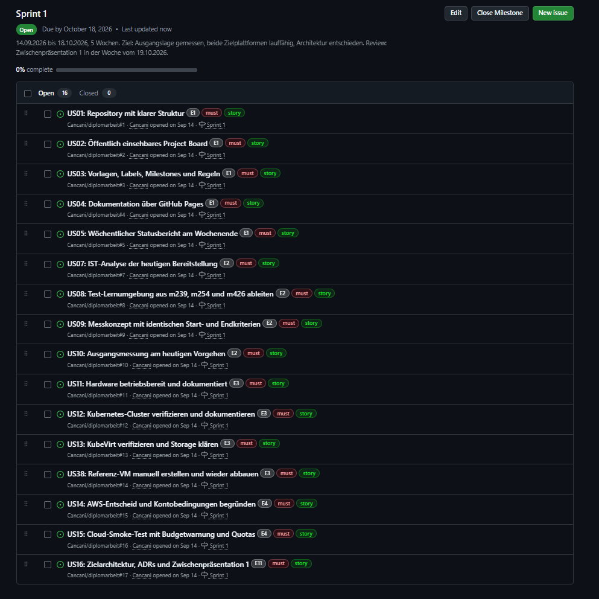

<small id="abb-04"><em>Abbildung 4: Sprint 1 mit allen User Stories offen</em></small>

Die ursprüngliche Planung umfasst 16 Stories mit 38 Story Points. Die vollständige Aufgabenliste steht in Kapitel 2.4. Der Sprint enthält folgende Arbeitspakete:

| Arbeitspaket | Stories | Erwartetes Ergebnis |
| --- | --- | --- |
| Projektgrundlagen | US01 bis US05 | Repository, Board, Vorlagen, Dokumentationsveröffentlichung und ursprünglich vorgesehene Statusberichte |
| IST-Analyse und Messgrundlage | US07 bis US10 | Bestehendes Verfahren, abgeleitete Referenzdefinition, Messkonzept und Ausgangsmessungen |
| Lokale Plattform | US11 bis US13 und US38 | Verifizierte Hardware und Plattform sowie erfolgreicher KubeVirt-Referenzlauf |
| Public Cloud | US14 und US15 | Begründete AWS-Auswahl, geprüfter Zugang, Kostenkontrolle und erfolgreicher Smoke-Test |
| Architektur und Zwischenpräsentation | US16 | Systemkontext, Komponentensicht, Architekturentscheide und erstes Review mit Rückmeldungen |

US06 ist als entfallenes Kickoff nicht Teil des aktiven Backlogs. US05 wurde im Verlauf gestrichen; eine feste wöchentliche Berichtspflicht wird nicht weitergeführt. Die ursprüngliche Planung bleibt für den Vergleich sichtbar. Die bereits umgesetzten Stories US17 und US18 gehören weiterhin zur ursprünglichen Sprint-2-Planung.

##### Zeitplan der User Stories

Die geplanten Zeiträume sind im [GitHub-Zeitplan](https://github.com/users/Cancani/projects/7/views/2) hinterlegt. Die folgende Darstellung zeigt die Aufgaben innerhalb des Sprints sowie die anschliessende Reviewvorbereitung und den Abschluss von US16. Die Balken zeigen Plantermine, keine tatsächlich geleisteten Arbeitszeiten.

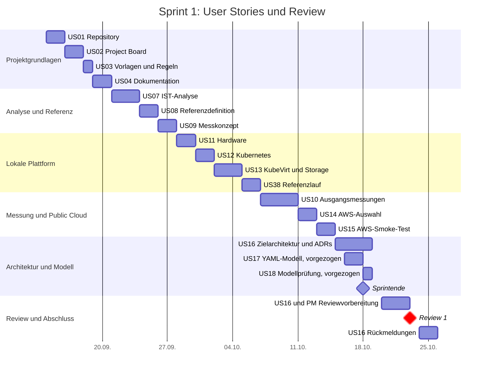

<small id="abb-05"><em>Abbildung 5: Zeitplan der User Stories für Sprint 1 mit anschliessendem Review</em></small>

US05 entfällt und erhält keinen Zeitbalken. US17 und US18 sind aus Sprint 2 vorgezogen. US16 ist in Architekturarbeit, Reviewvorbereitung und Nachbereitung aufgeteilt. Im GitHub-Zeitplan umfasst die Story deshalb den Zeitraum vom 15.10. bis 25.10.2026.

??? info "Plantermine der User Stories in Sprint 1"

    | User Story | Geplanter Beginn | Geplantes Ende |
    | --- | --- | --- |
    | [US01](https://github.com/Cancani/diplomarbeit/issues/1) | 14.09.2026 | 15.09.2026 |
    | [US02](https://github.com/Cancani/diplomarbeit/issues/2) | 16.09.2026 | 17.09.2026 |
    | [US03](https://github.com/Cancani/diplomarbeit/issues/3) | 18.09.2026 | 18.09.2026 |
    | [US04](https://github.com/Cancani/diplomarbeit/issues/4) | 19.09.2026 | 20.09.2026 |
    | [US05](https://github.com/Cancani/diplomarbeit/issues/5) | Entfallen | Entfallen |
    | [US07](https://github.com/Cancani/diplomarbeit/issues/7) | 21.09.2026 | 23.09.2026 |
    | [US08](https://github.com/Cancani/diplomarbeit/issues/8) | 24.09.2026 | 25.09.2026 |
    | [US09](https://github.com/Cancani/diplomarbeit/issues/9) | 26.09.2026 | 27.09.2026 |
    | [US11](https://github.com/Cancani/diplomarbeit/issues/11) | 28.09.2026 | 29.09.2026 |
    | [US12](https://github.com/Cancani/diplomarbeit/issues/12) | 30.09.2026 | 01.10.2026 |
    | [US13](https://github.com/Cancani/diplomarbeit/issues/13) | 02.10.2026 | 04.10.2026 |
    | [US38](https://github.com/Cancani/diplomarbeit/issues/14) | 05.10.2026 | 06.10.2026 |
    | [US10](https://github.com/Cancani/diplomarbeit/issues/10) | 07.10.2026 | 10.10.2026 |
    | [US14](https://github.com/Cancani/diplomarbeit/issues/15) | 11.10.2026 | 12.10.2026 |
    | [US15](https://github.com/Cancani/diplomarbeit/issues/16) | 13.10.2026 | 14.10.2026 |
    | [US16](https://github.com/Cancani/diplomarbeit/issues/17) | 15.10.2026 | 18.10.2026 |
    | [US17](https://github.com/Cancani/diplomarbeit/issues/18) (aus Sprint 2 vorgezogen) | 16.10.2026 | 17.10.2026 |
    | [US18](https://github.com/Cancani/diplomarbeit/issues/19) (aus Sprint 2 vorgezogen) | 18.10.2026 | 18.10.2026 |
    | [US16](https://github.com/Cancani/diplomarbeit/issues/17) / PM, Reviewvorbereitung | 20.10.2026 | 22.10.2026 |
    | Review 1 mit den Experten | 23.10.2026 | 23.10.2026 |
    | [US16](https://github.com/Cancani/diplomarbeit/issues/17), Rückmeldungen und Abschlussprüfung | 24.10.2026 | 25.10.2026 |

##### Bisheriger Bearbeitungsstand

| Bereich | Erreichtes Ergebnis |
| --- | --- |
| Projektorganisation | Repository, öffentliches Board, Vorlagen und Dokumentationsveröffentlichung eingerichtet |
| Infrastruktur | System- und Netzwerkaufnahme vorhanden; DL380 und Terra stehen exklusiv zur Verfügung |
| KubeVirt-Referenzlauf | VM erstellt, HTTP und SSH erfolgreich geprüft und Testressourcen entfernt; US38 abgeschlossen |
| Vergleichsbasis | Drei LernMAAS-Basisläufe technisch erfolgreich; Grenzen der Bedienzeiterfassung bei den Ergebnissen beschrieben |
| AWS | Smoke-Test erfolgreich; Budget, Preisabschätzung und Ressourcenabbau dokumentiert |
| Architektur | Systemkontext, Komponentensicht und vier ADRs vorhanden |
| Vorgezogene Arbeiten | Fachmodell und Modellprüfung mit JSON-Schema aus US17 und US18 umgesetzt |

Vor dem Review waren 14 der ursprünglichen Sprint-1-Stories fachlich abgeschlossen. US05 war entfallen und US16 in Bearbeitung. Die abgebildete Milestone-Detailansicht zeigt entsprechend einen offenen und 15 geschlossene Issues. Im abgebildeten Board steht US16 auf In Progress. Die geschlossene US05 zählt nicht als fachlich erbrachte Leistung.

Die damalige Board-Aufnahme zeigt 16 Karten in Done. Dazu gehören 14 Stories aus Sprint 1 sowie US17 und US18 aus Sprint 2.

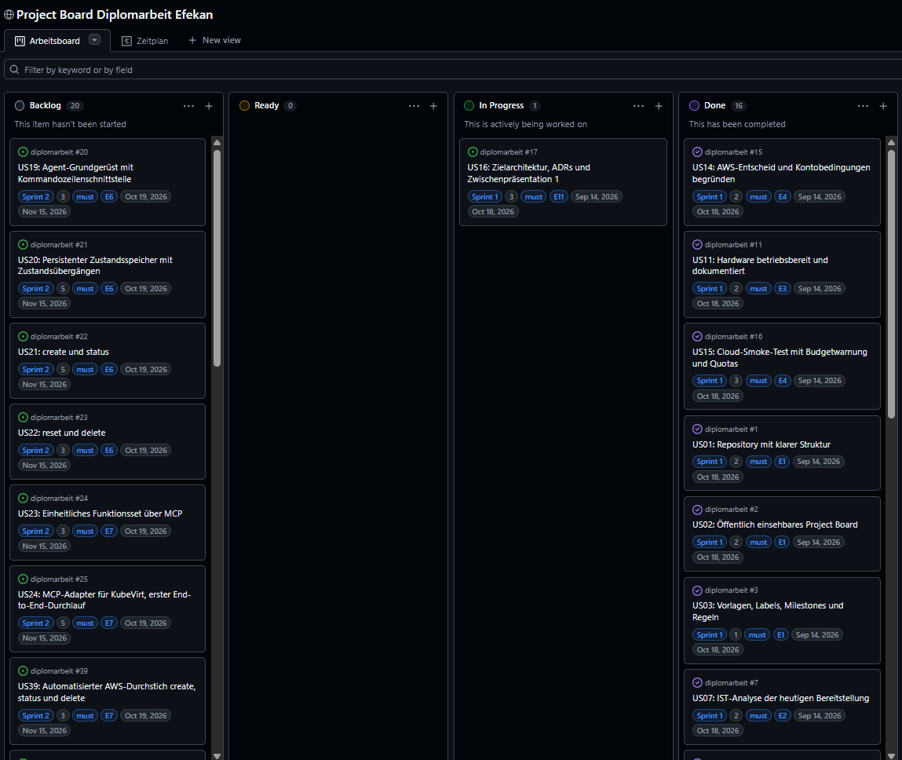

<small id="abb-06"><em>Abbildung 6: Project Board mit Bearbeitungsstand und US16 in Bearbeitung</em></small>

Die Detailansicht zeigt den Stand vor dem Review mit US16 als einzigem offenen Issue. Das Review ist inzwischen durchgeführt und die Rückmeldungen sind nachfolgend dokumentiert. US16 ist nach der Nachführung der Reviewrückmeldungen abgeschlossen.

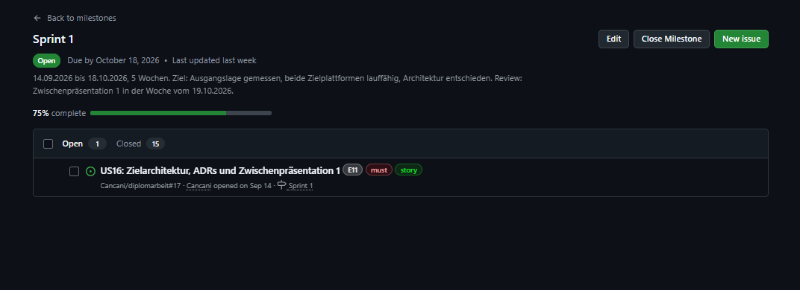

<small id="abb-07"><em>Abbildung 7: Milestone Sprint 1 mit offener US16</em></small>

| Zuordnung | Ursprünglich geplant | Fachlich abgeschlossen | Entfallen | Noch offen |
| --- | --- | --- | --- | --- |
| Sprint 1 | 16 Stories, 38 SP | 14 Stories, 34 SP | US05, 1 SP | US16, 3 SP |
| Sprint 2 | 9 Stories, 35 SP | US17 und US18, zusammen 8 SP, vorgezogen | Keine | 7 Stories, 27 SP |
| Sprint 3 | 13 Stories, 38 SP | Keine | Keine | 13 Stories, 38 SP |

Die Tabelle hält die Zwischenbilanz vor dem Review fest. Die Zwischenpräsentation ist inzwischen durchgeführt und die Rückmeldungen stehen im folgenden Reviewabschnitt. Mit dem Abschluss von US16 sind in Sprint 1 insgesamt 15 Stories mit 37 Story Points fachlich abgeschlossen. Für die weitere Umsetzung hat der vollständige lokale Lebenszyklus erste Priorität.

#### Sprint 1 Retrospektive

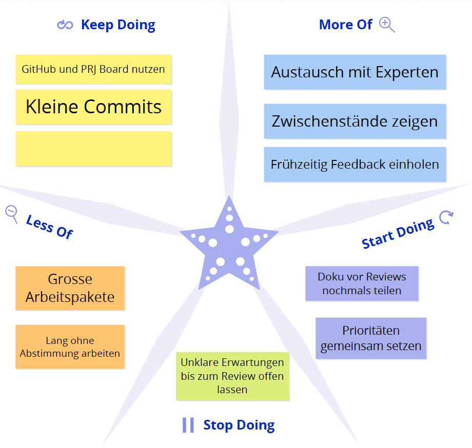

<small id="abb-08"><em>Abbildung 8: Starfish-Retrospektive zu Sprint 1</em></small>

##### Was gut funktioniert hat

GitHub und das Project Board haben mir geholfen, die Aufgaben zu organisieren und den Überblick zu behalten. Kleine Commits machen Änderungen nachvollziehbar. Die Planung, Dokumentation und technischen Abklärungen konnte ich selbstständig bearbeiten.

##### Was schwierig war

Nach der ersten Nachricht habe ich Kuno Vogt und Thanam Pangri zu wenig über den Fortschritt informiert. Im Gespräch mit Kuno Vogt wurde deutlich, dass wir die Erwartungen an die Planung und das Review früher hätten abstimmen sollen.

##### Verbesserungen für Sprint 2

Ich möchte Zwischenstände früher zeigen und gezielt Feedback einholen. Vor den Reviews stelle ich den aktuellen Dokumentationsstand und offene Fragen bereit. Grössere Aufgaben teile ich in kleinere, überprüfbare Schritte auf.

Die Prioritäten für Sprint 2 wurden im ersten Review gemeinsam mit den Experten besprochen und im folgenden Abschnitt festgehalten. Die Arbeit mit GitHub und kleinen Commits behalte ich bei.

<span id="sprint-1-review"></span>

#### Sprint 1 Review mit den Experten

**Termin:** Freitag, 23.10.2026, 11:30 bis 12:00 Uhr, vor Ort.

Das erste Review fand gemeinsam mit den Experten statt. Ich stellte die Planung und die Ergebnisse von Sprint 1, meine Retrospektive sowie die vorgesehene Umsetzung für Sprint 2 vor. Die Experten gaben eine positive Rückmeldung zum bisherigen Arbeitsstand und zur Präsentation.

Im Gespräch wurden die Prioritäten für die weitere Umsetzung festgelegt. Bis zum Ende von Sprint 2 muss der Agent die Grundfunktionen ausführen können. Diese bilden die Voraussetzung für die Messungen und Auswertung in Sprint 3.

##### Rückmeldungen und Vereinbarungen

| Thema | Ergebnis der Besprechung |
| --- | --- |
| Lokaler Lebenszyklus | Erste Priorität hat ein vollständiger Ablauf auf KubeVirt mit Erstellung, Statusprüfung, Zurücksetzen und vollständigem Löschen. |
| MCP | Die Umsetzung mit MCP wird weiterverfolgt. Die praktische Einbindung und ihre Eigenschaften werden im weiteren Projektverlauf untersucht. |
| Sprachmodell | Im Gespräch wurde eine mögliche Verwendung eines Sprachmodells angesprochen. Ob daraus eine zusätzliche Anforderung entsteht, ist noch zu klären. Die bisherige Architektur sieht einen regelbasierten Agenten vor. |
| AWS | Die AWS-Anbindung bleibt Bestandteil des Projekts. Bei der Umsetzung hat zunächst der funktionierende lokale Lebenszyklus Vorrang. |
| Zusammenarbeit | In den bestehenden wöchentlichen 1:1-Sitzungen mit Kuno Vogt werden ungefähr zehn Minuten für den Projektstand und offene Fragen genutzt. Wichtige Ergebnisse, Fragen und Entscheidungen werden zusätzlich im gemeinsamen Teams-Kanal für alle Experten festgehalten. |

Als betrieblicher Hintergrund wurde die angestrebte Ablösung der bestehenden lokalen LernMAAS-Installation besprochen. Dabei wurden die veraltete Hardware sowie der Aufwand für Erweiterung und Pflege der bestehenden Umgebung angesprochen.

### 2.11 Sprint 2

#### Sprint 2 Planung

**Zeitraum:** 19.10. bis 15.11.2026. Das zweite Review findet am 18.11.2026 statt.

**Sprintziel:** Den vollständigen Lebenszyklus auf KubeVirt mit dem Agenten umsetzen und dieselbe Referenzdefinition auf AWS erproben.

US17 und US18 (8 SP) waren bereits in Sprint 1 umgesetzt. Damit verblieben zu Beginn der weiteren Arbeiten sieben ursprünglich Sprint 2 zugeordnete Stories mit 27 SP. Die Milestone-Abbildung zeigt diesen damaligen Stand.

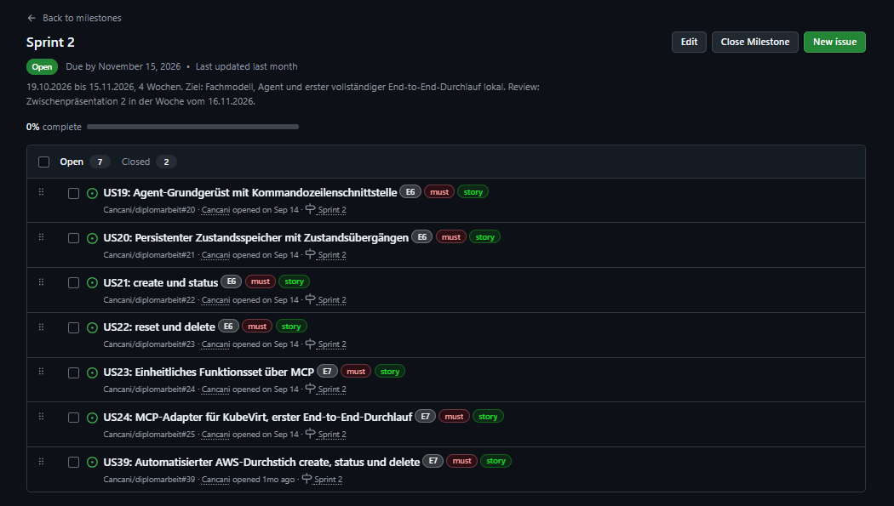

<small id="abb-09"><em>Abbildung 9: Milestone Sprint 2 mit offenen und vorgezogenen Stories</em></small>

##### Zeitplan der User Stories

Das Gantt-Diagramm zeigt die Plantermine für die verbleibenden Aufgaben.

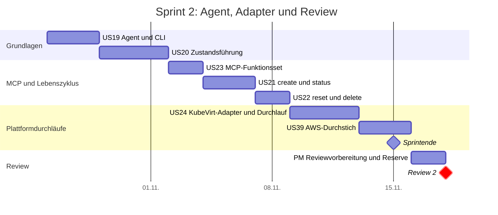

<small id="abb-10"><em>Abbildung 10: Ursprüngliche Zeitplanung für Sprint 2 und Review</em></small>

##### Arbeitspakete und Zeitplanung

| Geplanter Zeitraum | Story | Arbeitspaket | Erwartetes Ergebnis | SP |
| --- | --- | --- | --- | --- |
| 26.10. bis 28.10.2026 | US19 | Agent-Grundgerüst und CLI | Aufträge über die Kommandozeile entgegennehmen und den Ablauf starten. | 3 |
| 29.10. bis 01.11.2026 | US20 | Persistente Zustandsführung | Modelldefinition, Laufkennung, Phase und Ressourcen-IDs speichern und Zustandsübergänge verwalten. | 5 |
| 02.11. bis 03.11.2026 | US23 | Einheitliches Funktionsset über MCP | Werkzeugverträge für die Lebenszyklusfunktionen festlegen und die MCP-Anbindung umsetzen. | 3 |
| 04.11. bis 06.11.2026 | US21 | create und status | Erstellung steuern und Ressourcenstatus sowie Dienstbereitschaft unterscheiden. | 5 |
| 07.11. bis 08.11.2026 | US22 | reset und delete | Ressourcen anhand der gespeicherten IDs abbauen und für reset aus derselben Modelldefinition erneut erstellen. | 3 |
| 09.11. bis 12.11.2026 | US24 | KubeVirt-Adapter und erster vollständiger Durchlauf | Agent, Zustandsführung und Adapter auf der lokalen Plattform gemeinsam prüfen. | 5 |
| 13.11. bis 15.11.2026 | US39 | Automatisierter AWS-Durchstich | create, status und delete auf AWS ausführen und den Abbau nachkontrollieren. | 3 |

#### Ergebnisse

| Bereich | Umgesetztes und geprüftes Ergebnis |
| --- | --- |
| US19 bis US24 | Ich habe CLI, SQLite-Zustand und MCP-Adapter verbunden. Auf KubeVirt habe ich Erstellung, Status, Reset und Abbau ausgeführt. Die [Funktionsprüfung](#55-funktionsprufung-des-lokalen-agenten) beschreibt auch die getesteten Abbruch- und Wiederaufnahmefälle. |
| US39 | Der Agent hat dieselbe Referenzumgebung im Learner Lab erstellt, per HTTP geprüft und abgebaut. Die [direkte AWS-Nachkontrolle](#56-funktionsprufung-des-aws-agenten) zeigt die Abfrageergebnisse. |
| US25, aus Sprint 3 vorgezogen | Im Learner Lab habe ich einen regulären Reset und die Fortsetzung eines mit Ctrl+C unterbrochenen Resets geprüft. |
| Statusabfrage | Das Dashboard zeigt gespeicherte Läufe. Der zusätzliche MCP-Server bietet eine lesende Abfrage von VM-Zustand und HTTP-Bereitschaft an. |

#### Sprint 2 Retrospektive


#### Sprint 2 Review mit den Experten

**Termin:** Mittwoch, 18.11.2026, 15:00 Uhr, online, mit Kuno Vogt und Thanam Pangri.

### 2.12 Sprint 3

#### Sprint 3 Planung

**Zeitraum:** 16.11. bis 18.12.2026.

**Vorgeschlagenes Sprintziel:** Beide Plattformen vollständig prüfen, die Ergebnisse vergleichen, MCP bewerten und die Arbeit für die Abgabe abschliessen.

Der ursprüngliche Sprint-3-Backlog umfasst 13 Stories mit 38 SP. US25 wurde vorgezogen und ist bei den Ergebnissen von Sprint 2 beschrieben. Die [Plantermine](https://github.com/users/Cancani/projects/7/views/2) stehen im Projektboard.

| User Story | Aufgabe | SP |
| --- | --- | --- |
| US25 | AWS-Adapter um Reset und Wiederaufnahme vervollständigen | 5 |
| US26 | Readiness auf beiden Plattformen validieren | 2 |
| US27 | Drei vollständige Durchläufe auf der lokalen Plattform | 2 |
| US28 | Drei vollständige Durchläufe in der Public Cloud | 3 |
| US29 | Nachweis des vollständigen Abbaus | 3 |
| US30 | Vorher-Nachher-Vergleich | 3 |
| US31 | Bewertung der MCP-Architektur gegen eine direkte API-Anbindung | 3 |
| US32 | Wirtschaftlichkeitsbetrachtung | 3 |
| US33 | Beurteilung der Übertragbarkeit in den Produktivbetrieb | 3 |
| US34 | Runbook für Aufbau, Bedienung, Fehleranalyse und Abbau | 2 |
| US35 | Schulungsunterlage und Einführung | 3 |
| US36 | Dokumentation finalisieren, Management Summary, Ehrenwort | 3 |
| US37 | Kolloquiumspräsentation und Demo-Skript | 3 |

US35 bleibt eine ergänzende Aufgabe bei freier Kapazität. Der Scope-Freeze ist am 04.12.2026, die Abgabe am 18.12.2026. Änderungen an verbindlichen Ergebnissen werden mit beiden Experten abgestimmt.

#### Sprint 3 Review mit den Experten

**Termin:** Mittwoch, 16.12.2026, 15:00 Uhr, online, gemeinsam mit Kuno Vogt und Thanam Pangri.

## 3 Analyse und Konzept

### 3.1 Ausgangslage der Infrastruktur

Ich habe die beiden vorgesehenen KubeVirt-Systeme lesend untersucht. Entscheidend waren Virtualisierungsunterstützung, erreichbarer Cluster und verfügbarer Speicher. Die [Systemausgaben](#nachweise-und-aussagegrenzen) halten diesen Ausgangszustand fest. Die getrennte LernMAAS-Anlage bildet die Vergleichsbasis; für die dortigen Messläufe wurden Konfiguration und installiertes Erstellungsskript gesichert.

#### 3.1.1 Freigegebene Hardware

Der DL380 und alle Terra-Rechner stehen mir für die Diplomarbeit exklusiv und vollständig zur Verfügung. Es gibt keine parallele Nutzung dieser Geräte durch den Unterricht oder andere Projekte. Für die Versuche auf diesen Geräten ist keine zusätzliche Nutzungsfreigabe nötig. Die gemeinsam genutzte Netzinfrastruktur wird davon getrennt betrachtet.

Die Systemaufnahme ergab folgende Werte:

| System | Hostname | CPU | Arbeitsspeicher | Datenträger | Rolle im Projekt |
| --- | --- | --- | --- | --- | --- |
| HP DL380 | `dl380-01` | Intel Xeon E5-2620 v3, 24 logische Kerne | 125 GB, davon 121 GB frei | 1,7 TB, davon 1,6 TB frei | Zielplattform für die Umsetzung |
| Terra | `kvcontrol` | Intel Core i7-9700T, 8 Kerne | 15 GB, davon 12 GB frei | 238 GB NVMe, davon 184 GB frei | Zweitsystem und Ausweichumgebung |
| Terra, vier weitere | noch nicht in Betrieb genommen | | | | Reserve, im Proof of Concept nicht benötigt |

Beide Systeme liefen bei der Erhebung unter Ubuntu 24.04.4 LTS. Der praktische Einzel-VM-Nachweis erfolgte auf `dl380-01`. Die vier zusätzlichen Terra-Rechner bleiben Reserve; ihre spätere Adressierung ist in Kapitel 3.1.2 ergänzt.

#### 3.1.2 Zugang und Netzwerk

Die folgende Beschreibung verbindet System- und Netzwerkaufnahme. Die Geräte stehen im HF-Labor AU70-U069a und sind am Switch `nau-as-u70-01` im VLAN 21 angeschlossen. Das Netz lautet `10.0.21.0/24`, das Gateway `10.0.21.1`. Routing und DHCP liegen auf `nau-as-e014-01` im Serverraum; der Internetzugang führt über die dortige Firewall zum Init7-Anschluss.

| Gerät | LAN-Adresse | Adressvergabe | Verwendung im PoC |
| --- | --- | --- | --- |
| `dl380-01` | `10.0.21.197` | Statisch in Netplan, zusätzlich DHCP-reserviert | Lokale Zielplattform |
| `kvcontrol` | `10.0.21.219` | Statisch in Netplan, zusätzlich DHCP-reserviert | Eigenständiges Zweitsystem |
| `terra-01` | `10.0.21.224` | DHCP mit Reservation | Zusätzlicher Testrechner, Reserve |
| `terra-02` | `10.0.21.225` | DHCP mit Reservation | Zusätzlicher Testrechner, Reserve |
| `terra-03` | `10.0.21.228` | DHCP mit Reservation | Zusätzlicher Testrechner, Reserve |
| `terra-04` | `10.0.21.231` | DHCP mit Reservation | Zusätzlicher Testrechner, Reserve |

Die vier zusätzlichen Terra-Rechner sind im Netzwerkanhang als Worker bezeichnet. Für diese Arbeit ist bisher ihre Adressierung erfasst; eine Einbindung in den KubeVirt-Zielcluster wurde nicht verifiziert.

Die DHCP-Reservationen berücksichtigen die Client-ID der Geräte. Die beiden Steuerknoten verwenden zusätzlich statische Adressen, damit ihre lokale Konfiguration nicht von einer abweichenden DHCP-Zuordnung abhängt. DHCP kann ebenfalls stabile Adressen liefern, wenn Client-Kennung und Reservation übereinstimmen. Netplan unterscheidet beim networkd-Backend zwischen der MAC-Adresse und einer aus IAID und DUID gebildeten Kennung; siehe [Netplan-Referenz](https://netplan.readthedocs.io/en/stable/netplan-yaml/).

Der Fernzugriff erfolgt über WireGuard und danach SSH mit Schlüssel. `dl380-01` ist unter `10.1.24.5`, `kvcontrol` unter `10.1.24.8` erreichbar. Die Geräte bauen die Tunnel selbst auf. Dafür benötigen sie weiterhin eine funktionierende lokale Verbindung und Route zum WireGuard-Gateway. Eine Änderung der LAN-Adresse oder ein Neustart kann deshalb auch den Fernzugriff betreffen (R11).

Im VLAN 21 stehen ausserdem mobile HF-Labore mit MAAS beziehungsweise OpenShift. Bei aktiviertem Netzwerkboot besteht dadurch das Risiko einer unbeabsichtigten PXE-Installation. Als separates Netz ist VLAN 22 mit `10.0.22.0/24`, Gateway `10.0.22.1`, eigenem DHCP-Pool und den Switch-Ports 0/44 bis 0/48 vorgesehen. Es ist reserviert, wird aber noch nicht genutzt.

Die Versuche bleiben im bestehenden VLAN 21. Ein späterer Umzug nach VLAN 22 würde eine gesicherte Konfiguration, angepasste Adressen und eine erneute Prüfung von MicroK8s und Fernzugriff erfordern.

#### 3.1.3 Vorgefundener Zustand auf dl380-01

Auf dem Zielsystem lief bei Projektbeginn bereits eine vollständige Plattform.

| Komponente | Zustand |
| --- | --- |
| MicroK8s | v1.35.6, Einzelknoten, nicht hochverfügbar |
| Netzwerk im Cluster | Calico |
| Aktivierte Erweiterungen | dns, ha-cluster, helm, helm3, hostpath-storage, metrics-server, rbac, cert-manager |
| KubeVirt | v1.9.0, Zustand `Deployed`, inklusive Export-Proxy und Vorlagenverwaltung |
| CDI, Containerized Data Importer | vorhanden, vier Komponenten aktiv |
| Kommandozeilenwerkzeug | `virtctl` unter `/usr/local/bin/virtctl` |
| Virtualisierung auf dem Host | `vmx` vorhanden, Kernelmodul `kvm_intel` geladen, keine aktive Nutzung |
| Laufende virtuelle Maschinen | keine |
| Fachliche Arbeitslasten | keine Test-VMs; die bestehende PVC `default/data-claim` mit PV `rwm-volume` gehört zur Basis und wird nicht entfernt |

Nicht vorhanden sind ein Ingress-Controller und ein Load-Balancer. Die Erreichbarkeit von Diensten muss deshalb über andere Mechanismen gelöst werden, siehe ADR-002.

#### 3.1.4 Zweitsystem kvcontrol

Auf `kvcontrol` läuft ein eigenständiges MicroK8s derselben Version. KubeVirt und CDI sind vorhanden; cert-manager, Export-Proxy und Vorlagenverwaltung fehlen gegenüber `dl380-01`. Bei der Erhebung liefen dort keine Test-VMs.

`kvcontrol` dient als möglicher Ersatz. Vor seiner Nutzung ist ein eigener Referenzlauf einschliesslich Abbau erforderlich.

#### 3.1.5 Einordnung der übernommenen Vorarbeit

Der Kubernetes-Cluster und die KubeVirt-Installation auf beiden Systemen waren bei Projektbeginn bereits vorhanden und sind nicht Eigenleistung dieser Arbeit. Die Einrichtung erfolgte bereits vor dem bewilligten Projektbeginn und ist im Cluster nachvollziehbar.

Die Eigenleistung dieser Arbeit beginnt oberhalb dieser Plattform und umfasst:

- die Verifikation und Dokumentation des vorgefundenen Zustands
- das plattformneutrale Fachmodell und dessen Validierung
- den Agenten mit Zustandsführung
- die MCP-basierte Adapterschicht für beide Zielplattformen
- die Messung, den Vergleich und die Bewertung

Der Umstand, dass die Plattform bereitstand, verändert den Umfang der Arbeit gegenüber der bewilligten Projektbeschreibung nicht. Er verschiebt lediglich Aufwand von der Einrichtung zur Verifikation. US12 und US13 umfassen jeweils zwei Story Points für Verifikation und Dokumentation. US38 deckt den vollständigen Referenzlauf ab.

#### 3.1.6 Architekturentscheide aus der Erhebung

Aus dem vorgefundenen Zustand ergeben sich drei Entscheide, die vor der Umsetzung getroffen werden mussten.

**ADR-001: dl380-01 als Zielplattform**

| | |
| --- | --- |
| Status | Entschieden |
| Kontext | Auf dl380-01 und kvcontrol sind MicroK8s, KubeVirt und CDI vorhanden. Der vollständige Referenzlauf ist auf dl380-01 nachgewiesen; kvcontrol benötigt vor einem Einsatz einen eigenen Referenzlauf. |
| Entscheid | Die Umsetzung erfolgt auf `dl380-01`, `kvcontrol` dient als Ausweichumgebung |

Begründung: Auf dl380-01 steht die benötigte Plattform bereits bereit und der erste VM-Versuch wurde dort durchgeführt. Die vorhandenen Reserven sind ausreichend. Die sechs PoC-Läufe erfolgen nacheinander mit vollständigem Abbau; ihr Speicherbedarf summiert sich deshalb nicht über alle Läufe. Für die Auswahl ist kein Mehrmaschinenbetrieb erforderlich.

Verworfene Alternative: Zusammenschluss beider Systeme zu einem Cluster mit zwei Knoten. Ein Mehrknoten-Cluster ist in der bewilligten Projektbeschreibung ausdrücklich dem Ausblick zugeordnet und nicht Teil des Umfangs. Zudem würde der Zusammenschluss Eingriffe in die Netzwerkkonfiguration erfordern, die den Fernzugriff gefährden.

**ADR-002: NodePort für die Erreichbarkeit des Testdienstes**

| | |
| --- | --- |
| Status | Entschieden |
| Kontext | Der Readiness-Check muss den Testdienst in der virtuellen Maschine automatisiert erreichen. Auf dem Cluster sind weder ein Ingress-Controller noch ein Load-Balancer vorhanden |
| Entscheid | Der Testdienst wird über einen Service vom Typ NodePort erreichbar gemacht |

Geprüfte Alternativen:

| Weg | Bewertung |
| --- | --- |
| NodePort | Gewählt. Standardmittel von Kubernetes, keine Änderung an der Plattform nötig, aus dem Verwaltungsnetz direkt erreichbar, vom Adapter mit wenigen Zeilen erzeugbar |
| Weiterleitung über `virtctl port-forward` | Verworfen. Für manuelle Arbeit geeignet, für einen automatisierten Check jedoch umständlich, weil der Agent einen Prozess offen halten müsste |
| Multus mit Netzwerkbrücke, Maschine erhält eine Adresse im Labornetz | Verworfen für den Proof of Concept. Am nächsten an einer produktiven Lernumgebung, erfordert aber Eingriffe in die Netzwerkkonfiguration des Systems, das den Fernzugriff trägt. Wird im Ausblick als produktionsnaher Weg behandelt |

**ADR-003: microk8s-hostpath als Speicherklasse**

| | |
| --- | --- |
| Status | Entschieden |
| Kontext | Zwei Speicherklassen stehen zur Verfügung |
| Entscheid | Virtuelle Maschinen verwenden `microk8s-hostpath` |

Begründung: `local-storage` verwendet den Provisioner `kubernetes.io/no-provisioner` und legt keine Datenträger selbst an. Jede virtuelle Maschine würde damit ein von Hand erstelltes PersistentVolume benötigen. Solche manuellen Schritte sollen durch diese Arbeit entfallen. `microk8s-hostpath` ist die Standardklasse des Clusters und legt Datenträger bei Bedarf an. Die beobachtete Speicherklasse hat die Reclaim Policy Delete; ob der zugehörige PV tatsächlich entfernt wird, muss nach jedem Lauf geprüft werden.

Einschränkung, die bewusst in Kauf genommen wird: `microk8s-hostpath` bindet Daten an einen einzelnen Knoten. Auch im Einzelknotenbetrieb bleiben Hostausfall und lokaler Datenverlust relevant. In einem Mehrknotenbetrieb wäre lokaler Storage weiterhin möglich, würde aber Platzierung und Ausfallsicherheit begrenzen. Ein verteilter Speicher wäre eine mögliche spätere Lösung.

#### 3.1.7 Umgebung der Ausgangsmessung

LernMAAS läuft auf einer von `dl380-01` getrennten Anlage. Die Betriebsbeschreibung umfasst fünf Racks mit jeweils einem MAAS-Controller und sechs Virtualisierungshosts. Für die Versuche wurde Rack 5 mit Controller `cloud-au-30` und Netz `10.0.45.0/24` verwendet. Die drei Basisläufe liefen auf `cloud-au-32`, MAAS-Pod 7, in der Zone `10-1-45-0`.

Die vier VPN-Umgebungen eines Racks werden in MAAS als Availability Zones geführt. Sie sind keine eigenen MAAS-Subnetze; die VPN-Trennung erfolgt am Gateway. Für die Versuche waren deshalb neben dem freien Maschinenbestand auch die richtige Zone und der erreichbare Endpunkt zu prüfen.

Als Beispiel für die bestehende Hostgeneration wurde `cloud-au-31` aufgenommen: HP ProDesk 600 G1 SFF, Intel Core i7-4790 mit acht logischen Kernen, 32 GiB RAM und einem 1-TB-Datenträger unter Ubuntu 22.04 LTS. Das ist eine andere Hardwareklasse als der DL380. Die Stromsteuerung der physischen Maschinen ist in MAAS als `Manual` erfasst; die virtuellen Maschinen werden über Virsh gesteuert.

Bei der ersten Bestandsaufnahme wich die Reservationsliste vom erfassten Bestand in einer anderen Zone ab. Der vollständige rackübergreifende Auditexport liegt nicht im Nachweisarchiv. Dieser Befund wird deshalb nur als qualitative Beobachtung verwendet. Für die Basisläufe ist der konkrete Bestand vor und nach jedem Versuch dagegen durch gespeicherte MAAS-Abfragen belegt. Bereits vorhandene Maschinen blieben dabei unangetastet.

Private VPN-Konfigurationen können in Zonenbeschreibungen enthalten sein. Die veröffentlichten Inventarauszüge beschränken diese Felder auf ID und Namen. Damit bleiben Ressourcen zuordenbar, ohne private Schlüssel offenzulegen.

### 3.2 IST-Analyse der heutigen Bereitstellung

#### 3.2.1 Beteiligte Komponenten

| Komponente | Aufgabe |
| --- | --- |
| MAAS | Verwaltung der Maschinen, DHCP, PXE, Installation des Betriebssystems |
| `config.yaml` | Zentrale Beschreibung aller Modulprofile, Grösse und Dienste der virtuellen Maschinen |
| `createvms` | Legt Resource Pool und virtuelle Maschinen anhand eines Profils an |
| `updateaz` | Erzeugt WireGuard-Schlüssel und legt sie in der Availability Zone ab |
| cloud-init | Erstkonfiguration beim ersten Start, bindet Dienste und Modul-Repositories ein |
| Modul-Repositories | Je Modul ein eigenes Repository mit Installationsskripten und Anleitung |
| Reservationsliste | Tabelle, in der die Belegung der VPN-Umgebungen von Hand geführt wird |

#### 3.2.2 Die zentrale Konfigurationsdatei

Die gesicherte [Originalkonfiguration](messungen/laeufe/lernmaas-basis-20260930/config-original.yaml) enthält 28 Modulprofile. Sie beschreibt VM-Grössen, Anzahl, Dienste und Modul-Repositories. Die drei ausgewählten Profile enthalten folgende Werte:

| Feld | m239 | m254 | m426 |
| --- | --- | --- | --- |
| `vm.storage` | 8 | 12 | 8 |
| `vm.memory` | 2048 | 2048 | 3584 |
| `vm.cores` | 2 | 2 | 2 |
| `vm.count` | 24 | 20 | 6 |
| `services.nfs` | true | true | true |
| `services.docker` | false | false | true |
| `services.k8s` | leer | k3s | minimal |
| `services.wireguard` | use | use | use |
| `services.ssh` | generate | generate | generate |
| `services.samba` | true | false | false |
| `services.firewall` | false | false | false |
| `repositories` | tbz-it/M239 | tbz-it/M254 | tbz-it/M426 |

Daraus lässt sich die fachliche Struktur der heutigen Beschreibung ablesen: Grösse der Maschine, Anzahl, ein Satz von Diensten als Schalter und ein Verweis auf ein Modul-Repository.

Die Profile enthalten bereits die zentralen fachlichen Angaben. Der PoC übernimmt daraus ausgewählte Anforderungen und ergänzt eine formale Prüfung sowie einen gemeinsamen Lebenszyklus:

| Merkmal | Bestehende Beschreibung | Fachmodell und Lebenszyklus des PoC |
| --- | --- | --- |
| Deklarativ | ja | ja |
| Schema-Validierung | Im gesicherten `createvms` keine Schema-Prüfung | JSON Schema, lokal implementiert |
| Plattformneutral | nein, die Felder zielen auf `maas pod compose` | ja |
| Dienste | boolesche Schalter, umgesetzt in Shellskripten | fachlich beschriebener Zielzustand mit prüfbarem Readiness-Kriterium |
| Gemeinsamer Lebenszyklus | Im beobachteten Hilfsskript nicht vollständig enthalten; MAAS besitzt eigene Maschinenzustände | create, status, reset, delete über festgelegte Zustandsübergänge |
| Abbau | nicht Teil der Beschreibung | Teil des Lebenszyklus, mit Nachweis |

#### 3.2.3 Verteilung der Konfiguration

Die Systemaufnahme nennt getrennte Git-Arbeitsverzeichnisse auf fünf Controllern. Der vollständige Vergleichsoutput fehlt. Für die Messungen auf `cloud-au-30` ist der verwendete Stand über den [Repository-Commit](messungen/laeufe/lernmaas-basis-20260930/lernmaas-commit.txt) und die gesicherten Dateien nachvollziehbar. Daraus lässt sich keine Aussage über den damaligen Inhalt aller fünf Controller ableiten.

#### 3.2.4 Das Skript `createvms`

Der Aufruf `createvms <config.yaml> <Modul> <Anzahl> <Suffix> <Offset>` erzeugt einen Resource Pool und legt darin virtuelle Maschinen an. In den beobachteten Läufen folgten Commissioning und ein getrenntes Deployment über die MAAS-Oberfläche.

Die [gesicherte installierte Skriptversion](messungen/laeufe/lernmaas-basis-20260930/createvms-original.sh) liest die VM-Werte aus YAML in Shellvariablen ein. Sie prüft die Mindestzahl der Argumente und das Vorhandensein der Datei; eine Schema-Validierung ist darin nicht enthalten. Weitere Werkzeuge des bestehenden Systems wurden dafür nicht vollständig untersucht.

Die Verteilung verwendet die ganzzahlige Division der angeforderten VM-Zahl durch die Zahl der Hosts, mindestens jedoch eine VM je durchlaufenem Host. Bei einer nicht teilbaren Anzahl kann die Zielzahl unterschritten werden: Bei 20 VMs und sechs Hosts ergibt die Rechnung drei VMs pro Host, insgesamt 18. Dies ist ein Befund aus dem Quellcode, kein zusätzlich durchgeführter Lasttest. Die Ein-VM-Basisläufe sind davon nicht betroffen.

Im Parallelversuch entstanden nach einem I/O-Fehler nur Teile der angeforderten Umgebung. Der Agent speichert deshalb die bekannten Ressourcen nach jedem bestätigten Erstellungsschritt. So bleiben sie bei einem späteren Fehler dem Lauf zugeordnet.

#### 3.2.5 Ablauf und Zählung der manuellen Schritte

Im Lernlauf auf `cloud-au-30` habe ich in der Zone `10-1-45-0` eine VM mit dem Profil m254 erstellt und wieder entfernt. Ich hielt fest, welche Schritte ich bedienen musste und welche automatisch abliefen. Der Versuch diente dazu, den Ablauf zu verstehen. Die Beobachtungen stehen im [Lernlaufprotokoll](nachweise/lernlauf-lernmaas-00-20260916.txt).

| Nr | Schritt | Art |
| --- | --- | --- |
| 1 | WireGuard-Verbindung zum Rack aufbauen | manuell |
| 2 | Per SSH auf den MAAS-Controller verbinden | manuell |
| 3 | `createvms` mit Profil und Anzahl aufrufen | manuell |
| 4 | Commissioning abwarten | automatisch |
| 5 | Zone in der Oberfläche setzen | manuell |
| 6 | Deploy-Dialog öffnen | manuell |
| 7 | Betriebssystem wählen | manuell |
| 8 | Erstkonfiguration in das Textfeld einfügen | manuell |
| 9 | Bereitstellung bestätigen | manuell |
| 10 | Bereitstellung abwarten | automatisch |
| 11 | Adresse der Maschine ermitteln | manuell |
| 12 | Testdienst prüfen | manuell |
| 13 | Maschine freigeben | manuell |
| 14 | Maschine löschen | manuell |
| 15 | Resource Pool löschen | manuell |

Die Liste enthält zehn manuelle Schritte für Zugang, Aufbau und Prüfung sowie drei für den Abbau. Zwei technische Wartephasen sind keine Bedienhandlungen. Die Aufstellung umfasst auch VPN und SSH. Im Plattformvergleich gelten diese beiden Schritte als vorbereiteter Zugang und liegen ausserhalb der Messgrenze. Für den Vergleich werden die Bedienhandlungen innerhalb derselben Phasen gezählt.

Im Lernlauf vergingen 569 Sekunden vom Start von `createvms` bis zum MAAS-Zustand `Deployed`. Für die erste erfolgreiche HTTP-Antwort fehlt ein Zeitstempel. Ich habe die aktive Bedienzeit in diesem Lernlauf nicht separat gemessen. Der `createvms`-Prozess lief 21 Sekunden, davon fünf Sekunden bereits während des Commissionings. Die im ursprünglichen Protokoll geschätzte Bedienzeit ist deshalb kein Messwert für den Plattformvergleich.

Das Commissioning läuft nach `createvms` selbsttätig an und dauerte 157 Sekunden. Der Zustand `Ready` wird also nicht unmittelbar erreicht, und die Bereitstellung kann erst danach ausgelöst werden.

Die Adresse der Maschine wechselt. Während des Commissionings lautete sie `10.0.45.250`, nach der Bereitstellung `10.0.45.56`. Eine automatisierte Prüfung darf die Adresse deshalb nicht annehmen, sondern muss sie aus der Plattform auslesen.

Ich habe die Erstkonfiguration im Deployment-Dialog von Hand in das Cloud-init-Textfeld eingefügt. Im beobachteten Ablauf wurde dieser Inhalt separat vom Modulprofil eingegeben. Ein Fehler in der Eingabe kann sich erst beim Start der VM oder bei der Dienstprüfung zeigen.

Über cloud-init lässt sich auf LernMAAS derselbe HTTP-Dienst einrichten wie auf KubeVirt und AWS. Für die Vergleichsläufe wurde deshalb `lernumgebung bereit` auf Gastport 8080 als gemeinsames Endkriterium festgelegt. Der erste KubeVirt-Versuch mit `testvm bereit` bleibt ein eigener Vorversuch.

#### 3.2.6 Abbau

Im beobachteten Ablauf wird der Abbau über drei getrennte Vorgänge ausgeführt:

| Vorgang | Wirkung | Dauer |
| --- | --- | --- |
| Freigeben | Die Maschine wechselt zurück nach `Ready`. Sie bleibt bestehen | 5 s |
| Maschine löschen | Die Maschine verschwindet, die Ressourcen des Hosts werden freigegeben | 6 s |
| Resource Pool löschen | Der beim Aufbau angelegte Pool wird entfernt | eigener Vorgang |

Nach dem Freigeben waren die VM und der Resource Pool `m254-da01` weiterhin vorhanden. Die Gesamtzahl blieb bei 31 Maschinen. Erst das Löschen der Maschine gab die Ressourcen des Virtualisierungshosts zurück, nachweisbar an den Werten von 10 auf 8 Kernen, von 10240 auf 8192 MB und von 60 auf 48 GB. Der Resource Pool blieb auch danach bestehen und musste getrennt entfernt werden.

Eine weitere Beobachtung betrifft die Nachweisführung selbst: Die Ereignisabfrage von MAAS löst über den Hostnamen auf. Nach dem Löschen der Maschine lieferte sie keine Daten mehr. Nachweise müssen deshalb erhoben werden, solange die Objekte bestehen. Diese Regel wurde in die Messprotokollvorlage übernommen.

#### 3.2.7 Zusammenfassung der Befunde

| Befund | Grundlage | Konsequenz für den PoC |
| --- | --- | --- |
| Eine deklarative Profilbeschreibung besteht bereits | Gesicherte `config-original.yaml` mit 28 Profilen | Ausgewählte Felder übernehmen und formal validieren |
| Zwischen Maschinenanlage und nutzbarem Dienst liegen weitere Schritte | Lernlauf und mess01 | Lebenszyklus bis zur tatsächlichen Readiness steuern |
| Die IP-Adresse kann sich zwischen Commissioning und Deployment ändern | Lernlauf | Endpunkt von der Plattform auslesen |
| Freigeben, Maschine löschen und Pool löschen sind getrennte Schritte | Lernlauf | Abbau vollständig ausführen und prüfen |
| Eine Umgebung kann teilweise entstehen | parallel01 | Ressourcen sofort erfassen und Teilfehler bereinigbar halten |
| Die manuelle Reservationsliste und der erfasste Bestand wichen voneinander ab | Eigene Aufnahme, vollständiger Auditexport offen | Grenzen der bestehenden Organisation benennen |

Die Aussagen zur Skriptlogik beziehen sich auf den gesicherten Stand; der I/O-Fehler ist davon getrennt zu betrachten.

#### 3.2.8 Quellen und Umgang mit internen Unterlagen

Die Analyse stützt sich auf das öffentliche Repository [LernMAAS](https://github.com/mc-b/lernmaas), das Projekt [Lerncloud](https://github.com/mc-b/lerncloud), die internen Unterlagen zum TBZ-Cloud-Zugang sowie eigene Beobachtungen und Protokolle. Für die untersuchte Skriptlogik sind die gesicherte Konfiguration und die installierte Version von `createvms` massgeblich.

Interne Betriebsunterlagen und Reservationslisten werden in eigenen Worten eingeordnet. Zugangsdaten und private VPN-Konfigurationen werden nicht veröffentlicht. Die Aufbereitung der öffentlichen Inventarauszüge ist im betreffenden Laufordner dokumentiert.

Das bestehende Verfahren erfüllt die lokale Unterrichtsbereitstellung. Die hier beschriebenen Grenzen beziehen sich auf die zusätzliche Anforderung dieser Arbeit: dieselbe fachliche Definition auf unterschiedlichen Plattformen zu verwenden und den gesamten Lebenszyklus gemeinsam zu steuern.

### 3.3 Ableitung der Test-Lernumgebung

Die drei Profile unterscheiden sich bei Arbeitsspeicher, Datenträgergrösse und Diensten. Für einen Plattformvergleich habe ich daraus einen gemeinsamen technischen Testfall abgeleitet: eine Ubuntu-VM, SSH-Zugang und ein HTTP-Dienst mit festem Antwortinhalt. Damit lassen sich Erstellung, Nutzbarkeit, Reset und Abbau prüfen, ohne komplette Unterrichtsmodule nachzubauen.

| Merkmal | Festlegung für neue Läufe | Herleitung und Grenze |
| --- | --- | --- |
| Anzahl und Rolle | 1 Server | Gemeinsamer reduzierter Testfall |
| CPU | mindestens 2 vCPU | An den zwei Kernen der drei Profile orientiert |
| Arbeitsspeicher | mindestens 2048 MiB | Explizite Einheit; Profilwerte ohne Einheit werden nicht stillschweigend umgedeutet |
| Systemdatenträger | mindestens 12 GiB | Bewusst vereinheitlichte Zielgrösse; MAAS-Eingabe in Bytes beziehungsweise GB passend aufrunden und tatsächliche Grösse protokollieren |
| Betriebssystem | Ubuntu 24.04, x86_64 | Konkrete Abbildversion, URL beziehungsweise AMI-ID je Plattform festhalten |
| Zugang | SSH mit öffentlichem Schlüssel | Anmeldung getrennt vom HTTP-Check nachweisen |
| Dienst | HTTP, Gastport 8080 | Status 200 und Antwort `lernumgebung bereit`, abschliessender Zeilenumbruch zulässig |
| Nutzbarkeit | VM läuft und Dienstprüfung erfolgreich | Externe Adresse und Port sind plattformspezifisch |

Der erste KubeVirt-Versuch verwendete 2 GiB RAM und 10 GiB Datenträger. Der erfolgreiche Referenzlauf verwendete bereits 12 GiB und den gemeinsamen HTTP-Antwortinhalt `lernumgebung bereit`. Die Vergleichsläufe verwenden ebenfalls den festgelegten Systemdatenträger von 12 GiB. Bei EC2 sind CPU und RAM an Instanztypen gebunden. Der Adapter ordnet die Mindestanforderung einem unterstützten Typ zu und protokolliert dessen tatsächliche Kapazitäten. Für MAAS werden die Einheiten des verwendeten API-Aufrufs vor der Messung geprüft. Ungültige oder nicht unterstützte Anforderungen werden vor der Bereitstellung abgewiesen.

NFS, Samba, Docker, Kubernetes innerhalb der Gast-VM und die Modul-Repositories werden nicht übernommen. Ihre bestehende Einbindung würde zusätzlichen Konfigurationsaufwand erzeugen, der für den Lebenszyklusnachweis nicht nötig ist. Diese Dienste wären grundsätzlich auch in der Cloud möglich.

Die festgelegte Spezifikation bildet die Grundlage der Basis- und PoC-Läufe. Für jede Messserie werden die verwendete Definition und der Abbildstand versioniert und unverändert verwendet.

### 3.4 Messkonzept

Die technische Gesamtdauer und der notwendige Bedienaufwand beantworten unterschiedliche Fragen. Eine schnelle Maschine kann lange manuelle Arbeit nicht ausgleichen; umgekehrt kann ein automatisierter Ablauf trotz längerer Wartezeit weniger Bedienung benötigen. Deshalb werden beide Grössen getrennt betrachtet. Der [Messplan](#51-messplan) setzt diese Regeln in einen Ablauf um.

#### 3.4.1 Vergleich und Messgrenzen

Vor jedem Lauf sind Zugang, Werkzeuge und Basisinfrastruktur vorbereitet. Einmalige Einrichtung und Reservation liegen ausserhalb der Zeitmessung. Für die konkrete Lernumgebung bestehen noch keine Ressourcen. Abbildversion, Hardware und bekannte Cache- oder Lastbedingungen werden festgehalten.

Die Aufbaudauer beginnt unmittelbar vor der ersten wiederkehrenden Bedienhandlung und endet bei der ersten beobachteten erfolgreichen HTTP-Antwort. Erwartet werden Status 200 und `lernumgebung bereit`; ein abschliessender Zeilenumbruch ist zulässig. Die VM muss zusätzlich laufen. Gastport 8080 und der tatsächlich erreichbare Prüfendpunkt werden getrennt erfasst, beispielsweise bei einem NodePort-Service.

Der HTTP-Beobachter prüft standardmässig alle zwei Sekunden mit begrenzter Anfragezeit. Die Bereitschaft kann zwischen zwei Prüfungen eintreten. Die angegebenen Zeitstempel bezeichnen daher den Beobachtungszeitpunkt. Abweichende Intervalle historischer Versuche stehen beim jeweiligen Ergebnis.

#### 3.4.2 Bedienhandlungen und Zeit

Als Bedienhandlung zählt eine bewusste Aktion, etwa ein ausgeführter Befehl, das Öffnen eines Dialogs oder das Setzen zusammengehöriger Eingaben. Automatische API-Aufrufe und Polling zählen nicht dazu. Befehlsblöcke werden nicht in einzelne Tastendrücke zerlegt.

Für Aufbau, Reset und endgültigen Abbau werden aktive Bedienzeit und Handlungszahl getrennt erfasst. Technisches Warten pausiert die aktive Zeitnahme. Zusätzliche Fehlerkorrekturen werden eigens notiert. Die verstrichene Laufzeit eines Befehls ist deshalb keine Messung der aktiven Arbeit.

Die [LernMAAS-Basisserie](#lernmaas-basisserie) enthält einen separat erfassten Wert für die aktive Bedienzeit.

#### 3.4.3 Umfang der Serien

Die Vergleichsbasis umfasst drei abgeschlossene LernMAAS-Läufe. Für den formalen PoC-Nachweis gilt als Zielwert je eine Serie mit drei vollständigen Läufen auf KubeVirt und AWS. Ein PoC-Lauf umfasst create, status und Readiness, danach reset mit erneutem status und Readiness sowie delete und Ressourcenprüfung. Reset verwendet den unveränderten gespeicherten Modell-Snapshot und erstellt erst nach bestätigtem Abbau neu.

Die drei PoC-Läufe je Plattform müssen aufeinanderfolgend ohne manuelle Korrektur bestehen. Nach einem Fehler und seiner Behebung beginnt die Serie dieser Plattform neu; Fehlversuche bleiben dokumentiert. Lern- und Smoke-Tests zählen nicht zu den formalen Serien.

Für den Vorher-Nachher-Vergleich werden Aufbau bis Readiness und endgültiger Abbau gegenübergestellt. Reset wird als zusätzliche Funktion separat ausgewertet. Minimum, Median und Maximum beschreiben die drei Beobachtungen; eine allgemeine Zuverlässigkeit lässt sich daraus nicht ableiten.

#### 3.4.4 Vollständiger Abbau

Vor dem Löschen wird ein Inventar mit Laufkennung, Ressourcentyp, Name oder ID und Abhängigkeiten gesichert. Gemeinsame Basisressourcen sind darin von den erzeugten Testressourcen getrennt.

| Plattform | Prüfung des Endzustands |
| --- | --- |
| KubeVirt | VM, VMI, DataVolume, PVC, Service und zugeordnete Folgeobjekte sind entfernt. Der gebundene PV wird vor dem PVC-Abbau ermittelt und anschliessend clusterweit geprüft. |
| AWS | Die Instanz ist `terminated`; erzeugte Volumes, Interfaces und weitere laufbezogene Ressourcen sind entfernt oder freigegeben. Die Prüfung verwendet gespeicherte IDs und ergänzende Suchabfragen. |
| LernMAAS | Testmaschine und Testpool sind entfernt. Die gemeldete Hostzuteilung und der vorherige Maschinenbestand werden verglichen. |

Ein PV ist clusterweit und wird durch eine Namespace-Abfrage nicht vollständig erfasst. Tags unterstützen in AWS die Suche, erfassen aber nicht alle Ressourcen. Deshalb reichen weder `kubectl get all` noch eine Tag-Abfrage allein aus. Die Grundlagen sind in der [PV-Dokumentation](https://kubernetes.io/docs/concepts/storage/persistent-volumes/) und der [AWS-Referenz zu GetResources](https://docs.aws.amazon.com/resourcegroupstagging/latest/APIReference/API_GetResources.html) beschrieben.

Fehlende Berechtigung, eine fehlgeschlagene Abfrage und ein Timeout werden als Fehler gewertet. Sie gelten nicht als leerer Bestand. Nach Ablauf der vorab festgelegten Zeitgrenze werden bekannte Restressourcen im Ergebnis aufgeführt.

### 3.5 Ausgangsaufnahme des heutigen Verfahrens

Die ersten Versuche dienten dazu, Ablauf und Fehlerfälle zu verstehen. Daraus wurden die spätere Referenzdefinition und die gemeinsamen Messgrenzen entwickelt.

| Versuch | Beobachtung | Verwendung in der Arbeit |
| --- | --- | --- |
| LernMAAS `lernmaas-00` | 569 s bis `Deployed`; der HTTP-Prüfung fehlt ein Zeitstempel | Grundlage für die beobachteten Bedienhandlungen und den getrennten Abbau |
| LernMAAS `mess01` | 673 s bis `Deployed`, HTTP-Erfolg nach 797 s geprüft | Zeigt, weshalb `Deployed` und Dienstbereitschaft unterschiedliche Endpunkte sind |
| LernMAAS `parallel01` | Eine von zwei Maschinen angelegt, I/O-Fehler auf `cloud-au-36` | Grundlage für die Erfassung und Bereinigung von Teilressourcen |
| KubeVirt `testlauf-01` | Laufende VM und HTTP-Antwort | Erster Machbarkeitsversuch vor dem vollständigen Referenzlauf |

Diese Protokolle enthalten keine vergleichbare Serie mit vollständigen Zeit- und Bedienmessungen. Insbesondere ist die spätere einzelne HTTP-Prüfung bei `mess01` kein genauer Zeitpunkt der ersten Dienstbereitschaft. Der Parallelversuch enthält zudem keinen abschliessenden Bereinigungsnachweis. Die Originalprotokolle bleiben im [Nachweisverzeichnis](#nachweise-und-aussagegrenzen) erreichbar; für die Vergleichsbasis werden die drei LernMAAS-Basisläufe verwendet.

### 3.6 Auswahl der Public-Cloud-Plattform

#### 3.6.1 Entscheid für AWS

**ADR-004: AWS als zweite Zielplattform**

Ich verwende AWS, weil der Zugang über das Academy Learner Lab vorhanden ist und ich die Plattform aus dem Lehrgang kenne. EC2 bietet die benötigten Aufrufe zum Erstellen, Abfragen und Beenden einer VM. Der Python-Adapter verwendet Boto3 für die EC2- und STS-Aufrufe.

Der Smoke-Test belegt die praktische Eignung für die Referenzkonfiguration: Die Referenz-VM konnte erstellt, über SSH und HTTP erreicht und mit ihren abhängigen Ressourcen entfernt werden. Damit steht für den PoC eine zweite ausführbare Zielplattform zur Verfügung. Ein zusätzlicher Anbieter würde den Umfang erhöhen, ohne den vorgesehenen Nachweis zu erweitern.

Der bewilligte Antrag nennt einen Student-Account. Tatsächlich wird das AWS Academy Learner Lab als Ausbildungszugang mit temporären Zugangsdaten und eingeschränkten Diensten verwendet. Diese Konkretisierung des Zugangs und seine Bedingungen sind nachfolgend dokumentiert. Das private Kostenlimit von CHF 50 bleibt vom angezeigten Lab-Guthaben von USD 50 getrennt.

#### 3.6.2 Kontobedingungen und Kostenkontrolle

Die Lab-Bedingungen wurden anhand der bereitgestellten Readme, Stand 24.06.2025, geprüft. Der praktische Test bestätigt die für eine einzelne Referenz-VM benötigten Rechte.

| Bedingung | Verwendeter Stand |
| --- | --- |
| Konto und Rolle | AWS Academy Learner Lab mit temporären Zugangsdaten und Rolle `voclabs` |
| Region | `us-east-1`; laut Lab-Anleitung ist auch `us-west-2` erlaubt |
| EC2 | On-Demand, unterstützte Grössen nano bis large; laut Anleitung höchstens neun gleichzeitig laufende Instanzen und 32 vCPU je unterstützter Region |
| Speicher | Bis 100 GiB je Volume laut Anleitung, unter anderem `gp2` und `gp3`; im Test 12 GiB `gp3` |
| Abbild und Zugang | Ubuntu 24.04 von Canonical, vorhandenes Schlüsselpaar `vockey` |
| Sitzung | Starttimer 03:59; ungefähr vier Stunden, über Start Lab verlängerbar |
| Sitzungsende | Ressourcen bleiben grundsätzlich erhalten. EC2-Instanzen werden gestoppt und können beim nächsten Start wieder anlaufen. Der vollständige Abbau erfolgt deshalb vor End Lab. |

Beim ersten CLI-Aufruf wurde die Infrastrukturrolle des Webterminals verwendet. Ein eigenes Zugangsprofil und die Prüfung der Konto-ID stellten anschliessend den richtigen Zugang sicher. Temporäre Zugangsdaten und private SSH-Schlüssel sind ausserhalb der veröffentlichten Nachweise abgelegt.

Das konkrete Ablaufdatum des Lab-Zugangs beziehungsweise Guthabens ist nicht bekannt. Sitzungstimer und Kostenbudget geben darüber keine Auskunft. Dieser Prüfstand ist in US14 und US15 festgehalten; beide Stories sind abgeschlossen.

#### 3.6.3 Budgetwarnungen und Kostenstand

Ich habe das Budget `diplomarbeit-gesamt` eingerichtet. Der [CSV-Export](nachweise/aws-budget-20261015/budgets.csv) bestätigt Betrag, Zeitraum und Status `HEALTHY`.

| Einstellung | Stand |
| --- | --- |
| Budget | USD 50, Zeitraum 15.10.2026 bis 01.02.2027 gemäss Export |
| Warnschwellen | 50 und 80 Prozent der tatsächlichen Kosten, entsprechend USD 25 und USD 40 |
| Empfänger | Eigene E-Mail-Adresse; aktive Benachrichtigung bestätigt |
| Automatische Aktionen | Keine automatische Abschaltung eingerichtet |
| Historische Kontokosten | USD 0,92 für 29.06. bis 15.10.2026; keine eindeutige Zuordnung zum einzelnen Smoke-Test |

Die Einrichtung und der aktive Empfänger sind bestätigt. Eine tatsächlich ausgelöste Warnzustellung wurde nicht getestet. Budgetwarnungen sind keine harte Kostensperre. Laut Lab-Anleitung führt dagegen eine Überschreitung des Lab-Guthabens zur Deaktivierung des Kontos.

Direkt nach dem Smoke-Test zeigte das Lab noch USD 0 an. Laut Anleitung wird die Verbrauchsanzeige typischerweise erst nach acht bis zwölf Stunden aktualisiert. Für die Bewertung verwende ich deshalb die folgende Preisabschätzung und den separat bezeichneten historischen Kontokostenstand.

Die gespeicherten Kostenfilter sind im CSV-Export nicht auswertbar. Die [Auswertungsnotiz](nachweise/aws-budget-20261015/auswertung.txt) hält den damaligen Erfassungsstand fest; die spätere Bestätigung des Empfängers ist in dieser Dokumentation und im Issue nachgeführt.

#### 3.6.4 Preisabschätzung der Referenz-VM

Die folgende Planungsrechnung verwendet die veröffentlichten Preisangaben der angegebenen Quellen. Grundlage ist die getestete Konfiguration in `us-east-1`: Linux auf `t3.small`, 12 GiB `gp3` und eine öffentliche IPv4-Adresse. Die dokumentierten 3000 IOPS und 125 MiB/s des Datenträgers entsprechen der enthaltenen Basisleistung.

| Bestandteil | Rechenansatz | USD je Stunde |
| --- | --- | ---: |
| EC2 `t3.small` | Veröffentlichter Linux/Unix-On-Demand-Preis für Nord-Virginia | 0,0209 |
| 12 GiB EBS `gp3` | 12 × USD 0,08 je GiB-Monat, verteilt auf einen angenommenen Monat mit 720 Stunden | 0,00133 |
| Öffentliche IPv4-Adresse | Eine zugewiesene Adresse | 0,0050 |
| Summe | Eine VM mit diesen Ressourcen | rund 0,02723 |

Quellen: [AWS T3](https://aws.amazon.com/ec2/instance-types/t3/), [AWS gp3-Speicherpreis](https://docs.aws.amazon.com/prescriptive-guidance/latest/optimize-costs-microsoft-workloads/ebs-migrate-gp2-gp3.html), [EBS-Abrechnung](https://aws.amazon.com/ebs/pricing/) und [IPv4-Preis](https://aws.amazon.com/vpc/pricing/). Die EBS-Umrechnung mit 30 Tagen ist eine einheitliche Rechenannahme; abgerechnet werden die tatsächlichen Nutzungszeiträume der einzelnen Ressourcen.

Für die CHF-Einordnung dient das auf dem [SNB-Datenportal](https://data.snb.ch/en) veröffentlichte Monatsmittel August 2026: **1 USD = CHF 0,8078**. Die Umrechnung ist damit historisch nachvollziehbar; die tatsächliche Abrechnung kann einen anderen Kurs verwenden.

| Planungsszenario | Angenommene VM-Zeit | Geschätzte USD | CHF mit dieser Umrechnungsbasis |
| --- | ---: | ---: | ---: |
| Eine Bereitstellung für 30 Minuten | 0,5 Stunden | 0,0136 | 0,0110 |
| Drei PoC-Läufe mit je einer Erstellung und einer Neuerstellung nach Reset, jeweils 30 Minuten | 3 Stunden insgesamt | 0,0817 | 0,0660 |
| Beispiel für Entwicklung und weitere Tests | 20 Stunden insgesamt | 0,5447 | 0,4400 |

Die Schätzung umfasst EC2, Basisleistung des Datenträgers und eine öffentliche IPv4-Adresse während der angenommenen Laufzeit. Zusätzliche CPU-Surplus-Credits, IOPS, Durchsatzoptionen, S3, weiterer Datenverkehr, Steuern und andere Dienste sind nicht eingerechnet. Sie setzt einen zeitnahen vollständigen Abbau voraus und wird nicht als gemessener Preis des Smoke-Tests verwendet.

Das Lab-Budget von USD 50 entspricht mit dieser Rechenbasis CHF 40,39. Das private Limit bleibt CHF 50. Für die weitere Umsetzung sind der laufende Kostenstand und die tatsächlich erzeugten Ressourcen massgeblich.

### 3.7 Zielarchitektur

Der Agent liest die YAML-Definition, speichert den Lauf in SQLite und ruft für die gewählte Plattform den passenden Adapter auf.

#### 3.7.1 Systemkontext

Die Bedienperson übergibt der CLI eine YAML-Definition und wählt KubeVirt oder AWS. Die gleiche CLI steuert beide Plattformen.

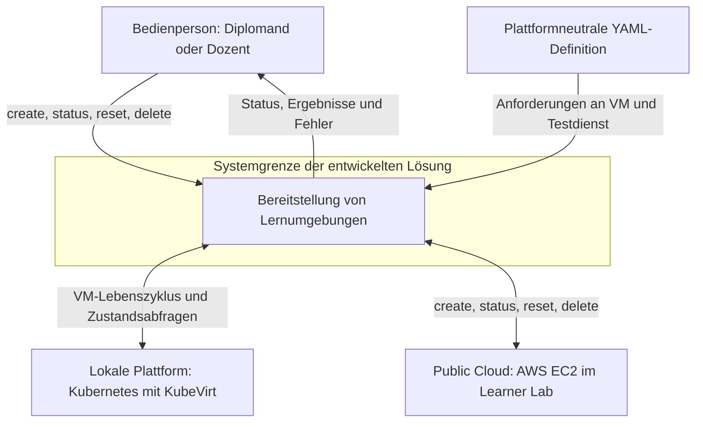

<small id="abb-11"><em>Abbildung 11: Systemkontext der Bereitstellungslösung</em></small>

Die Systemgrenze umfasst die CLI, den Agenten, SQLite und die Adapter. Der lesende Statusserver und das Dashboard greifen auf denselben gespeicherten Zustand zu. Kubernetes mit KubeVirt sowie AWS liegen ausserhalb dieser Grenze. Pro Lernumgebung wird eine der beiden Zielplattformen verwendet. Die YAML-Definition beschreibt die fachlichen Anforderungen; die Zuordnung zu konkreten Plattformressourcen übernimmt die Lösung.

#### 3.7.2 Komponentensicht

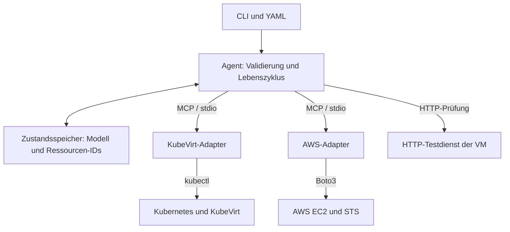

<small id="abb-12"><em>Abbildung 12: Aufbau von CLI, Agent und Adaptern</em></small>

Die Kommandozeilenschnittstelle nimmt Definition und Zielplattform entgegen. Der Agent validiert die Eingabe und steuert den Auftrag. Mit Agent ist hier ein Programm mit festen Regeln gemeint: Es entscheidet anhand der Operation und des gespeicherten Zustands über den nächsten Schritt. Eine Sprachmodellentscheidung ist dafür nicht vorgesehen.

SQLite speichert Modell-Snapshot, Laufkennung, Operationskennung, Phase und Ressourcen-UIDs, siehe Kapitel 4.4. Der Snapshot bleibt für einen Lauf unverändert; sein Hash ordnet die Definition den Plattformressourcen zu. Nach jedem bestätigten Erstellungsschritt werden die UIDs gespeichert. Nach einer verlorenen Antwort versucht ein lesender Abgleich, bereits erzeugte Ressourcen über Kennzeichnungen und Zuordnungen wiederzufinden.

| Zustand | Bedeutung | Zulässige nächste Aktion |
| --- | --- | --- |
| Nicht vorhanden | Keine laufbezogenen Ressourcen vorhanden | create |
| Wird erstellt | Aufbau begonnen, Dienst noch nicht bereit | status; laufenden Auftrag abwarten |
| Bereit | VM läuft und Dienstprüfung ist erfolgreich | status, reset oder delete |
| Wird gelöscht | Abbau begonnen, Endkontrolle läuft | status; laufenden Auftrag abwarten |
| Fehler | Aufbau, Dienstprüfung oder Abbau fehlgeschlagen | status; behandelten Reset oder Abbau fortsetzen beziehungsweise bereinigen |

Nur eine schreibende Operation darf gleichzeitig auf derselben Umgebung laufen. Eine wiederholte Erstellung darf keine Dublette erzeugen. Die Operationskennung unterscheidet einen neuen Auftrag von der Wiederaufnahme nach einem Abbruch. Ein erneutes delete einer bereits entfernten Umgebung bleibt ohne zusätzliche Wirkung. Beim Reset wird erst nach bestätigtem Abbau aus dem Snapshot neu erstellt.

Die Adapter kapseln die Übersetzung in Kubernetes- beziehungsweise AWS-Aufrufe. Beispielsweise kann die Mindestanforderung an CPU und RAM auf AWS nur über einen passenden Instanztyp erfüllt werden; auf KubeVirt entstehen daraus VM-Ressourcen im Manifest. Die fachliche Definition enthält diese Unterschiede nicht.

Agent und lokal gestarteter MCP-Adapter kommunizieren über stdio. MCP-Nachrichten laufen über die Standardein- und -ausgabe, Diagnosemeldungen getrennt über stderr. Der Werkzeugvertrag beschreibt Aufrufe, Antworten und Fehler. SDK, Protokollaushandlung und Werkzeuge sind in Kapitel 4.5 festgehalten; Grundlage der Anbindung ist das MCP-Python-SDK.

Der [lesende Statuszugriff](#410-lesender-statuszugriff) ergänzt diesen Ablauf. Das Dashboard und der Statusserver verwenden dieselbe Live-Prüfung für VM und HTTP-Dienst.

### 3.8 Bewertungskonzept

#### Vorher-Nachher-Vergleich

Verglichen werden die verstrichene Zeit bis zur HTTP-Bereitschaft und die Zeit für den endgültigen Abbau. Reset, Wiederaufnahme und Fehlerbehandlung sind eigene Funktionsprüfungen. Bei der aktiven Bedienzeit gelten die Erfassungsgrenzen der [LernMAAS-Basisserie](#lernmaas-basisserie).

#### Vergleich der MCP-Anbindung

Der Vergleich setzt denselben Provider-Code und dieselben Eingaben voraus. Ein Weg ruft den Provider direkt aus Python auf, der andere über MCP. Die folgenden Kriterien bestimmen, welche Unterschiede der Vergleich erfasst.

| Kriterium | Leitfrage |
| --- | --- |
| Kopplung | Welche Abhängigkeiten entstehen zwischen Agent, Vertrag und Provider? |
| Aufwand | Welche zusätzlichen Komponenten, Konfigurationen und Aufrufe benötigt MCP? |
| Testbarkeit | Wie lassen sich Adapter und Fehlerfälle jeweils isoliert prüfen? |
| Fehlerbehandlung | Wie werden Plattformfehler, Timeouts und Prozessabbrüche an den Agenten übermittelt? |
| Erweiterbarkeit | Welche Änderungen wären für einen weiteren Adapter erforderlich? |

Beide Wege verwenden dieselbe Adapterlogik. Der Vergleich untersucht damit, was sich durch die zusätzliche Prozess- und Protokollgrenze ändert.

### 3.9 Entscheidungsübersicht der ADRs

Die Architekturentscheide wurden von mir als Diplomand im Rahmen der bewilligten technischen Entscheidungsbefugnisse getroffen. Die Übersicht verbindet die Auswahl mit ihrer Begründung und den Folgen für den PoC. Die ausführlichen Herleitungen stehen in den verlinkten Fachabschnitten.

| ADR | Technischer Entscheid | Begründung und Auswirkung | Herleitung |
| --- | --- | --- | --- |
| ADR-001 | dl380-01 als Zielplattform, kvcontrol als möglicher Ersatz | Die benötigte Plattform und der erfolgreiche Referenzlauf liegen auf dl380-01 vor. Ein Mehrknoten-Cluster ist für den PoC nicht vorgesehen. Vor einem Ersatzbetrieb muss kvcontrol separat geprüft werden. | [Lokale Zielplattform](#316-architekturentscheide-aus-der-erhebung) |
| ADR-002 | NodePort für den Testdienst | HTTP und SSH sind aus dem Verwaltungsnetz erreichbar. Zusätzliche Netzwerktechnik ist für den Referenzversuch nicht erforderlich; eine produktive Netzwerkanbindung bleibt ausserhalb des PoC. | [Erreichbarkeit des Gasts](#316-architekturentscheide-aus-der-erhebung) |
| ADR-003 | microk8s-hostpath als Speicherklasse | Die vorhandene Klasse stellt Speicher dynamisch bereit. Die Bindung an den einzelnen Host wird akzeptiert; zum Abbau gehört die Kontrolle von PV und Datenverzeichnis. | [Speicherklasse und Grenzen](#316-architekturentscheide-aus-der-erhebung) |
| ADR-004 | AWS als zweite Zielplattform | Learner-Lab-Zugang und Vorkenntnisse sind vorhanden; der Smoke-Test belegt die Eignung der Referenzkonfiguration. Lab-Beschränkungen, unbekanntes Ablaufdatum und Kostenkontrolle bleiben zu beachten. | [AWS-Auswahl und Kontobedingungen](#36-auswahl-der-public-cloud-plattform) |

## 4 Umsetzung

### 4.1 Referenz-Lernumgebung auf KubeVirt

Als erste Umsetzung habe ich die Referenz-VM auf der vorhandenen KubeVirt-Plattform manuell bereitgestellt. Das [Referenzmanifest](messungen/laeufe/kv-ref-20260922-01/manifest.yaml) enthält einen eigenen Namespace, die VM mit DataVolume und einen NodePort-Service für SSH und HTTP. cloud-init hinterlegt den öffentlichen Schlüssel und startet den Testdienst.

Beim Referenzlauf erreichte ich die VM über HTTP und SSH. Nach der Namespace-Löschung blieb der PV zunächst im Zustand `Released`. Erst die Nachkontrolle bestätigte, dass der PV und das zugehörige Datenverzeichnis entfernt waren. Der automatisierte Abbau prüft deshalb beide Endzustände.

Aus dem Manifest wurden die fachlichen Felder für das gemeinsame Modell abgeleitet. Abbild-URL, Namespace, StorageClass, NodePorts und Ressourcen-IDs bleiben Plattformdetails. Konfiguration, Zeiten und Belege des erfolgreichen Versuchs stehen im [Referenzlauf](#kubevirt-referenzlauf).

### 4.2 Plattformneutrales Fachmodell

Das Fachmodell trennt den gewünschten Testfall von seiner technischen Umsetzung. Modellversion `1.0`, JSON-Schema, Beispiele und lokale Validierung sind umgesetzt. US17 und US18 sind nach dem Abgleich von Code und Tests abgeschlossen.

#### Dateien und Beispiel

| Datei | Aufgabe |
| --- | --- |
| `modell/lernumgebung-v1.schema.json` | JSON-Schema nach Draft 2020-12 für Modellversion 1.0 |
| `modell/beispiele/referenz.yaml` | Vollständige fachliche Definition der reduzierten Referenzumgebung |
| `modell/beispiele/ungueltig-ram.yaml` | Bewusst ungültige Variante mit 1024 statt mindestens 2048 MiB RAM |
| `modell/validierung.py` | Gemeinsame YAML- und Schemaprüfung für Modellwerkzeug und Agent |
| `scripts/modell-pruefen.py` | Eigenständiger Aufruf der Modellprüfung |
| `tests/test_modell.py` | Automatisierte positive und negative Validierungsfälle |

Die Beispieldefinition zeigt die vollständige Eingabe aus `modell/beispiele/referenz.yaml`:

```yaml
modelVersion: "1.0"
name: referenzumgebung
vm:
  role: server
  resources:
    minVcpus: 2
    minMemoryMiB: 2048
    minDiskGiB: 12
  os:
    distribution: ubuntu
    release: "24.04"
    architecture: x86_64
  ssh:
    username: ubuntu
    publicKeys:
      - ssh-ed25519 AAAAC3NzaC1lZDI1NTE5AAAAICDeni6OPrsYaCfeayWMiGPRKbpcOZf+4Q6T+lFv9tAz diplomarbeit-referenz
  testService:
    protocol: http
    port: 8080
    path: /
    expectedStatus: 200
    expectedBody: lernumgebung bereit
```

Der öffentliche Schlüssel stammt aus dem Referenzmanifest. Für einen neuen Infrastrukturversuch muss der zugehörige private Schlüssel auf dem Zugangsrechner verfügbar sein. Die Validierung prüft hier nur das öffentliche Schlüsselformat; die Anmeldung wird separat getestet.

#### Fachliche Festlegungen

| Feld | Bedeutung und Grenze |
| --- | --- |
| `modelVersion` | Zeichenkette `1.0`; unbekannte Modellversionen werden abgewiesen |
| `name` | Name der Lernumgebung aus Kleinbuchstaben, Ziffern und einzelnen Bindestrichen, beginnend mit einem Buchstaben; höchstens 63 Zeichen |
| `vm.role` | `server`; Version 1.0 beschreibt genau eine VM |
| `vm.resources` | Ganzzahlige Mindestkapazitäten: mindestens 2 vCPU, 2048 MiB RAM und 12 GiB Systemdatenträger |
| `vm.os` | Ubuntu `24.04` auf `x86_64`; die Release-Angabe bleibt eine Zeichenkette |
| `vm.ssh` | Benutzer `ubuntu` und mindestens ein öffentlicher Ed25519-Schlüssel im OpenSSH-Format |
| `vm.testService` | HTTP auf Gastport 8080, Pfad `/`, Status 200 und Antwort `lernumgebung bereit` |

Der Adapter ermittelt den tatsächlichen Prüfendpunkt. In der Definition stehen Gastport und erwarteter Inhalt. Dadurch bleibt dieselbe fachliche Eingabe für einen NodePort-Service und den öffentlichen AWS-Endpunkt verwendbar.

Höhere Kapazitäten als die Mindestwerte sind zulässig. Die Modellprüfung bestätigt jedoch keine verfügbare Host- oder Cloud-Kapazität. Auf KubeVirt entscheidet die Plattform über die tatsächliche Bereitstellung; Kontorechte, Quotas und verfügbare Instanztypen lassen sich durch das Schema allein nicht prüfen.

Das Schema weist unbekannte Felder auf jeder Ebene zurück. Dadurch werden sowohl Schreibfehler als auch Plattformfelder wie `amiId`, `storageClass` und `nodePort` erkannt. Weitere Betriebssysteme oder mehrere VMs erfordern eine neue Festlegung des Modells und passende Tests.

#### Lokale Validierung

Für die Modellprüfung sind PyYAML 6.0.3 und jsonschema 4.26.0 in `requirements.txt` festgeschrieben. Die Validierung verwendet ein lokales Schema und benötigt nach der Installation keinen Netzwerkzugriff. Die explizite Auswahl von `Draft202012Validator` und die zusätzliche Formatprüfung folgen der [jsonschema-Dokumentation](https://python-jsonschema.readthedocs.io/en/stable/validate/).

Im aktivierten Python-Umfeld, aus dem Repository-Verzeichnis:

```bash
python -m pip install -r requirements.txt
python scripts/modell-pruefen.py modell/beispiele/referenz.yaml
python scripts/modell-pruefen.py modell/beispiele/ungueltig-ram.yaml
```

Die gültige Definition liefert Exitcode 0 und `Gültig: referenzumgebung (Modellversion 1.0)`. Die ungültige Definition muss Exitcode 1 und `Ungültig: $.vm.resources.minMemoryMiB: Muss mindestens 2048 sein.` liefern. Die Angabe bezeichnet den betroffenen Feldpfad und die verletzte Mindestanforderung.

Neben den Schemaregeln prüft der YAML-Lader mehrdeutige Eingaben: doppelte Feldnamen, Alias-Verweise, mehrere Dokumente und nicht JSON-kompatible Werte werden abgewiesen. Die Ed25519-Prüfung kontrolliert auch den binären Aufbau des öffentlichen Schlüssels. Fehlermeldungen nennen den betroffenen Feldpfad, ohne eingegebene Werte oder YAML-Zeilen auszugeben. Das Werkzeug validiert Dateien und verändert keine Infrastruktur.

Automatisierte Modelltests prüfen Pflichtfelder, Mindestkapazitäten, Datentypen, Versionen, Plattformfelder, öffentliche Schlüssel und fehlerhafte YAML-Eingaben. Befehlsaufrufe aus einem anderen Arbeitsverzeichnis prüfen zusätzlich Ausgabe und Exitcodes. Die vollständigen Prüfbefehle und die Abgrenzung zu echten Infrastrukturtests stehen in Kapitel 5.5.

### 4.3 Agent und Kommandozeile

Der Agent verbindet die Modellprüfung mit der Zustandsführung und dem Plattformadapter. Der Einstieg erfolgt über `python -m agent`. Die Lebenszyklussteuerung liegt in `agent/lebenszyklus.py`; die CLI nimmt die Argumente entgegen und gibt Ergebnisse sowie Fehler zurück. Beide Plattformen bieten dieselben Operationen; die erzeugten Ressourcen unterscheiden sich.

| Operation | KubeVirt | AWS EC2 |
| --- | --- | --- |
| `platform-status` | Knoten, KubeVirt und VM-/VMI-Bestand | Region und gekennzeichnete EC2-Instanzen |
| `create` | VM, Datenträger und NodePort-Service | EC2-Instanz, EBS-Datenträger, Netzwerkschnittstelle und Security Group |
| `status` | Aktueller Bestand sowie VM- und HTTP-Bereitschaft | Aktueller Bestand sowie Instanz- und HTTP-Bereitschaft |
| `reset` | Abbau und Neuerstellung aus dem gespeicherten Modell | Abbau und Neuerstellung aus dem gespeicherten Modell |
| `delete` | Laufbezogener Abbau mit Speicherabschluss | Laufbezogener Abbau mit Kontrolle der gespeicherten AWS-IDs |

| Bestandteil | Aufgabe |
| --- | --- |
| `agent/cli.py` | Befehle, Argumente, Hilfe und Exitcodes |
| `agent/ausgabe.py` | Fortschritt, Ergebnisübersicht und vollständige JSON-Ausgabe |
| `agent/konfiguration.py` | Externe Konfiguration einlesen und prüfen |
| `agent/lebenszyklus.py` | Erstellung, Statusprüfung, Reset und Abbau steuern |
| `agent/zustand.py` | Modell, Operationen und Ressourcen persistent speichern |
| `agent/mcp_client.py` | Konfigurierten MCP-Prozess aufrufen und Antworten prüfen |
| `adapter/` | Werkzeugvertrag, KubeVirt- und AWS-Aufrufe sowie gemeinsame Cloud-init-Erzeugung |

Die Konfiguration wird mit `--config` vor dem Befehlsnamen angegeben. Sie trennt technische Einstellungen vom fachlichen Modell. Die Vorlage in `agent/beispiele/konfiguration.yaml` lautet:

```yaml
stateFile: zustand.sqlite3
adapters:
  kubevirt:
    command: python
    args: ["-m", "adapter.kubevirt"]
    timeoutSeconds: 30
```

`stateFile` bezeichnet die lokale SQLite-Datei. Relative Pfade beziehen sich auf den Ordner der Konfigurationsdatei, nicht auf das aktuelle Arbeitsverzeichnis. Bei dieser Vorlage liegt die Datenbank deshalb unter `agent/beispiele/zustand.sqlite3`. `~` wird als Benutzerverzeichnis aufgelöst. Das Einlesen der Konfiguration erzeugt weder eine Datenbank noch einen Adapterprozess.

`command` und `args` bestimmen den Adapterprozess, `timeoutSeconds` begrenzt einen MCP-Aufruf einschliesslich Verbindungsaufbau. Der Adapter wird mit dem Repository als Arbeitsverzeichnis gestartet. Bei `command: python` muss das virtuelle Python-Umfeld aktiviert sein.

Der Konfigurationsleser verwendet denselben strikten YAML-Lader wie die Modellprüfung. Er weist unbekannte Felder, fehlende Pflichtangaben, falsche Datentypen und nicht positive Zeitgrenzen zurück. Fehlerausgaben nennen den Feldpfad, ohne eingegebene Konfigurationswerte auszugeben. Eigene Einstellungen können in `agent.local.yaml` liegen. Diese Datei sowie SQLite-Dateien und ihre Journaldateien sind von Git ausgeschlossen. Zugangsdaten und private Schlüssel gehören ausserhalb des Repositorys.

Die Hilfe funktioniert ohne Konfigurationsdatei. Die CLI verwendet folgende Exitcodes:

| Code | Bedeutung |
| --- | --- |
| 0 | Befehl erfolgreich oder Hilfe ausgegeben |
| 1 | Konfigurations-, Modell-, Zustands- oder Adapterfehler |
| 2 | Ungültige oder fehlende Kommandozeilenargumente |
| 130 | Operation mit Ctrl+C unterbrochen |

Standardausgabe und Fehlerausgabe verwenden UTF-8. Die CLI zeigt standardmässig lesbare Meldungen mit Lauf und Auftrag, aktuellem Fortschritt und einer Ergebnisübersicht. Bei Erstellung und Reset wird ausdrücklich zwischen laufender VM und bestätigtem HTTP-Dienst unterschieden. Die Statusansicht trennt gespeicherte Phase, VM-/VMI-Zustand, VM-Bereitschaft, HTTP-Bereitschaft und aktuell beobachteten Ressourcenbestand. Verfügbare HTTP- und SSH-Zugangsangaben erscheinen beim Ergebnis. Beim Abbau werden bestätigte Entfernungen und die verbleibende Anzahl bekannter Ressourcen angezeigt. Unveränderte Abbaumeldungen erscheinen höchstens alle 30 Sekunden.

Mit `--json` bleibt die vollständige maschinenlesbare Ausgabe verfügbar. Lebenszyklusereignisse erscheinen dann wie bisher als JSON-Zeilen mit UTC-Zeitstempel, Ereignis, Laufkennung und Operationskennung. Zustandsangaben, Ressourcen-UIDs und Speichermetadaten bleiben enthalten. `platform-status` liefert in diesem Modus das strukturierte Plattformobjekt einschliesslich MCP-Protokollversion. Die Option kann vor oder nach dem Befehlsnamen stehen. Skripte, die CLI-Ausgaben als JSON lesen, müssen `--json` setzen. Direkte Python-Aufrufe der Lebenszyklusfunktionen behalten die JSON-Ereignisse als Voreinstellung.

Fehlermeldungen gehen unabhängig vom Ausgabeformat lesbar an stderr. Ein behandelter Lebenszyklusfehler erscheint im JSON-Modus zusätzlich als strukturiertes Fehlerereignis auf stdout. Die Textansicht nennt den gespeicherten Fehlerzustand, die Zahl bekannter Ressourcen und das Vorgehen zur Wiederaufnahme. Eine Änderung des Ausgabeformats verändert weder Exitcodes noch Zustandsübergänge.

### 4.4 Persistenter Zustand und Kapazitätsgrenze

Der Agent verwendet SQLite aus der Python-Standardbibliothek. Vor der ersten Plattformänderung speichert er die Definition und den Auftrag. So bleibt auch nach einem Fehler bekannt, welche Umgebung verwaltet wird und welche Ressourcen bereits beobachtet wurden.

| Tabelle | Gespeicherte Daten |
| --- | --- |
| `runs` | Laufkennung, Plattform, unveränderter Modell-Snapshot, Modell-Hash, Phase und aktuelle Operationskennung |
| `operations` | Operationskennung, Art create/reset/delete, Status running/succeeded/failed, letzte Ablaufphase, Kennzeichnung des Prozessschutzes, Fehlercode und Zeitstempel |
| `resources` | Laufkennung, Ressourcentyp, Name, UID, Namespace beziehungsweise clusterweiter Bereich und zusätzliche Speichermetadaten |

`modell/snapshot.py` validiert das Modell und serialisiert es als JSON mit sortierten Schlüsseln. Daraus entsteht ein SHA-256-Hash. YAML-Formatierung und die Reihenfolge von Objektschlüsseln verändern diesen Hash nicht. Plattform und Snapshot bleiben für eine Laufkennung unverändert. Reset liest diese gespeicherte Definition; eine spätere Änderung der ursprünglichen YAML-Datei verändert den Reset nicht. Eine andere Definition benötigt eine neue Laufkennung.

Kurze Transaktionen mit `BEGIN IMMEDIATE` schützen Zustandsprüfung und Änderung. Ein eindeutiger Index erlaubt höchstens eine Operation mit Status `running` pro Lauf. Die Zustandstransaktion bleibt nicht während eines Plattformaufrufs offen. Die Datenbank ist für den lokalen Agentenbetrieb vorgesehen.

Zusätzlich schützt `gemeinsam/prozessschutz.py` die gesamte schreibende Operation. Pro Lauf liegt eine separate SQLite-Sperrdatei im Verzeichnis `<Zustandsdatei>.agent-locks`. Eine neue Sitzung benötigt exklusiven Zugriff und schreibt eine zufällige Sitzungskennung. Danach halten Agent und Adapter Lesetransaktionen auf dieser Datei. Solange einer von ihnen noch arbeitet, kann kein zweiter Agent die exklusive Sitzung eröffnen. Das gilt auch für dieselbe Operationskennung. Andere Läufe verwenden eigene Sperrdateien.

Der Adapter hält den Schutz sowohl während seines Prozesses als auch innerhalb der Werkzeugausführung. Vor einem Werkzeugaufruf prüft er die Sitzungskennung. Ein verspätet gestarteter Adapter einer abgelösten Sitzung wird dadurch abgewiesen. Der Client verlangt zusätzlich die Bestätigung des Adapters über MCP. Die Sperrdateien sind von Git ausgeschlossen und dürfen zur Freigabe eines Auftrags nicht gelöscht werden: Ein neuer Dateipfad würde die Sperre noch aktiver Prozesse umgehen.

`PRAGMA user_version` kennzeichnet das Schema. Version 5 speichert zusätzlich mit `guarded`, ob eine Operation unter Prozessschutz begonnen wurde. Die gespeicherte Ablaufphase unterscheidet bei einem fehlgeschlagenen Reset zwischen Abbau und Neuerstellung. Unterstützte ältere Versionen werden migriert, wobei vorhandene Ressourcenkennungen und Speicherdetails erhalten bleiben. Unbekannte Versionen werden abgewiesen. Alte laufende Aufträge erhalten bei der Migration keinen nachträglichen Prozessschutz und werden nicht automatisch übernommen.

#### Zustandsübergänge im Normalablauf

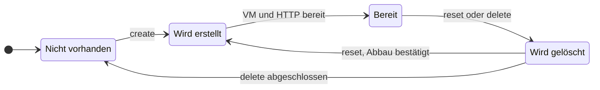

Ein Übergang von `deleting` nach `creating` oder `absent` setzt ein leeres bestätigtes Ressourceninventar voraus. Vorher führt der Lebenszyklus zusätzlich einen Plattformabgleich aus. Der Zustandsspeicher allein kann keine Ressourcenabwesenheit auf Kubernetes beweisen. Für `ready` müssen Ressourcen gespeichert sein; VM- und HTTP-Bereitschaft prüft der Agent.

status liest den Plattformzustand und prüft die Dienstbereitschaft. Es löst keinen Wechsel der gespeicherten Phase aus.

#### Fehlerbehandlung und Wiederaufnahme

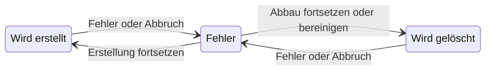

Die Fehlerpfade beschreiben behandelte Adapterfehler, Timeouts und Ctrl+C. Dabei bleiben der Auftrag, seine letzte Ablaufphase und das bekannte Inventar gespeichert. Die Rückwege aus `error` sind an folgende Bedingungen gebunden:

| Rückweg | Voraussetzung |
| --- | --- |
| Nach `creating` | Fehlgeschlagenes create oder fehlgeschlagenen Reset mit derselben Operationskennung fortsetzen; die gespeicherte Ablaufphase ist `creating` |
| Nach `deleting` | Fehlgeschlagenen Reset oder delete mit derselben Operationskennung fortsetzen; die gespeicherte Ablaufphase ist `deleting` |
| Zur Bereinigung nach `deleting` | Einen neuen delete-Auftrag für die fehlerhafte Umgebung beginnen, beispielsweise nach einem fehlgeschlagenen create |

Ein harter Prozessabbruch führt nicht automatisch in die Phase `error`: In SQLite bleibt der Auftrag zunächst als `running` gespeichert. Bei einem erneuten Schreibbefehl muss der Agent zuerst die exklusive Prozesssitzung erwerben. Für einen geschützten Auftrag gleicht er danach den Plattformbestand lesend ab, ergänzt das Inventar und markiert den verlassenen Auftrag als `interrupted`. Das Ereignis `operation_recovered` zeigt diese Übernahme an. Derselbe Auftrag kann anschliessend in seiner gespeicherten Ablaufphase fortfahren. Scheitert der Bestandsabgleich, bleibt der laufende Auftrag erhalten. Eine Freigabe allein aufgrund seines Alters oder einer nicht mehr sichtbaren PID findet nicht statt.

Neue Beobachtungen ergänzen das Inventar. Eine fehlende Ressource wird durch eine reine Statusabfrage nicht ausgetragen. Erst der Abbau bestätigt ihre Entfernung. Dadurch bleiben auch früher beobachtete Importer-Pods oder temporäre Datenträger für die Abschlusskontrolle bekannt. Antworten eines inzwischen abgelösten Auftrags werden über die aktuelle Operationskennung abgewiesen.

#### Obergrenze von 30 VMs

Modellversion 1.0 beschreibt genau eine VM pro Lauf. Eine Schülerzahl oder eine frei wählbare Anzahl VMs ist kein Eingabefeld des Modells. Die Begrenzung erfolgt deshalb über den verwalteten Bestand:

- Innerhalb einer Zustandsdatenbank reservieren höchstens 30 nicht als `absent` bestätigte Läufe einen Platz. Begonnene, bereite, im Abbau befindliche und fehlgeschlagene Läufe zählen mit.
- Prüfung und Reservierung erfolgen atomar beim Erstellungsauftrag. Zwei gleichzeitige Aufträge können denselben freien Platz nicht beide erhalten.
- Auf KubeVirt begrenzt eine ResourceQuota im verwalteten Namespace zusätzlich die Anzahl der VM- und VMI-Objekte auf jeweils 30.

Die Quota schützt den lokalen Namespace auch bei konkurrierenden API-Aufrufen. Der Adapter prüft ihren beobachteten Zustand, bevor er eine VM erstellt. Gemeinsame Basisressourcen ausserhalb des verwalteten Namespace gehören nicht zu dieser Quota. Ein Reset behält seine bestehende Reservierung und erstellt erst nach dem Abbau neu.

Die Zahl 30 ist eine festgelegte Obergrenze, keine nachgewiesene Kapazität des Hosts. Es wurde kein Lastversuch mit 30 gleichzeitig nutzbaren VMs durchgeführt. Die Ressourcenanforderungen einer einzelnen VM werden weiterhin durch Modell und Plattform geprüft.

### 4.5 MCP-Vertrag und Adapterkommunikation

Der Agent startet den konfigurierten Adapter als lokalen Unterprozess und kommuniziert über MCP mit stdio. Für jeden Werkzeugaufruf werden Verbindung und Prozess im SDK-Kontext verwaltet. stdout ist dem Protokoll vorbehalten; Diagnosen werden davon getrennt ausgegeben. Der KubeVirt-Provider führt die Kubernetes-Aufrufe aus. Der AWS-Adapter ruft EC2 und STS über Boto3 auf. Der Agent verwendet für beide denselben MCP-Client.

Die direkten Abhängigkeiten stehen festgeschrieben in `requirements.txt`: PyYAML 6.0.3, jsonschema 4.26.0, MCP-Python-SDK 2.3.0, AnyIO 4.15.1, httpx2 2.16.0 und Boto3 1.43.123. Grundlage der Client- und Server-Anbindung ist das [MCP-Python-SDK](https://github.com/modelcontextprotocol/python-sdk/tree/v2.3.0). Client und Server handeln beim Verbindungsaufbau die Protokollversion aus. Der lokale Durchstich verwendete `2026-07-28`; dies ist keine im eigenen Client fest eingetragene Protokollversion.

`adapter/kubevirt.py` bietet folgende Werkzeuge an:

| Werkzeug | Argumente | Ergebnis |
| --- | --- | --- |
| `platform_status()` | Keine | Plattform, Knotenbereitschaft, KubeVirt-Phase und VM-/VMI-Bestand |
| `process_guard()` | Keine; Sitzung aus der Prozessumgebung | Bestätigung der aktuellen Sitzungskennung vor einem geschützten Werkzeugaufruf |
| `create(run_id, operation_id, model)` | Lauf, Auftrag und validierbares Modell | `complete` und die im Schritt bestätigten Ressourcen |
| `status(run_id)` | Lauf | Tatsächlicher Ressourcenbestand, VM-/VMI-Zustand, Modell-Hash und ermittelte Zugangsangaben |
| `delete(run_id, operation_id, resources)` | Lauf, Auftrag und bekanntes Inventar | `complete`, beobachtete Ressourcen und als entfernt bestätigte Ressourcen |

`adapter/aws.py` bietet ebenfalls `platform_status`, `process_guard`, `create`, `status` und `delete` an. Sein Löschaufruf erhält zusätzlich den gespeicherten `model_hash`, gegen den das gefundene Inventar geprüft wird. Der AWS-Plattformstatus enthält die Region und die gekennzeichneten EC2-Instanzen. Beim laufbezogenen Status bezeichnet `vmiPhase` den auf den gemeinsamen Vertrag abgebildeten EC2-Zustand.

Der Agent setzt Reset auf beiden Plattformen aus delete und create zusammen. Bei AWS ruft er zuvor das lesende Werkzeug `check_reset` auf. Dieses prüft die Startkonfiguration, die Subnetzzuordnung und die Verfügbarkeit des AMI.

Ein Lebenszykluswerkzeug antwortet mit `{ok: true, data: ...}` oder `{ok: false, error: ...}`. `platform_status` verwendet bei Erfolg das Feld `status`. Das technische Hilfswerkzeug `process_guard` bestätigt die Sitzung separat mit `{session: ...}`; eine fehlende oder abweichende Bestätigung verhindert den anschliessenden Werkzeugaufruf. Der Server liefert diese Objekte als strukturierte MCP-Inhalte. `adapter/vertrag.py` prüft die fachlichen Antworten mit JSON-Schemas; unbekannte Felder oder unpassende Typen führen zu einem Fehler.

Ein Ressourceneintrag enthält `kind`, `name`, `resource_id` und `scope`. `resource_id` ist bei Kubernetes die UID. `scope` enthält den Namespace und ist bei einem PV leer. Bei AWS enthält `resource_id` die EC2-Ressourcenkennung und `scope` die Region. Optionale `details` sichern bei KubeVirt die PVC-Zuordnung, den Hostpath und den Knotennamen für die Speicherprüfung. `pathSource` unterscheidet aus der API gelesene Angaben von kontrolliert abgeleiteten historischen Scratch-Pfaden.

| Fehlercode | Bedeutung |
| --- | --- |
| `invalid_request` | Ungültiges Modell oder ungültige Auftragskennung |
| `command_not_found`, `transport_error` | Kubernetes-Werkzeug oder MCP-Verbindung nicht verfügbar |
| `platform_error` | Plattformaufruf fehlgeschlagen |
| `timeout` | Zeitgrenze überschritten |
| `invalid_response` | Antwort verletzt den Vertrag |
| `resource_conflict` | Ressourcenbestand, Zuordnung oder Kennzeichnung widerspricht dem Auftrag |
| `capacity_limit` | VM-Obergrenze erreicht |
| `storage_unverified` | Datenträgerzuordnung oder Speicherabschluss nicht bestätigt |
| `aws_query_failed` | AWS-Aufruf fehlgeschlagen, beispielsweise wegen Profil, Lab-Sitzung oder Berechtigung |
| `aws_launch_unconfigured` | Erforderliche Angaben für den EC2-Start fehlen |
| `aws_model_unsupported` | Modell überschreitet den vom EC2-Adapter unterstützten Umfang |
| `aws_image_unavailable` | AMI für die Neuerstellung ist nicht verfügbar |

Der Agent gibt begrenzte Fehlermeldungen aus. Freie Kubernetes- und AWS-Fehlertexte werden nicht als Ergebnis durchgereicht oder in SQLite gespeichert. Dort stehen die zusammengefassten Fehlercodes `timeout`, `platform_error` und `interrupted`. Die Werkzeuge sind entsprechend ihrer Wirkung als lesend oder schreibend gekennzeichnet; Löschung ist als destruktiv markiert.

### 4.6 KubeVirt-Adapter und Ressourcenverwaltung

Der Adapter verwendet die vorhandene MicroK8s-Installation über `microk8s kubectl`. Die Aufrufe erfolgen als Argumentliste ohne Shell-Auswertung. Schreibende Objekte werden als JSON über stdin übergeben. Der Kubernetes-Zugriff setzt die bereits berechtigte lokale Benutzerumgebung voraus; die Agent-Konfiguration enthält keine Clusterzugangsdaten.

#### Umsetzung des Modells

`adapter/kubevirt_manifest.py` übersetzt Modellversion 1.0 in eine VM mit DataVolume und einen NodePort-Service. Die wesentlichen Zuordnungen sind:

| Fachliche Angabe | KubeVirt-Umsetzung |
| --- | --- |
| CPU, RAM und Datenträger | CPU-Kerne, Gastspeicher und Speicheranforderung des DataVolume |
| Ubuntu 24.04, x86_64 | Festgelegtes Canonical-Cloud-Abbild für Noble auf amd64 |
| Benutzer und öffentlicher SSH-Schlüssel | cloud-init mit gesperrter Passwortanmeldung |
| HTTP-Testdienst | systemd-Dienst mit Python-HTTP-Server und erwartetem Inhalt auf Gastport 8080 |
| HTTP und SSH | NodePort-Service mit dynamisch vergebenen Ports |

Das verwendete Abbild ist der Canonical-Build `20260911` aus dem manuellen Referenzlauf. Die veröffentlichte Prüfsumme wird als Annotation festgehalten; dies ist keine zusätzliche Laufzeitprüfung des heruntergeladenen Abbilds durch den Agenten. Die gemeinsame Funktion in `adapter/cloud_init.py` richtet Benutzer, öffentliche SSH-Schlüssel und HTTP-Testdienst für beide Plattformen ein. Paketaktualisierungen und Distributionsupgrades sind darin deaktiviert.

Der gemeinsame Namespace `diplomarbeit-agent` und die Quota `vm-limit` sind Agent-Infrastruktur. Sie bleiben beim Löschen eines einzelnen Laufs erhalten. Ressourcenname und Labels werden vor der Erstellung festgelegt. Der Name entsteht deterministisch aus der Laufkennung; Labels enthalten verwaltenden Agenten, Lauf und Erstellungsauftrag. Der Modell-Hash steht als Annotation auf VM und Service. Bei vorhandenen VM- und Service-Objekten prüft der Adapter die Besitzkennzeichnungen und die Annotation mit dem Modell-Hash. Diese Prüfung liest die tatsächlichen CPU-, RAM- und Service-Einstellungen nicht gegen das Sollmodell zurück.

#### Laufbezogenes Inventar

Der Bestand umfasst VM, VMI, DataVolume, PVC, Service, Pods, EndpointSlices und zugehörige PVs. Die Zuordnung erfolgt über Labels, bekannte UIDs und OwnerReferences. Das schliesst Folgeobjekte ein, die Controller erzeugen. Der Provider prüft beim gebundenen PV die `claimRef`-Zuordnung zu PVC-UID, Name und Namespace.

CDI kann während des Imports temporäre Scratch-PVCs, Scratch-PVs und Importer-Pods erzeugen. Diese Einträge bleiben im bekannten Inventar, auch wenn sie später bereits verschwunden sind. Wiederverwendete Namen mit anderen UIDs werden getrennt behandelt. Ein früherer Pod-Eintrag darf nicht zum Löschen eines fremden Ersatzobjekts führen.

#### Abbau und Speicherabschluss

Vor dem Löschen sichert der Agent die PV-/PVC-Zuordnung und die Angaben zum lokalen Datenverzeichnis. Neue Speichermetadaten werden zuerst zurückgegeben und persistent gespeichert, bevor der nächste destruktive Schritt folgt.

Löschanfragen enthalten eine UID-Precondition und verwenden Foreground-Löschung. Dadurch bezieht sich ein Auftrag auf das beobachtete Objekt und nicht nur auf dessen wiederverwendbaren Namen. VM und Folgeobjekte werden schrittweise entfernt beziehungsweise als bereits abwesend bestätigt. Der Adapter erzwingt keine PV-Löschung: Der Storage-Provisioner muss den Datenträger und das PV-Objekt bereinigen.

Bei `microk8s-hostpath` reicht ein fehlendes PVC- oder PV-Objekt als Speicherabschluss nicht aus. Geprüft werden auch Reclaim Policy `Delete`, die gesicherte Zuordnung, der lokale Knoten und das fehlende Datenverzeichnis. Deshalb wird dieser Adapter auf dem Clusterknoten ausgeführt. Ein fehlender Pfad wird über `lstat` festgestellt; fehlende Zugriffsrechte gelten nicht als bestätigte Entfernung.

Für ältere Inventare mit einem bereits verschwundenen Scratch-PV kann der Pfad nur unter engen Voraussetzungen ergänzt werden: Die Scratch-PVC-UID muss bekannt sein, der PV-Name muss dazu passen und ein vorhandener, verifizierter PV desselben Laufs muss das lokale Speicherverzeichnis bestätigen. Die Scratch-Speicherklasse wird mit der CDI-Konfiguration beziehungsweise der Klasse des bekannten Ziel-PVC abgeglichen. Bei unvollständiger oder widersprüchlicher Zuordnung stoppt der Abbau mit `storage_unverified` oder `resource_conflict`. Die Pfadbildung und der Fallback auf die Ziel-PVC-Klasse folgen dem [MicroK8s-Hostpath-Provisioner](https://github.com/canonical/hostpath-provisioner/blob/master/hostpath-provisioner.go) und der [Scratch-Auswahl von CDI](https://github.com/kubevirt/containerized-data-importer/blob/main/pkg/controller/util.go).

Der Abbau gilt erst als abgeschlossen, wenn das bekannte Inventar leer ist und eine abschliessende Plattformabfrage keine laufbezogenen Ressourcen mehr findet. Vorhandene Basis-PVCs und Basis-PVs werden nicht in diesen Lauf übernommen.

### 4.7 Lebenszyklus und Fehlerbehandlung

#### create und status

create prüft Modell, Kennungen und Zielplattform. Danach speichert es Snapshot, Auftrag und Reservierung in SQLite. Der MCP-Adapter bestätigt die im jeweiligen Erstellungsschritt angelegten oder beobachteten Ressourcen. Bei AWS kann ein EC2-Start zugleich eine Instanz, einen Datenträger und eine Netzwerkschnittstelle erzeugen. Der Agent sichert die zurückgemeldeten Ressourcen-IDs vor dem nächsten Schritt. Ist die Erstellung vollständig, beginnt die Bereitschaftsprüfung.

Eine laufende VM genügt dafür nicht. Zusätzlich zum laufenden Plattformzustand muss der HTTP-Test Status 200 und den erwarteten Inhalt liefern. Bei KubeVirt wird die VMI-Phase geprüft, bei AWS der entsprechend abgebildete EC2-Instanzzustand. Der HTTP-Client folgt keinen Weiterleitungen, verwendet keine Umgebungs-Proxys und begrenzt Zeit sowie Antwortgrösse. Eine Antwort über 4096 Byte oder mit falschem Inhalt wird nicht als bereit akzeptiert.

status liest den gespeicherten Lauf und fragt die Plattform neu ab. Es zeigt `storedPhase`, `vmState`, `vmiPhase`, `vmReady` und `serviceReady` getrennt. Ein fehlgeschlagener Auftrag kann deshalb `storedPhase: error` haben, obwohl die bisherige VM weiterhin läuft und der Dienst antwortet. Umgekehrt beweist eine zuvor gespeicherte Phase `ready` keine aktuelle Nutzbarkeit. Die Statusprüfung ergänzt das Inventar, repariert den Ablauf aber nicht automatisch.

Wird create für eine bereits als bereit gespeicherte Umgebung mit demselben Modell und derselben Plattform wiederholt, prüft der Agent nur den bestehenden Lauf. Er erstellt keine zweite VM. Ein abweichendes Modell unter derselben Laufkennung wird zurückgewiesen.

#### reset und delete

Reset startet für eine bereite Umgebung einen Abbau. Erst nach bestätigter Entfernung des gesamten bekannten Bestands wechselt die gespeicherte Ablaufphase von `deleting` nach `creating`. Danach erstellt der Agent die Umgebung aus dem unveränderten Snapshot neu und wartet erneut auf HTTP-Bereitschaft. Die neue VM hat auf KubeVirt eine neue UID und auf AWS eine neue Instanz-ID.

Die Wiederholung des zuletzt abgeschlossenen Reset-Auftrags löst eine Statusprüfung aus. Eine ältere, bereits verwendete Operationskennung wird abgewiesen. Eine neue Reset-Kennung startet einen neuen Reset. Nach einem behandelten Reset-Fehler setzt dieselbe Kennung die gespeicherte Phase fort. Auf AWS bildet diese Kennung zusammen mit der Laufkennung den EC2-ClientToken für die Neuerstellung.

delete verwendet dieselbe Abbaukontrolle und schliesst den Lauf mit `absent` ab. Bei einer Wiederholung prüft es die tatsächliche Abwesenheit und meldet `alreadyAbsent: true`. Auf KubeVirt bleiben gemeinsamer Namespace und Quota bestehen. Auf AWS gehört die für den Lauf angelegte Security Group zum Abbau.

#### Zeitgrenzen und Wiederaufnahme

| Grenze | Standardwert | Geltungsbereich |
| --- | --- | --- |
| create | 900 Sekunden | Erstellung bis zur HTTP-Bereitschaft |
| reset | 1200 Sekunden | Abbau und erneute Erstellung bis zur HTTP-Bereitschaft |
| delete | 300 Sekunden | Abbau und Abschlusskontrolle |
| MCP-Aufruf | 30 Sekunden in den versionierten Beispielen, 60 Sekunden in der verwendeten AWS-Laufkonfiguration | Prozessstart, Verbindung und ein Werkzeugaufruf |
| Provider-Aufruf | 15 Sekunden | Kubernetes-Aufrufe sowie Verbindungs- und Lesezeitgrenze der AWS-SDK-Aufrufe |
| HTTP-Prüfung | Höchstens 2 Sekunden pro Versuch | Vollständige Antwort innerhalb der verbleibenden Operationszeit |

Die CLI-Option `--timeout-seconds` verändert die Zeitgrenze von create, reset oder delete. Der Agent verwendet für einzelne Aufrufe die kleinere Grenze aus verbleibender Operationszeit und Adapterkonfiguration. Nach einem Fehler versucht er zusätzlich einen begrenzten lesenden Plattformabgleich und beendet den MCP-Kontext. Dieser Fehlerabgleich und die Prozessbereinigung können über die fachliche Zeitgrenze hinaus dauern. Eine Vorgabe von einer Sekunde bedeutet deshalb nicht, dass der gesamte Prozess nach genau einer Sekunde beendet ist.

Bei einem behandelten Adapterfehler oder Ctrl+C speichert der Agent `error` und erhält das bekannte Inventar. Der lesende Abgleich versucht auch Ressourcen zu erfassen, deren API-Aufruf erfolgreich war, dessen Antwort aber verloren ging. Eine Ressource wird erst nach bestätigter Entfernung ausgetragen.

| Situation | Vorgehen im vorhandenen Ablauf |
| --- | --- |
| Reset nach behandeltem Fehler | Dieselbe Reset-Kennung erneut verwenden; die gespeicherte Abbau- oder Erstellungsphase wird fortgesetzt |
| delete nach behandeltem Fehler | Dieselbe Löschkennung erneut verwenden und den Restbestand abgleichen |
| Fehlgeschlagenes create | Dieselbe Erstellungskennung mit unverändertem Modell und unveränderter Plattform fortsetzen oder mit delete bereinigen |
| Hart beendeter Prozess mit geschütztem Auftrag `running` | Dieselbe Kennung verwenden; erst Prozesssitzung erwerben, Bestand lesen und dann die gespeicherte Phase fortsetzen |
| Noch aktiver Agent oder Adapter | Zweiter Schreibbefehl wird abgewiesen; den ursprünglichen Auftrag weiterlaufen lassen |
| Alter laufender Auftrag ohne Prozessschutz | Automatische Übernahme wird abgewiesen; eine fehlende alte Prozesssperre bestätigt kein Prozessende |
| Fremde UID, unpassende Kennzeichnung oder unklare Speicherzuordnung | Fehler prüfen; der Adapter übernimmt oder entfernt das widersprüchliche Objekt nicht ungeprüft |

Die Prozesssperre und die Sitzungsprüfung schützen die lokalen Agenten- und Adapterprozesse. Ein bereits von Kubernetes angenommener Auftrag kann unabhängig vom Ende des aufrufenden Prozesses weiterlaufen. Deshalb bestätigt erst der anschliessende Ressourcenabgleich den erreichten Plattformzustand. Die auf KubeVirt geprüften Abbruch- und Timeout-Fälle stehen in Kapitel 5.5. Der auf AWS ausgeführte Ablauf einschliesslich Reset und Wiederaufnahme nach Ctrl+C ist in Kapitel 5.6 belegt.

### 4.8 Bedienung auf der lokalen Plattform

Der erprobte Betriebsweg führt per SSH auf den lokalen Clusterknoten. Dort laufen Agent, MCP-Adapter und Speicherprüfung. Voraussetzung sind Python 3.12 mit venv-Unterstützung, Git, der berechtigte MicroK8s-Zugriff sowie KubeVirt, CDI und die Speicherklasse `microk8s-hostpath`.

Für eine neue Arbeitskopie:

```bash
git clone https://github.com/Cancani/diplomarbeit.git
cd diplomarbeit
python3 -m venv .venv
source .venv/bin/activate
python -m pip install -r requirements.txt
```

Fehlt unter Ubuntu das venv-Modul, wird zunächst das zur Python-Version passende Paket benötigt, auf dem verwendeten System `python3.12-venv`. Die Erstellung des virtuellen Umfelds wird danach erneut ausgeführt. Nach jeder neuen SSH-Anmeldung wird im vorhandenen Repository `source .venv/bin/activate` aufgerufen.

Die technische Erreichbarkeit und die Hilfe lassen sich vor einer Erstellung prüfen:

```bash
python -m agent --help
python -m agent reset --help
python -m agent --config agent/beispiele/konfiguration.yaml platform-status \
  --platform kubevirt
```

`platform-status` liest Knoten, KubeVirt und VM-/VMI-Bestand. Es erstellt keine Lernumgebung und bestätigt keine HTTP-Bereitschaft. Vor einem eigenen Lauf muss der öffentliche Schlüssel in der fachlichen Definition zu einem verfügbaren privaten Schlüssel passen, wenn auch SSH im Gast verwendet werden soll.

Für eine vollständige maschinenlesbare Statusausgabe wird `--json` ergänzt:

```bash
python -m agent --config agent/beispiele/konfiguration.yaml status \
  --run-id demo-01 --json
```

Dieselbe Option steht bei create, reset, delete und platform-status zur Verfügung. Eine Umleitung von stdout speichert die JSON-Ausgabe; Fehlermeldungen bleiben auf stderr. Die Nachweisauszüge enthalten die Ausgabe des jeweils dort genannten Code-Stands.

Die folgenden Befehle verwenden für eine Beispielumgebung durchgehend die Laufkennung `demo-01`:

```bash
python -m agent --config agent/beispiele/konfiguration.yaml create \
  modell/beispiele/referenz.yaml \
  --platform kubevirt \
  --run-id demo-01 \
  --operation-id create-demo-01
python -m agent --config agent/beispiele/konfiguration.yaml status \
  --run-id demo-01
python -m agent --config agent/beispiele/konfiguration.yaml reset \
  --run-id demo-01 \
  --operation-id reset-demo-01
python -m agent --config agent/beispiele/konfiguration.yaml delete \
  --run-id demo-01 \
  --operation-id delete-demo-01
```

Jeder Befehl wird einzeln ausgeführt und sein Ergebnis geprüft. create endet bei erfolgreicher Erstellung mit `ready`. reset meldet den bestätigten Phasenwechsel über `reset_recreating` und schliesst mit `reset_completed`. delete meldet `deleted`. Zugangsadresse und vergebene Ports stehen in der jeweiligen Statusausgabe und können sich nach einem Reset ändern.

Die Laufkennung bezeichnet die Umgebung, die Operationskennung einen einzelnen Auftrag. Beide bestehen aus Kleinbuchstaben, Ziffern und durch einzelne Bindestriche getrennten Teilen mit höchstens 63 Zeichen. Ohne `--operation-id` erzeugt die CLI eine neue Kennung. Für eine gezielte Wiederaufnahme wird die Kennung aus der Ausgabe erneut angegeben. Ein weiterer beabsichtigter Reset erhält beispielsweise `reset-demo-02`.

Nach einem behandelten Fehler wird zuerst der Status gelesen. Ein unterbrochener Reset wird anschliessend mit derselben Kennung und einer passenden Zeitgrenze fortgesetzt:

```bash
python -m agent --config agent/beispiele/konfiguration.yaml status \
  --run-id demo-01
python -m agent --config agent/beispiele/konfiguration.yaml reset \
  --run-id demo-01 \
  --operation-id reset-demo-01 --timeout-seconds 1200
```

Für bestehende Läufe müssen Konfiguration und Zustandsdatenbank beibehalten werden. Beim Verschieben einer Konfiguration ist der Bezug relativer Zustandspfade zu beachten. Die Datenbank enthält auch Ressourcen früherer Fehlversuche und wird nicht durch einen neuen leeren Zustand ersetzt.

Für eine unabhängige Abbaukontrolle werden vor delete die UIDs und Speichermetadaten aus dem Inventar gesichert. Danach werden der laufbezogene Bestand im Namespace, die bekannten PV-Namen clusterweit und die gesicherten lokalen Datenverzeichnisse geprüft. Andere Läufe sowie gemeinsame Basisressourcen können weiterhin bestehen. Ein leerer Namespace allein ersetzt die PV- und Verzeichniskontrolle nicht.


### 4.9 AWS-Adapter und EC2-Betrieb

Der Agent läuft auf `dl380-01` und startet `adapter/aws.py` als MCP-Prozess. Der Adapter verwendet Boto3 1.43.123 mit dem lokalen AWS-Profil `diplomarbeit`. EC2 stellt die VM-Ressourcen bereit, STS prüft das erwartete Konto. Die Zugangsdaten des Learner Labs liegen im AWS-Profil ausserhalb des Repositorys.

#### Zuordnung der Referenz-YAML

Der AWS-Durchstich verarbeitet unverändert `modell/beispiele/referenz.yaml`. Die Plattformwahl erfolgt mit `--platform aws`. Die Plattformparameter gehören zur Adapterkonfiguration.

| Fachliche Anforderung | Umsetzung auf EC2 |
| --- | --- |
| Mindestens zwei vCPU und 2048 MiB RAM | Festgelegter Instanztyp `t3.small` mit zwei vCPU und 2048 MiB |
| Ubuntu 24.04 für x86_64 | Canonical-AMI `ami-0fa5967347d08d2df` in `us-east-1` |
| Mindestens 12 GiB Systemdatenträger | EBS-Volume `gp3` in der angeforderten Grösse, `DeleteOnTermination: true` |
| Benutzer und öffentliche Schlüssel | Gemeinsame Cloud-init-Erzeugung mit gesperrter Passwortanmeldung |
| Testdienst | Python-HTTP-Server als systemd-Dienst auf Port 8080 mit `lernumgebung bereit` |
| Erreichbarkeit der HTTP-Prüfung | Öffentliche IPv4 der Instanz und eigene Security Group mit einer TCP-8080-Regel für die öffentliche Agentenadresse als `/32` |

Die unterstützten Mindestanforderungen sind durch `t3.small` begrenzt. Mehr als zwei vCPU, mehr als 2048 MiB RAM, mehr als 100 GiB Datenträger oder mehr als 16 KiB Cloud-init-Daten weist der Adapter vor einer Ressourcenerstellung ab. Die Grösse des Systemdatenträgers bleibt innerhalb dieses Bereichs aus dem Modell abgeleitet. Die gemeinsame SQLite-Datenbank reserviert pro Lauf einen VM-Platz nach der Grenze aus Kapitel 4.4.

#### Erstellung und Ressourceninventar

Vor dem ersten Plattformaufruf sichert der Agent das Modell und den Auftrag. Der Adapter prüft die Subnetzzuordnung zur konfigurierten VPC und legt eine deterministisch benannte Security Group an. In einem weiteren Schritt bestätigt er die einzelne HTTP-Regel. Danach startet er genau eine Instanz mit öffentlicher IPv4, Systemdatenträger und Netzwerkschnittstelle. Der Start verlangt IMDSv2 und verwendet die CPU-Credit-Einstellung `standard`.

Ein aus Lauf- und Operationskennung berechneter `ClientToken` kennzeichnet den EC2-Start. Vorhandene Ressourcen werden auf Modell, Auftrag und Startkonfiguration geprüft. Ein bereits sichtbarer passender Instanzbestand wird wiederverwendet. Die Funktionsprüfung dieses Wiederholungsfalls erfolgt automatisiert über die SDK-Schnittstelle. Der Live-Nachweis in Kapitel 5.6 umfasst einen regulären Start.

| Kennzeichnung | Zuordnung |
| --- | --- |
| `ManagedBy` | Verwaltung durch `diplomarbeit-agent` |
| `RunId` | Lernumgebung |
| `OperationId` | Erstellungsauftrag |
| `ModelHash` | Unveränderter YAML-Snapshot |
| `LaunchConfig` | Hash aus VPC, Subnetz, HTTP-Quelladresse und AMI |

Die Tags werden beim Anlegen von Security Group, Instanz, EBS-Volume und Netzwerkschnittstelle gesetzt. Der Agent sichert die gemeldeten IDs in SQLite. Die Bestandsabfrage liest alle vier Ressourcentypen mit Seitennavigation. Sie erfasst Datenträger, Netzwerkschnittstelle und Security Group unabhängig davon, ob die Instanz noch aktiv ist. Eine beendete Instanz zählt als entfernt.

#### Status und Abbau

Nach bestätigter Erstellung fragt der Agent den Instanzzustand und den HTTP-Testdienst ab. Erst eine laufende Instanz zusammen mit der erwarteten HTTP-Antwort führt zur gespeicherten Phase `ready`. Ein separater Statusaufruf fragt AWS und den Dienst erneut ab. Der ausgeführte Durchstich verwendet ausschliesslich die HTTP-Freigabe. Die Security Group enthält keine eingehende SSH-Regel.

Vor einem schreibenden Werkzeugaufruf bestätigt der Adapter seine Prozesssitzung und gleicht das AWS-Konto über STS mit der Konfiguration ab. Für delete prüft er die gefundenen Ressourcen gegen Laufkennung, Modell-Hash und Region. Bekannte IDs, die in der Tag-Suche fehlen, werden zusätzlich über ihren ID-Filter gesucht. Widersprüchliche Besitzkennzeichnungen führen zu einem Fehler.

Der Abbau beendet zuerst die Instanz. Verbliebene EBS-Datenträger und Netzwerkschnittstellen werden nur im Zustand `available` gelöscht. Die Security Group wird nach dem Verschwinden der laufbezogenen Netzwerkschnittstellen entfernt. Neu entdeckte IDs meldet der Adapter zuerst an den Agenten zurück, damit sie vor einem Löschaufruf gespeichert sind. Eine erfolgreiche Löschanforderung gilt erst bei einer nachfolgenden Bestandsabfrage als bestätigte Entfernung. Der Agent trägt die IDs einzeln aus und setzt den Lauf nach leerer Abschlusskontrolle auf `absent`.

#### Verwendete Betriebskonfiguration

Die lokale Datei `~/.config/diplomarbeit/aws.yaml` enthält das erwartete Konto, die VPC, das Subnetz und die öffentliche Quelladresse von `dl380-01` als `/32`. Sie verwendet dieselbe Zustandsdatei wie das KubeVirt-Beispiel. Die MCP-Zeitgrenze beträgt in dieser Konfiguration 60 Sekunden. Die versionierte Datei `agent/beispiele/aws-status.yaml` enthält die Einstellungen für reine Bestandsabfragen.

| Adapterargument | Wert oder Zweck |
| --- | --- |
| `--profile` | `diplomarbeit`, Profil mit den temporären Learner-Lab-Zugangsdaten |
| `--region` | `us-east-1` |
| `--account-id` | Erwartetes zwölfstelliges AWS-Konto |
| `--vpc-id`, `--subnet-id` | Verifiziertes Netz des Learner Labs |
| `--http-source-cidr` | Öffentliche IPv4 des Agentenhosts als `/32` |

Bei aktivierter virtueller Python-Umgebung werden die Befehle im Repository ausgeführt. Die Konfigurationsdatei ist lokal befüllt.

```bash
AWS_CFG="$HOME/.config/diplomarbeit/aws.yaml"
python -m agent --config "$AWS_CFG" create modell/beispiele/referenz.yaml \
  --platform aws --run-id aws-s2-01 --operation-id create-aws-s2-01
python -m agent --config "$AWS_CFG" status --run-id aws-s2-01
python -m agent --config "$AWS_CFG" delete \
  --run-id aws-s2-01 --operation-id delete-aws-s2-01
python -m agent --config "$AWS_CFG" status --run-id aws-s2-01
```

Diese Befehle zeigen die im Durchstich verwendeten Kennungen. Die Datenbank enthält den zugehörigen abgeschlossenen Lauf. Ein neuer eigenständiger Durchlauf erhält eine eigene Laufkennung.

### 4.10 Lesender Statuszugriff

Der MCP-Statusserver `agent.mcp_server` bietet genau ein Werkzeug an. `lernumgebung_status` erhält die Laufkennung und liefert die gespeicherte Phase, den aktuellen VM-Zustand sowie die HTTP-Bereitschaft zurück. Der Server öffnet die SQLite-Datei im Lesemodus. Für die Live-Abfrage nutzt er `inspect_status`. Erstellung, Reset und Löschung stehen über die CLI zur Verfügung.

Die beiden MCP-Verbindungen haben unterschiedliche Endpunkte. Ein externer Client wie Claude Code ruft den Statusserver auf. Für die Plattformabfrage spricht der Agent den KubeVirt- oder AWS-Adapter separat über MCP stdio an. In den automatisierten Tests ruft ein MCP-Client das Statuswerkzeug über stdio auf. Ein Test vergleicht dabei die SQLite-Datei vor und nach der Abfrage. Ein weiterer prüft die Antwort auf eine unbekannte Laufkennung.

Das Dashboard zeigt die gespeicherten Läufe und prüft auf Anfrage den Status eines ausgewählten Laufs. Es lauscht standardmässig auf `127.0.0.1:8765`. Der Statusserver nutzt derzeit die SQLite-Lesefunktion `read_runs` aus dem Dashboard-Modul. Für einen MCP-Aufruf muss der HTTP-Server des Dashboards nicht laufen.

## 5 Tests und Messungen

| Prüfung | Stand und Aussage |
| --- | --- |
| Modell, Agent, Adapter und Hilfswerkzeuge | Automatisierte Codeprüfung ohne bereitgestellte VM; Verfahren und Umfang in Kapitel 5.5 |
| KubeVirt-Referenzlauf | Manuelle Erstellung, HTTP, SSH und Ressourcenabschluss erfolgreich |
| Lokaler Agentenlebenszyklus | create, status, reset und delete sowie Wiederholung und behandelte Fehlerfälle geprüft; Grenzen in Kapitel 5.5 |
| LernMAAS-Basisserie | Drei technische Abläufe abgeschlossen; abweichende Erfassung der Bedienzeit bei den Ergebnissen ausgewiesen |
| AWS-Smoke-Test | Manuelle Erstellung, HTTP, SSH und Abbau erfolgreich; manueller Referenzversuch vor der Adapterumsetzung |
| AWS-Agentenlauf | create, status, HTTP-Bereitschaft und delete erfolgreich, direkte AWS-Nachkontrolle ohne Treffer in us-east-1, siehe Kapitel 5.6 |
| AWS-Reset und Wiederaufnahme | Neuerstellung aus demselben Modell, Fortsetzung nach Ctrl+C, Wiederholung derselben Operationskennung und direkter Abbaunachweis anhand der IDs |
| Formale PoC-Serien | Kein vollständiger versionierter Datensatz mit je drei Messläufen pro Plattform vorhanden |

### 5.1 Messplan

Für die formalen Läufe gelten die Messgrenzen aus Kapitel 3.4. Die folgende Reihenfolge wird auf beiden Zielplattformen verwendet:

| Phase | Durchführung |
| --- | --- |
| Vorbereitung | Laufkennung vergeben, Codeversion, Definition und Abbild festhalten. Zugang vorbereiten und freien Ausgangsbestand prüfen. |
| create | Zeitnahme vor der ersten Bedienhandlung starten. Erstellung auslösen und den ermittelten HTTP-Endpunkt bis zum erwarteten Inhalt beobachten. |
| status und SSH | Laufenden VM-Zustand, zugeteilte Kapazitäten, Anmeldung und aktiven Testdienst prüfen. |
| reset | Inventar sichern, vollständig abbauen und aus derselben gespeicherten Definition neu erstellen. Neue IDs und zweite Dienstbereitschaft erfassen. |
| delete | Endgültigen Abbau auslösen und Ressourcenabschluss anhand des Inventars prüfen. |
| Auswertung | Verstrichene Zeiten, aktive Arbeit, Bedienhandlungen und Abweichungen je Phase zusammenführen. |

Die Protokolle verwenden UTC. Pollingintervall, Anfrage-Timeout und Gesamtgrenzen werden vor einer Serie festgelegt. `scripts/probe-http.py` prüft standardmässig im Abstand von zwei Sekunden mit zwei Sekunden Anfrage-Timeout. Die eigene Laufzeit des Beobachters ist von der gesamten Aufbaudauer ab Startmarker zu unterscheiden.

Bei einem Fehler bleiben das Protokoll und das Ressourceninventar erhalten. Die Bereinigung wird gezielt abgeschlossen. Für eine erfolgreiche formale Serie gelten danach wieder drei aufeinanderfolgende Läufe ohne manuelle Korrektur.

#### Durchführung der LernMAAS-Basisserie

Zwei SSH-Terminals auf `cloud-au-30` trennten Bedienung und Beobachtung. Das Hilfswerkzeug `maas-beobachten.py` prüfte Eingaben und Ausgangszustand und beobachtete MAAS sowie den HTTP-Dienst. Die VM-Erstellung erfolgte mit dem gesicherten `createvms`; Zone, Betriebssystem und Cloud-init wurden in der MAAS-Oberfläche gesetzt.

Sobald der Deployment-Endpunkt vorlag, begann das HTTP-Polling. Nach HTTP und SSH wurden Maschine und Testpool gelöscht. Maschinenbestand, Poolliste und Hostzuteilung wurden mit dem Zustand vor dem Lauf verglichen. Die Aufbaugrenze lag bei 1800 Sekunden, das HTTP-Polling bei höchstens 900 Sekunden innerhalb dieser Gesamtzeit. Die Laufkennungen aus der Vorbereitung blieben bestehen.

### 5.2 Messprotokollvorlage

Ein Laufprotokoll enthält die folgenden Angaben. Fehlende Daten werden als fehlend gekennzeichnet. Die Ressourcen vor und nach einem Reset werden getrennt zugeordnet.

| Bereich | Inhalt |
| --- | --- |
| Zuordnung | Laufkennung, Plattform, Datum, Person, Serien- und Versuchsnummer |
| Eingaben und Umgebung | Git-Commit, YAML-Definition, Cloud-init, Abbild-ID oder datierte URL, Host beziehungsweise Region und tatsächliche Kapazitäten |
| Ausgangsbestand | Vorbereiteter Zugang, bestehende Basisressourcen und freie Testumgebung |
| Zeitmessung | Startmarker, erste Readiness, Resetbeginn, bestätigter interner Abbau, zweite Readiness, endgültiger Abbaustart und abgeschlossene Nachkontrolle |
| Prüfparameter | Endpunkt, Pollingintervall, Anfrage-Timeout und Gesamtgrenzen |
| Bedienaufwand | Aktive Zeit und Handlungszahl je Phase sowie zusätzliche Fehlerkorrekturen |
| Ressourcenabschluss | Ressourcentyp, ID, Abhängigkeiten und Endzustand für beide Erstellungen; bekannte Restressourcen bei Fehlern |
| Ergebnis | Erfolg oder Fehler, Abweichungen, Kosten soweit verfügbar und Verweise auf die Rohprotokolle |

### 5.3 Messläufe

Die folgenden Abschnitte dokumentieren die ausgeführten Versuche. Ihre Ergebnisse werden entsprechend dem jeweiligen Zweck verwendet: technische Machbarkeit, Vorbereitung der Messung oder Vergleichsbasis.

#### KubeVirt-Referenzlauf

Der Lauf `kv-ref-20260922-01` auf `dl380-01` bestätigte die manuelle Erstellung und Entfernung der Referenzumgebung. VM, HTTP-Dienst und SSH funktionierten; US38 ist abgeschlossen.

| Merkmal | Konfiguration |
| --- | --- |
| Plattform | MicroK8s v1.35.6 mit KubeVirt und CDI, Einzelknoten `dl380-01` |
| Definition | [Manifest](messungen/laeufe/kv-ref-20260922-01/manifest.yaml), eigener Namespace `da-kv-ref-20260922-01` |
| VM | 2 vCPU, 2 GiB RAM, 12 GiB Datenträger; Ubuntu 24.04 amd64, Build `20260911` |
| Endpunkte | NodePort 31946 für HTTP und 30526 für SSH, geprüft vom Clusterhost |
| Speicher | `microk8s-hostpath`, `WaitForFirstConsumer`, Reclaim-Policy `Delete` |

| Prüfung | Ergebnis |
| --- | --- |
| Erstellung und HTTP | HTTP 200 mit `lernumgebung bereit`, 302,922 s ab Startmarker |
| Plattformstatus | VM und VMI `Running/Ready`, DataVolume erfolgreich, PVC gebunden |
| SSH | Anmeldung erfolgreich, Dienst aktiv und Gastdatenträger geprüft |
| Namespace-Abbau | Namespace entfernt, Test-PV zunächst noch `Released` |
| Storage-Nachkontrolle | PV und zugeordnetes Datenverzeichnis entfernt |

Die Nachkontrolle bezog sich auf den vorher gesicherten PV `pvc-af106e61-e080-46c8-8b38-4ba46f59b092` und seinen HostPath. Der bestehende PV `rwm-volume` blieb erhalten. Der Speicherabschluss wurde rund 163 Sekunden nach Abbaustart festgestellt. Eine Namespace-Löschung allein wäre dafür kein ausreichendes Endkriterium gewesen.

Das HTTP-Polling begann nach dem Erstellungsaufruf und lief selbst 234,367 Sekunden. Als beobachtete Aufbaudauer werden die 302,922 Sekunden ab Startmarker verwendet. Bedienzeit, Handlungszahl, Zugriff vom Laptop und Reset wurden in diesem Referenzlauf nicht gemessen beziehungsweise geprüft.

Belege: [HTTP](messungen/laeufe/kv-ref-20260922-01/http-create.jsonl), [SSH](messungen/laeufe/kv-ref-20260922-01/ssh-pruefung.txt), [Ressourceninventar](messungen/laeufe/kv-ref-20260922-01/inventar-vor-abbau.json), [PV-Zuordnung](messungen/laeufe/kv-ref-20260922-01/pv-vor-abbau.json), [Abbau](messungen/laeufe/kv-ref-20260922-01/abbau.txt) und [Storage-Nachkontrolle](messungen/laeufe/kv-ref-20260922-01/storage-nachkontrolle.txt).

#### LernMAAS-Vorversuch

Mit `lernmaas-20260930-01` habe ich die gemeinsame Referenz auf LernMAAS erprobt. Der Lauf verwendete Controller `cloud-au-30`, KVM-Host `cloud-au-32` und MAAS-Pod 7. Die Maschine `daref-01-da20260930a` hatte die System-ID `rf376m`, der Pool die ID 16. Sie erhielt 2 vCPU, 2048 MiB RAM und 13 GB Datenträger unter Ubuntu 24.04 amd64 mit Kernel `ga-24.04` und MAAS-Abbildsatz `20260223`.

Die im Gast bestätigten 13 000 000 000 Bytes erfüllen die Anforderung von mindestens 12 GiB. Die Definition wurde mit dem gesicherten Erstellungsskript ausgeführt; der LernMAAS-Repository-Stand war `1f105a74cd0684286379fe4dc539d58331bc62e8`.

Der Ablauf umfasste Maschinenanlage, die Zustände `Ready`, `Deploying` und `Deployed`, die externe HTTP-Prüfung sowie die anschliessende Entfernung von Maschine und Pool. Die vollständigen Ereigniszeitstempel stehen in den verlinkten Protokollen.

Bis zur beobachteten HTTP-Bereitschaft vergingen 652,061 Sekunden. Die 77,596 Sekunden bis zur bestätigten Poolentfernung enthalten einen längeren Abstand vor dem Pool-Löschaufruf und sind keine reine technische Löschzeit.

Der Versuch zeigte zwei Probleme für die geplante Serie. Im Deployment-Dialog wurde eine verkürzte Cloud-init-Vorlage verwendet; die ausgelesene systemd-Unit lief dadurch als root. Ausserdem gelang SSH vom Controller mit einem vorhandenen Schlüssel, während der Laptop-Schlüssel abgewiesen wurde. Für die Basisserie wurden deshalb die vollständige Cloud-init-Datei und der passende öffentliche Schlüssel festgeschrieben. Die [nachträglich rekonstruierte Eingabe](messungen/laeufe/lernmaas-basis-20260930/lauf-01/cloud-init-verwendet-rekonstruiert.yaml) bleibt ausdrücklich als Rekonstruktion bezeichnet.

Nach dem Abbau waren Maschine und Pool entfernt, die Hostzuteilung wieder auf dem Ausgangsstand und die zuvor vorhandenen 30 Maschinen weiterhin erfasst. Der Lauf bleibt wegen der abweichenden Eingabe und unvollständigen Bedienzeiterfassung ein Vorversuch.

Belege: [Referenzprofil](messungen/laeufe/lernmaas-basis-20260930/config-referenz.yaml), [Erstellungsskript](messungen/laeufe/lernmaas-basis-20260930/createvms-original.sh), [Abbildstand](messungen/laeufe/lernmaas-basis-20260930/ubuntu-noble-ga24.04.json), [HTTP](messungen/laeufe/lernmaas-basis-20260930/lauf-01/http-create.jsonl), [SSH](messungen/laeufe/lernmaas-basis-20260930/lauf-01/ssh-pruefung-02.txt), [ausgelesener Dienst](messungen/laeufe/lernmaas-basis-20260930/lauf-01/testdienst-tatsaechlich.txt), [Maschinen nach Abbau](messungen/laeufe/lernmaas-basis-20260930/lauf-01/maschinen-abschluss.json) und [Pools nach Abbau](messungen/laeufe/lernmaas-basis-20260930/lauf-01/pools-abschluss.json). Die [Aufbereitung](messungen/laeufe/lernmaas-basis-20260930/aufbereitung.json) dokumentiert das Entfernen privater Zoneninhalte aus den öffentlichen Inventaren.

#### LernMAAS-Basisserie

Die drei Basisläufe wurden auf `cloud-au-30` durchgeführt. Sie verwendeten dieselbe reduzierte Referenzdefinition. Jeder Lauf umfasste Erstellung, manuelles Deployment, HTTP, SSH und anschliessenden Abbau. Alle drei technischen Abläufe waren erfolgreich.

**Gemeinsame Eingaben**

| Merkmal | Stand |
| --- | --- |
| Ausführung | KVM-Host `cloud-au-32`, MAAS-Pod 7, Zone `10-1-45-0` |
| Referenz | Profil `daref`, eine VM, 2 vCPU, 2048 MiB RAM, 13 GB Datenträger |
| Abbild | Ubuntu 24.04 LTS, `noble`, amd64, Kernel `ga-24.04`; identischer gesicherter MAAS-Abbildstand |
| Erstkonfiguration | Vollständige `cloud-init-referenz.yaml` mit öffentlichem SSH-Schlüssel und HTTP-Dienst als `nobody:nogroup` |
| Prüfung | HTTP 200 mit `lernumgebung bereit`, erfolgreiche SSH-Anmeldung als `ubuntu`, aktiver Dienst und Gastdatenträger bestätigt |
| Zeitführung | UTC; vor jedem Lauf `NTPSynchronized=yes` |
| Zeitgrenzen | 1800 s Aufbau, HTTP höchstens 900 s darin; Sollintervall und Anfrage-Timeout je 2 s. Löschaufruf höchstens 300 s, MAAS-Inventarabfrage höchstens 30 s. |

Referenzprofil, Cloud-init, Erstellungsskript, öffentlicher Schlüssel und Beobachter sind in den drei Laufordnern identisch. Name, Architektur und Abbildsätze stimmen überein. Das veränderliche Feld `last_deployed` zählt nicht zur Abbildversion. Cache und Hintergrundlast wurden nicht separat gemessen.

| Lauf | VM-Name | Maschinen-ID | Pool-ID | Deployment-IP |
| --- | --- | --- | ---: | --- |
| b01 | `daref-01-da20260930b01` | `ggnhct` | 17 | `10.0.45.52` |
| b02 | `daref-01-da20260930b02` | `83md8a` | 18 | `10.0.45.65` |
| b03 | `daref-01-da20260930b03` | `rbggst` | 19 | `10.0.45.73` |

**Zeitmessung und Ergebnisse**

Die Aufbaudauer reicht vom Startmarker vor `createvms` bis zum ersten Ereignis `ready_observed` im HTTP-Protokoll. Die Abbaudauer reicht vom Abbaustartmarker bis zur bestätigten Prüfung von Maschinenbestand, Pool und Hostzuteilung.

| Lauf | Aufbau bis HTTP in s | Abbau mit Nachkontrolle in s | Ergebnis |
| --- | ---: | ---: | --- |
| b01 | 568,332 | 26,043 | HTTP und SSH erfolgreich, Maschine und Pool entfernt |
| b02 | 692,909 | 17,077 | HTTP und SSH erfolgreich, Maschine und Pool entfernt |
| b03 | 919,463 | 16,756 | HTTP und SSH erfolgreich, Maschine und Pool entfernt |

Die längere Gesamtdauer von b03 bleibt in der Auswertung erhalten. Zwischen dem erstmals beobachteten Zustand `Ready` und `Deploying` lagen bei b01 63,603 s, bei b02 133,443 s und bei b03 419,217 s. Dieser Abschnitt enthält den manuellen Deployment-Schritt und mögliche Zeit bis zu seiner Ausführung. Der genaue Grund der unterschiedlichen Abstände wurde nicht aufgezeichnet. Die längere Dauer kann deshalb nicht allein der Plattformleistung zugeschrieben werden. b03 blieb innerhalb der Gesamtgrenze von 1800 s; die 900-s-Grenze betraf das später gestartete HTTP-Polling.

**Bedienzeit**

Für b01 wurden folgende Stoppuhrwerte erfasst und gemeldet:

| Phase | Aktive Zeit in s |
| --- | ---: |
| YAML kopieren und CLI bedienen | 15 |
| Zonenwechsel und Deployment | 25 |
| SSH-Prüfung | 5 |
| Löschen und Nachkontrolle | 10 |
| Gesamt | 55 |

Ich habe die Stoppuhrwerte aus b01 für b02 und b03 übernommen und dies in den jeweiligen `bedienung.csv` gekennzeichnet. Für die aktive Bedienzeit liegt damit ein erfasster Wert vor. Die Zahl der Bedienhandlungen und den Aufwand für die Messbeobachtung habe ich nicht separat erhoben. Aus diesen Daten lässt sich keine prozentuale Veränderung der aktiven Bedienzeit ableiten.

**Ressourcenabschluss und Belege**

Nach jedem Lauf fehlten die gesicherte Maschinen-ID, der VM-Name und der Testpool in MAAS. Alle zuvor erfassten Maschinen blieben vorhanden. Die gesamte gemeldete Hostzuteilung von Pod 7 entsprach jeweils wieder dem Ausgangsstand: acht Kerne, 8192 MiB RAM und 48 000 000 000 Bytes Speicher. Eine direkte Kontrolle der libvirt-Domänen und Datenträgerdateien auf dem KVM-Host erfolgte nicht; der Abschluss ist durch MAAS-Inventare und Hostzuteilung belegt.

Die [zusammengefasste Auswertung](messungen/laeufe/lernmaas-basis-20260930/auswertung-b01-b03-20261007.json) enthält die vollständigen Zeitstempel und Teilzeiten. In den Laufordnern liegen Eingaben und Einzelbelege:

| Lauf | Eingaben | HTTP und SSH | Abschluss | Bedienzeit |
| --- | --- | --- | --- | --- |
| b01 | [Plan](messungen/laeufe/lernmaas-basis-20260930/maas-b01-20260930/plan.json) | [HTTP](messungen/laeufe/lernmaas-basis-20260930/maas-b01-20260930/http-create.jsonl), [SSH](messungen/laeufe/lernmaas-basis-20260930/maas-b01-20260930/ssh-pruefung.txt) | [Maschinen](messungen/laeufe/lernmaas-basis-20260930/maas-b01-20260930/maschinen-nachher.json), [Pools](messungen/laeufe/lernmaas-basis-20260930/maas-b01-20260930/pools-nachher.json), [Host](messungen/laeufe/lernmaas-basis-20260930/maas-b01-20260930/hosts-nachher.json) | [CSV](messungen/laeufe/lernmaas-basis-20260930/maas-b01-20260930/bedienung.csv) |
| b02 | [Plan](messungen/laeufe/lernmaas-basis-20260930/maas-b02-20260930/plan.json) | [HTTP](messungen/laeufe/lernmaas-basis-20260930/maas-b02-20260930/http-create.jsonl), [SSH](messungen/laeufe/lernmaas-basis-20260930/maas-b02-20260930/ssh-pruefung.txt) | [Maschinen](messungen/laeufe/lernmaas-basis-20260930/maas-b02-20260930/maschinen-nachher.json), [Pools](messungen/laeufe/lernmaas-basis-20260930/maas-b02-20260930/pools-nachher.json), [Host](messungen/laeufe/lernmaas-basis-20260930/maas-b02-20260930/hosts-nachher.json) | [CSV](messungen/laeufe/lernmaas-basis-20260930/maas-b02-20260930/bedienung.csv) |
| b03 | [Plan](messungen/laeufe/lernmaas-basis-20260930/maas-b03-20260930/plan.json) | [HTTP](messungen/laeufe/lernmaas-basis-20260930/maas-b03-20260930/http-create.jsonl), [SSH](messungen/laeufe/lernmaas-basis-20260930/maas-b03-20260930/ssh-pruefung.txt) | [Maschinen](messungen/laeufe/lernmaas-basis-20260930/maas-b03-20260930/maschinen-nachher.json), [Pools](messungen/laeufe/lernmaas-basis-20260930/maas-b03-20260930/pools-nachher.json), [Host](messungen/laeufe/lernmaas-basis-20260930/maas-b03-20260930/hosts-nachher.json) | [CSV](messungen/laeufe/lernmaas-basis-20260930/maas-b03-20260930/bedienung.csv) |

#### AWS-Smoke-Test

**Zweck:** Früher Machbarkeitsnachweis für US14 und US15. Geprüft wurden eine einzelne Referenz-VM, SSH, der erwartete HTTP-Inhalt und der Abbau. Agent, MCP und Reset waren nicht Bestandteil dieses Tests.

| Merkmal | Verwendete Konfiguration |
| --- | --- |
| Plattform | AWS Academy Learner Lab, `us-east-1`, Availability Zone `us-east-1a` |
| VM | `t3.small`, zwei vCPU und 2048 MiB zugewiesener RAM; im Gast 1905 MiB sichtbar |
| Betriebssystem | Ubuntu 24.04.5 LTS; AMI `ami-0fa5967347d08d2df`, Canonical-Abbild |
| Speicher | 12 GiB EBS `gp3`, automatische Löschung bei Terminierung aktiviert |
| Netzwerk | Vorhandene Default-VPC, Subnetz und Internet-Gateway; automatische öffentliche IPv4-Adresse, keine Elastic IP angelegt |
| Zugang und Dienst | Benutzer `ubuntu`, Schlüsselpaar `vockey`; HTTP auf Port 8080, Inhalt `lernumgebung bereit` |

Die [Cloud-init-Konfiguration](messungen/laeufe/aws-smoke-20261013/cloud-init-aws.yaml) übernimmt HTML-Datei, systemd-Unit und Dienststart unverändert aus der LernMAAS-Basisserie. Der SSH-Zugang verwendet den Ubuntu-Standardbenutzer und den AWS-Schlüssel. Der Dienst läuft auf beiden Plattformen als `nobody:nogroup`; Paketaktualisierungen sind deaktiviert. Die Abbildwege und Infrastruktur unterscheiden sich weiterhin.

| Prüfung | Ergebnis |
| --- | --- |
| Aufbau bis HTTP-Bereitschaft | 27,634 s; HTTP 200 und erwarteter Inhalt |
| SSH und Gast | Ubuntu, CPU-Zahl, Datenträger und Dienst geprüft; Cloud-init ohne Fehler abgeschlossen |
| Vollständiger Abbau | 30,656 s bis zur abschliessenden Nachkontrolle |

Beim SSH-Zugriff änderte sich nach einem Wechsel des Lab-Terminals dessen öffentliche Quelladresse. Die Security Group erlaubte noch die vorherige Adresse, weshalb die Verbindung scheiterte und die Hostschlüssel-Abfrage leer blieb. Ich ermittelte die neue Quelladresse, passte die Regel an und entfernte die alte Freigabe. Danach war SSH erfolgreich. Die eingehenden Ports 22 und 8080 blieben auf die jeweilige einzelne Quelladresse beschränkt. Für weitere Versuche muss der vorbereitete Zugang deshalb auch nach einem Terminalwechsel stimmen.

**Ressourcenabschluss**

| Ressource | Gespeicherte ID | Nachkontrolle |
| --- | --- | --- |
| EC2-Instanz | `i-0a0774aadaba3d3f8` | Zustand `terminated` |
| EBS-Datenträger | `vol-081d7155d44444f52` | ID-Abfrage ohne Treffer |
| Netzwerkinterface | `eni-0e285a28037829c01` | ID-Abfrage ohne Treffer |
| Eigene Security Group | `sg-0bb906f137fcbca0c` | ID-Abfrage ohne Treffer |

VPC, Subnetz, Internet-Gateway und Schlüsselpaar gehörten zur vorhandenen Lab-Basis und blieben bestehen. Für den Nachweistransfer wurde anschliessend ein privater S3-Bucket verwendet. Nach dem Download wurde der Bucket gelöscht. Diese spätere Bestätigung ergänzt die im Laufarchiv enthaltenen API-Abfragen des VM-Abbaus.

**Einordnung und Nachweise**

Das [HTTP-Protokoll](messungen/laeufe/aws-smoke-20261013/http-create.jsonl), die [SSH-Prüfung](messungen/laeufe/aws-smoke-20261013/ssh-pruefung.txt), das [Instanzinventar](messungen/laeufe/aws-smoke-20261013/instanz-vor-abbau.json), die [Datenträgerprüfung](messungen/laeufe/aws-smoke-20261013/datentraeger-pruefung.json) und das [Abbauergebnis](messungen/laeufe/aws-smoke-20261013/abbau-ergebnis.json) belegen den Ablauf.

HTTP wurde alle fünf Sekunden geprüft, der Startmarker hat Sekundenauflösung. Die Nachkommastellen geben die Berechnung aus den gespeicherten Zeitstempeln wieder, nicht eine entsprechend hohe Messgenauigkeit. Bedienzeit und Handlungszahl wurden nicht erfasst. Der Test enthält direkte CLI-Bedienung und einen korrigierenden Eingriff bei SSH; Reset wurde nicht geprüft. Er bestätigt die Cloud-Machbarkeit und zählt nicht zur formalen PoC-Serie. Die [damalige Budgetaufnahme](messungen/laeufe/aws-smoke-20261013/budget-nach-test.txt) wird durch den späteren Kostenstand in Kapitel 3.6 ergänzt.

### 5.4 Ergebnisse der Ausgangsmessung

Die drei LernMAAS-Basisläufe liefern folgende verstrichene Zeiten:

| Phase | Minimum in s | Median in s | Maximum in s |
| --- | ---: | ---: | ---: |
| Aufbau bis HTTP-Bereitschaft | 568,332 | 692,909 | 919,463 |
| Endgültiger Abbau mit MAAS-Nachkontrolle | 16,756 | 17,077 | 26,043 |

Die Streuung beim Aufbau fällt deutlich grösser aus als beim Abbau. Die Ereignisprotokolle zeigen, dass sich vor allem der Abschnitt zwischen `Ready` und `Deploying` unterscheidet. In diesem Abschnitt wird das Deployment manuell ausgelöst. Die Werte beschreiben daher den beobachteten Gesamtprozess und lassen sich nicht als reiner Leistungsvergleich der Infrastruktur lesen.

Der manuelle KubeVirt-Lauf und der AWS-Smoke-Test bestätigen inzwischen, dass die Referenz auf beiden Zielplattformen funktioniert. Ihre einzelnen Zeiten werden wegen der unterschiedlichen Abläufe nicht mit den Basisläufen zu einer gemeinsamen Leistungsrangfolge verrechnet.

### 5.5 Funktionsprüfung des lokalen Agenten

Die Funktionsprüfung verbindet automatisierte Tests mit Aufrufen auf der lokalen KubeVirt-Plattform. Die automatisierten Tests prüfen Modell und Konfiguration, SQLite-Transaktionen, MCP-Transport, Manifestbildung, Bereitschaft und Abbau. Testbestände und Fake-Provider ersetzen dabei gezielt die Kubernetes-API; sie stellen keine laufende VM bereit. HTTP-Prüfungen verwenden zusätzlich einen lokalen Testserver.

| Testbereich | Abgedecktes Verhalten |
| --- | --- |
| Modell und Konfiguration | Pflichtfelder, Datentypen, unbekannte Felder, YAML-Mehrdeutigkeiten, öffentliche Schlüssel, Pfadauflösung und verständliche Fehler |
| CLI und Ausgabe | Hilfe, Argumente, Exitcodes, UTF-8, Aufruf aus einem anderen Arbeitsverzeichnis, lesbare Zustandsanzeige und explizite vollständige JSON-Ausgabe |
| SQLite | Unveränderter Snapshot, Migrationen, konkurrierende Starts, zulässige Übergänge, Kapazitätsreservierung und Inventarerhalt |
| MCP und Prozessschutz | Tatsächlicher stdio-Transport mit Test-Provider, strukturierte Antworten, Fehler, Handshake-Timeout, harter Agentenabbruch, verbliebener Adapter, veraltete Sitzung und erforderliche Sitzungsbestätigung |
| Erstellung und Bereitschaft | Einzelne Erstellungsschritte, Inventarsicherung, Wiederholung ohne Dubletten und HTTP-Prüfung auf Status, Inhalt, Weiterleitung, Grösse und Zeit |
| Reset und Abbau | Bestätigter Abbau vor Neuerstellung, gleiche und neue Operationskennungen, verlorene Antworten, historische UIDs und Prüfung des Speicherabschlusses |
| Bestehende Hilfswerkzeuge | Messproben, Issue-Verarbeitung und Repository-Konsistenz |

Die vollständige automatisierte Prüfung läuft unter Python 3.12 ohne Clusterzugriff. Sie ist auch auf dem lokalen Zielsystem erfolgreich ausgeführt worden. Die [Tests im Repository](https://github.com/Cancani/diplomarbeit/tree/main/tests) und der [Dokumentationsworkflow](https://github.com/Cancani/diplomarbeit/actions/workflows/docs.yaml) machen die Codeprüfung wiederholbar. Ein erfolgreicher Testlauf allein belegt keinen Infrastrukturaufbau.

Für die lokale Prüfung aus dem Repository-Verzeichnis:

```bash
python -m pip install -r requirements.txt -r requirements-docs.txt
python -m unittest discover -s tests -q
python scripts/check-repository.py
bash -n scripts/create-issues.sh scripts/update-issues.sh
python -m mkdocs build --strict
```

Am 13. November 2026 habe ich auf `dl380-01` einen vollständigen KubeVirt-Lauf mit der Referenz-YAML ausgeführt. Nach `create` und nach `reset` bestätigte ein separater `status` die HTTP-Bereitschaft. Beim Reset wechselte die VM-UID, der Modell-Hash blieb gleich. Nach `delete` meldete der Agent `absent` und ein leeres Ressourceninventar. Bei der anschliessenden direkten Nachkontrolle fand ich keine Objekte des Laufs mehr. Auch die vier protokollierten PersistentVolumes und ihre Speicherpfade aus beiden VM-Generationen waren entfernt. Der [Laufauszug](messungen/laeufe/kv-normal-20261113-091803/normalablauf.txt) enthält die Ereignisse und das Ergebnis der Nachkontrolle.

Weitere Funktionsprüfungen auf KubeVirt:

| Ablauf | Beobachtetes Ergebnis |
| --- | --- |
| Plattformstatus über MCP | Knoten bereit, KubeVirt verfügbar, VM-/VMI-Bestand lesbar |
| Wiederholtes create | Status der bestehenden Umgebung; die direkte Kubernetes-Abfrage zeigt eine VM mit unveränderter UID |
| Wiederholtes delete | `alreadyAbsent: true`, ohne weitere Ressourcenänderung |
| Wiederholung derselben abgeschlossenen Reset-Kennung | Nur eine Statusmeldung; die direkte Kubernetes-Abfrage bestätigt dieselbe VM-UID |
| Neue Reset-Kennung und Ctrl+C während des Abbaus | Neuer Auftrag beginnt. Der Abbruch hinterlässt `error` mit `interrupted` und bekanntem Inventar. Derselbe Auftrag setzt bei `deleting` fort und schliesst erfolgreich ab |
| Timeout bei der Abfrage vor dem Abbau | Die absichtlich kurze Zeitgrenze führt zu `timeout` und erhaltenem Inventar. Mit derselben Kennung und normaler Zeitgrenze gelingt der vollständige Reset |
| Harter Agentenabbruch während des Abbaus | Der Agent wird nach `waiting_for_deletion` mit SIGKILL beendet. Der nächste Start derselben Reset-Kennung meldet `operation_recovered`, bestätigt den Abbau und erreicht erneut HTTP-Bereitschaft |
| Wiederholung des wiederaufgenommenen Resets | Nur `status`; die direkte Kubernetes-Abfrage zeigt genau eine VM mit derselben UID |
| Zweiter Reset während eines laufenden Resets | Derselbe Auftrag wird aus einem zweiten SSH-Terminal gestartet und mit Sperrmeldung und Exitcode 1 abgewiesen. Der erste Reset erreicht weiterhin `ready` und `reset_completed` |
| MCP-Timeout nach bestätigtem VM-Löschaufruf | Ein Testadapter verzögert die Antwort nach dem tatsächlich angenommenen Löschaufruf um 45 Sekunden bei 30 Sekunden MCP-Zeitgrenze. `timeout`, `error` und bekannte Ressourcen bleiben gespeichert. Mit der normalen Konfiguration bestätigt derselbe Auftrag den Restabbau und erstellt aus demselben Modell neu bis zur HTTP-Bereitschaft |

Die Statusausgabe nach dem Abfrage-Timeout zeigte zugleich einen fehlgeschlagenen Auftrag und eine weiterhin bereite bestehende VM. Nach dem verzögerten Löschaufruf blieb die gespeicherte Phase dagegen `error`, während die VM bereits fehlte und noch Service sowie EndpointSlice beobachtet wurden. Der Abbau prüfte anschliessend auch das übrige gespeicherte Inventar auf Abwesenheit. Damit ist die getrennte Darstellung von Auftragsphase, aktuellem Bestand und Dienstbereitschaft im lokalen Ablauf geprüft.

Die [Nachweisauszüge zur Fehlerbehandlung](nachweise/agent-fehlerbehandlung.txt) enthalten die entscheidenden Ereignisse der Prozessabbruch-, Parallel- und Timeout-Prüfung. Zugangsangaben, konkrete Ressourcenkennungen und lokale Speicherpfade sind ausgelassen. Das Verfahren für die gezielte Antwortverzögerung ist dort ebenfalls festgehalten.

Diese Ergebnisse sind Funktionsprüfungen während der Entwicklung. Sie beruhen auf Konsolenausgaben vom Zielsystem; ein vollständiger versionierter Agenten-Laufdatensatz für eine formale Messserie liegt noch nicht vor. Die Entwicklungsläufe werden deshalb weder als die drei vorgesehenen PoC-Messläufe gezählt noch zur Berechnung einer Verbesserung gegenüber LernMAAS verwendet.

Der Timeout-Nachweis betrifft eine gezielte Antwortverzögerung nach einem bestätigten VM-Löschaufruf. Ein beliebiger Netzwerkausfall oder das harte Ende eines noch laufenden kubectl-Unterprozesses ist damit nicht geprüft. Der harte Agentenabbruch wurde auf dem Cluster in der Abbauphase geprüft; der Schutz bei verloren gegangener Erstellungsantwort und in beiden Reset-Phasen ist zusätzlich automatisiert mit Testbeständen abgedeckt. Die AWS-Läufe sind separat in Kapitel 5.6 dokumentiert. Für 30 gleichzeitig nutzbare VMs und eine automatisierte SSH-Anmeldung im Gast liegt kein Last- beziehungsweise Funktionsnachweis vor.


### 5.6 Funktionsprüfung des AWS-Agenten

Der Lauf `aws-s2-01` wurde vom Agenten auf `dl380-01` gegen das AWS Academy Learner Lab in `us-east-1` ausgeführt. Eingabe war dieselbe `modell/beispiele/referenz.yaml` wie auf KubeVirt. Die Prüfung umfasst die Verbindung über MCP und Boto3, den Aufbau einer einzelnen EC2-VM, die aktuelle HTTP-Bereitschaft und den vollständigen Abbau. Die [Nachweisauszüge](nachweise/aws-agent-durchstich.txt) enthalten die Terminalausgaben dieses Laufs.

| Prüfung | Beobachtetes Ergebnis |
| --- | --- |
| Profil und MCP-Plattformstatus | Profil `diplomarbeit` war verwendbar, MCP erreichbar und die Region `us-east-1` lesbar |
| AMI und Subnetz | AMI verfügbar mit Architektur `x86_64` und Root-Gerät `/dev/sda1`, Standard-Subnetz verfügbar und öffentliche IPv4-Zuweisung aktiviert |
| Startberechtigung | AWS-Dry-Runs für `RunInstances` und `CreateSecurityGroup` lieferten `DryRunOperation` |
| create | Eigene Security Group, EC2-Instanz, Netzwerkschnittstelle und EBS-Datenträger erfasst, anschliessend VM und HTTP-Dienst bereit |
| Separater Statusaufruf | Gespeicherter Zustand `Bereit`, VM läuft, HTTP-Dienst bereit und vier aktuell beobachtete Ressourcen |
| delete | Entfernung der vier Ressourcen bestätigt und Lauf vollständig entfernt |
| Status nach delete | Gespeicherter Zustand `Nicht vorhanden`, VM und VM-Instanz nicht vorhanden, VM-Bereitschaft nein und null aktuell beobachtete Ressourcen |

Zusätzlich wurde nach delete direkt mit der AWS CLI geprüft. Die Abfragen verwendeten das Profil `diplomarbeit` und die Region `us-east-1`. Sie waren unabhängig von den Agent-Tags.

| Direkte AWS-Abfrage | Umfang | Ergebnis |
| --- | --- | --- |
| `describe-instances` | Alle Instanzen in `pending`, `running`, `stopping`, `stopped` und `shutting-down` | `[]` |
| `describe-volumes` | Alle EBS-Datenträger | `[]` |
| `describe-network-interfaces` | Alle Netzwerkschnittstellen | `[]` |
| `describe-security-groups` | Alle Security Groups ausser `default` | `[]` |
| `describe-addresses` | Alle Elastic IPs | `[]` |

Damit sind der automatische Aufbau, die Dienstbereitschaft und der Abbau im geprüften Konto und in der geprüften Region durch den Plattformbetrieb belegt. Die direkte Nachkontrolle bestätigte auch ausserhalb der Agent-Tags den leeren Bestand der abgefragten Ressourcenarten.

Die AWS-Tests prüfen die erwarteten Boto3-Aufrufe mit `botocore.stub.Stubber`. Dazu gehören Profil und Region, Ressourceninventar, der Start mit ClientToken und eingeschränkter HTTP-Regel sowie die Löschreihenfolge und Besitzprüfung. Die Aufrufe gegen das echte Learner Lab sind in den Laufnachweisen dokumentiert.

| Umfang des Nachweises | Einordnung |
| --- | --- |
| Automatisierter Plattformbetrieb | Ein erfolgreicher AWS-Lauf mit create, status, HTTP-Prüfung und delete |
| Direkte Nachkontrolle | Die fünf Abfragen in `us-east-1` lieferten leere Listen. Die Instanzabfrage liess beendete Instanzen aus, die Security-Group-Abfrage die Gruppe `default`. |
| Ressourcen-IDs | Im Agenten verwendet und geprüft, in den abgelegten Textausgaben nicht einzeln enthalten |
| Zeitmessung | Fortschrittsausgaben ohne vollständige Start- und Endzeitstempel, keine daraus berechnete Aufbaudauer |
| SSH | HTTP-Freigabe im Agentenlauf, SSH-Nachweis im manuellen Smoke-Test aus Kapitel 5.3 |

#### AWS-Reset und Wiederaufnahme

Im Learner Lab wurden mit derselben Referenz-YAML zwei weitere Funktionsläufe auf `dl380-01` ausgeführt. Die [Nachweisauszüge](nachweise/aws-agent-reset.txt) enthalten die gespeicherten Statuswerte, Ressourcen-IDs und die Ergebnisse der direkten AWS-Abfragen.

| Lauf | Beobachtetes Ergebnis |
| --- | --- |
| `aws-reset-01` | Der Agent bestätigte den Abbau vor der Neuerstellung. EC2-Instanz, EBS-Volume, Netzwerkschnittstelle und Security Group erhielten neue IDs. Modell-Hash und Laufkennung blieben gleich. Der HTTP-Dienst wurde erneut bereit. |
| `aws-reset-abbruch-01` | Ctrl+C während des Abbaus hinterliess den gespeicherten Zustand `error` und vier bekannte Ressourcen. Der Status zeigte eine Instanz im Abbau. Dieselbe Operationskennung setzte den Abbau fort und erreichte nach der Neuerstellung erneut HTTP-Bereitschaft. |
| Wiederholung von `reset-aws-reset-abbruch-01` | Der abgeschlossene Auftrag lieferte den aktuellen Status. Alle vier IDs und der Modell-Hash stimmten mit dem vorherigen Status überein. |

Nach dem abschliessenden delete meldete der Agent für beide Läufe `absent` und null beobachtete Ressourcen. Die direkte AWS-Abfrage nach IDs bestätigte für den regulären Reset beide Instanzgenerationen als `terminated`. Für die jeweiligen EBS-Volumes, Netzwerkschnittstellen und Security Groups gab es keine Treffer. Beim Abbruchlauf bestätigte die direkte Abfrage die IDs der nach der Wiederaufnahme erstellten Umgebung. Der Agent bestätigte den Abbau der ursprünglichen Ressourcen vor der Neuerstellung.

Der Live-Test der Wiederaufnahme deckt Ctrl+C während des Abbaus ab. Die Fortsetzung nach Timeouts in der Abbau- und Erstellungsphase ist zusätzlich automatisiert geprüft. Beide Läufe dienen als Funktionsnachweise. Ihre Terminalausgaben enthalten keine durchgängigen Messmarker für die vergleichende PoC-Serie.

## 6 Diskussion des bisherigen Ergebnisses

Die Funktionsläufe beantworten die erste Forschungsfrage für den gewählten Testfall. Dieselbe YAML-Datei beschreibt eine Ubuntu-VM mit HTTP-Testdienst auf KubeVirt und AWS EC2. Der Agent hat die Umgebung auf beiden Plattformen erstellt und aus der gespeicherten Definition neu aufgebaut. Die Prüfung umfasst eine VM pro Lauf und den festgelegten Testdienst. Vollständige Unterrichtsmodule und Klassensätze lagen ausserhalb des Versuchs.

Für die zweite Forschungsfrage liegen Beobachtungen zur MCP-Anbindung vor. Beide Plattformadapter verwenden denselben Werkzeugvertrag. Der lesende Statusserver stellt die Statusprüfung zusätzlich einem externen MCP-Client bereit. Die Adapteranbindung benötigt pro Werkzeugaufruf einen Unterprozess und einen Verbindungsaufbau. Eine Gegenüberstellung mit direkten Aufrufen liegt im bisherigen Stand noch nicht vor. Der Zusatznutzen von MCP für die interne Adapteranbindung bleibt damit offen.

Die LernMAAS-Basisserie liefert drei Aufbaudauern und drei Abbauzeiten. Auf KubeVirt und AWS dokumentieren die vorhandenen Funktionsläufe den Ablauf und die geprüften Fehlerfälle. Für einen Zeitvergleich fehlen die formalen Serien unter den festgelegten Messbedingungen. Die Versuche belegen die Machbarkeit für die Referenzumgebung. Für einen Entscheid über die Ablösung von LernMAAS fehlen unter anderem Erfahrungen mit Klassensätzen und dem Unterrichtsbetrieb.

## Verzeichnisse

### Glossar

| Begriff | Bedeutung |
| --- | --- |
| ADR | Architectural Decision Record; hält Kontext, Entscheid, Alternativen und Folgen einer Architekturentscheidung fest |
| Agent | In dieser Arbeit ein Programm, das Operationen anhand festgelegter Regeln und gespeicherter Zustände steuert |
| CDI | Containerized Data Importer; unterstützt unter anderem den Import eines VM-Abbilds in den Kubernetes-Speicher |
| cloud-init | Erstkonfiguration einer Maschine beim ersten Start, beispielsweise für SSH-Schlüssel und Dienststart |
| DataVolume | Von CDI verwendetes Objekt zur Verwaltung der Befüllung eines Volumes |
| KubeVirt | Kubernetes-Erweiterung für den Betrieb virtueller Maschinen als Kubernetes-Ressourcen |
| LernMAAS | TBZ-Umsetzung von Lernumgebungen mit MAAS, Modulprofilen und Hilfsskripten |
| MAAS | Metal as a Service; Grundlage der heutigen Maschinenverwaltung und Bereitstellung |
| MCP | Model Context Protocol; verbindet den Agenten mit dem lokal gestarteten Plattformadapter |
| Modell-Snapshot | Unveränderte Kopie der für einen Lauf verwendeten fachlichen Definition |
| NodePort | Kubernetes-Service, der einen Dienst über einen Port auf dem Knoten erreichbar macht |
| PV und PVC | PersistentVolume als clusterweite Speicherressource und PersistentVolumeClaim als Speicheranforderung im Namespace |
| Readiness | Geprüfte Nutzbarkeit: VM läuft, HTTP-Status und Antwortinhalt entsprechen der Definition |
| Reset | Vollständiger Abbau und Neuerstellung aus derselben gespeicherten Definition |
| Story Point | Relative Schätzgrösse für Aufwand, Komplexität und Unsicherheit |
| Teardown | Abbau aller laufbezogenen Ressourcen bis zum festgelegten Endzustand |
| Velocity | In einem Sprint tatsächlich abgeschlossene Story Points; keine feste Umrechnung in Stunden |

### Quellenverzeichnis

| Quelle | Verwendung und Stand |
| --- | --- |
| Bewilligte Projektbeschreibung, Efekan Demirci, 10.09.2026 | Verbindlicher Umfang, Ziele, Lieferobjekte und Budget; als separate Originaldatei bereitgestellt |
| TBZ, Experteninformation 2026 | Hinweise zur Begleitung und Abgabe; konkrete Termine und gültiges Merkblatt mit der Schule abgleichen |
| Bewertungsblatt Semesterarbeit 5 | Rückmeldungen zu Demo, Testerklärung und Nachweisführung |
| [LernMAAS](https://github.com/mc-b/lernmaas) | Profilstruktur und Hilfsskripte; Repository-Commit, installiertes `createvms` und Konfigurationsdatei gesichert, siehe [Laufnachweis](#lernmaas-vorversuch) |
| [Lerncloud](https://github.com/mc-b/lerncloud) | Bestehende Erstkonfiguration und Dienste |
| [Kubernetes: Persistent Volumes](https://kubernetes.io/docs/concepts/storage/persistent-volumes/) | Clusterweiter PV und Reclaim-Verhalten |
| [MCP: Transports, Version 2025-06-18](https://modelcontextprotocol.io/specification/2025-06-18/basic/transports) | Transportgrundlage des Architekturentwurfs |
| [MCP-Python-SDK 2.3.0](https://github.com/modelcontextprotocol/python-sdk/tree/v2.3.0) | Implementierte Client-/Server-Anbindung, stdio und strukturierte Werkzeugantworten |
| [MicroK8s-Hostpath-Provisioner](https://github.com/canonical/hostpath-provisioner/blob/master/hostpath-provisioner.go) | Bildung lokaler Datenpfade und Bereinigung durch den Provisioner |
| [CDI: Scratch-Speicherklasse](https://github.com/kubevirt/containerized-data-importer/blob/main/pkg/controller/util.go) | Auswahl der Scratch-Klasse und Rückgriff auf die Klasse des Ziel-PVC |
| [jsonschema: Schema Validation](https://python-jsonschema.readthedocs.io/en/stable/validate/) | Draft202012Validator und explizite Formatprüfung; verwendete Bibliotheksversion 4.26.0 |
| [AWS Academy Learner Lab](https://awsacademy.instructure.com/courses/182558/modules/items/18005637), Readme Stand 24.06.2025 | Konkrete Lab-Bedingungen zu Regionen, Ressourcen, Sitzungen und Budget, siehe Kapitel 3.6 |
| Eigene Board- und Milestone-Screenshots sowie Meetingübersicht | Statusspalten, Sprintzuordnung und Issue-Zahlen für Kapitel 2; Reviewtermine aus der Meetingübersicht |
| Eigene Netzwerkaufnahme, Efekan Demirci | Zuordnung der Geräte, Adressvergabe, aktuelles VLAN und reserviertes Ausweichnetz; Zusammenfassung in Kapitel 3.1.2 |
| [Netplan: YAML-Konfiguration](https://netplan.readthedocs.io/en/stable/netplan-yaml/) | DHCP-Client-Kennung beim networkd-Backend |
| [AWS T3](https://aws.amazon.com/ec2/instance-types/t3/), [gp3](https://docs.aws.amazon.com/prescriptive-guidance/latest/optimize-costs-microsoft-workloads/ebs-migrate-gp2-gp3.html), [EBS-Abrechnung](https://aws.amazon.com/ebs/pricing/), [öffentliche IPv4](https://aws.amazon.com/vpc/pricing/) | Veröffentlichte Rechenansätze der Preisabschätzung |
| [SNB-Datenportal](https://data.snb.ch/en) | USD-Monatsmittel August 2026, CHF 0,8078 je USD; historische Umrechnungsbasis |
| [AWS: GetResources](https://docs.aws.amazon.com/resourcegroupstagging/latest/APIReference/API_GetResources.html) | Grenze der Tagging-Abfragen |
| [Boto3 EC2 RunInstances](https://docs.aws.amazon.com/boto3/latest/reference/services/ec2/client/run_instances.html) | SDK-Aufruf, ClientToken, Cloud-init und Tags beim Instanzstart |
| [Boto3 DeleteSecurityGroup](https://docs.aws.amazon.com/boto3/latest/reference/services/ec2/client/delete_security_group.html) | Abbauabhängigkeit zwischen Security Group und Netzwerkschnittstellen |
| [Scrum Guide](https://scrumguides.org/scrum-guide.html) | Abgrenzung des angepassten Vorgehens |

Interne Betriebsunterlagen und die Reservationsliste sind in der IST-Analyse benannt. Die Rohprotokolle sind eigene Erhebungen.

### Nachweise und Aussagegrenzen

Die Rohprotokolle und verwendeten Eingaben bleiben in den ursprünglichen Laufordnern erhalten. Die Versuchskapitel verlinken die für ihre Ergebnisse massgeblichen Dateien. Die Übersicht erleichtert die Zuordnung:

| Nachweis | Inhalt und Verwendung |
| --- | --- |
| [KubeVirt-Referenzlauf](#kubevirt-referenzlauf) | Manifest, HTTP, SSH, Ressourceninventar und Storage-Nachkontrolle für die lokale Machbarkeit |
| [Lokaler Agentenlebenszyklus](#55-funktionsprufung-des-lokalen-agenten) | Automatisierte Codeprüfungen und beobachtete Funktionsabläufe; noch keine formale Agenten-Messserie |
| [LernMAAS-Vorversuch](#lernmaas-vorversuch) | Vorbereitung der gemeinsamen Referenz; abweichende Eingabe und Messgrenzen im Versuchskapitel beschrieben |
| [LernMAAS-Basisserie](#lernmaas-basisserie) | Drei technische Läufe, Zeitstempel, Eingaben und MAAS-Ressourcenvergleich; Herkunft der Bedienzeiten dort ausgewiesen |
| [AWS-Smoke-Test](#aws-smoke-test) | EC2-Aufbau, HTTP, SSH und API-Abbauprüfung; S3-Transfer-Bucket nach dem Download gelöscht |
| [AWS-Agentenlauf](#56-funktionsprufung-des-aws-agenten), [Terminalauszüge](nachweise/aws-agent-durchstich.txt) | create, status, HTTP-Bereitschaft, delete und direkte regionale AWS-Nachkontrolle |
| [AWS-Reset und Wiederaufnahme](#aws-reset-und-wiederaufnahme), [Terminalauszüge](nachweise/aws-agent-reset.txt) | Reset, Fortsetzung nach Ctrl+C, Wiederholung derselben Operationskennung und Abbauprüfung anhand der IDs |
| [AWS-Budget](#363-budgetwarnungen-und-kostenstand) | CSV-Export, Warnschwellen und bestätigter aktiver Empfänger; historische Erfassungsnotiz bleibt unverändert |
| [LernMAAS-Lernlauf](nachweise/lernlauf-lernmaas-00-20260916.txt), [mess01](messungen/messprotokoll-mess01.txt), [parallel01](messungen/messprotokoll-parallel01.txt) | Frühe Ablaufanalyse; Einordnung der unvollständigen Mess- und Abbaudaten in Kapitel 3.5 |
| [Erster KubeVirt-Versuch](nachweise/nachweis-testvm-20260914.txt), [damaliges Manifest](nachweise/testvm.yaml), [frühe Cloud-init-Vorlage](messungen/cloud-init-messlauf.yaml) | Historische Vorbereitung; das bearbeitete Manifest und die frühe Vorlage sind keine unveränderten Definitionen der späteren Serie |
| [DL380](nachweise/recon-dl380-01-20260914.txt), [kvcontrol](nachweise/recon-kvcontrol-20260914.txt) | Systemaufnahme |
| [Kubernetes](nachweise/recon-k8s-20260914.txt), [Details](nachweise/recon-detail-20260914.txt), [Cluster](nachweise/recon-cluster-20260914.txt) | Ausgangszustand der übernommenen Plattform |

Die Bestätigung des aktiven Budgetempfängers ist kein Test einer tatsächlich ausgelösten Warnung. Die später bestätigte Bucket-Löschung wird von den im Smoke-Test gespeicherten API-Prüfungen unterschieden. Die historische Budgetnotiz enthält entsprechend noch den damaligen Prüfstand.

### Abbildungsverzeichnis

| Nr. | Abbildung | Stand |
| --- | --- | --- |
| 1 | [Projektorganisation und Berichtswege](#abb-01) | Vorhanden |
| 2 | [Milestone-Übersicht der drei Sprints](#abb-02) | Sprintgliederung |
| 3 | [Project Board mit Aufgaben im Backlog](#abb-03) | Aufgabenübersicht |
| 4 | [Sprint 1 mit allen User Stories offen](#abb-04) | Planungsansicht |
| 5 | [Zeitplan der User Stories für Sprint 1 mit anschliessendem Review](#abb-05) | Planung |
| 6 | [Project Board mit Bearbeitungsstand und US16 in Bearbeitung](#abb-06) | Bearbeitungsstand vor dem Review |
| 7 | [Milestone Sprint 1 mit offener US16](#abb-07) | Bearbeitungsstand vor dem Review |
| 8 | [Starfish-Retrospektive zu Sprint 1](#abb-08) | Eigene Rückschau und Verbesserungen |
| 9 | [Milestone Sprint 2 mit offenen und vorgezogenen Stories](#abb-09) | Grundlage für die Sprintplanung |
| 10 | [Ursprüngliche Zeitplanung für Sprint 2 und Review](#abb-10) | Plantermine der verbleibenden Aufgaben |
| 11 | [Systemkontext der Bereitstellungslösung](#abb-11) | KubeVirt und AWS umgesetzt |
| 12 | [Aufbau von CLI, Agent und Adaptern](#abb-12) | CLI, SQLite und beide MCP-Adapter implementiert |

## Hilfsmittel

- **ChatGPT** für Codevorschläge und Formulierungshilfe in der Dokumentation.

## Kontakt

Efekan Demirci, ITCNE24, TBZ Höhere Fachschule
efekan.demirci@tbz.ch
