# Diplomarbeit: Agentenbasierte Hybrid-Cloud-Bereitstellung von Lernumgebungen mit Kubernetes, KubeVirt und MCP

!!! info "Arbeitsstand: Sprint 1"
    Die Grundlagen aus Sprint 1 sind erarbeitet: Infrastrukturaufnahme, Vergleichsbasis, Machbarkeitsversuche und Architektur liegen vor. Das Fachmodell mit Schema-Validierung ist bereits umgesetzt. Als Abschluss von US16 folgen noch die Zwischenpräsentation und ihre Rückmeldungen. Agent und Adapter sind für Sprint 2 vorgesehen. Der Übergang zur weiteren Umsetzung wird im ersten Review besprochen.

| | |
| --- | --- |
| Diplomand | Efekan Demirci, ITCNE24, TBZ Höhere Fachschule |
| Auftraggeber | Technische Berufsschule Zürich, Informatikdienst |
| Firmenexperte | Kuno Vogt, Leiter Informatikdienst TBZ |
| Schulexperte | Thanam Pangri, HF-Lehrgangsleitung |
| Bewilligter Zeitraum | 11.09.2026 bis 18.12.2026 |
| Arbeitsplanung | 14.09.2026 bis 18.12.2026 |
| Version | 0.14, Arbeitsstand vor dem ersten Review |
| Grundlage | Bewilligte Projektbeschreibung vom 10.09.2026; schulische Vorgaben gemäss gültigem Merkblatt |

---

## Zusammenfassung des bisherigen Projektstands

Die Grundlagen für den Proof of Concept sind erarbeitet. Die bestehende LernMAAS-Bereitstellung wurde untersucht und mit drei Basisläufen als Vergleichsgrundlage dokumentiert. Die lokale KubeVirt-Plattform ist verifiziert. Auf KubeVirt und AWS wurde jeweils eine reduzierte Referenz-VM manuell erstellt, über HTTP und SSH geprüft und wieder abgebaut. Die Messwerte und die Grenzen ihrer Aussagekraft stehen bei den jeweiligen Versuchen.

Systemkontext, Komponentensicht und vier Architekturentscheide liegen vor. Das plattformneutrale YAML-Modell mit JSON-Schema und automatisierter Validierung ist bereits umgesetzt. Diese Ergebnisse gehören zu den vorgezogenen Stories US17 und US18 aus Sprint 2. Der gemeinsame Agent mit Zustandsführung und die MCP-Adapter sind noch nicht implementiert. Die bisherigen Einzelversuche belegen deshalb die praktische Machbarkeit, aber noch keinen vollständig automatisierten Lebenszyklus und keine gemessene Verbesserung gegenüber LernMAAS.

Aus der ursprünglichen Sprint-1-Planung sind 14 fachliche Stories mit 34 Story Points abgeschlossen. US05 ist entfallen; US16 mit drei Punkten bleibt offen. Der nächste Schritt ist die erste Zwischenpräsentation am Freitag, 23.10.2026, von 11:30 bis 12:00 Uhr vor Ort. Die eigene Retrospektive zu Sprint 1 ist in Kapitel 2.10 festgehalten. Die Rückmeldungen der Experten werden nach dem Review ergänzt; Kapitel 2.11 enthält den Planungsvorschlag für Sprint 2. Für Sprint 2 sind Agent und Adapter vorgesehen. Die Auswirkungen des späteren Reviewabschlusses auf die weitere Umsetzung werden im Review besprochen. Später folgen je drei vollständige PoC-Läufe auf KubeVirt und AWS, der Vergleich und die abschliessende Bewertung.

---

## 1 Einleitung

### 1.1 Ausgangslage

Die Technische Berufsschule Zürich stellt für den Unterricht virtuelle Übungsumgebungen bereit. Auf der bestehenden Anlage übernimmt MAAS die Maschinenverwaltung und Betriebssysteminstallation. LernMAAS ergänzt Modulprofile und Hilfsskripte. Eine Bedienperson wählt ein Profil, erstellt die benötigten Maschinen und löst deren Deployment aus.

Das Verfahren ist auf die bekannte lokale Infrastruktur abgestimmt. Für eine Bereitstellung auf einer anderen Plattform müssten sowohl die technischen Aufrufe als auch Teile der Konfiguration angepasst werden. Diese Bindung ist der Ausgangspunkt der Diplomarbeit.

### 1.2 Problemstellung

Eine deklarative Beschreibung ist mit den LernMAAS-Profilen bereits vorhanden. Es fehlt jedoch ein gemeinsamer Ablauf, der diese fachlichen Anforderungen von der Infrastruktur trennt und Erstellung, Statusprüfung, Reset und Löschung über dieselbe Schnittstelle steuert.

Die Arbeit soll deshalb zwei Fragen beantworten: Lässt sich eine reduzierte Lernumgebung mit derselben Definition auf KubeVirt und AWS bereitstellen? Welchen Nutzen und welchen zusätzlichen Aufwand bringt dabei eine Adapterschicht über MCP gegenüber direkten API-Aufrufen?

### 1.3 Zielbild

Die Bedienperson beschreibt die Lernumgebung einmal in YAML und wählt die Zielplattform. Der Agent prüft die Definition und steuert den Lebenszyklus nach festgelegten Regeln. Die Adapter übersetzen die Anforderungen in die Ressourcen der jeweiligen Plattform. Ein HTTP-Test zeigt, wann die Umgebung tatsächlich nutzbar ist; ein Ressourcenvergleich bestätigt den abgeschlossenen Abbau.

Der PoC liefert eine technische Entscheidungsgrundlage für die Weiterentwicklung der Lernplattform. Die bestehende MAAS-Umgebung wird dafür weder migriert noch abgeschaltet.

### 1.4 Zielsetzungen und Erfolgskriterien

Die fünf Teilziele aus der bewilligten Projektbeschreibung bestimmen den Umfang. Im Review wird ihr Nachweisstand geprüft.

| ID | Ziel | Messkriterium | Zielwert | Nachweis | Status |
| --- | --- | --- | --- | --- | --- |
| Z1 | Plattformneutrales Modell für Lernumgebungen | Versioniertes YAML-Modell mit JSON-Schema, gültige Definition wird akzeptiert, ungültige abgewiesen | 1 Modell, 1 Schema, je 1 positiver und 1 negativer Testfall bestehen | Repository, Testprotokoll | Versioniert; lokale Tests und CI erfolgreich, siehe Kapitel 4.2 |
| Z2 | Zentraler Agent mit Zustandsführung | create, status, reset und delete laufen über festgelegte Zustandsübergänge, Zustand ist persistent | 4 Operationen funktionsfähig, reset erzeugt aus derselben Definition neu | Quellcode, Zustandsdiagramm, Testprotokoll | Offen |
| Z3 | On-Prem-Backend mit Kubernetes und KubeVirt | Test-Lernumgebung wird automatisiert bereitgestellt und vollständig entfernt | 3 vollständige Durchläufe ohne manuelle Korrektur | Laufprotokolle, Screenshots | Offen |
| Z4 | Bewertung der MCP-basierten Adapterarchitektur | Dieselbe Definition läuft lokal und auf genau einer Public Cloud, Bewertung gegen direkte API-Anbindung | 3 vollständige Durchläufe in der Cloud, Bewertung nach 5 Kriterien dokumentiert | Laufprotokolle, Bewertungstabelle | Offen |
| Z5 | Messbarer Vergleich mit dem heutigen Vorgehen | Bereitstellungszeit, manuelle Eingriffe, Reproduzierbarkeit, vollständiger Abbau | Vorher- und Nachher-Werte für denselben Testfall protokolliert | Messprotokoll, Vergleichstabelle | Offen |

Die vorhandenen Machbarkeitsversuche erfüllen diese Ziele noch nicht vollständig.

### 1.5 Erfolgskriterien des Proof of Concept

Die Zieltabelle wird durch folgende Prüfkriterien konkretisiert:

- Das versionierte Modell beschreibt den festgelegten Testfall. Die Validierung akzeptiert eine gültige Definition und weist eine bewusst ungültige Definition verständlich zurück.
- create, status, reset und delete verwenden einen persistent gespeicherten Zustand. Ein Reset besteht aus vollständigem Abbau und Neuerstellung aus derselben gespeicherten Definition.
- Auf KubeVirt und AWS bestehen jeweils drei aufeinanderfolgende vollständige Läufe ohne korrigierenden manuellen Eingriff. Jeder Lauf enthält die erste Bereitstellung, Status- und Dienstprüfung, Reset mit erneuter Prüfung sowie den endgültigen Abbau.
- Der Ressourcenabschluss wird mit einem vor dem Löschen gesicherten Inventar geprüft. Vorhandene gemeinsame Basisressourcen bleiben bestehen; laufbezogene Ressourcen müssen ihren festgelegten Endzustand erreicht haben.
- Der Vergleich mit LernMAAS wertet Bereitstellungszeit und Bedienaufwand aus. Infrastrukturunterschiede und Abweichungen in der Erfassung werden berücksichtigt. Hinzu kommen die Bewertung von MCP gegenüber direkter API-Anbindung und die Beurteilung einer möglichen späteren produktiven Nutzung.

Das [Messkonzept](#34-messkonzept) legt die Zeitgrenzen fest. Die tatsächlichen Ergebnisse werden in Kapitel 5 ausgewertet.

### 1.6 Abgrenzung

Der Umfang ist bewusst so festgelegt, dass der vollständige und messbare Nachweis innerhalb der verfügbaren Projektzeit möglich bleibt. Nicht Teil dieser Arbeit sind:

| Nicht im Umfang | Begründung |
| --- | --- |
| Migration oder Abschaltung der bestehenden MAAS-Umgebung | Die produktive Umgebung bleibt unverändert in Betrieb und dient als Vergleichsbasis |
| Produktiver Betrieb der neuen Infrastruktur | Der Nachweis erfolgt als Proof of Concept, nicht als Einführung |
| Vollständige Umsetzung aller Unterrichtsmodule | Eine technisch reduzierte Test-Lernumgebung genügt für den Nachweis des Lebenszyklus |
| Sprachmodellbasierte Entscheidungslogik | Der Agent arbeitet nach festgelegten Regeln, um Abläufe und Fehlerfälle eindeutig prüfen zu können |
| Bedienoberfläche | Der Nachweis erfolgt über die Kommandozeile, eine Oberfläche liefert für die Fragestellung keinen zusätzlichen Erkenntnisgewinn |
| Zweite Public Cloud | Eine Plattform genügt, um die Austauschbarkeit über die Adapterschicht zu zeigen |
| GitOps oder Argo CD | Wird in dieser Arbeit nicht behandelt |
| Hochverfügbarkeit, verteilter Storage, produktive Skalierung | Betriebsthemen, die erst bei einer produktiven Einführung relevant werden |
| Hardwarebeschaffung und betriebliche Netzwerkumstellungen | Es wird ausschliesslich vorhandene, freigegebene Hardware verwendet |

Der Ausblick greift die für eine spätere Einführung relevanten Erweiterungen auf.

### 1.7 Zielgruppe und Lesehinweise

Die Dokumentation richtet sich an die Experten, den Informatikdienst und die HF-Lehrgangsleitung. Kapitel 3 erklärt die Ausgangslage und die technischen Entscheide; Kapitel 3.9 fasst die ADRs zusammen. Kapitel 4 beschreibt die bisherige Umsetzung. Messverfahren und Ergebnisse stehen in Kapitel 5. Planung, Retrospektive und Review von Sprint 1 stehen in Kapitel 2.10. Kapitel 2.11 enthält die Planung für Sprint 2. Rohprotokolle sind bei den betreffenden Versuchen verlinkt; zentrale Begriffe stehen im Glossar.

### 1.8 Themenfeldabdeckung

Der Schwerpunkt liegt auf Cloud Engineering und Automatisierung. Das Fachmodell und die Adapterschicht betreffen das Schnittstellendesign, KubeVirt die cloud-native Virtualisierung. Projektführung, Wirtschaftlichkeit und Runbook ergänzen die technische Umsetzung. Die Bewertung verbindet diese Bereiche mit der Frage, ob sich der Ansatz für eine spätere Weiterentwicklung der Lernplattform eignet.

## 2 Projektmanagement

### 2.1 Vorgehensmodell

Ich gliedere die Arbeit in drei Iterationen mit jeweils einem vorführbaren Ergebnis: zuerst die Grundlagen und Machbarkeitsversuche, danach den automatisierten Lebenszyklus und zuletzt die Messung und Bewertung. Tests und Rückmeldungen bestimmen, welche Korrekturen im nächsten Abschnitt nötig sind.

Backlog, Reviews und Retrospektiven sind aus Scrum übernommen. Die vier beziehungsweise fünf Wochen langen Abschnitte und die Durchführung als Einzelprojekt bilden ein angepasstes Vorgehen; der [Scrum Guide](https://scrumguides.org/scrum-guide.html) sieht Sprints von höchstens einem Monat vor.

Der Ablauf eines Sprints verbindet die Aufgabensteuerung im Board mit einem überprüfbaren Ergebnis:

| Phase | Vorgehen |
| --- | --- |
| Planung | Sprintziel und zugehörige Stories prüfen. Nutzen, Akzeptanzkriterien, Abhängigkeiten und Schätzung müssen verständlich sein, bevor die fachliche Bearbeitung beginnt. |
| Durchführung | Bearbeitete Stories im Board nachführen. Umsetzung, Tests und Dokumentation zusammen bearbeiten; Hindernisse und Änderungen beim betroffenen Issue festhalten. |
| Review | Den erreichten Stand den Experten anhand der Ergebnisse und zugehörigen Nachweise vorstellen. Rückmeldungen und daraus folgende Aufgaben anschliessend dokumentieren. |
| Retrospektive | Die eigene Arbeitsweise vor dem Review beurteilen: Was hat funktioniert, was hat gebremst und welche konkrete Anpassung wird für den nächsten Sprint übernommen? Die Erkenntnisse in Kapitel 2.10 festhalten. |

Als Einzelprojekt benötigt die Arbeit kein tägliches Teammeeting. Für die Steuerung sind der aktuelle Aufgabenstand, die nächsten ausführbaren Schritte und erkennbare Hindernisse massgeblich. Die Reviews beurteilen das Ergebnis; die Retrospektive betrachtet zusätzlich Planung und Arbeitsweise.

Bei Zeitdruck haben der vollständige Lebenszyklus, beide Plattformen, die sechs PoC-Läufe, die MCP-Bewertung und das Runbook Vorrang. Zusätzliche Ausarbeitung wird zuerst gekürzt. Änderungen am bewilligten Kernumfang werden mit den Experten abgestimmt.

### 2.2 Organisation und Zusammenarbeit

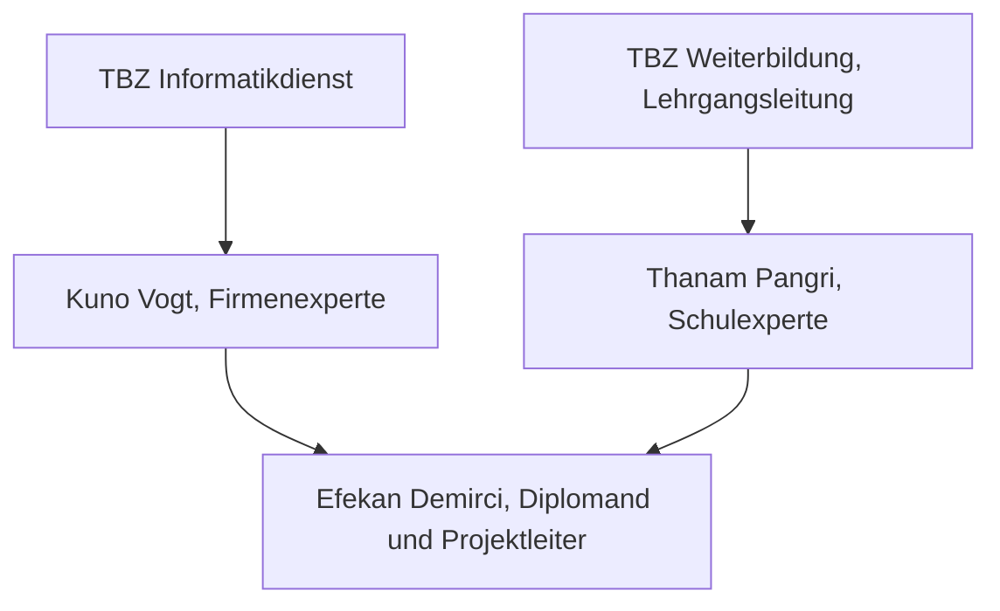

<small id="abb-01"><em>Abbildung 1: Projektorganisation und Berichtswege</em></small>

Die Arbeit wird als Einzelprojekt durchgeführt. Die bewilligte Projektbeschreibung überträgt mir die technischen Entscheide und die Umsetzung. Die folgende Tabelle ordnet die Aufgaben und Entscheidungsbefugnisse zu.

| Person und Rolle | Aufgaben | Entscheidungsbefugnisse und Abstimmung |
| --- | --- | --- |
| Efekan Demirci, Diplomand und Projektleiter | Planung, Priorisierung des Backlogs, technische Auswahl, Umsetzung, Tests und Dokumentation | Technische Entscheide innerhalb des bewilligten Umfangs selbst treffen und begründen. Ergebnisse anhand der Akzeptanzkriterien prüfen und zur Beurteilung im Review vorlegen. |
| Kuno Vogt, Firmenexperte und Leiter Informatikdienst | Auftraggeberinteressen vertreten, fachliche und betriebliche Anforderungen einbringen, Ergebnisse beurteilen | Betriebliche Rahmenbedingungen und Prioritäten aus Sicht des Auftraggebers klären. Auswirkungen auf den Auftrag und offene Fragen gemeinsam mit dem Diplomanden und dem Schulexperten abstimmen. |
| Thanam Pangri, Schulexperte | Einhaltung der schulischen Vorgaben begleiten, Projektfortschritt und Ergebnisse beurteilen | Schulische Anforderungen und Vorgaben zur Prüfungsleistung klären. Änderungen am bewilligten Kernumfang gemeinsam mit dem Firmenexperten und dem Diplomanden abstimmen. |

Planung, Priorisierung und Ablaufsteuerung liegen im Einzelprojekt bei mir. Eine getrennte Besetzung der Rollen Product Owner und Scrum Master besteht nicht. Änderungen an Zielen oder zugesagten Ergebnissen werden mit beiden Experten abgestimmt.

#### Ergebnisprüfung und Abnahme

Ich prüfe die Akzeptanzkriterien und dokumentiere den fachlichen Abschluss einer Story mit den zugehörigen Nachweisen. Der Status Done bezeichnet diesen Bearbeitungsstand. Die Beurteilung durch die Experten wird beim Review separat festgehalten.

Für das erste Review ist vorgeschlagen, die erarbeiteten Ergebnisse und ihre Nachweise gemeinsam zu beurteilen. Wer die fachliche Abnahme verbindlich bestätigt und wie sie dokumentiert wird, ist mit Kuno Vogt und Thanam Pangri noch zu klären. Die technischen Entscheidungsbefugnisse gemäss bewilligter Projektbeschreibung bleiben dabei die Grundlage.

Dozierende sind die späteren Nutzenden der Lernumgebungen, Lernende deren indirekte Nutzende. Ihr Interesse betrifft vor allem einen verständlichen Ablauf und eine zuverlässig nutzbare Umgebung. Der PoC liefert noch keine produktive Einführung.

Für die Abstimmung mit den Experten steht der vereinbarte Teams-Kanal zur Verfügung. In Sprint 1 habe ich diesen Austausch nach der ersten Nachricht zu wenig genutzt. Die daraus abgeleiteten Verbesserungen stehen in der Retrospektive in Kapitel 2.10. Rückmeldungen und Beschlüsse werden beim betroffenen Issue und in der Dokumentation festgehalten. Die Termine der Zwischenpräsentationen sind mit beiden Experten vereinbart.

### 2.3 Termine und Meilensteine

Der bewilligte Projektzeitraum beginnt am 11.09.2026. Die operative Wochenplanung beginnt am Montag, 14.09.2026, und umfasst 14 Wochen bis zur Abgabe am 18.12.2026. Für die drei Reviews liegen konkrete Termine vor. Der Kolloquiumstermin ist noch mit der Schule zu bestätigen.

Die GitHub-Milestones bündeln die User Stories nach Sprint. Die folgende Übersicht zeigt diese Gliederung. Die Bearbeitungsstände werden in den jeweiligen Sprintkapiteln erläutert.

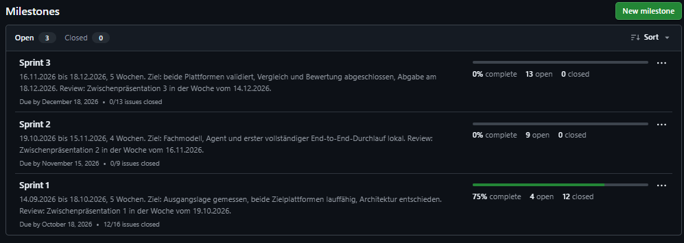

<small id="abb-02"><em>Abbildung 2: Milestone-Übersicht der drei Sprints</em></small>

| Abschnitt | Zeitraum | Ergebnis am Ende |
| --- | --- | --- |
| Sprint 1 | 14.09. bis 18.10.2026 | Ausgangsmessungen, lokaler Referenzlauf, AWS-Smoke-Test und Architekturentwurf |
| Sprint 2 | 19.10. bis 15.11.2026 | Modell und Agent, vollständiger lokaler Lebenszyklus sowie automatisiertes create, status und delete auf AWS |
| Sprint 3 | 16.11. bis 18.12.2026 | AWS-Reset und Wiederaufnahme, sechs formale PoC-Läufe, Bewertung und Abgabe |

| ID | Meilenstein | Plantermin | Erforderlicher Stand |
| --- | --- | --- | --- |
| M0 | Arbeitsbeginn | 14.09.2026 | Die Experten haben den Antrag geprüft; Projektstart ohne separates Kickoff-Meeting |
| M1 | Erstes Review | 23.10.2026 | Vergleichsbasis, lokale Machbarkeit, AWS-Smoke-Test und Architektur liegen vor |
| M2 | Zweites Review | 18.11.2026 | Vollständiger lokaler Durchlauf und automatisierter AWS-Durchstich demonstrierbar |
| M3 | Scope-Freeze | 04.12.2026 | Kernfunktionen stehen; danach Fehlerkorrekturen, Messungen und Abschluss |
| M4 | Drittes Review | 16.12.2026 | Sechs erfolgreiche PoC-Läufe und Bewertung dokumentiert |
| M5 | Abgabe | 18.12.2026 | Dokumentation, Management Summary, Ehrenwort und vereinbarte Abgabeunterlagen fertig |
| M6 | Kolloquium | Mit Schule bestätigen | Präsentation, kurze Demo und vorbereitete Ersatznachweise verfügbar |

Die Reviewtermine sind fest vereinbart. Alle Uhrzeiten gelten für Zürich. Die Aufgaben mit ihren Start- und Enddaten stehen im [GitHub-Zeitplan](https://github.com/users/Cancani/projects/7/views/2). Die Sprintplanung in Kapitel 2.10 und 2.11 zeigt die zugehörigen Ausschnitte.

| Review | Termin | Durchführung |
| --- | --- | --- |
| 1 | Freitag, 23.10.2026, 11:30 bis 12:00 Uhr | Vor Ort |
| 2 | Mittwoch, 18.11.2026, 15:00 Uhr | Online |
| 3 | Mittwoch, 16.12.2026, 15:00 Uhr | Online |

Die Sprintzeiträume bleiben die ursprünglichen Planungsabschnitte. Das erste Review findet nach dem geplanten Ende von Sprint 1 statt; US16 bleibt bis zur Durchführung und Dokumentation der Rückmeldungen offen. Der geplante Beginn von Sprint 2 liegt damit vor dem ersten Review. Welche Auswirkungen dieser spätere Reviewabschluss auf den Umsetzungsstart und die Abhängigkeiten hat, wird im ersten Review besprochen. Durchgeführte Reviews werden in Kapitel 2.10 dokumentiert. Ab dem Scope-Freeze am 04.12.2026 ist die verbleibende Zeit für Fehlerkorrekturen, Messungen und Abschluss vorgesehen.

### 2.4 Backlog und Prioritäten

Das öffentliche [Project Board](https://github.com/users/Cancani/projects/7) dient der laufenden Aufgabensteuerung. Die [Milestones](https://github.com/Cancani/diplomarbeit/milestones) bündeln die Issues nach Sprint und führen die jeweiligen Endtermine. Die Karten enthalten Sprint, Story Points, Priorität, Epic sowie Start- und Enddatum. Die Statusspalten werden wie folgt verwendet:

| Status | Bedeutung und Übergang |
| --- | --- |
| Backlog | Geplante Aufgabe, deren Bearbeitung noch nicht begonnen hat. |
| Ready | Aufgabe ist für die Bearbeitung vorbereitet: Ziel, prüfbare Kriterien, Zuordnung und notwendige Voraussetzungen sind geklärt. |
| In Progress | Aufgabe wird aktiv bearbeitet. Offene Fragen und Hindernisse werden im Issue sichtbar gehalten. |
| Done | Akzeptanzkriterien und Abschlussnachweise sind erfüllt, Änderungen geprüft und Dokumentation nachgeführt. Issue-Abschluss und Boardstatus müssen zusammenpassen. |

Die Backlog-Ansicht zeigt die Aufgaben vor ihrer Einordnung in die Bearbeitung. Sprint, Story Points und weitere Merkmale sind auf den Karten sichtbar.

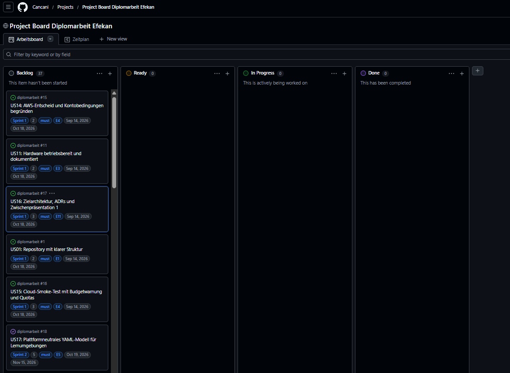

<small id="abb-03"><em>Abbildung 3: Project Board mit Aufgaben im Backlog</em></small>

Die [User-Story-Vorlage](https://github.com/Cancani/diplomarbeit/blob/main/.github/ISSUE_TEMPLATE/01_user_story.yml) enthält die Definition of Ready und die Definition of Done. Eine entfallene Aufgabe wird mit Begründung geschlossen und in der Sprintbilanz separat ausgewiesen. Ein geschlossener Issue zählt dadurch nicht automatisch als fachlich erbrachtes Ergebnis.

Der Backlog enthält 38 Stories mit 111 Story Points. Der AWS-Durchstich US39 umfasst drei Punkte in Sprint 2, die Vervollständigung US25 fünf Punkte in Sprint 3. Readiness und Abbauprüfung entstehen bereits mit dem ersten lokalen Durchlauf; US26 und US29 prüfen sie später auf beiden Plattformen formal.

Die folgenden Tabellen halten die ursprüngliche Planung mit 38 Stories und 111 Punkten fest. Verbindlich für den aktuellen Bearbeitungsstand sind die GitHub-Issues und die Übersicht in Kapitel 2.10. US05 ist gemäss [Entscheid im Issue](https://github.com/Cancani/diplomarbeit/issues/5) entfallen; zusätzliche Wochenberichte werden nur bei ausdrücklichem Bedarf erstellt. Der Eintrag bleibt hier zur Nachvollziehbarkeit der ursprünglichen Planung erhalten.

Die Epics bündeln Initialisierung (E1), IST-Aufnahme (E2), lokale Plattform (E3), AWS-Vorbereitung (E4), Fachmodell (E5), Agent (E6), Adapter (E7), Validierung (E8), Bewertung (E9), Betrieb und Schulung (E10) sowie Architektur und Abschluss (E11).

#### Sprint 1

16 Stories, 38 Story Points.

| ID | Aufgabe | Epic | SP | Priorität |
| --- | --- | --- | --- | --- |
| US01 | Repository mit klarer Struktur | E1 | 2 | Must |
| US02 | Öffentlich einsehbares Project Board | E1 | 2 | Must |
| US03 | Vorlagen, Labels, Milestones und Regeln | E1 | 1 | Must |
| US04 | Dokumentation über GitHub Pages | E1 | 2 | Must |
| US05 | Wöchentlicher Statusbericht am Wochenende | E1 | 1 | Must |
| US07 | IST-Analyse der heutigen Bereitstellung | E2 | 2 | Must |
| US08 | Test-Lernumgebung aus m239, m254 und m426 ableiten | E2 | 3 | Must |
| US09 | Messkonzept mit identischen Start- und Endkriterien | E2 | 3 | Must |
| US10 | Ausgangsmessung am heutigen Vorgehen | E2 | 5 | Must |
| US11 | Hardware betriebsbereit und dokumentiert | E3 | 2 | Must |
| US12 | Kubernetes-Cluster verifizieren und dokumentieren | E3 | 2 | Must |
| US13 | KubeVirt verifizieren und Storage klären | E3 | 2 | Must |
| US38 | Referenz-VM manuell erstellen und wieder abbauen | E3 | 3 | Must |
| US14 | AWS-Entscheid und Kontobedingungen begründen | E4 | 2 | Must |
| US15 | Cloud-Smoke-Test mit Budgetwarnung und Quotas | E4 | 3 | Must |
| US16 | Zielarchitektur, ADRs und Zwischenpräsentation 1 | E11 | 3 | Must |

#### Sprint 2

9 Stories, 35 Story Points.

| ID | Aufgabe | Epic | SP | Priorität |
| --- | --- | --- | --- | --- |
| US17 | Plattformneutrales YAML-Modell für Lernumgebungen | E5 | 5 | Must |
| US18 | JSON-Schema mit positiver und negativer Validierung | E5 | 3 | Must |
| US19 | Agent-Grundgerüst mit Kommandozeilenschnittstelle | E6 | 3 | Must |
| US20 | Persistenter Zustandsspeicher mit Zustandsübergängen | E6 | 5 | Must |
| US21 | create und status | E6 | 5 | Must |
| US22 | reset und delete | E6 | 3 | Must |
| US23 | Einheitliches Funktionsset über MCP | E7 | 3 | Must |
| US24 | MCP-Adapter für KubeVirt, erster End-to-End-Durchlauf | E7 | 5 | Must |
| US39 | Automatisierter AWS-Durchstich create, status und delete | E7 | 3 | Must |

#### Sprint 3

13 Stories, 38 Story Points.

| ID | Aufgabe | Epic | SP | Priorität |
| --- | --- | --- | --- | --- |
| US25 | AWS-Adapter um Reset und Wiederaufnahme vervollständigen | E7 | 5 | Must |
| US26 | Readiness auf beiden Plattformen validieren | E8 | 2 | Must |
| US27 | Drei vollständige Durchläufe auf der lokalen Plattform | E8 | 2 | Must |
| US28 | Drei vollständige Durchläufe in der Public Cloud | E8 | 3 | Must |
| US29 | Nachweis des vollständigen Abbaus | E8 | 3 | Must |
| US30 | Vorher-Nachher-Vergleich | E9 | 3 | Must |
| US31 | Bewertung der MCP-Architektur gegen eine direkte API-Anbindung | E9 | 3 | Must |
| US32 | Wirtschaftlichkeitsbetrachtung | E9 | 3 | Must |
| US33 | Beurteilung der Übertragbarkeit in den Produktivbetrieb | E9 | 3 | Must |
| US34 | Runbook für Aufbau, Bedienung, Fehleranalyse und Abbau | E10 | 2 | Must |
| US35 | Schulungsunterlage und Einführung | E10 | 3 | Should |
| US36 | Dokumentation finalisieren, Management Summary, Ehrenwort | E11 | 3 | Must |
| US37 | Kolloquiumspräsentation und Demo-Skript | E11 | 3 | Must |


Must bezeichnet die verbindlichen Ergebnisse und ihre notwendigen Arbeitsschritte. US35 ist als ergänzende Einführung ein Should. Das Runbook bleibt auch bei Zeitdruck vollständig und enthält Aufbau, Bedienung, Fehleranalyse und Abbau. Eine knappe Beurteilung der Produktivübertragbarkeit bleibt ebenfalls bestehen. Zusätzliche Workshops, doppelte Grafiken und ausführliche Wiederholungen werden zuerst gekürzt. Änderungen an verbindlichen Ergebnissen werden mit den Experten abgestimmt.

### 2.5 Aufwand und Kapazität

Die Planung nimmt etwa 14 Stunden pro Woche an. Über 14 Wochen ergeben sich rund 196 Stunden. Das ist eine Kapazitätsannahme, kein gemessener Aufwand. Die Arbeit erfolgt gemäss bewilligter Projektbeschreibung ausserhalb der bezahlten TBZ-Arbeitszeit sowie im vorgesehenen Rahmen an Schultagen. Eine Auswertung der tatsächlich geleisteten Projektstunden ist nicht vorgesehen. Story Points beschreiben relativ Aufwand und Unsicherheit; sie werden nicht fest in Stunden umgerechnet.

Als erste Orientierung dienen acht Story Points pro Woche. Sprint 2 umfasst den lokalen Lebenszyklus und den AWS-Durchstich und liegt mit 35 Story Points über dem Richtwert von 32.

| Sprint | Wochen | Orientierungsbudget | Backlog | Differenz |
| --- | --- | --- | --- | --- |
| 1 | 5 | 40 SP | 38 SP | -2 SP |
| 2 | 4 | 32 SP | 35 SP | +3 SP |
| 3 | 5 | 40 SP | 38 SP | -2 SP |
| Gesamt | 14 | 112 SP | 111 SP | -1 SP |

Die ursprünglichen 35 Punkte in Sprint 2 lagen über dem Richtwert. US17 und US18 mit zusammen acht Punkten sind inzwischen vorgezogen und abgeschlossen. Es verbleiben 27 Punkte für Agent, Zustandsführung und Adapter. Die Sprintzuordnung bleibt für den Vergleich mit der ursprünglichen Planung bestehen. Der Umgang mit dem noch offenen Reviewabschluss und dem Beginn der weiteren Umsetzung wird im ersten Review abgestimmt.

Für die Schätzung verwende ich 1, 2, 3, 5 und 8 Punkte. US01 dient mit zwei Punkten als Bezug. Grössere Stories werden in überprüfbare Ergebnisse zerlegt. Beim Sprintabschluss werden geplante und fachlich abgeschlossene Story Points, entfallene Aufgaben und vorgezogene Arbeiten gegenübergestellt. Offene Stories zählen nicht anteilig als fertig. Die ursprüngliche Sprintzuordnung bleibt dabei sichtbar. Aus den Punkten wird keine tatsächliche Arbeitszeit abgeleitet. Bisher liegt noch keine abschliessende Sprintbilanz vor.

### 2.6 Arbeitsweise und Qualität

#### Ablagestruktur

Die fachliche Dokumentation steht in dieser Datei. Code, Testdaten und Originalprotokolle liegen separat im Repository:

| Ablage | Inhalt |
| --- | --- |
| `docs/dokumentation.md` | Planung, Entscheidungen, Umsetzung, Messungen und später das Runbook |
| `docs/nachweise/`, `docs/messungen/` | Systemausgaben, Laufprotokolle und verwendete Manifeste |
| `modell/` | JSON-Schema, YAML-Beispiele und Validierung |
| `scripts/` | Hilfswerkzeuge für Messungen, Issues und Repository-Prüfungen |
| `tests/` | Automatisierte Tests des vorhandenen Codes |
| `.github/`, `mkdocs.yml`, `requirements-docs.txt` | Vorlagen und Veröffentlichung der Dokumentation |
| `requirements.txt` | Direkte Abhängigkeiten der Modellvalidierung |

README und Einstiegsseite verweisen auf diese Dokumentation.

#### Vorgehen und Prüfungen

Ich arbeite direkt auf `main` und fasse zusammengehörige Änderungen in kleinen Commits zusammen. Die Commitnachricht benennt Art und Inhalt der Änderung. Verwendet wird das Schema `typ(zusatz): Beschreibung`; der Zusatz kennzeichnet die Aktion oder den betroffenen Bereich. Beispiele sind `docs(add): Systemkontext ergänzen`, `docs(update): Reviewtermine nachführen`, `feat(agent): Statusabfrage ergänzen` und `chore(checks): Repository-Prüfung anpassen`. Die Nachricht beschreibt die tatsächlich enthaltene Änderung.

Der Arbeitsablauf zu einer Story besteht aus folgenden Schritten:

1. Ziel, Akzeptanzkriterien und Voraussetzungen im Issue prüfen und den Bearbeitungsstand im Board nachführen.
2. Die fachliche Änderung umsetzen und die zugehörige Dokumentation sowie Nachweise ergänzen.
3. Den Diff und die zur Änderung passenden lokalen Prüfungen kontrollieren.
4. Zusammengehörige Änderungen committen und auf `main` pushen.
5. Den zugehörigen GitHub-Actions-Lauf prüfen. Bei einem Fehler Ursache und Änderung korrigieren und erneut prüfen. Die Veröffentlichung der Dokumentation setzt einen erfolgreichen Build voraus.
6. Nach Erfüllung der Abschlusskriterien das Issue schliessen und den Boardstatus abgleichen.

Der [Dokumentationsworkflow](https://github.com/Cancani/diplomarbeit/blob/main/.github/workflows/docs.yaml) prüft Repository-Konsistenz, automatisierte Tests, Shell-Syntax und den strikten MkDocs-Build. Die Veröffentlichung über GitHub Pages folgt erst nach erfolgreicher Prüfung. Ein Commit auf `main` allein bestätigt deshalb noch keinen erfolgreichen Prüfstand.

Den fachlichen Abschluss einer Story halte ich fest, wenn ihre Akzeptanzkriterien erfüllt und die Ergebnisse dokumentiert sind. Für Infrastrukturarbeiten gehören dazu Protokolle vom Zielsystem. Die lokalen Tests prüfen den Code ohne Bereitstellung einer VM. Die Expertenbeurteilung und die noch abzustimmende Form der Abnahme stehen in Kapitel 2.2.

Die späteren Agententests sollen auch Timeouts, unterbrochene Operationen und verbleibende Ressourcen abdecken. Die sechs vollständigen PoC-Läufe werden anschliessend auf den Zielplattformen protokolliert. Für ein Review bereite ich die Präsentation der Ergebnisse und die passenden Nachweise vor. Rückmeldungen sowie daraus folgende Aufgaben werden nach dem Meeting festgehalten.

### 2.7 Projektstand und Berichte

Gemäss Rückmeldung von Thanam Pangri ist ein regelmässiges Wochenjournal nicht erforderlich. Zusätzliche Berichte können verlangt werden, wenn der Fortschritt zu gering oder nicht ausreichend nachvollziehbar ist. US05 wurde entsprechend [gestrichen](https://github.com/Cancani/diplomarbeit/issues/5). Der Projektverlauf bleibt über die folgenden Ablagen nachvollziehbar:

| Ablage | Beitrag zum Projektverlauf |
| --- | --- |
| Issues und Board | Aufgaben, Bearbeitungsstand, Hindernisse, Akzeptanzkriterien und Abschlussnachweise |
| Git-Commits und CI | Inhalt und Zeitpunkt der Änderungen sowie zugehöriger automatisierter Prüfstand |
| Fachkapitel und Laufprotokolle | Technische Entscheidungen, Ergebnisse, Abweichungen und deren Nachweise |
| Kapitel 2.10 | Planung, Bearbeitungsstand und eigene Retrospektive zu Sprint 1 sowie anschliessend die Rückmeldungen aus dem gemeinsamen Review |
| Kapitel 2.11 | Planungsvorschlag für Sprint 2 und nach dem Review die gemeinsam festgelegten Prioritäten |

Bei relevanten Änderungen werden Anlass, Auswirkung und die daraus folgende Aufgabe im betroffenen Issue oder Fachkapitel festgehalten.

### 2.8 Änderungen und Risiken

Technische Entscheide werden im betroffenen Kapitel festgehalten. Änderungen an Zielen oder zugesagten Ergebnissen werden den Experten mit ihren Auswirkungen vorgelegt. Die Risikobewertung unterstützt diese Steuerung: Eintrittswahrscheinlichkeit (EW) und Auswirkung (AW) werden jeweils von 1 bis 5 eingeschätzt. Das Produkt bestimmt die Priorität; Werte ab 12 erhalten besondere Aufmerksamkeit.

| ID | Risiko | EW | AW | Wert | Behandlung und Auslöser |
| --- | --- | ---: | ---: | ---: | --- |
| R01 | Technische Komplexität von Agent, MCP und zwei Plattformen | 4 | 4 | 16 | Frühe Durchstiche und kleine Umsetzungsschritte. Nach zwei blockierten Arbeitseinheiten Alternativweg prüfen; überzogene Schätzungen machen die Blockade sichtbar. |
| R02 | Cloud-Berechtigungen, Quotas und Kosten | 3 | 3 | 9 | Einzel-VM-Smoke-Test bestanden, Budgetwarnungen bei USD 25 und USD 40 eingerichtet. Ressourcen nach jedem Test abbauen; Quota-Fehler und Kostenstand beobachten. |
| R03 | Umfang überschreitet die verfügbare Zeit | 4 | 5 | 20 | Kernumfang priorisieren, optionale Einführung zuerst kürzen. Scope-Freeze am 04.12.2026; verschobene Zwischenziele früh mit den Experten besprechen. |
| R05 | Restressourcen oder Abweichung zwischen gespeichertem und tatsächlichem Zustand | 3 | 3 | 9 | Ressourcen-IDs nach jedem Erstellungsschritt speichern und Endzustände abfragen. Ein verbliebener Datenträger oder ein unvollständiger Abbau führt zum Fehler. |
| R06 | Ausfall des lokalen Hosts | 2 | 3 | 6 | Konfiguration sichern. `kvcontrol` ist als Ersatz vorgesehen und wird vor einem tatsächlichen Einsatz mit einem eigenen Referenzlauf geprüft. |
| R07 | Reviewtermine kommen nicht rechtzeitig zustande oder fallen aus | 2 | 3 | 6 | Die drei Termine liegen vor. Bei einem Ausfall zeitnah einen Ersatz abstimmen und Auswirkungen auf Rückmeldungen und nächste Schritte prüfen. |
| R08 | Dokumentation läuft der Umsetzung hinterher | 3 | 4 | 12 | Änderungen zusammen mit der betroffenen Story dokumentieren. Vor jedem Review aktuellen Stand, alte Aussagen und Nachweislinks abgleichen. |
| R09 | Änderungen im MCP-Umfeld | 3 | 3 | 9 | Verwendete Versionen festschreiben und Adaptervertrag klein halten. Inkompatible Änderungen zuerst im isolierten Test prüfen. |
| R10 | Weniger Zeit durch Krankheit oder berufliche Engpässe | 3 | 4 | 12 | Wochenkapazität prüfen. Wenn zwei Wochen lang wesentliche Sprintaufgaben nicht vorankommen, Planung und optionale Ausarbeitung prüfen und den Firmenexperten informieren. |
| R11 | Remote-Zugang fällt nach Neustart oder Netzwerkänderung aus | 3 | 4 | 12 | Adressierung und DHCP-Zuordnung abstimmen. Vor Änderungen Konfiguration sichern; anschliessend WireGuard, SSH und Clusterzugang prüfen. |

Die Werte sind Planungseinschätzungen. Der Ersatzhost reduziert das Ausfallrisiko erst nach einem erfolgreichen eigenen Test. Neue Erkenntnisse und ihre Auswirkungen werden nachgeführt. Für die weitere Planung sind folgende Entwicklungen relevant:

| Entwicklung | Auswirkung auf die Steuerung |
| --- | --- |
| AWS-Smoke-Test erfolgreich | Der praktische Zugriff für die Referenz-VM ist belegt. Quotas, Zugang und Kosten sind bei späteren Läufen weiterhin zu beachten; die Lab-Gültigkeit bleibt unbekannt. |
| Budget und Benachrichtigung eingerichtet | Kostenwarnungen sind vorbereitet. Sie ersetzen den vollständigen Abbau und die laufende Kostenkontrolle nicht. |
| Reviewtermine fest vereinbart | Für die Reviews bestehen konkrete Termine. Ein späterer Ausfall oder eine Verschiebung bleibt möglich. |
| US17 und US18 vorgezogen | Acht Punkte aus Sprint 2 sind bereits abgeschlossen. Der verbleibende Umfang und die ursprüngliche Zuordnung werden getrennt ausgewiesen. |
| US05 entfallen | Die ursprüngliche Planung bleibt sichtbar. Laufende Ergebnisse und Entscheidungen werden über die Ablagen aus Kapitel 2.7 nachgeführt. |

### 2.9 Wirtschaftliche Betrachtung

Die Wirtschaftlichkeitsbetrachtung verbindet den einmaligen Entwicklungsaufwand mit dem wiederkehrenden Bedienaufwand und dem Ressourcenverbrauch. Ein Ansatz für den Entwicklungsaufwand wird als begründete Schätzung ausgewiesen. Gemessene Bedienzeiten der Bereitstellung werden davon getrennt ausgewiesen. Eine Hochrechnung auf den Unterrichtsbetrieb benötigt zusätzlich eine begründete Zahl von Bereitstellungen; sie bleibt ein Szenario.

Die Preisabschätzung für die AWS-Referenz steht in Kapitel 3.6.4. Für die spätere Wirtschaftlichkeitsbetrachtung werden die PoC-Messwerte benötigt. Der Entwicklungsaufwand wird bei Bedarf als begründete Schätzung mit offengelegten Annahmen berücksichtigt; er wird nicht als tatsächlich erfasster Stundenaufwand dargestellt. Ein gemessener Amortisationszeitpunkt lässt sich daraus nicht ableiten. Eine Einsparung wird zum jetzigen Zeitpunkt nicht beziffert.

Die Bewertung aus US32 und US33 umfasst zusätzlich Ressourcen, Skalierbarkeit und Nachhaltigkeit:

| Aspekt | Vorgesehene Betrachtung |
| --- | --- |
| Ressourcen | Zugewiesene CPU, RAM und Datenträger sowie Nutzungsdauer und Restressourcen nach dem Abbau vergleichen. Unterschiede zwischen bestehender Laborhardware und Cloud-VM offenlegen. |
| Skalierbarkeit | Auswirkungen mehrerer gleichzeitiger Lernumgebungen auf Hostkapazität, Storage, Adressierung, Quotas und Bedienablauf qualitativ beurteilen. Der Einzel-VM-PoC ist kein Lasttest. |
| Nachhaltigkeit | Wiederverwendung vorhandener Hardware, bedarfsgerechte Bereitstellung und zeitnahen Abbau ungenutzter Umgebungen betrachten. Das Freigeben einer VM bedeutet bei weiterlaufendem Host keine nachgewiesene Stromersparnis. |

Stromverbrauch und CO2-Wirkung werden im PoC nicht gemessen. Ohne entsprechende Daten wird keine quantitative Umweltentlastung behauptet. Die Betrachtung beschreibt mögliche Wirkungen und verbleibende Unsicherheiten.

Für eine spätere produktive Nutzung wären insbesondere Zugriffsrechte, Netzwerk, Storage, Zuständigkeiten und Überwachung zu beurteilen. Die exklusive Laborhardware und die einzelne Referenz-VM erleichtern den Versuch, bilden aber noch keinen Unterrichtsbetrieb mit vielen gleichzeitig genutzten Umgebungen ab.

### 2.10 Sprint 1

#### Sprint 1 Planung

**Zeitraum:** 14.09. bis 18.10.2026. Das zugehörige Review findet in der anschliessenden Reviewwoche statt.

**Sprintziel:** Die Ausgangslage und den bisherigen Bereitstellungsablauf verstehen, eine belastbare Vergleichsgrundlage vorbereiten, die reduzierte Referenzumgebung auf beiden Zielplattformen praktisch prüfen und die Zielarchitektur festlegen.

Die Planungsansicht zeigt den ursprünglichen Umfang von Sprint 1 mit allen 16 User Stories als offen. Die später entfallene US05 ist darin noch enthalten.

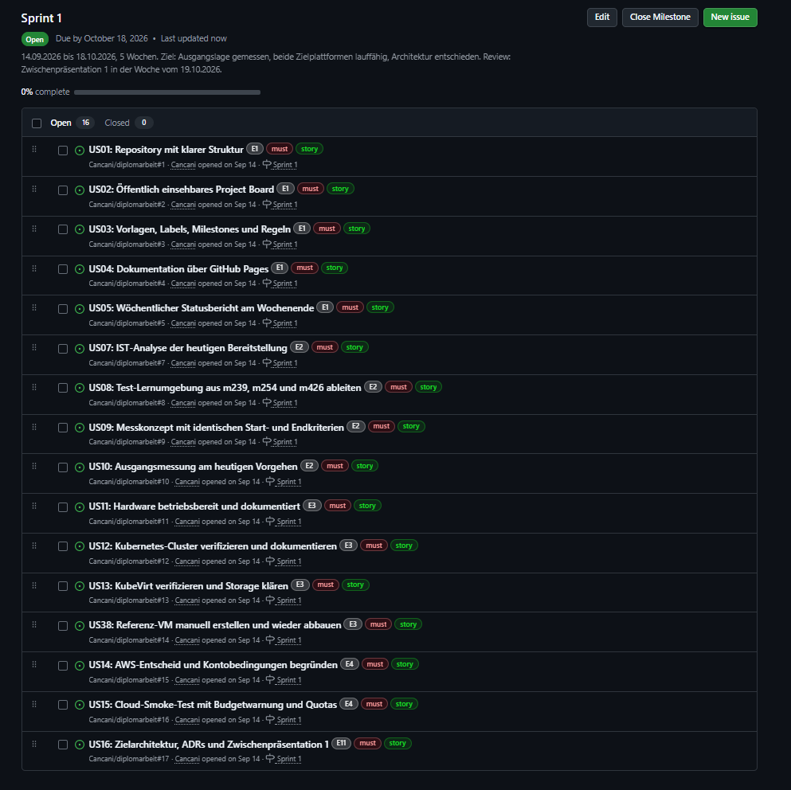

<small id="abb-04"><em>Abbildung 4: Sprint 1 mit allen User Stories offen</em></small>

Die ursprüngliche Planung umfasst 16 Stories mit 38 Story Points. Die vollständige Aufgabenliste steht in Kapitel 2.4. Der Sprint enthält folgende Arbeitspakete:

| Arbeitspaket | Stories | Erwartetes Ergebnis |
| --- | --- | --- |
| Projektgrundlagen | US01 bis US05 | Repository, Board, Vorlagen, Dokumentationsveröffentlichung und ursprünglich vorgesehene Statusberichte |
| IST-Analyse und Messgrundlage | US07 bis US10 | Bestehendes Verfahren, abgeleitete Referenzdefinition, Messkonzept und Ausgangsmessungen |
| Lokale Plattform | US11 bis US13 und US38 | Verifizierte Hardware und Plattform sowie erfolgreicher KubeVirt-Referenzlauf |
| Public Cloud | US14 und US15 | Begründete AWS-Auswahl, geprüfter Zugang, Kostenkontrolle und erfolgreicher Smoke-Test |
| Architektur und Zwischenpräsentation | US16 | Systemkontext, Komponentensicht, Architekturentscheide und erstes Review mit Rückmeldungen |

US06 ist als entfallenes Kickoff nicht Teil des aktiven Backlogs. US05 wurde im Verlauf gestrichen; eine feste wöchentliche Berichtspflicht wird nicht weitergeführt. Die ursprüngliche Planung bleibt für den Vergleich sichtbar. Die bereits umgesetzten Stories US17 und US18 gehören weiterhin zur ursprünglichen Sprint-2-Planung.

##### Zeitplan der User Stories

Die geplanten Zeiträume sind im [GitHub-Zeitplan](https://github.com/users/Cancani/projects/7/views/2) hinterlegt. Die folgende Darstellung zeigt die Aufgaben innerhalb des Sprints sowie die anschliessende Reviewvorbereitung und den Abschluss von US16. Die Balken zeigen Plantermine, keine tatsächlich geleisteten Arbeitszeiten.

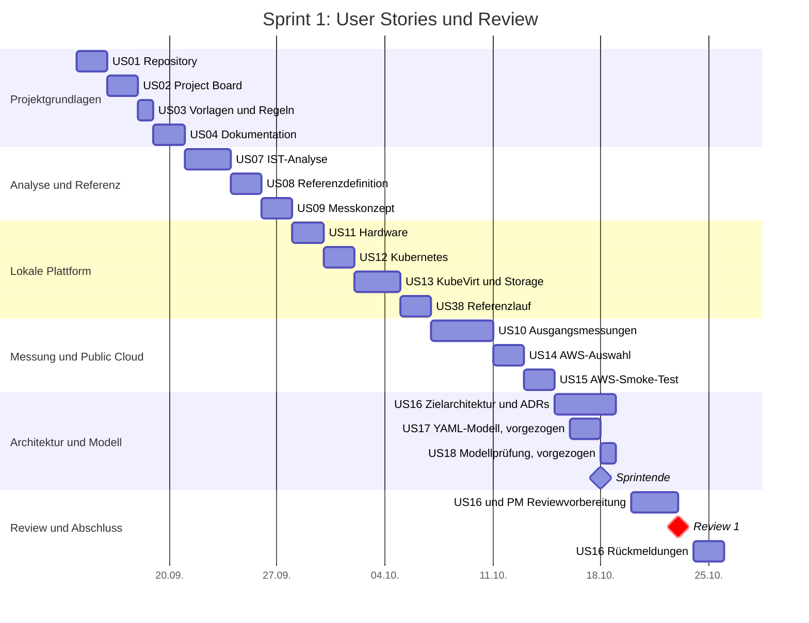

<small id="abb-05"><em>Abbildung 5: Zeitplan der User Stories für Sprint 1 mit anschliessendem Review</em></small>

US05 entfällt und erhält keinen Zeitbalken. US17 und US18 sind aus Sprint 2 vorgezogen. US16 ist in Architekturarbeit, Reviewvorbereitung und Nachbereitung aufgeteilt. Im GitHub-Zeitplan umfasst die Story deshalb den Zeitraum vom 15.10. bis 25.10.2026.

??? info "Plantermine der User Stories in Sprint 1"

    | User Story | Geplanter Beginn | Geplantes Ende |
    | --- | --- | --- |
    | [US01](https://github.com/Cancani/diplomarbeit/issues/1) | 14.09.2026 | 15.09.2026 |
    | [US02](https://github.com/Cancani/diplomarbeit/issues/2) | 16.09.2026 | 17.09.2026 |
    | [US03](https://github.com/Cancani/diplomarbeit/issues/3) | 18.09.2026 | 18.09.2026 |
    | [US04](https://github.com/Cancani/diplomarbeit/issues/4) | 19.09.2026 | 20.09.2026 |
    | [US05](https://github.com/Cancani/diplomarbeit/issues/5) | Entfallen | Entfallen |
    | [US07](https://github.com/Cancani/diplomarbeit/issues/7) | 21.09.2026 | 23.09.2026 |
    | [US08](https://github.com/Cancani/diplomarbeit/issues/8) | 24.09.2026 | 25.09.2026 |
    | [US09](https://github.com/Cancani/diplomarbeit/issues/9) | 26.09.2026 | 27.09.2026 |
    | [US11](https://github.com/Cancani/diplomarbeit/issues/11) | 28.09.2026 | 29.09.2026 |
    | [US12](https://github.com/Cancani/diplomarbeit/issues/12) | 30.09.2026 | 01.10.2026 |
    | [US13](https://github.com/Cancani/diplomarbeit/issues/13) | 02.10.2026 | 04.10.2026 |
    | [US38](https://github.com/Cancani/diplomarbeit/issues/14) | 05.10.2026 | 06.10.2026 |
    | [US10](https://github.com/Cancani/diplomarbeit/issues/10) | 07.10.2026 | 10.10.2026 |
    | [US14](https://github.com/Cancani/diplomarbeit/issues/15) | 11.10.2026 | 12.10.2026 |
    | [US15](https://github.com/Cancani/diplomarbeit/issues/16) | 13.10.2026 | 14.10.2026 |
    | [US16](https://github.com/Cancani/diplomarbeit/issues/17) | 15.10.2026 | 18.10.2026 |
    | [US17](https://github.com/Cancani/diplomarbeit/issues/18) (aus Sprint 2 vorgezogen) | 16.10.2026 | 17.10.2026 |
    | [US18](https://github.com/Cancani/diplomarbeit/issues/19) (aus Sprint 2 vorgezogen) | 18.10.2026 | 18.10.2026 |
    | [US16](https://github.com/Cancani/diplomarbeit/issues/17) / PM, Reviewvorbereitung | 20.10.2026 | 22.10.2026 |
    | Review 1 mit den Experten | 23.10.2026 | 23.10.2026 |
    | [US16](https://github.com/Cancani/diplomarbeit/issues/17), Rückmeldungen und Abschlussprüfung | 24.10.2026 | 25.10.2026 |

##### Bisheriger Bearbeitungsstand

| Bereich | Erreichtes Ergebnis |
| --- | --- |
| Projektorganisation | Repository, öffentliches Board, Vorlagen und Dokumentationsveröffentlichung eingerichtet |
| Infrastruktur | System- und Netzwerkaufnahme vorhanden; DL380 und Terra stehen exklusiv zur Verfügung |
| KubeVirt-Referenzlauf | VM erstellt, HTTP und SSH erfolgreich geprüft und Testressourcen entfernt; US38 abgeschlossen |
| Vergleichsbasis | Drei LernMAAS-Basisläufe technisch erfolgreich; Grenzen der Bedienzeiterfassung bei den Ergebnissen beschrieben |
| AWS | Smoke-Test erfolgreich; Budget, Preisabschätzung und Ressourcenabbau dokumentiert |
| Architektur | Systemkontext, Komponentensicht und vier ADRs vorhanden |
| Vorgezogene Arbeiten | Fachmodell und Modellprüfung mit JSON-Schema aus US17 und US18 umgesetzt |

Von den ursprünglichen Sprint-1-Stories sind 14 fachlich abgeschlossen, US05 ist entfallen und US16 bleibt in Bearbeitung. Die Milestone-Detailansicht zeigt entsprechend einen offenen und 15 geschlossene Issues. Das Board führt US16 auf In Progress. Die geschlossene US05 zählt nicht als fachlich erbrachte Leistung.

Das Project Board zeigt den Bearbeitungsstand über alle Sprints hinweg. Die 16 Karten in Done umfassen die 14 fachlich abgeschlossenen Stories aus Sprint 1 sowie US17 und US18, die aus Sprint 2 vorgezogen wurden.

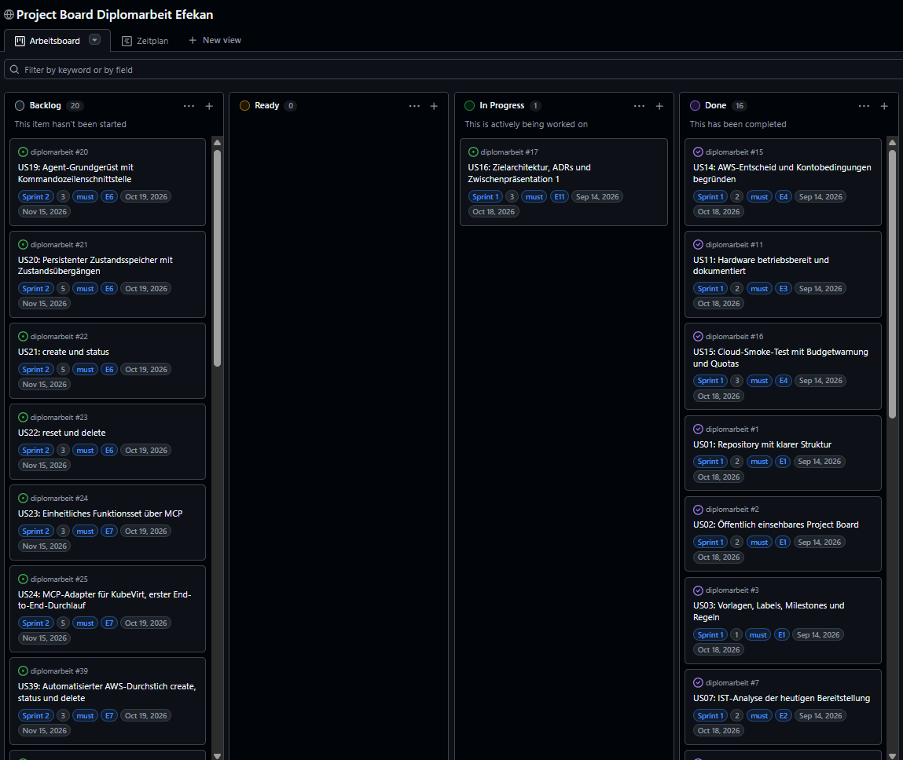

<small id="abb-06"><em>Abbildung 6: Project Board mit Bearbeitungsstand und US16 in Bearbeitung</em></small>

Die Detailansicht von Sprint 1 weist US16 als einziges offenes Issue aus. Der Abschluss hängt noch von der Durchführung des Reviews und der Dokumentation seiner Rückmeldungen ab.

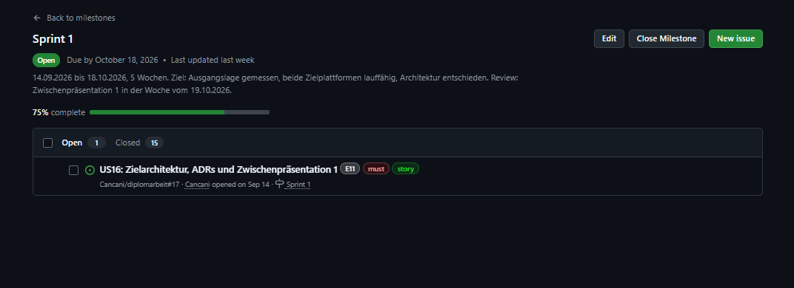

<small id="abb-07"><em>Abbildung 7: Milestone Sprint 1 mit offener US16</em></small>

| Zuordnung | Ursprünglich geplant | Fachlich abgeschlossen | Entfallen | Noch offen |
| --- | --- | --- | --- | --- |
| Sprint 1 | 16 Stories, 38 SP | 14 Stories, 34 SP | US05, 1 SP | US16, 3 SP |
| Sprint 2 | 9 Stories, 35 SP | US17 und US18, zusammen 8 SP, vorgezogen | Keine | 7 Stories, 27 SP |
| Sprint 3 | 13 Stories, 38 SP | Keine | Keine | 13 Stories, 38 SP |

Die Tabelle ist eine Zwischenbilanz. Die Architekturarbeit ist vorhanden; für US16 fehlen noch die durchgeführte Zwischenpräsentation und die dokumentierten Rückmeldungen. Der Übergang zur weiteren Sprint-2-Umsetzung wird im ersten Review besprochen.

#### Sprint 1 Retrospektive

##### Was gut funktioniert hat

Die Arbeit mit GitHub hat sich bewährt. User Stories und Project Board unterstützen mich dabei, die Aufgaben zu strukturieren und den Fortschritt zu verfolgen. Durch einzelne Commits bleiben Änderungen nachvollziehbar. Das erleichtert auch, frühere Entscheidungen und Bearbeitungsstände später wieder nachzuvollziehen.

Die selbstständige Bearbeitung hat ebenfalls gut funktioniert. Ich konnte die Planung und Dokumentation eigenständig aufbauen und die technischen Grundlagen für die weitere Umsetzung erarbeiten.

##### Was schwierig war

Nach der ersten Nachricht fand kein weiterer regelmässiger Austausch über den Projektstand mit Kuno und Thanam statt. Ich arbeitete selbstständig weiter, informierte die Experten jedoch zu wenig über Ergebnisse, Planung und offene Fragen. Dadurch war mein Fortschritt für sie nicht ausreichend sichtbar. Im Gespräch mit Kuno zeigte sich zudem, dass seine Erwartungen an die Planung und die Gestaltung des Reviews noch nicht genügend abgestimmt waren.

Eine technische Schwierigkeit waren die Netzwerkanpassungen im Labor. Diese erforderten zusätzliche Abklärungen, konnten aber gelöst werden.

##### Verbesserungen für Sprint 2

Für den nächsten Sprint möchte ich den Austausch mit den Experten gezielter vorbereiten. Vor den Reviews sollen sie den aktuellen Dokumentationsstand und die offenen Fragen erhalten, damit sie sich ein Bild vom Fortschritt machen können.

Die Aufgaben möchte ich in kleinere Arbeitsschritte mit konkreten Zeiträumen gliedern. Die Prioritäten für Sprint 2 bespreche ich im ersten Review gemeinsam mit den Experten. Anschliessend halte ich die Vereinbarungen in der Dokumentation und im Project Board fest.

Die Arbeit mit GitHub, User Stories und einzelnen Commits führe ich weiter.

#### Sprint 1 Review mit den Experten

**Vereinbarter Termin:** Freitag, 23.10.2026, 11:30 bis 12:00 Uhr, vor Ort.

**Vorgesehene Teilnehmende:** Efekan Demirci, Kuno Vogt als Firmenexperte und Thanam Pangri als Schulexperte.

Das Review ist noch nicht durchgeführt. Ich stelle den erreichten Stand vor und bespreche die Ergebnisse gemeinsam mit den Experten. Grundlage sind die Sprintziele, die Ergebnisse aus den User Stories und die zugehörigen Nachweise. Die eigene Retrospektive dient zusätzlich dazu, Verbesserungen für die weitere Zusammenarbeit und Planung zu besprechen.

##### Vorgesehene Inhalte

| Thema | Grundlage und Ziel der Besprechung |
| --- | --- |
| Sprintziel und Ergebnisse | Geplante Arbeitspakete mit dem Bearbeitungsstand vergleichen. Fachlich abgeschlossene, entfallene und offene Stories unterscheiden. |
| IST-Analyse und Machbarkeit | Ergebnisse aus LernMAAS, KubeVirt und AWS sowie ihre Aussagegrenzen erläutern. |
| Zielarchitektur und ADRs | Die Entscheide aus Kapitel 3.9 vorstellen und fachliche oder betriebliche Rückmeldungen aufnehmen. |
| Retrospektive und Zusammenarbeit | Erfahrungen aus Sprint 1 und die vorgesehenen Verbesserungen der Kommunikation und Planung besprechen. |
| Planung für Sprint 2 | Den Vorschlag aus Kapitel 2.11 prüfen und die Prioritäten gemeinsam festlegen. |

##### Offene Abstimmungen

| Thema | Im ersten Review zu klären |
| --- | --- |
| Ergebnisprüfung und Abnahme | Wer bestätigt die fachliche Abnahme, wie wird sie festgehalten und wie wird sie vom Bearbeitungsstatus der Stories unterschieden? |
| Vorgehensmodell und Planungsabschnitte | Wie werden die vier beziehungsweise fünf Wochen langen Iterationen und die fest vereinbarten Reviewtermine im Einzelprojekt gehandhabt? |
| Übergang zu Sprint 2 | Welche Auswirkungen hat das nachlaufende Review auf den Umsetzungsstart und auf Arbeiten, die von den Rückmeldungen abhängen? |
| Prioritäten und erreichbares Sprintziel | Welche Ergebnisse sollen bis Sprintende am 15.11.2026 fertig und beim zweiten Review am 18.11.2026 vorführbar sein? |

##### Rückmeldungen und Vereinbarungen

Die Rückmeldungen der Experten und die gemeinsam vereinbarten nächsten Schritte werden nach dem Termin ergänzt. Aufgaben erhalten einen Bezug zur betroffenen User Story. Änderungen an Architekturentscheiden werden zusätzlich bei der jeweiligen ADR festgehalten. US16 bleibt bis zur Durchführung des Reviews und Dokumentation der Rückmeldungen offen. Eine fachliche Abnahme ist damit noch nicht vorweggenommen.

### 2.11 Sprint 2 Planung

**Zeitraum:** 19.10. bis 15.11.2026. Das zweite Review findet am 18.11.2026 statt.

**Vorgeschlagenes Sprintziel:** Den Agenten mit Zustandsführung und MCP-Anbindung so weit umsetzen, dass die Referenzumgebung auf KubeVirt erstellt, geprüft, zurückgesetzt und vollständig gelöscht werden kann. Ergänzend ist ein erster automatisierter AWS-Durchstich für create, status und delete vorgesehen.

Die ursprüngliche Planung umfasst neun Stories mit 35 Story Points. Das YAML-Modell und die Modellprüfung aus US17 und US18 mit zusammen acht Punkten sind bereits umgesetzt. Es verbleiben sieben Stories mit 27 Punkten. Die folgenden Zeiträume bilden die aktuelle Planung ab. Umfang, Reihenfolge und Prioritäten werden im ersten Review gemeinsam mit den Experten besprochen.

Die Milestone-Ansicht zeigt die sieben offenen Issues und die beiden vorgezogenen, bereits abgeschlossenen Stories. Die offenen Aufgaben bilden die Grundlage für die gemeinsame Priorisierung.

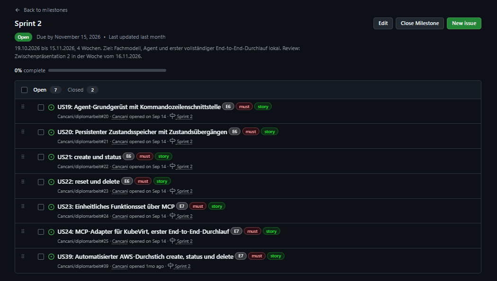

<small id="abb-08"><em>Abbildung 8: Milestone Sprint 2 mit offenen und vorgezogenen Stories</em></small>

#### Zeitplan der User Stories

Die geplanten Start- und Enddaten sind im [GitHub-Zeitplan](https://github.com/users/Cancani/projects/7/views/2) einsehbar. Der Zeitplan zeigt die noch offenen Arbeiten. US17 und US18 sind bereits vorgezogen; ihre geplanten Zeiträume stehen bei Sprint 1. Die Umsetzung ab dem 26.10. und ihre Prioritäten werden im ersten Review abgestimmt. Sprint 2 endet am 15.11.; die Vorbereitung und Durchführung des zweiten Reviews liegen anschliessend.

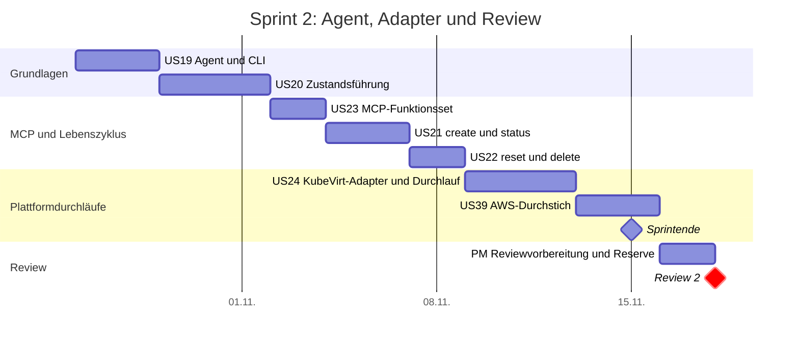

<small id="abb-09"><em>Abbildung 9: Zeitplan der offenen User Stories für Sprint 2 mit anschliessendem Review</em></small>

#### Arbeitspakete und Zeitplanung

| Geplanter Zeitraum | Story | Arbeitspaket | Erwartetes Ergebnis | SP |
| --- | --- | --- | --- | --- |
| 26.10. bis 28.10.2026 | US19 | Agent-Grundgerüst und CLI | Aufträge über die Kommandozeile entgegennehmen und den Ablauf starten. | 3 |
| 29.10. bis 01.11.2026 | US20 | Persistente Zustandsführung | Modelldefinition, Laufkennung, Phase und Ressourcen-IDs speichern und Zustandsübergänge verwalten. | 5 |
| 02.11. bis 03.11.2026 | US23 | Einheitliches Funktionsset über MCP | Werkzeugverträge für die Lebenszyklusfunktionen festlegen und die MCP-Anbindung umsetzen. | 3 |
| 04.11. bis 06.11.2026 | US21 | create und status | Erstellung steuern und Ressourcenstatus sowie Dienstbereitschaft unterscheiden. | 5 |
| 07.11. bis 08.11.2026 | US22 | reset und delete | Ressourcen anhand der gespeicherten IDs abbauen und für reset aus derselben Modelldefinition erneut erstellen. | 3 |
| 09.11. bis 12.11.2026 | US24 | KubeVirt-Adapter und erster vollständiger Durchlauf | Agent, Zustandsführung und Adapter auf der lokalen Plattform gemeinsam prüfen. | 5 |
| 13.11. bis 15.11.2026 | US39 | Automatisierter AWS-Durchstich | create, status und delete auf AWS ausführen und den Abbau nachkontrollieren. | 3 |

Der Beginn der weiteren Umsetzung am 26.10.2026 ist als Vorschlag nach dem ersten Review eingeplant. Die Sprintgrenzen bleiben bestehen. Die Auswirkungen des späteren Reviewabschlusses und die verfügbare Kapazität werden im Review besprochen. Die 27 offenen Story Points liegen über dem bisherigen Orientierungswert von acht Punkten pro Woche für die verbleibenden drei Umsetzungswochen. Die Planung muss deshalb gemeinsam auf ihre Umsetzbarkeit geprüft werden.

#### Abhängigkeiten und Ergebnisprüfung

Das bereits geprüfte Modell bildet die Eingabe für den Agenten. Das Grundgerüst und die Zustandsführung schaffen die Grundlage für die Lebenszyklusfunktionen. Die MCP-Anbindung legt fest, wie der Agent mit den Adaptern zusammenarbeitet. Die Funktionen werden schrittweise mit dem KubeVirt-Adapter verbunden und im ersten vollständigen lokalen Durchlauf gemeinsam geprüft.

Für den lokalen Durchlauf müssen create, status, reset und delete funktionieren. Eine laufende VM allein gilt noch nicht als bereite Lernumgebung. Zusätzlich wird die HTTP-Antwort des Testdienstes geprüft. Beim Löschen müssen die zugehörigen Testressourcen nach der Nachkontrolle entfernt sein. Reset umfasst den vollständigen Abbau und die erneute Erstellung aus der unveränderten Modelldefinition.

Der AWS-Durchstich prüft zunächst create, status und delete. Die Vervollständigung des AWS-Adapters um Reset und Wiederaufnahme gehört mit US25 weiterhin zur ursprünglichen Sprint-3-Planung. Die Serienmessungen mit je drei vollständigen Durchläufen pro Plattform folgen ebenfalls in Sprint 3.

#### Gemeinsame Priorisierung im ersten Review

Ich bringe die Arbeitspakete als Vorschlag in das Review ein. Gemeinsam mit den Experten kläre ich, welches Ergebnis bis Sprintende erreichbar ist, welche Arbeiten zuerst erfolgen und was bei knapper Zeit innerhalb des Projektplans später umgesetzt werden kann. Der vereinbarte Kernumfang bleibt dabei bestehen. Änderungen an verbindlichen Ergebnissen werden mit beiden Experten abgestimmt.

Nach dem Review ergänze ich die vereinbarten Prioritäten und passe die betroffenen Issues sowie das Project Board an. Die Verbesserungen aus der Retrospektive übernehme ich in die weitere Arbeitsweise: kleinere Arbeitsschritte, frühzeitige Bereitstellung der Dokumentation und gezielte Abstimmung offener Fragen.

## 3 Analyse und Konzept

### 3.1 Ausgangslage der Infrastruktur

Ich habe die beiden vorgesehenen KubeVirt-Systeme lesend untersucht. Entscheidend waren Virtualisierungsunterstützung, erreichbarer Cluster und verfügbarer Speicher. Die [Systemausgaben](#nachweise-und-aussagegrenzen) halten diesen Ausgangszustand fest. Die getrennte LernMAAS-Anlage bildet die Vergleichsbasis; für die dortigen Messläufe wurden Konfiguration und installiertes Erstellungsskript gesichert.

#### 3.1.1 Freigegebene Hardware

Der DL380 und alle Terra-Rechner stehen mir für die Diplomarbeit exklusiv und vollständig zur Verfügung. Es gibt keine parallele Nutzung dieser Geräte durch den Unterricht oder andere Projekte. Für die Versuche auf diesen Geräten ist keine zusätzliche Nutzungsfreigabe nötig. Die gemeinsam genutzte Netzinfrastruktur wird davon getrennt betrachtet.

Die Systemaufnahme ergab folgende Werte:

| System | Hostname | CPU | Arbeitsspeicher | Datenträger | Rolle im Projekt |
| --- | --- | --- | --- | --- | --- |
| HP DL380 | `dl380-01` | Intel Xeon E5-2620 v3, 24 logische Kerne | 125 GB, davon 121 GB frei | 1,7 TB, davon 1,6 TB frei | Zielplattform für die Umsetzung |
| Terra | `kvcontrol` | Intel Core i7-9700T, 8 Kerne | 15 GB, davon 12 GB frei | 238 GB NVMe, davon 184 GB frei | Zweitsystem und Ausweichumgebung |
| Terra, vier weitere | noch nicht in Betrieb genommen | | | | Reserve, im Proof of Concept nicht benötigt |

Beide Systeme liefen bei der Erhebung unter Ubuntu 24.04.4 LTS. Der praktische Einzel-VM-Nachweis erfolgte auf `dl380-01`. Die vier zusätzlichen Terra-Rechner bleiben Reserve; ihre spätere Adressierung ist in Kapitel 3.1.2 ergänzt.

#### 3.1.2 Zugang und Netzwerk

Die folgende Beschreibung verbindet System- und Netzwerkaufnahme. Die Geräte stehen im HF-Labor AU70-U069a und sind am Switch `nau-as-u70-01` im VLAN 21 angeschlossen. Das Netz lautet `10.0.21.0/24`, das Gateway `10.0.21.1`. Routing und DHCP liegen auf `nau-as-e014-01` im Serverraum; der Internetzugang führt über die dortige Firewall zum Init7-Anschluss.

| Gerät | LAN-Adresse | Adressvergabe | Verwendung im PoC |
| --- | --- | --- | --- |
| `dl380-01` | `10.0.21.197` | Statisch in Netplan, zusätzlich DHCP-reserviert | Lokale Zielplattform |
| `kvcontrol` | `10.0.21.219` | Statisch in Netplan, zusätzlich DHCP-reserviert | Eigenständiges Zweitsystem |
| `terra-01` | `10.0.21.224` | DHCP mit Reservation | Zusätzlicher Testrechner, Reserve |
| `terra-02` | `10.0.21.225` | DHCP mit Reservation | Zusätzlicher Testrechner, Reserve |
| `terra-03` | `10.0.21.228` | DHCP mit Reservation | Zusätzlicher Testrechner, Reserve |
| `terra-04` | `10.0.21.231` | DHCP mit Reservation | Zusätzlicher Testrechner, Reserve |

Die vier zusätzlichen Terra-Rechner sind im Netzwerkanhang als Worker bezeichnet. Für diese Arbeit ist bisher ihre Adressierung erfasst; eine Einbindung in den KubeVirt-Zielcluster wurde nicht verifiziert.

Die DHCP-Reservationen berücksichtigen die Client-ID der Geräte. Die beiden Steuerknoten verwenden zusätzlich statische Adressen, damit ihre lokale Konfiguration nicht von einer abweichenden DHCP-Zuordnung abhängt. DHCP kann ebenfalls stabile Adressen liefern, wenn Client-Kennung und Reservation übereinstimmen. Netplan unterscheidet beim networkd-Backend zwischen der MAC-Adresse und einer aus IAID und DUID gebildeten Kennung; siehe [Netplan-Referenz](https://netplan.readthedocs.io/en/stable/netplan-yaml/).

Der Fernzugriff erfolgt über WireGuard und danach SSH mit Schlüssel. `dl380-01` ist unter `10.1.24.5`, `kvcontrol` unter `10.1.24.8` erreichbar. Die Geräte bauen die Tunnel selbst auf. Dafür benötigen sie weiterhin eine funktionierende lokale Verbindung und Route zum WireGuard-Gateway. Eine Änderung der LAN-Adresse oder ein Neustart kann deshalb auch den Fernzugriff betreffen (R11).

Im VLAN 21 stehen ausserdem mobile HF-Labore mit MAAS beziehungsweise OpenShift. Bei aktiviertem Netzwerkboot besteht dadurch das Risiko einer unbeabsichtigten PXE-Installation. Als separates Netz ist VLAN 22 mit `10.0.22.0/24`, Gateway `10.0.22.1`, eigenem DHCP-Pool und den Switch-Ports 0/44 bis 0/48 vorgesehen. Es ist reserviert, wird aber noch nicht genutzt.

Die Versuche bleiben im bestehenden VLAN 21. Ein späterer Umzug nach VLAN 22 würde eine gesicherte Konfiguration, angepasste Adressen und eine erneute Prüfung von MicroK8s und Fernzugriff erfordern.

#### 3.1.3 Vorgefundener Zustand auf dl380-01

Auf dem Zielsystem lief bei Projektbeginn bereits eine vollständige Plattform.

| Komponente | Zustand |
| --- | --- |
| MicroK8s | v1.35.6, Einzelknoten, nicht hochverfügbar |
| Netzwerk im Cluster | Calico |
| Aktivierte Erweiterungen | dns, ha-cluster, helm, helm3, hostpath-storage, metrics-server, rbac, cert-manager |
| KubeVirt | v1.9.0, Zustand `Deployed`, inklusive Export-Proxy und Vorlagenverwaltung |
| CDI, Containerized Data Importer | vorhanden, vier Komponenten aktiv |
| Kommandozeilenwerkzeug | `virtctl` unter `/usr/local/bin/virtctl` |
| Virtualisierung auf dem Host | `vmx` vorhanden, Kernelmodul `kvm_intel` geladen, keine aktive Nutzung |
| Laufende virtuelle Maschinen | keine |
| Fachliche Arbeitslasten | keine Test-VMs; die bestehende PVC `default/data-claim` mit PV `rwm-volume` gehört zur Basis und wird nicht entfernt |

Nicht vorhanden sind ein Ingress-Controller und ein Load-Balancer. Die Erreichbarkeit von Diensten muss deshalb über andere Mechanismen gelöst werden, siehe ADR-002.

#### 3.1.4 Zweitsystem kvcontrol

Auf `kvcontrol` läuft ein eigenständiges MicroK8s derselben Version. KubeVirt und CDI sind vorhanden; cert-manager, Export-Proxy und Vorlagenverwaltung fehlen gegenüber `dl380-01`. Bei der Erhebung liefen dort keine Test-VMs.

`kvcontrol` dient als möglicher Ersatz. Vor seiner Nutzung ist ein eigener Referenzlauf einschliesslich Abbau erforderlich.

#### 3.1.5 Einordnung der übernommenen Vorarbeit

Der Kubernetes-Cluster und die KubeVirt-Installation auf beiden Systemen waren bei Projektbeginn bereits vorhanden und sind nicht Eigenleistung dieser Arbeit. Die Einrichtung erfolgte bereits vor dem bewilligten Projektbeginn und ist im Cluster nachvollziehbar.

Die Eigenleistung dieser Arbeit beginnt oberhalb dieser Plattform und umfasst:

- die Verifikation und Dokumentation des vorgefundenen Zustands
- das plattformneutrale Fachmodell und dessen Validierung
- den Agenten mit Zustandsführung
- die MCP-basierte Adapterschicht für beide Zielplattformen
- die Messung, den Vergleich und die Bewertung

Der Umstand, dass die Plattform bereitstand, verändert den Umfang der Arbeit gegenüber der bewilligten Projektbeschreibung nicht. Er verschiebt lediglich Aufwand von der Einrichtung zur Verifikation. US12 und US13 umfassen jeweils zwei Story Points für Verifikation und Dokumentation. US38 deckt den vollständigen Referenzlauf ab.

#### 3.1.6 Architekturentscheide aus der Erhebung

Aus dem vorgefundenen Zustand ergeben sich drei Entscheide, die vor der Umsetzung getroffen werden mussten.

**ADR-001: dl380-01 als Zielplattform**

| | |
| --- | --- |
| Status | Entschieden |
| Kontext | Auf dl380-01 und kvcontrol sind MicroK8s, KubeVirt und CDI vorhanden. Der vollständige Referenzlauf ist auf dl380-01 nachgewiesen; kvcontrol benötigt vor einem Einsatz einen eigenen Referenzlauf. |
| Entscheid | Die Umsetzung erfolgt auf `dl380-01`, `kvcontrol` dient als Ausweichumgebung |

Begründung: Auf dl380-01 steht die benötigte Plattform bereits bereit und der erste VM-Versuch wurde dort durchgeführt. Die vorhandenen Reserven sind ausreichend. Die sechs PoC-Läufe erfolgen nacheinander mit vollständigem Abbau; ihr Speicherbedarf summiert sich deshalb nicht über alle Läufe. Für die Auswahl ist kein Mehrmaschinenbetrieb erforderlich.

Verworfene Alternative: Zusammenschluss beider Systeme zu einem Cluster mit zwei Knoten. Ein Mehrknoten-Cluster ist in der bewilligten Projektbeschreibung ausdrücklich dem Ausblick zugeordnet und nicht Teil des Umfangs. Zudem würde der Zusammenschluss Eingriffe in die Netzwerkkonfiguration erfordern, die den Fernzugriff gefährden.

**ADR-002: NodePort für die Erreichbarkeit des Testdienstes**

| | |
| --- | --- |
| Status | Entschieden |
| Kontext | Der Readiness-Check muss den Testdienst in der virtuellen Maschine automatisiert erreichen. Auf dem Cluster sind weder ein Ingress-Controller noch ein Load-Balancer vorhanden |
| Entscheid | Der Testdienst wird über einen Service vom Typ NodePort erreichbar gemacht |

Geprüfte Alternativen:

| Weg | Bewertung |
| --- | --- |
| NodePort | Gewählt. Standardmittel von Kubernetes, keine Änderung an der Plattform nötig, aus dem Verwaltungsnetz direkt erreichbar, vom Adapter mit wenigen Zeilen erzeugbar |
| Weiterleitung über `virtctl port-forward` | Verworfen. Für manuelle Arbeit geeignet, für einen automatisierten Check jedoch umständlich, weil der Agent einen Prozess offen halten müsste |
| Multus mit Netzwerkbrücke, Maschine erhält eine Adresse im Labornetz | Verworfen für den Proof of Concept. Am nächsten an einer produktiven Lernumgebung, erfordert aber Eingriffe in die Netzwerkkonfiguration des Systems, das den Fernzugriff trägt. Wird im Ausblick als produktionsnaher Weg behandelt |

**ADR-003: microk8s-hostpath als Speicherklasse**

| | |
| --- | --- |
| Status | Entschieden |
| Kontext | Zwei Speicherklassen stehen zur Verfügung |
| Entscheid | Virtuelle Maschinen verwenden `microk8s-hostpath` |

Begründung: `local-storage` verwendet den Provisioner `kubernetes.io/no-provisioner` und legt keine Datenträger selbst an. Jede virtuelle Maschine würde damit ein von Hand erstelltes PersistentVolume benötigen. Solche manuellen Schritte sollen durch diese Arbeit entfallen. `microk8s-hostpath` ist die Standardklasse des Clusters und legt Datenträger bei Bedarf an. Die beobachtete Speicherklasse hat die Reclaim Policy Delete; ob der zugehörige PV tatsächlich entfernt wird, muss nach jedem Lauf geprüft werden.

Einschränkung, die bewusst in Kauf genommen wird: `microk8s-hostpath` bindet Daten an einen einzelnen Knoten. Auch im Einzelknotenbetrieb bleiben Hostausfall und lokaler Datenverlust relevant. In einem Mehrknotenbetrieb wäre lokaler Storage weiterhin möglich, würde aber Platzierung und Ausfallsicherheit begrenzen. Ein verteilter Speicher wäre eine mögliche spätere Lösung.

#### 3.1.7 Umgebung der Ausgangsmessung

LernMAAS läuft auf einer von `dl380-01` getrennten Anlage. Die Betriebsbeschreibung umfasst fünf Racks mit jeweils einem MAAS-Controller und sechs Virtualisierungshosts. Für die Versuche wurde Rack 5 mit Controller `cloud-au-30` und Netz `10.0.45.0/24` verwendet. Die drei Basisläufe liefen auf `cloud-au-32`, MAAS-Pod 7, in der Zone `10-1-45-0`.

Die vier VPN-Umgebungen eines Racks werden in MAAS als Availability Zones geführt. Sie sind keine eigenen MAAS-Subnetze; die VPN-Trennung erfolgt am Gateway. Für die Versuche waren deshalb neben dem freien Maschinenbestand auch die richtige Zone und der erreichbare Endpunkt zu prüfen.

Als Beispiel für die bestehende Hostgeneration wurde `cloud-au-31` aufgenommen: HP ProDesk 600 G1 SFF, Intel Core i7-4790 mit acht logischen Kernen, 32 GiB RAM und einem 1-TB-Datenträger unter Ubuntu 22.04 LTS. Das ist eine andere Hardwareklasse als der DL380. Die Stromsteuerung der physischen Maschinen ist in MAAS als `Manual` erfasst; die virtuellen Maschinen werden über Virsh gesteuert.

Bei der ersten Bestandsaufnahme wich die Reservationsliste vom erfassten Bestand in einer anderen Zone ab. Der vollständige rackübergreifende Auditexport liegt nicht im Nachweisarchiv. Dieser Befund wird deshalb nur als qualitative Beobachtung verwendet. Für die Basisläufe ist der konkrete Bestand vor und nach jedem Versuch dagegen durch gespeicherte MAAS-Abfragen belegt. Bereits vorhandene Maschinen blieben dabei unangetastet.

Private VPN-Konfigurationen können in Zonenbeschreibungen enthalten sein. Die veröffentlichten Inventarauszüge beschränken diese Felder auf ID und Namen. Damit bleiben Ressourcen zuordenbar, ohne private Schlüssel offenzulegen.

### 3.2 IST-Analyse der heutigen Bereitstellung

#### 3.2.1 Beteiligte Komponenten

| Komponente | Aufgabe |
| --- | --- |
| MAAS | Verwaltung der Maschinen, DHCP, PXE, Installation des Betriebssystems |
| `config.yaml` | Zentrale Beschreibung aller Modulprofile, Grösse und Dienste der virtuellen Maschinen |
| `createvms` | Legt Resource Pool und virtuelle Maschinen anhand eines Profils an |
| `updateaz` | Erzeugt WireGuard-Schlüssel und legt sie in der Availability Zone ab |
| cloud-init | Erstkonfiguration beim ersten Start, bindet Dienste und Modul-Repositories ein |
| Modul-Repositories | Je Modul ein eigenes Repository mit Installationsskripten und Anleitung |
| Reservationsliste | Tabelle, in der die Belegung der VPN-Umgebungen von Hand geführt wird |

#### 3.2.2 Die zentrale Konfigurationsdatei

Die gesicherte [Originalkonfiguration](messungen/laeufe/lernmaas-basis-20260930/config-original.yaml) enthält 28 Modulprofile. Sie beschreibt VM-Grössen, Anzahl, Dienste und Modul-Repositories. Die drei ausgewählten Profile enthalten folgende Werte:

| Feld | m239 | m254 | m426 |
| --- | --- | --- | --- |
| `vm.storage` | 8 | 12 | 8 |
| `vm.memory` | 2048 | 2048 | 3584 |
| `vm.cores` | 2 | 2 | 2 |
| `vm.count` | 24 | 20 | 6 |
| `services.nfs` | true | true | true |
| `services.docker` | false | false | true |
| `services.k8s` | leer | k3s | minimal |
| `services.wireguard` | use | use | use |
| `services.ssh` | generate | generate | generate |
| `services.samba` | true | false | false |
| `services.firewall` | false | false | false |
| `repositories` | tbz-it/M239 | tbz-it/M254 | tbz-it/M426 |

Daraus lässt sich die fachliche Struktur der heutigen Beschreibung ablesen: Grösse der Maschine, Anzahl, ein Satz von Diensten als Schalter und ein Verweis auf ein Modul-Repository.

Die Profile enthalten bereits die zentralen fachlichen Angaben. Der PoC übernimmt daraus ausgewählte Anforderungen und ergänzt eine formale Prüfung sowie einen gemeinsamen Lebenszyklus:

| Merkmal | Bestehende Beschreibung | Fachmodell und geplanter Lebenszyklus |
| --- | --- | --- |
| Deklarativ | ja | ja |
| Schema-Validierung | Im gesicherten `createvms` keine Schema-Prüfung | JSON Schema, lokal implementiert |
| Plattformneutral | nein, die Felder zielen auf `maas pod compose` | ja |
| Dienste | boolesche Schalter, umgesetzt in Shellskripten | fachlich beschriebener Zielzustand mit prüfbarem Readiness-Kriterium |
| Gemeinsamer Lebenszyklus | Im beobachteten Hilfsskript nicht vollständig enthalten; MAAS besitzt eigene Maschinenzustände | create, status, reset, delete über festgelegte Zustandsübergänge |
| Abbau | nicht Teil der Beschreibung | Teil des Lebenszyklus, mit Nachweis |

#### 3.2.3 Verteilung der Konfiguration

Die Systemaufnahme nennt getrennte Git-Arbeitsverzeichnisse auf fünf Controllern. Der vollständige Vergleichsoutput fehlt. Für die Messungen auf `cloud-au-30` ist der verwendete Stand über den [Repository-Commit](messungen/laeufe/lernmaas-basis-20260930/lernmaas-commit.txt) und die gesicherten Dateien nachvollziehbar. Daraus lässt sich keine Aussage über den damaligen Inhalt aller fünf Controller ableiten.

#### 3.2.4 Das Skript `createvms`

Der Aufruf `createvms <config.yaml> <Modul> <Anzahl> <Suffix> <Offset>` erzeugt einen Resource Pool und legt darin virtuelle Maschinen an. In den beobachteten Läufen folgten Commissioning und ein getrenntes Deployment über die MAAS-Oberfläche.

Die [gesicherte installierte Skriptversion](messungen/laeufe/lernmaas-basis-20260930/createvms-original.sh) liest die VM-Werte aus YAML in Shellvariablen ein. Sie prüft die Mindestzahl der Argumente und das Vorhandensein der Datei; eine Schema-Validierung ist darin nicht enthalten. Weitere Werkzeuge des bestehenden Systems wurden dafür nicht vollständig untersucht.

Die Verteilung verwendet die ganzzahlige Division der angeforderten VM-Zahl durch die Zahl der Hosts, mindestens jedoch eine VM je durchlaufenem Host. Bei einer nicht teilbaren Anzahl kann die Zielzahl unterschritten werden: Bei 20 VMs und sechs Hosts ergibt die Rechnung drei VMs pro Host, insgesamt 18. Dies ist ein Befund aus dem Quellcode, kein zusätzlich durchgeführter Lasttest. Die Ein-VM-Basisläufe sind davon nicht betroffen.

Der Parallelversuch zeigte ausserdem einen Teilaufbau nach einem I/O-Fehler. Der neue Agent muss deshalb angeforderte und tatsächlich erzeugte Ressourcen vergleichen und einen unvollständigen Aufbau als Fehler melden.

#### 3.2.5 Ablauf und Zählung der manuellen Schritte

Die Aufstellung stammt aus dem Lernlauf auf `cloud-au-30` in der Zone `10-1-45-0`. Verwendet wurden Profil m254 und eine Maschine. Beobachtet wurden Bedienung und Systemverhalten; die spätere Zeitvergleichsserie wird davon getrennt ausgewertet. Das [Lernlaufprotokoll](nachweise/lernlauf-lernmaas-00-20260916.txt) hält den Ablauf fest.

| Nr | Schritt | Art |
| --- | --- | --- |
| 1 | WireGuard-Verbindung zum Rack aufbauen | manuell |
| 2 | Per SSH auf den MAAS-Controller verbinden | manuell |
| 3 | `createvms` mit Profil und Anzahl aufrufen | manuell |
| 4 | Commissioning abwarten | automatisch |
| 5 | Zone in der Oberfläche setzen | manuell |
| 6 | Deploy-Dialog öffnen | manuell |
| 7 | Betriebssystem wählen | manuell |
| 8 | Erstkonfiguration in das Textfeld einfügen | manuell |
| 9 | Bereitstellung bestätigen | manuell |
| 10 | Bereitstellung abwarten | automatisch |
| 11 | Adresse der Maschine ermitteln | manuell |
| 12 | Testdienst prüfen | manuell |
| 13 | Maschine freigeben | manuell |
| 14 | Maschine löschen | manuell |
| 15 | Resource Pool löschen | manuell |

Die Liste enthält zehn manuelle Schritte für Zugang, Aufbau und Prüfung sowie drei für den Abbau. Zwei technische Wartephasen sind keine Bedienhandlungen. Die Aufstellung umfasst auch VPN und SSH. Im Plattformvergleich gelten diese beiden Schritte als vorbereiteter Zugang und liegen ausserhalb der Messgrenze. Für den Vergleich werden die Bedienhandlungen innerhalb derselben Phasen gezählt.

Im Lernlauf vergingen 569 Sekunden vom Start von `createvms` bis zum MAAS-Zustand `Deployed`. Für die erste erfolgreiche HTTP-Antwort fehlt ein Zeitstempel. Die aktive Bedienzeit wurde in diesem Lernlauf nicht separat erfasst. Sie lässt sich weder aus der Befehlsdauer noch aus der verstrichenen Zeit in der Oberfläche ableiten.

Drei Beobachtungen aus diesem Lauf waren in der Anleitung nicht beschrieben:

Das Commissioning läuft nach `createvms` selbsttätig an und dauerte 157 Sekunden. Der Zustand `Ready` wird also nicht unmittelbar erreicht, und die Bereitstellung kann erst danach ausgelöst werden.

Die Adresse der Maschine wechselt. Während des Commissionings lautete sie `10.0.45.250`, nach der Bereitstellung `10.0.45.56`. Eine automatisierte Prüfung darf die Adresse deshalb nicht annehmen, sondern muss sie aus der Plattform auslesen.

Die Erstkonfiguration wird bei jedem Lauf von Hand eingefügt. Der Bereitstellungsdialog enthält ein Textfeld für cloud-init. Der im beobachteten Dialog eingefügte Inhalt wird dadurch nicht automatisch zusammen mit dem Modulprofil versioniert oder geprüft. Ein Tippfehler wird deshalb erst erkennbar, wenn die Maschine später nicht das erwartete Verhalten zeigt.

Über cloud-init lässt sich auf LernMAAS derselbe HTTP-Dienst einrichten wie auf KubeVirt und AWS. Für die Vergleichsläufe wurde deshalb `lernumgebung bereit` auf Gastport 8080 als gemeinsames Endkriterium festgelegt. Der erste KubeVirt-Versuch mit `testvm bereit` bleibt ein eigener Vorversuch.

#### 3.2.6 Abbau

Im beobachteten Ablauf wird der Abbau über drei getrennte Vorgänge ausgeführt:

| Vorgang | Wirkung | Dauer |
| --- | --- | --- |
| Freigeben | Die Maschine wechselt zurück nach `Ready`. Sie bleibt bestehen | 5 s |
| Maschine löschen | Die Maschine verschwindet, die Ressourcen des Hosts werden freigegeben | 6 s |
| Resource Pool löschen | Der beim Aufbau angelegte Pool wird entfernt | eigener Vorgang |

Der wesentliche Befund lautet, dass das Freigeben keinen Abbau darstellt. Nach dem Freigeben war die Maschine weiterhin vorhanden, die Gesamtzahl unverändert bei 31, und der beim Aufbau angelegte Resource Pool `m254-da01` bestand weiter. Erst das Löschen der Maschine gab die Ressourcen des Virtualisierungshosts zurück, nachweisbar an den Werten von 10 auf 8 Kernen, von 10240 auf 8192 MB und von 60 auf 48 GB. Der Resource Pool blieb auch danach bestehen und musste getrennt entfernt werden.

Eine weitere Beobachtung betrifft die Nachweisführung selbst: Die Ereignisabfrage von MAAS löst über den Hostnamen auf. Nach dem Löschen der Maschine lieferte sie keine Daten mehr. Nachweise müssen deshalb erhoben werden, solange die Objekte bestehen. Diese Regel wurde in die Messprotokollvorlage übernommen.

#### 3.2.7 Zusammenfassung der Befunde

| Befund | Grundlage | Konsequenz für den PoC |
| --- | --- | --- |
| Eine deklarative Profilbeschreibung besteht bereits | Gesicherte `config-original.yaml` mit 28 Profilen | Ausgewählte Felder übernehmen und formal validieren |
| Zwischen Maschinenanlage und nutzbarem Dienst liegen weitere Schritte | Lernlauf und mess01 | Lebenszyklus bis zur tatsächlichen Readiness steuern |
| Die IP-Adresse kann sich zwischen Commissioning und Deployment ändern | Lernlauf | Endpunkt von der Plattform auslesen |
| Freigeben, Maschine löschen und Pool löschen sind getrennte Schritte | Lernlauf | Abbau vollständig ausführen und prüfen |
| Eine Umgebung kann teilweise entstehen | parallel01 | Ressourcen sofort erfassen und Teilfehler bereinigbar halten |
| Die manuelle Reservationsliste und der erfasste Bestand wichen voneinander ab | Eigene Aufnahme, vollständiger Auditexport offen | Grenzen der bestehenden Organisation benennen |

Die Aussagen zur Skriptlogik beziehen sich auf den gesicherten Stand; der I/O-Fehler ist davon getrennt zu betrachten.

#### 3.2.8 Quellen und Umgang mit internen Unterlagen

Die Analyse stützt sich auf das öffentliche Repository [LernMAAS](https://github.com/mc-b/lernmaas), das Projekt [Lerncloud](https://github.com/mc-b/lerncloud), die internen Unterlagen zum TBZ-Cloud-Zugang sowie eigene Beobachtungen und Protokolle. Für die untersuchte Skriptlogik sind die gesicherte Konfiguration und die installierte Version von `createvms` massgeblich.

Interne Betriebsunterlagen und Reservationslisten werden in eigenen Worten eingeordnet. Zugangsdaten und private VPN-Konfigurationen werden nicht veröffentlicht. Die Aufbereitung der öffentlichen Inventarauszüge ist im betreffenden Laufordner dokumentiert.

Das bestehende Verfahren erfüllt die lokale Unterrichtsbereitstellung. Die hier beschriebenen Grenzen beziehen sich auf die zusätzliche Anforderung dieser Arbeit: dieselbe fachliche Definition auf unterschiedlichen Plattformen zu verwenden und den gesamten Lebenszyklus gemeinsam zu steuern.

### 3.3 Ableitung der Test-Lernumgebung

Die drei Profile unterscheiden sich bei Arbeitsspeicher, Datenträgergrösse und Diensten. Für einen Plattformvergleich habe ich daraus einen gemeinsamen technischen Testfall abgeleitet: eine Ubuntu-VM, SSH-Zugang und ein HTTP-Dienst mit festem Antwortinhalt. Damit lassen sich Erstellung, Nutzbarkeit, Reset und Abbau prüfen, ohne komplette Unterrichtsmodule nachzubauen.

| Merkmal | Festlegung für neue Läufe | Herleitung und Grenze |
| --- | --- | --- |
| Anzahl und Rolle | 1 Server | Gemeinsamer reduzierter Testfall |
| CPU | mindestens 2 vCPU | An den zwei Kernen der drei Profile orientiert |
| Arbeitsspeicher | mindestens 2048 MiB | Explizite Einheit; Profilwerte ohne Einheit werden nicht stillschweigend umgedeutet |
| Systemdatenträger | mindestens 12 GiB | Bewusst vereinheitlichte Zielgrösse; MAAS-Eingabe in Bytes beziehungsweise GB passend aufrunden und tatsächliche Grösse protokollieren |
| Betriebssystem | Ubuntu 24.04, x86_64 | Konkrete Abbildversion, URL beziehungsweise AMI-ID je Plattform festhalten |
| Zugang | SSH mit öffentlichem Schlüssel | Anmeldung getrennt vom HTTP-Check nachweisen |
| Dienst | HTTP, Gastport 8080 | Status 200 und Antwort `lernumgebung bereit`, abschliessender Zeilenumbruch zulässig |
| Nutzbarkeit | VM läuft und Dienstprüfung erfolgreich | Externe Adresse und Port sind plattformspezifisch |

Der erste KubeVirt-Versuch verwendete 2 GiB RAM und 10 GiB Datenträger. Der erfolgreiche Referenzlauf verwendete bereits 12 GiB und den gemeinsamen HTTP-Antwortinhalt `lernumgebung bereit`. Die Vergleichsläufe verwenden ebenfalls den festgelegten Systemdatenträger von 12 GiB. Bei EC2 sind CPU und RAM an Instanztypen gebunden. Der Adapter ordnet die Mindestanforderung einem unterstützten Typ zu und protokolliert dessen tatsächliche Kapazitäten. Für MAAS werden die Einheiten des verwendeten API-Aufrufs vor der Messung geprüft. Ungültige oder nicht unterstützte Anforderungen werden vor der Bereitstellung abgewiesen.

NFS, Samba, Docker, Kubernetes innerhalb der Gast-VM und die Modul-Repositories werden nicht übernommen. Ihre bestehende Einbindung würde zusätzlichen Konfigurationsaufwand erzeugen, der für den Lebenszyklusnachweis nicht nötig ist. Diese Dienste wären grundsätzlich auch in der Cloud möglich.

Die festgelegte Spezifikation bildet die Grundlage der Basis- und PoC-Läufe. Für jede Messserie werden die verwendete Definition und der Abbildstand versioniert und unverändert verwendet.

### 3.4 Messkonzept

Die technische Gesamtdauer und der notwendige Bedienaufwand beantworten unterschiedliche Fragen. Eine schnelle Maschine kann lange manuelle Arbeit nicht ausgleichen; umgekehrt kann ein automatisierter Ablauf trotz längerer Wartezeit weniger Bedienung benötigen. Deshalb werden beide Grössen getrennt betrachtet. Der [Messplan](#51-messplan) setzt diese Regeln in einen Ablauf um.

#### 3.4.1 Vergleich und Messgrenzen

Vor jedem Lauf sind Zugang, Werkzeuge und Basisinfrastruktur vorbereitet. Einmalige Einrichtung und Reservation liegen ausserhalb der Zeitmessung. Für die konkrete Lernumgebung bestehen noch keine Ressourcen. Abbildversion, Hardware und bekannte Cache- oder Lastbedingungen werden festgehalten.

Die Aufbaudauer beginnt unmittelbar vor der ersten wiederkehrenden Bedienhandlung und endet bei der ersten beobachteten erfolgreichen HTTP-Antwort. Erwartet werden Status 200 und `lernumgebung bereit`; ein abschliessender Zeilenumbruch ist zulässig. Die VM muss zusätzlich laufen. Gastport 8080 und der tatsächlich erreichbare Prüfendpunkt werden getrennt erfasst, beispielsweise bei einem NodePort-Service.

Der HTTP-Beobachter prüft standardmässig alle zwei Sekunden mit begrenzter Anfragezeit. Die Bereitschaft kann zwischen zwei Prüfungen eintreten. Die angegebenen Zeitstempel bezeichnen daher den Beobachtungszeitpunkt. Abweichende Intervalle historischer Versuche stehen beim jeweiligen Ergebnis.

#### 3.4.2 Bedienhandlungen und Zeit

Als Bedienhandlung zählt eine bewusste Aktion, etwa ein ausgeführter Befehl, das Öffnen eines Dialogs oder das Setzen zusammengehöriger Eingaben. Automatische API-Aufrufe und Polling zählen nicht dazu. Befehlsblöcke werden nicht in einzelne Tastendrücke zerlegt.

Für Aufbau, Reset und endgültigen Abbau werden aktive Bedienzeit und Handlungszahl getrennt erfasst. Technisches Warten pausiert die aktive Zeitnahme. Zusätzliche Fehlerkorrekturen werden eigens notiert. Die verstrichene Laufzeit eines Befehls ist deshalb keine Messung der aktiven Arbeit.

Die tatsächliche Erfassung der LernMAAS-Basisserie weicht davon ab. Die Herkunft der übernommenen Bedienzeiten und die Konsequenzen für den Vergleich sind einmalig bei den [Ergebnissen der Basisserie](#lernmaas-basisserie) beschrieben.

#### 3.4.3 Umfang der Serien

Die Vergleichsbasis besteht aus drei LernMAAS-Läufen. Nach der Umsetzung folgen drei vollständige PoC-Läufe auf KubeVirt und drei auf AWS. Ein PoC-Lauf umfasst create, status und Readiness, danach reset mit erneutem status und Readiness sowie delete und Ressourcenprüfung. Reset verwendet den unveränderten gespeicherten Modell-Snapshot und erstellt erst nach bestätigtem Abbau neu.

Die drei PoC-Läufe je Plattform müssen aufeinanderfolgend ohne manuelle Korrektur bestehen. Nach einem Fehler und seiner Behebung beginnt die Serie dieser Plattform neu; Fehlversuche bleiben dokumentiert. Lern- und Smoke-Tests zählen nicht zu den formalen Serien.

Für den Vorher-Nachher-Vergleich werden Aufbau bis Readiness und endgültiger Abbau gegenübergestellt. Reset wird als zusätzliche Funktion separat ausgewertet. Minimum, Median und Maximum beschreiben die drei Beobachtungen; eine allgemeine Zuverlässigkeit lässt sich daraus nicht ableiten.

#### 3.4.4 Vollständiger Abbau

Vor dem Löschen wird ein Inventar mit Laufkennung, Ressourcentyp, Name oder ID und Abhängigkeiten gesichert. Gemeinsame Basisressourcen sind darin von den erzeugten Testressourcen getrennt.

| Plattform | Prüfung des Endzustands |
| --- | --- |
| KubeVirt | VM, VMI, DataVolume, PVC, Service und zugeordnete Folgeobjekte sind entfernt. Der gebundene PV wird vor dem PVC-Abbau ermittelt und anschliessend clusterweit geprüft. |
| AWS | Die Instanz ist `terminated`; erzeugte Volumes, Interfaces und weitere laufbezogene Ressourcen sind entfernt oder freigegeben. Die Prüfung verwendet gespeicherte IDs und ergänzende Suchabfragen. |
| LernMAAS | Testmaschine und Testpool sind entfernt. Die gemeldete Hostzuteilung und der vorherige Maschinenbestand werden verglichen. |

Ein PV ist clusterweit und wird durch eine Namespace-Abfrage nicht vollständig erfasst. Tags unterstützen in AWS die Suche, erfassen aber nicht alle Ressourcen. Deshalb reichen weder `kubectl get all` noch eine Tag-Abfrage allein aus. Die Grundlagen sind in der [PV-Dokumentation](https://kubernetes.io/docs/concepts/storage/persistent-volumes/) und der [AWS-Referenz zu GetResources](https://docs.aws.amazon.com/resourcegroupstagging/latest/APIReference/API_GetResources.html) beschrieben.

Fehlende Berechtigung, eine fehlgeschlagene Abfrage und ein Timeout werden als Fehler gewertet. Sie gelten nicht als leerer Bestand. Nach Ablauf der vorab festgelegten Zeitgrenze werden bekannte Restressourcen im Ergebnis aufgeführt.

### 3.5 Ausgangsaufnahme des heutigen Verfahrens

Die ersten Versuche dienten dazu, Ablauf und Fehlerfälle zu verstehen. Daraus wurden die spätere Referenzdefinition und die gemeinsamen Messgrenzen entwickelt.

| Versuch | Beobachtung | Verwendung in der Arbeit |
| --- | --- | --- |
| LernMAAS `lernmaas-00` | 569 s bis `Deployed`; der HTTP-Prüfung fehlt ein Zeitstempel | Grundlage für die beobachteten Bedienhandlungen und den getrennten Abbau |
| LernMAAS `mess01` | 673 s bis `Deployed`, HTTP-Erfolg nach 797 s geprüft | Zeigt, weshalb `Deployed` und Dienstbereitschaft unterschiedliche Endpunkte sind |
| LernMAAS `parallel01` | Eine von zwei Maschinen angelegt, I/O-Fehler auf `cloud-au-36` | Grundlage für die Erfassung und Bereinigung von Teilressourcen |
| KubeVirt `testlauf-01` | Laufende VM und HTTP-Antwort | Erster Machbarkeitsversuch vor dem vollständigen Referenzlauf |

Diese Protokolle enthalten keine vergleichbare Serie mit vollständigen Zeit- und Bedienmessungen. Insbesondere ist die spätere einzelne HTTP-Prüfung bei `mess01` kein genauer Zeitpunkt der ersten Dienstbereitschaft. Der Parallelversuch enthält zudem keinen abschliessenden Bereinigungsnachweis. Die Originalprotokolle bleiben im [Nachweisverzeichnis](#nachweise-und-aussagegrenzen) erreichbar; für die Vergleichsbasis werden die drei LernMAAS-Basisläufe verwendet.

### 3.6 Auswahl der Public-Cloud-Plattform

#### 3.6.1 Entscheid für AWS

**ADR-004: AWS als zweite Zielplattform**

Ich verwende AWS, weil der Zugang über das Academy Learner Lab vorhanden ist und ich die Plattform aus dem Lehrgang kenne. EC2 bietet die benötigten Aufrufe zum Erstellen, Abfragen und Beenden einer VM. Für den späteren Python-Adapter ist Boto3 vorgesehen.

Der Smoke-Test belegt die praktische Eignung für die Referenzkonfiguration: Die Referenz-VM konnte erstellt, über SSH und HTTP erreicht und mit ihren abhängigen Ressourcen entfernt werden. Damit steht für den PoC eine zweite ausführbare Zielplattform zur Verfügung. Ein zusätzlicher Anbieter würde den Umfang erhöhen, ohne den vorgesehenen Nachweis zu erweitern.

Der bewilligte Antrag nennt einen Student-Account. Tatsächlich wird das AWS Academy Learner Lab als Ausbildungszugang mit temporären Zugangsdaten und eingeschränkten Diensten verwendet. Diese Konkretisierung des Zugangs und seine Bedingungen sind nachfolgend dokumentiert. Das private Kostenlimit von CHF 50 bleibt vom angezeigten Lab-Guthaben von USD 50 getrennt.

#### 3.6.2 Kontobedingungen und Kostenkontrolle

Die Lab-Bedingungen wurden anhand der bereitgestellten Readme, Stand 24.06.2025, geprüft. Der praktische Test bestätigt die für eine einzelne Referenz-VM benötigten Rechte.

| Bedingung | Verwendeter Stand |
| --- | --- |
| Konto und Rolle | AWS Academy Learner Lab mit temporären Zugangsdaten und Rolle `voclabs` |
| Region | `us-east-1`; laut Lab-Anleitung ist auch `us-west-2` erlaubt |
| EC2 | On-Demand, unterstützte Grössen nano bis large; laut Anleitung höchstens neun gleichzeitig laufende Instanzen und 32 vCPU je unterstützter Region |
| Speicher | Bis 100 GiB je Volume laut Anleitung, unter anderem `gp2` und `gp3`; im Test 12 GiB `gp3` |
| Abbild und Zugang | Ubuntu 24.04 von Canonical, vorhandenes Schlüsselpaar `vockey` |
| Sitzung | Starttimer 03:59; ungefähr vier Stunden, über Start Lab verlängerbar |
| Sitzungsende | Ressourcen bleiben grundsätzlich erhalten. EC2-Instanzen werden gestoppt und können beim nächsten Start wieder anlaufen. Der vollständige Abbau erfolgt deshalb vor End Lab. |

Beim ersten CLI-Aufruf wurde die Infrastrukturrolle des Webterminals verwendet. Ein eigenes Zugangsprofil und die Prüfung der Konto-ID stellten anschliessend den richtigen Zugang sicher. Temporäre Zugangsdaten und private SSH-Schlüssel sind ausserhalb der veröffentlichten Nachweise abgelegt.

Das konkrete Ablaufdatum des Lab-Zugangs beziehungsweise Guthabens ist nicht bekannt. Sitzungstimer und Kostenbudget geben darüber keine Auskunft. Dieser Prüfstand ist in US14 und US15 festgehalten; beide Stories sind abgeschlossen.

#### 3.6.3 Budgetwarnungen und Kostenstand

Ich habe das Budget `diplomarbeit-gesamt` eingerichtet. Der [CSV-Export](nachweise/aws-budget-20261015/budgets.csv) bestätigt Betrag, Zeitraum und Status `HEALTHY`.

| Einstellung | Stand |
| --- | --- |
| Budget | USD 50, Zeitraum 15.10.2026 bis 01.02.2027 gemäss Export |
| Warnschwellen | 50 und 80 Prozent der tatsächlichen Kosten, entsprechend USD 25 und USD 40 |
| Empfänger | Eigene E-Mail-Adresse; aktive Benachrichtigung bestätigt |
| Automatische Aktionen | Keine automatische Abschaltung eingerichtet |
| Historische Kontokosten | USD 0,92 für 29.06. bis 15.10.2026; keine eindeutige Zuordnung zum einzelnen Smoke-Test |

Die Einrichtung und der aktive Empfänger sind bestätigt. Eine tatsächlich ausgelöste Warnzustellung wurde nicht getestet. Budgetwarnungen sind keine harte Kostensperre. Laut Lab-Anleitung führt dagegen eine Überschreitung des Lab-Guthabens zur Deaktivierung des Kontos.

Direkt nach dem Smoke-Test zeigte das Lab noch USD 0 an. Laut Anleitung wird die Verbrauchsanzeige typischerweise erst nach acht bis zwölf Stunden aktualisiert. Für die Bewertung verwende ich deshalb die folgende Preisabschätzung und den separat bezeichneten historischen Kontokostenstand.

Die gespeicherten Kostenfilter sind im CSV-Export nicht auswertbar. Die [Auswertungsnotiz](nachweise/aws-budget-20261015/auswertung.txt) hält den damaligen Erfassungsstand fest; die spätere Bestätigung des Empfängers ist in dieser Dokumentation und im Issue nachgeführt.

#### 3.6.4 Preisabschätzung der Referenz-VM

Die folgende Planungsrechnung verwendet die veröffentlichten Preisangaben der angegebenen Quellen. Grundlage ist die getestete Konfiguration in `us-east-1`: Linux auf `t3.small`, 12 GiB `gp3` und eine öffentliche IPv4-Adresse. Die dokumentierten 3000 IOPS und 125 MiB/s des Datenträgers entsprechen der enthaltenen Basisleistung.

| Bestandteil | Rechenansatz | USD je Stunde |
| --- | --- | ---: |
| EC2 `t3.small` | Veröffentlichter Linux/Unix-On-Demand-Preis für Nord-Virginia | 0,0209 |
| 12 GiB EBS `gp3` | 12 × USD 0,08 je GiB-Monat, verteilt auf einen angenommenen Monat mit 720 Stunden | 0,00133 |
| Öffentliche IPv4-Adresse | Eine zugewiesene Adresse | 0,0050 |
| Summe | Eine VM mit diesen Ressourcen | rund 0,02723 |

Quellen: [AWS T3](https://aws.amazon.com/ec2/instance-types/t3/), [AWS gp3-Speicherpreis](https://docs.aws.amazon.com/prescriptive-guidance/latest/optimize-costs-microsoft-workloads/ebs-migrate-gp2-gp3.html), [EBS-Abrechnung](https://aws.amazon.com/ebs/pricing/) und [IPv4-Preis](https://aws.amazon.com/vpc/pricing/). Die EBS-Umrechnung mit 30 Tagen ist eine einheitliche Rechenannahme; abgerechnet werden die tatsächlichen Nutzungszeiträume der einzelnen Ressourcen.

Für die CHF-Einordnung dient das auf dem [SNB-Datenportal](https://data.snb.ch/en) veröffentlichte Monatsmittel August 2026: **1 USD = CHF 0,8078**. Die Umrechnung ist damit historisch nachvollziehbar; die tatsächliche Abrechnung kann einen anderen Kurs verwenden.

| Planungsszenario | Angenommene VM-Zeit | Geschätzte USD | CHF mit dieser Umrechnungsbasis |
| --- | ---: | ---: | ---: |
| Eine Bereitstellung für 30 Minuten | 0,5 Stunden | 0,0136 | 0,0110 |
| Drei PoC-Läufe mit je einer Erstellung und einer Neuerstellung nach Reset, jeweils 30 Minuten | 3 Stunden insgesamt | 0,0817 | 0,0660 |
| Beispiel für Entwicklung und weitere Tests | 20 Stunden insgesamt | 0,5447 | 0,4400 |

Die Schätzung umfasst EC2, Basisleistung des Datenträgers und eine öffentliche IPv4-Adresse während der angenommenen Laufzeit. Zusätzliche CPU-Surplus-Credits, IOPS, Durchsatzoptionen, S3, weiterer Datenverkehr, Steuern und andere Dienste sind nicht eingerechnet. Sie setzt einen zeitnahen vollständigen Abbau voraus und wird nicht als gemessener Preis des Smoke-Tests verwendet.

Das Lab-Budget von USD 50 entspricht mit dieser Rechenbasis CHF 40,39. Das private Limit bleibt CHF 50. Für die weitere Umsetzung sind der laufende Kostenstand und die tatsächlich erzeugten Ressourcen massgeblich.

### 3.7 Zielarchitektur

Die Zielarchitektur trennt die fachliche Definition, die Steuerung des Lebenszyklus und die konkreten Plattformaufrufe. Das Modell ist bereits umgesetzt. Die folgenden Ansichten beschreiben den geplanten Ausbau mit Agent, Zustandsspeicher und Adaptern.

#### 3.7.1 Systemkontext

Die geplante Lösung stellt eine definierte Lernumgebung auf einer gewählten Zielplattform bereit. Die Bedienperson übergibt eine plattformneutrale YAML-Definition und steuert den Lebenszyklus über die Kommandozeile. Die Lösung übernimmt die Kommunikation mit der lokalen KubeVirt-Plattform oder AWS.

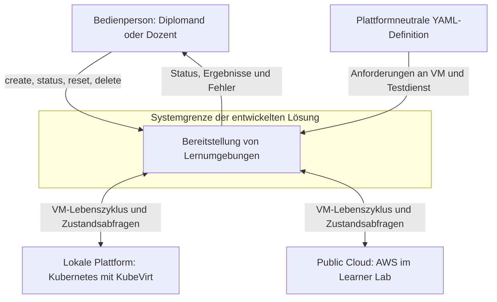

<small id="abb-10"><em>Abbildung 10: Systemkontext der geplanten Bereitstellungslösung</em></small>

Innerhalb der Systemgrenze liegen die selbst entwickelten Bestandteile: Kommandozeilenschnittstelle, Agent, Zustandsspeicher und Adapter. Kubernetes mit KubeVirt sowie AWS liegen ausserhalb dieser Grenze. Pro Lernumgebung wird eine der beiden Zielplattformen verwendet. Die YAML-Definition beschreibt die fachlichen Anforderungen; die Zuordnung zu konkreten Plattformressourcen übernimmt die Lösung.

#### 3.7.2 Komponentensicht

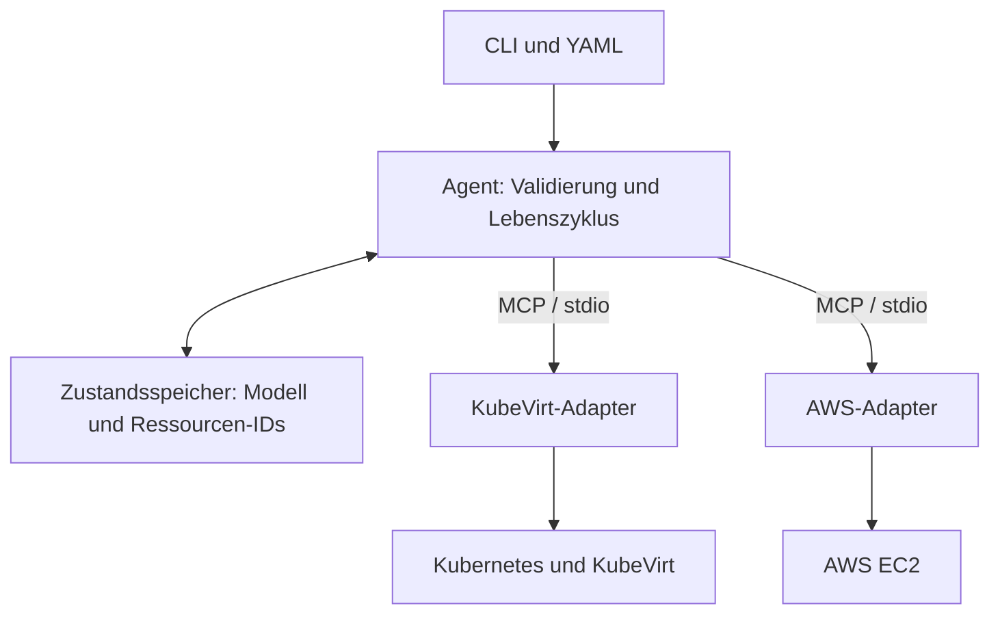

<small id="abb-11"><em>Abbildung 11: Geplanter Aufbau von CLI, Agent und Adaptern</em></small>

Die Kommandozeilenschnittstelle nimmt Definition und Zielplattform entgegen. Der Agent validiert die Eingabe und steuert den Auftrag. Mit Agent ist hier ein Programm mit festen Regeln gemeint: Es entscheidet anhand der Operation und des gespeicherten Zustands über den nächsten Schritt. Eine Sprachmodellentscheidung ist dafür nicht vorgesehen.

Der Zustandsspeicher soll als lokale SQLite-Datei Modell-Snapshot, Laufkennung, Operationskennung, Phase und Ressourcen-IDs halten. Der Snapshot bleibt für einen Lauf unverändert. Ein Hash dient der Zuordnung dieser Definition. Nach jedem erfolgreichen Plattformaufruf werden die erzeugten IDs gespeichert. Für einen Abbruch zwischen API-Erfolg und Speicherung muss der Adapter den Auftrag über eine zuvor festgelegte Kennung wiederfinden können.

| Zustand | Bedeutung | Zulässige nächste Aktion |
| --- | --- | --- |
| Nicht vorhanden | Keine laufbezogenen Ressourcen vorhanden | create |
| Wird erstellt | Aufbau begonnen, Dienst noch nicht bereit | status, fortsetzen oder delete |
| Bereit | VM läuft und Dienstprüfung ist erfolgreich | status, reset oder delete |
| Wird gelöscht | Abbau begonnen, Endkontrolle läuft | status oder Abbau fortsetzen |
| Fehler | Aufbau, Dienstprüfung oder Abbau fehlgeschlagen | Fehler und Ressourcen anzeigen, gezielt fortsetzen oder löschen |

Nur eine schreibende Operation darf gleichzeitig auf derselben Umgebung laufen. Eine wiederholte Erstellung darf keine Dublette erzeugen. Die Operationskennung unterscheidet einen neuen Auftrag von der Wiederaufnahme nach einem Abbruch. Ein erneutes delete einer bereits entfernten Umgebung bleibt ohne zusätzliche Wirkung. Bei reset wird erst nach bestätigtem Abbau aus dem Snapshot neu erstellt.

Die Adapter kapseln die Übersetzung in Kubernetes- beziehungsweise AWS-Aufrufe. Beispielsweise kann die Mindestanforderung an CPU und RAM auf AWS nur über einen passenden Instanztyp erfüllt werden; auf KubeVirt entstehen daraus VM-Ressourcen im Manifest. Die fachliche Definition enthält diese Unterschiede nicht.

Für die Kommunikation zwischen Agent und lokal gestarteten MCP-Adaptern ist stdio vorgesehen. MCP-Nachrichten laufen über die Standardein- und -ausgabe, Diagnosemeldungen über stderr. Die gemeinsame Werkzeugbeschreibung soll Aufrufe und Fehlerantworten vereinheitlichen. Der konkrete SDK- und Protokollstand wird beim Durchstich festgeschrieben; Grundlage ist die [MCP-Transportspezifikation](https://modelcontextprotocol.io/specification/2025-06-18/basic/transports).

Diese zusätzliche Prozess- und Protokollgrenze verursacht Aufwand. Deshalb vergleicht die spätere Bewertung denselben Provider-Code einmal direkt und einmal über MCP. So wird der Nutzen der Adaptertrennung von einem möglichen zusätzlichen Nutzen des Protokolls unterschieden. Die Kriterien stehen in Kapitel 3.8.

### 3.8 Bewertungskonzept

#### Vorher-Nachher-Vergleich

Nach der Umsetzung werden die gemeinsamen Phasen Aufbau bis Readiness und endgültiger Abbau verglichen. Reset, Wiederaufnahme und Fehlerbehandlung werden zusätzlich als Funktionen bewertet. Der Vergleich der aktiven Arbeit muss die bei der Basisserie beschriebenen übernommenen Bedienzeiten und die fehlende Handlungszählung berücksichtigen.

Die Auswertung verbindet die Zahlen mit dem Ablauf: Welche Eingaben bleiben für die Bedienperson nötig? Welche Schritte übernimmt der Agent? Sind Wiederholung und Abbau ohne Korrektur möglich? Erst diese Ergebnisse erlauben eine Aussage zum Nutzen der Automatisierung.

#### Vergleich der MCP-Anbindung

Der spätere Vergleich verwendet denselben Provider-Code direkt und über MCP. Bewertet werden fünf Kriterien:

| Kriterium | Leitfrage |
| --- | --- |
| Kopplung | Welche Abhängigkeiten entstehen zwischen Agent, Vertrag und Provider? |
| Aufwand | Welche zusätzlichen Komponenten, Konfigurationen und Aufrufe benötigt MCP? |
| Testbarkeit | Wie lassen sich Adapter und Fehlerfälle jeweils isoliert prüfen? |
| Fehlerbehandlung | Wie werden Plattformfehler, Timeouts und Prozessabbrüche an den Agenten übermittelt? |
| Erweiterbarkeit | Welche Änderungen wären für einen weiteren Adapter erforderlich? |

Skala und Gewichtung werden vor der eigentlichen Bewertung festgelegt. Ein Vorteil der sauberen Adaptertrennung wird nicht automatisch MCP zugeschrieben. Für den kleinen PoC kann der zusätzliche Protokollaufwand auch gegen MCP sprechen.

### 3.9 Entscheidungsübersicht der ADRs

Die Architekturentscheide wurden von mir als Diplomand im Rahmen der bewilligten technischen Entscheidungsbefugnisse getroffen. Die Übersicht verbindet die Auswahl mit ihrer Begründung und den Folgen für den PoC. Die ausführlichen Herleitungen stehen in den verlinkten Fachabschnitten.

| ADR | Technischer Entscheid | Begründung und Auswirkung | Herleitung |
| --- | --- | --- | --- |
| ADR-001 | dl380-01 als Zielplattform, kvcontrol als möglicher Ersatz | Die benötigte Plattform und der erfolgreiche Referenzlauf liegen auf dl380-01 vor. Ein Mehrknoten-Cluster ist für den PoC nicht vorgesehen. Vor einem Ersatzbetrieb muss kvcontrol separat geprüft werden. | [Lokale Zielplattform](#316-architekturentscheide-aus-der-erhebung) |
| ADR-002 | NodePort für den Testdienst | HTTP und SSH sind aus dem Verwaltungsnetz erreichbar. Zusätzliche Netzwerktechnik ist für den Referenzversuch nicht erforderlich; eine produktive Netzwerkanbindung bleibt ausserhalb des PoC. | [Erreichbarkeit des Gasts](#316-architekturentscheide-aus-der-erhebung) |
| ADR-003 | microk8s-hostpath als Speicherklasse | Die vorhandene Klasse stellt Speicher dynamisch bereit. Die Bindung an den einzelnen Host wird akzeptiert; zum Abbau gehört die Kontrolle von PV und Datenverzeichnis. | [Speicherklasse und Grenzen](#316-architekturentscheide-aus-der-erhebung) |
| ADR-004 | AWS als zweite Zielplattform | Learner-Lab-Zugang und Vorkenntnisse sind vorhanden; der Smoke-Test belegt die Eignung der Referenzkonfiguration. Lab-Beschränkungen, unbekanntes Ablaufdatum und Kostenkontrolle bleiben zu beachten. | [AWS-Auswahl und Kontobedingungen](#36-auswahl-der-public-cloud-plattform) |

Die gemeinsame Besprechung der Entscheide ist für das erste Review vorgesehen. Rückmeldungen und daraus folgende Anpassungen werden bei der betroffenen ADR und im zugehörigen Issue festgehalten. Die Zuständigkeit und Form der fachlichen Abnahme werden gemäss Kapitel 2.2 im Review geklärt.

## 4 Umsetzung

### 4.1 Referenz-Lernumgebung auf KubeVirt

Als erste Umsetzung habe ich die Referenz-VM auf der vorhandenen KubeVirt-Plattform manuell bereitgestellt. Das [Referenzmanifest](messungen/laeufe/kv-ref-20260922-01/manifest.yaml) enthält einen eigenen Namespace, die VM mit DataVolume und einen NodePort-Service für SSH und HTTP. cloud-init hinterlegt den öffentlichen Schlüssel und startet den Testdienst.

Damit waren die praktischen Voraussetzungen für den späteren Adapter geklärt: Abbildimport, nutzbarer Speicher, erreichbarer Gast und überprüfbarer Abbau. Besonders wichtig war die Speicherprüfung. Nach der Namespace-Löschung war der PV zunächst noch `Released`; seine Entfernung und das fehlende Datenverzeichnis wurden erst später bestätigt. Der spätere Adapter muss deshalb auf den tatsächlichen Endzustand warten.

Aus dem Manifest wurden die fachlichen Felder für das gemeinsame Modell abgeleitet. Abbild-URL, Namespace, StorageClass, NodePorts und Ressourcen-IDs bleiben Plattformdetails. Konfiguration, Zeiten und Belege des erfolgreichen Versuchs stehen im [Referenzlauf](#kubevirt-referenzlauf).

### 4.2 Plattformneutrales Fachmodell

Das Fachmodell trennt den gewünschten Testfall von seiner technischen Umsetzung. Modellversion `1.0`, JSON-Schema, Beispiele und lokale Validierung sind umgesetzt. US17 und US18 sind nach dem Abgleich von Code und Tests abgeschlossen.

#### Dateien und Beispiel

| Datei | Aufgabe |
| --- | --- |
| `modell/lernumgebung-v1.schema.json` | JSON-Schema nach Draft 2020-12 für Modellversion 1.0 |
| `modell/beispiele/referenz.yaml` | Vollständige fachliche Definition der reduzierten Referenzumgebung |
| `modell/beispiele/ungueltig-ram.yaml` | Bewusst ungültige Variante mit 1024 statt mindestens 2048 MiB RAM |
| `modell/validierung.py` | YAML einlesen und gegen das lokale Schema prüfen; später vom Agenten wiederverwendbar |
| `scripts/modell-pruefen.py` | Eigenständiger Aufruf der Modellprüfung |
| `tests/test_modell.py` | Automatisierte positive und negative Validierungsfälle |

Die Beispieldefinition zeigt die vollständige Eingabe aus `modell/beispiele/referenz.yaml`:

```yaml
modelVersion: "1.0"
name: referenzumgebung
vm:
  role: server
  resources:
    minVcpus: 2
    minMemoryMiB: 2048
    minDiskGiB: 12
  os:
    distribution: ubuntu
    release: "24.04"
    architecture: x86_64
  ssh:
    username: ubuntu
    publicKeys:
      - ssh-ed25519 AAAAC3NzaC1lZDI1NTE5AAAAICDeni6OPrsYaCfeayWMiGPRKbpcOZf+4Q6T+lFv9tAz diplomarbeit-referenz
  testService:
    protocol: http
    port: 8080
    path: /
    expectedStatus: 200
    expectedBody: lernumgebung bereit
```

Der öffentliche Schlüssel stammt aus dem Referenzmanifest. Für einen neuen Infrastrukturversuch muss der zugehörige private Schlüssel auf dem Zugangsrechner verfügbar sein. Die Validierung prüft hier nur das öffentliche Schlüsselformat; die Anmeldung wird separat getestet.

#### Fachliche Festlegungen

| Feld | Bedeutung und Grenze |
| --- | --- |
| `modelVersion` | Zeichenkette `1.0`; unbekannte Modellversionen werden abgewiesen |
| `name` | Name der Lernumgebung aus Kleinbuchstaben, Ziffern und einzelnen Bindestrichen, beginnend mit einem Buchstaben; höchstens 63 Zeichen |
| `vm.role` | `server`; Version 1.0 beschreibt genau eine VM |
| `vm.resources` | Ganzzahlige Mindestkapazitäten: mindestens 2 vCPU, 2048 MiB RAM und 12 GiB Systemdatenträger |
| `vm.os` | Ubuntu `24.04` auf `x86_64`; die Release-Angabe bleibt eine Zeichenkette |
| `vm.ssh` | Benutzer `ubuntu` und mindestens ein öffentlicher Ed25519-Schlüssel im OpenSSH-Format |
| `vm.testService` | HTTP auf Gastport 8080, Pfad `/`, Status 200 und Antwort `lernumgebung bereit` |

Der Prüfendpunkt wird später vom Adapter ermittelt. In der Definition stehen der Gastport und der erwartete Inhalt. So bleibt dieselbe Eingabe sowohl für einen NodePort-Service als auch für einen AWS-Endpunkt verwendbar.

Höhere Kapazitäten als die Mindestwerte sind zulässig. Ob eine Plattform sie tatsächlich bereitstellen kann, muss der Adapter vor der Erstellung prüfen. Kontorechte, Quotas und verfügbare Instanztypen lassen sich durch das Schema allein nicht prüfen.

Das Schema weist unbekannte Felder auf jeder Ebene zurück. Dadurch werden sowohl Schreibfehler als auch Plattformfelder wie `amiId`, `storageClass` und `nodePort` erkannt. Weitere Betriebssysteme oder mehrere VMs erfordern eine neue Festlegung des Modells und passende Tests.

#### Lokale Validierung

Die direkten Abhängigkeiten sind in `requirements.txt` festgeschrieben: PyYAML 6.0.3 und jsonschema 4.26.0. Die Validierung verwendet ein lokales Schema und benötigt nach der Installation keinen Netzwerkzugriff. Die explizite Auswahl von `Draft202012Validator` und die zusätzliche Formatprüfung folgen der [jsonschema-Dokumentation](https://python-jsonschema.readthedocs.io/en/stable/validate/).

Im aktivierten Python-Umfeld, aus dem Repository-Verzeichnis:

```bash
python -m pip install -r requirements.txt
python scripts/modell-pruefen.py modell/beispiele/referenz.yaml
python scripts/modell-pruefen.py modell/beispiele/ungueltig-ram.yaml
```

Die gültige Definition liefert Exitcode 0 und `Gültig: referenzumgebung (Modellversion 1.0)`. Die ungültige Definition muss Exitcode 1 und `Ungültig: $.vm.resources.minMemoryMiB: Muss mindestens 2048 sein.` liefern. Die Angabe bezeichnet den betroffenen Feldpfad und die verletzte Mindestanforderung.

Neben den Schemaregeln prüft der YAML-Lader mehrdeutige Eingaben: doppelte Feldnamen, Alias-Verweise, mehrere Dokumente und nicht JSON-kompatible Werte werden abgewiesen. Die Ed25519-Prüfung kontrolliert auch den binären Aufbau des öffentlichen Schlüssels. Fehlermeldungen nennen den betroffenen Feldpfad, ohne eingegebene Werte oder YAML-Zeilen auszugeben. Das Werkzeug validiert Dateien und verändert keine Infrastruktur.

Modell und Validierung sind seit Commit [`8b96ab1`](https://github.com/Cancani/diplomarbeit/commit/8b96ab108b46b0a8c1b67799cebf7e4ec93a8bf3) versioniert. Die Pipeline berücksichtigt Modellpfade und Abhängigkeiten. Der [erfolgreiche CI-Lauf](https://github.com/Cancani/diplomarbeit/actions/runs/38720709849) enthält die automatisierten Prüfungen dieses Stands.

Alle 35 Tests bestanden unter Python 3.12, darunter zehn Testmethoden zum Modell. Sie prüfen Pflichtfelder, Mindestkapazitäten, Datentypen, Versionen, Plattformfelder, öffentliche Schlüssel und fehlerhafte YAML-Eingaben. Die Befehlsaufrufe werden zusätzlich aus einem anderen Arbeitsverzeichnis ausgeführt; dabei werden Erfolg, Fehlerausgabe und Exitcodes geprüft.

Für die lokale Prüfung aus dem Repository-Verzeichnis:

```bash
python -m unittest discover -s tests -v
python scripts/check-repository.py
python -m mkdocs build --strict
```

Der Dokumentationsbuild benötigt zusätzlich `requirements-docs.txt`. Die Tests laufen ohne bereitgestellte VM. Infrastrukturversuche werden separat protokolliert.

## 5 Tests und Messungen

Die bisherigen Prüfungen haben unterschiedliche Zwecke. Die lokalen Tests sichern Modell und Hilfswerkzeuge ab. Lern- und Referenzversuche klären den praktischen Ablauf. Die drei LernMAAS-Basisläufe liefern die Ausgangswerte. Die formalen PoC-Serien folgen nach der Implementierung des vollständigen Lebenszyklus.

| Prüfung | Stand |
| --- | --- |
| Modell und Hilfswerkzeuge | 35 automatisierte Tests erfolgreich, darunter zehn Testmethoden zum Modell |
| KubeVirt-Referenzlauf | Manuelle Erstellung, HTTP, SSH und Ressourcenabschluss erfolgreich |
| LernMAAS-Basisserie | Drei technische Abläufe abgeschlossen; abweichende Erfassung der Bedienzeit bei den Ergebnissen ausgewiesen |
| AWS-Smoke-Test | Erstellung, HTTP, SSH und Abbau erfolgreich |
| Formale PoC-Serien | Je drei vollständige Läufe auf KubeVirt und AWS nach der Umsetzung vorgesehen |

### 5.1 Messplan

Für die formalen Läufe gelten die Messgrenzen aus Kapitel 3.4. Die folgende Reihenfolge wird auf beiden Zielplattformen verwendet:

| Phase | Durchführung |
| --- | --- |
| Vorbereitung | Laufkennung vergeben, Codeversion, Definition und Abbild festhalten. Zugang vorbereiten und freien Ausgangsbestand prüfen. |
| create | Zeitnahme vor der ersten Bedienhandlung starten. Erstellung auslösen und den ermittelten HTTP-Endpunkt bis zum erwarteten Inhalt beobachten. |
| status und SSH | Laufenden VM-Zustand, zugeteilte Kapazitäten, Anmeldung und aktiven Testdienst prüfen. |
| reset | Inventar sichern, vollständig abbauen und aus derselben gespeicherten Definition neu erstellen. Neue IDs und zweite Dienstbereitschaft erfassen. |
| delete | Endgültigen Abbau auslösen und Ressourcenabschluss anhand des Inventars prüfen. |
| Auswertung | Verstrichene Zeiten, aktive Arbeit, Bedienhandlungen und Abweichungen je Phase zusammenführen. |

Die Protokolle verwenden UTC. Pollingintervall, Anfrage-Timeout und Gesamtgrenzen werden vor einer Serie festgelegt. `scripts/probe-http.py` prüft standardmässig im Abstand von zwei Sekunden mit zwei Sekunden Anfrage-Timeout. Die eigene Laufzeit des Beobachters ist von der gesamten Aufbaudauer ab Startmarker zu unterscheiden.

Bei einem Fehler bleiben das Protokoll und das Ressourceninventar erhalten. Die Bereinigung wird gezielt abgeschlossen. Für eine erfolgreiche formale Serie gelten danach wieder drei aufeinanderfolgende Läufe ohne manuelle Korrektur.

#### Durchführung der LernMAAS-Basisserie

Zwei SSH-Terminals auf `cloud-au-30` trennten Bedienung und Beobachtung. Das Hilfswerkzeug `maas-beobachten.py` prüfte Eingaben und Ausgangszustand und beobachtete MAAS sowie den HTTP-Dienst. Die VM-Erstellung erfolgte mit dem gesicherten `createvms`; Zone, Betriebssystem und Cloud-init wurden in der MAAS-Oberfläche gesetzt.

Sobald der Deployment-Endpunkt vorlag, begann das HTTP-Polling. Nach HTTP und SSH wurden Maschine und Testpool gelöscht. Maschinenbestand, Poolliste und Hostzuteilung wurden mit dem Zustand vor dem Lauf verglichen. Die Aufbaugrenze lag bei 1800 Sekunden, das HTTP-Polling bei höchstens 900 Sekunden innerhalb dieser Gesamtzeit. Die Laufkennungen aus der Vorbereitung blieben bestehen.

### 5.2 Messprotokollvorlage

Ein Laufprotokoll enthält die folgenden Angaben. Fehlende Daten werden als fehlend gekennzeichnet. Die Ressourcen vor und nach einem Reset werden getrennt zugeordnet.

| Bereich | Inhalt |
| --- | --- |
| Zuordnung | Laufkennung, Plattform, Datum, Person, Serien- und Versuchsnummer |
| Eingaben und Umgebung | Git-Commit, YAML-Definition, Cloud-init, Abbild-ID oder datierte URL, Host beziehungsweise Region und tatsächliche Kapazitäten |
| Ausgangsbestand | Vorbereiteter Zugang, bestehende Basisressourcen und freie Testumgebung |
| Zeitmessung | Startmarker, erste Readiness, Resetbeginn, bestätigter interner Abbau, zweite Readiness, endgültiger Abbaustart und abgeschlossene Nachkontrolle |
| Prüfparameter | Endpunkt, Pollingintervall, Anfrage-Timeout und Gesamtgrenzen |
| Bedienaufwand | Aktive Zeit und Handlungszahl je Phase sowie zusätzliche Fehlerkorrekturen |
| Ressourcenabschluss | Ressourcentyp, ID, Abhängigkeiten und Endzustand für beide Erstellungen; bekannte Restressourcen bei Fehlern |
| Ergebnis | Erfolg oder Fehler, Abweichungen, Kosten soweit verfügbar und Verweise auf die Rohprotokolle |

### 5.3 Messläufe

Die folgenden Abschnitte dokumentieren die ausgeführten Versuche. Ihre Ergebnisse werden entsprechend dem jeweiligen Zweck verwendet: technische Machbarkeit, Vorbereitung der Messung oder Vergleichsbasis.

#### KubeVirt-Referenzlauf

Der Lauf `kv-ref-20260922-01` auf `dl380-01` bestätigte die manuelle Erstellung und Entfernung der Referenzumgebung. VM, HTTP-Dienst und SSH funktionierten; US38 ist abgeschlossen.

| Merkmal | Konfiguration |
| --- | --- |
| Plattform | MicroK8s v1.35.6 mit KubeVirt und CDI, Einzelknoten `dl380-01` |
| Definition | [Manifest](messungen/laeufe/kv-ref-20260922-01/manifest.yaml), eigener Namespace `da-kv-ref-20260922-01` |
| VM | 2 vCPU, 2 GiB RAM, 12 GiB Datenträger; Ubuntu 24.04 amd64, Build `20260911` |
| Endpunkte | NodePort 31946 für HTTP und 30526 für SSH, geprüft vom Clusterhost |
| Speicher | `microk8s-hostpath`, `WaitForFirstConsumer`, Reclaim-Policy `Delete` |

| Prüfung | Ergebnis |
| --- | --- |
| Erstellung und HTTP | HTTP 200 mit `lernumgebung bereit`, 302,922 s ab Startmarker |
| Plattformstatus | VM und VMI `Running/Ready`, DataVolume erfolgreich, PVC gebunden |
| SSH | Anmeldung erfolgreich, Dienst aktiv und Gastdatenträger geprüft |
| Namespace-Abbau | Namespace entfernt, Test-PV zunächst noch `Released` |
| Storage-Nachkontrolle | PV und zugeordnetes Datenverzeichnis entfernt |

Die Nachkontrolle bezog sich auf den vorher gesicherten PV `pvc-af106e61-e080-46c8-8b38-4ba46f59b092` und seinen HostPath. Der bestehende PV `rwm-volume` blieb erhalten. Der Speicherabschluss wurde rund 163 Sekunden nach Abbaustart festgestellt. Eine Namespace-Löschung allein wäre dafür kein ausreichendes Endkriterium gewesen.

Das HTTP-Polling begann nach dem Erstellungsaufruf und lief selbst 234,367 Sekunden. Als beobachtete Aufbaudauer werden die 302,922 Sekunden ab Startmarker verwendet. Bedienzeit, Handlungszahl, Zugriff vom Laptop und Reset wurden in diesem Referenzlauf nicht gemessen beziehungsweise geprüft.

Belege: [HTTP](messungen/laeufe/kv-ref-20260922-01/http-create.jsonl), [SSH](messungen/laeufe/kv-ref-20260922-01/ssh-pruefung.txt), [Ressourceninventar](messungen/laeufe/kv-ref-20260922-01/inventar-vor-abbau.json), [PV-Zuordnung](messungen/laeufe/kv-ref-20260922-01/pv-vor-abbau.json), [Abbau](messungen/laeufe/kv-ref-20260922-01/abbau.txt) und [Storage-Nachkontrolle](messungen/laeufe/kv-ref-20260922-01/storage-nachkontrolle.txt).

#### LernMAAS-Vorversuch

Mit `lernmaas-20260930-01` habe ich die gemeinsame Referenz auf LernMAAS erprobt. Der Lauf verwendete Controller `cloud-au-30`, KVM-Host `cloud-au-32` und MAAS-Pod 7. Die Maschine `daref-01-da20260930a` hatte die System-ID `rf376m`, der Pool die ID 16. Sie erhielt 2 vCPU, 2048 MiB RAM und 13 GB Datenträger unter Ubuntu 24.04 amd64 mit Kernel `ga-24.04` und MAAS-Abbildsatz `20260223`.

Die im Gast bestätigten 13 000 000 000 Bytes erfüllen die Anforderung von mindestens 12 GiB. Die Definition wurde mit dem gesicherten Erstellungsskript ausgeführt; der LernMAAS-Repository-Stand war `1f105a74cd0684286379fe4dc539d58331bc62e8`.

Der Ablauf umfasste Maschinenanlage, die Zustände `Ready`, `Deploying` und `Deployed`, die externe HTTP-Prüfung sowie die anschliessende Entfernung von Maschine und Pool. Die vollständigen Ereigniszeitstempel stehen in den verlinkten Protokollen.

Bis zur beobachteten HTTP-Bereitschaft vergingen 652,061 Sekunden. Die 77,596 Sekunden bis zur bestätigten Poolentfernung enthalten einen längeren Abstand vor dem Pool-Löschaufruf und sind keine reine technische Löschzeit.

Der Versuch zeigte zwei Probleme für die geplante Serie. Im Deployment-Dialog wurde eine verkürzte Cloud-init-Vorlage verwendet; die ausgelesene systemd-Unit lief dadurch als root. Ausserdem gelang SSH vom Controller mit einem vorhandenen Schlüssel, während der Laptop-Schlüssel abgewiesen wurde. Für die Basisserie wurden deshalb die vollständige Cloud-init-Datei und der passende öffentliche Schlüssel festgeschrieben. Die [nachträglich rekonstruierte Eingabe](messungen/laeufe/lernmaas-basis-20260930/lauf-01/cloud-init-verwendet-rekonstruiert.yaml) bleibt ausdrücklich als Rekonstruktion bezeichnet.

Nach dem Abbau waren Maschine und Pool entfernt, die Hostzuteilung wieder auf dem Ausgangsstand und die zuvor vorhandenen 30 Maschinen weiterhin erfasst. Der Lauf bleibt wegen der abweichenden Eingabe und unvollständigen Bedienzeiterfassung ein Vorversuch.

Belege: [Referenzprofil](messungen/laeufe/lernmaas-basis-20260930/config-referenz.yaml), [Erstellungsskript](messungen/laeufe/lernmaas-basis-20260930/createvms-original.sh), [Abbildstand](messungen/laeufe/lernmaas-basis-20260930/ubuntu-noble-ga24.04.json), [HTTP](messungen/laeufe/lernmaas-basis-20260930/lauf-01/http-create.jsonl), [SSH](messungen/laeufe/lernmaas-basis-20260930/lauf-01/ssh-pruefung-02.txt), [ausgelesener Dienst](messungen/laeufe/lernmaas-basis-20260930/lauf-01/testdienst-tatsaechlich.txt), [Maschinen nach Abbau](messungen/laeufe/lernmaas-basis-20260930/lauf-01/maschinen-abschluss.json) und [Pools nach Abbau](messungen/laeufe/lernmaas-basis-20260930/lauf-01/pools-abschluss.json). Die [Aufbereitung](messungen/laeufe/lernmaas-basis-20260930/aufbereitung.json) dokumentiert das Entfernen privater Zoneninhalte aus den öffentlichen Inventaren.

#### LernMAAS-Basisserie

Die drei Basisläufe wurden auf `cloud-au-30` durchgeführt. Sie verwendeten dieselbe reduzierte Referenzdefinition. Jeder Lauf umfasste Erstellung, manuelles Deployment, HTTP, SSH und anschliessenden Abbau. Alle drei technischen Abläufe waren erfolgreich.

**Gemeinsame Eingaben**

| Merkmal | Stand |
| --- | --- |
| Ausführung | KVM-Host `cloud-au-32`, MAAS-Pod 7, Zone `10-1-45-0` |
| Referenz | Profil `daref`, eine VM, 2 vCPU, 2048 MiB RAM, 13 GB Datenträger |
| Abbild | Ubuntu 24.04 LTS, `noble`, amd64, Kernel `ga-24.04`; identischer gesicherter MAAS-Abbildstand |
| Erstkonfiguration | Vollständige `cloud-init-referenz.yaml` mit öffentlichem SSH-Schlüssel und HTTP-Dienst als `nobody:nogroup` |
| Prüfung | HTTP 200 mit `lernumgebung bereit`, erfolgreiche SSH-Anmeldung als `ubuntu`, aktiver Dienst und Gastdatenträger bestätigt |
| Zeitführung | UTC; vor jedem Lauf `NTPSynchronized=yes` |
| Zeitgrenzen | 1800 s Aufbau, HTTP höchstens 900 s darin; Sollintervall und Anfrage-Timeout je 2 s. Löschaufruf höchstens 300 s, MAAS-Inventarabfrage höchstens 30 s. |

Referenzprofil, Cloud-init, Erstellungsskript, öffentlicher Schlüssel und Beobachter sind in den drei Laufordnern identisch. Name, Architektur und Abbildsätze stimmen überein. Das veränderliche Feld `last_deployed` zählt nicht zur Abbildversion. Cache und Hintergrundlast wurden nicht separat gemessen.

| Lauf | VM-Name | Maschinen-ID | Pool-ID | Deployment-IP |
| --- | --- | --- | ---: | --- |
| b01 | `daref-01-da20260930b01` | `ggnhct` | 17 | `10.0.45.52` |
| b02 | `daref-01-da20260930b02` | `83md8a` | 18 | `10.0.45.65` |
| b03 | `daref-01-da20260930b03` | `rbggst` | 19 | `10.0.45.73` |

**Zeitmessung und Ergebnisse**

Die Aufbaudauer reicht vom Startmarker vor `createvms` bis zum ersten Ereignis `ready_observed` im HTTP-Protokoll. Die Abbaudauer reicht vom Abbaustartmarker bis zur bestätigten Prüfung von Maschinenbestand, Pool und Hostzuteilung.

| Lauf | Aufbau bis HTTP in s | Abbau mit Nachkontrolle in s | Ergebnis |
| --- | ---: | ---: | --- |
| b01 | 568,332 | 26,043 | HTTP und SSH erfolgreich, Maschine und Pool entfernt |
| b02 | 692,909 | 17,077 | HTTP und SSH erfolgreich, Maschine und Pool entfernt |
| b03 | 919,463 | 16,756 | HTTP und SSH erfolgreich, Maschine und Pool entfernt |

Die längere Gesamtdauer von b03 bleibt in der Auswertung erhalten. Zwischen dem erstmals beobachteten Zustand `Ready` und `Deploying` lagen bei b01 63,603 s, bei b02 133,443 s und bei b03 419,217 s. Dieser Abschnitt enthält den manuellen Deployment-Schritt und mögliche Zeit bis zu seiner Ausführung. Der genaue Grund der unterschiedlichen Abstände wurde nicht aufgezeichnet. Die längere Dauer kann deshalb nicht allein der Plattformleistung zugeschrieben werden. b03 blieb innerhalb der Gesamtgrenze von 1800 s; die 900-s-Grenze betraf das später gestartete HTTP-Polling.

**Bedienzeit**

Für b01 wurden folgende Stoppuhrwerte erfasst und gemeldet:

| Phase | Aktive Zeit in s |
| --- | ---: |
| YAML kopieren und CLI bedienen | 15 |
| Zonenwechsel und Deployment | 25 |
| SSH-Prüfung | 5 |
| Löschen und Nachkontrolle | 10 |
| Gesamt | 55 |

Für b02 und b03 wurde derselbe Ansatz übernommen und in der jeweiligen `bedienung.csv` gekennzeichnet. Diese beiden Werte sind keine unabhängigen Messungen. Eine Handlungszählung und eine zeitgestempelte Handlungsliste liegen nicht vor; die Bedienung des Beobachters wurde nicht separat gemessen. Der spätere Vergleich kann deshalb die technischen Zeiten je Lauf auswerten, bei der aktiven Arbeit aber nur mit dem entsprechend bezeichneten Ansatz arbeiten.

**Ressourcenabschluss und Belege**

Nach jedem Lauf fehlten die gesicherte Maschinen-ID, der VM-Name und der Testpool in MAAS. Alle zuvor erfassten Maschinen blieben vorhanden. Die gesamte gemeldete Hostzuteilung von Pod 7 entsprach jeweils wieder dem Ausgangsstand: acht Kerne, 8192 MiB RAM und 48 000 000 000 Bytes Speicher. Eine direkte Kontrolle der libvirt-Domänen und Datenträgerdateien auf dem KVM-Host erfolgte nicht; der Abschluss ist durch MAAS-Inventare und Hostzuteilung belegt.

Die [zusammengefasste Auswertung](messungen/laeufe/lernmaas-basis-20260930/auswertung-b01-b03-20261007.json) enthält die vollständigen Zeitstempel und Teilzeiten. In den Laufordnern liegen Eingaben und Einzelbelege:

| Lauf | Eingaben | HTTP und SSH | Abschluss | Bedienzeit |
| --- | --- | --- | --- | --- |
| b01 | [Plan](messungen/laeufe/lernmaas-basis-20260930/maas-b01-20260930/plan.json) | [HTTP](messungen/laeufe/lernmaas-basis-20260930/maas-b01-20260930/http-create.jsonl), [SSH](messungen/laeufe/lernmaas-basis-20260930/maas-b01-20260930/ssh-pruefung.txt) | [Maschinen](messungen/laeufe/lernmaas-basis-20260930/maas-b01-20260930/maschinen-nachher.json), [Pools](messungen/laeufe/lernmaas-basis-20260930/maas-b01-20260930/pools-nachher.json), [Host](messungen/laeufe/lernmaas-basis-20260930/maas-b01-20260930/hosts-nachher.json) | [CSV](messungen/laeufe/lernmaas-basis-20260930/maas-b01-20260930/bedienung.csv) |
| b02 | [Plan](messungen/laeufe/lernmaas-basis-20260930/maas-b02-20260930/plan.json) | [HTTP](messungen/laeufe/lernmaas-basis-20260930/maas-b02-20260930/http-create.jsonl), [SSH](messungen/laeufe/lernmaas-basis-20260930/maas-b02-20260930/ssh-pruefung.txt) | [Maschinen](messungen/laeufe/lernmaas-basis-20260930/maas-b02-20260930/maschinen-nachher.json), [Pools](messungen/laeufe/lernmaas-basis-20260930/maas-b02-20260930/pools-nachher.json), [Host](messungen/laeufe/lernmaas-basis-20260930/maas-b02-20260930/hosts-nachher.json) | [CSV](messungen/laeufe/lernmaas-basis-20260930/maas-b02-20260930/bedienung.csv) |
| b03 | [Plan](messungen/laeufe/lernmaas-basis-20260930/maas-b03-20260930/plan.json) | [HTTP](messungen/laeufe/lernmaas-basis-20260930/maas-b03-20260930/http-create.jsonl), [SSH](messungen/laeufe/lernmaas-basis-20260930/maas-b03-20260930/ssh-pruefung.txt) | [Maschinen](messungen/laeufe/lernmaas-basis-20260930/maas-b03-20260930/maschinen-nachher.json), [Pools](messungen/laeufe/lernmaas-basis-20260930/maas-b03-20260930/pools-nachher.json), [Host](messungen/laeufe/lernmaas-basis-20260930/maas-b03-20260930/hosts-nachher.json) | [CSV](messungen/laeufe/lernmaas-basis-20260930/maas-b03-20260930/bedienung.csv) |

#### AWS-Smoke-Test

**Zweck:** Früher Machbarkeitsnachweis für US14 und US15. Geprüft wurden eine einzelne Referenz-VM, SSH, der erwartete HTTP-Inhalt und der Abbau. Agent, MCP und Reset waren nicht Bestandteil dieses Tests.

| Merkmal | Verwendete Konfiguration |
| --- | --- |
| Plattform | AWS Academy Learner Lab, `us-east-1`, Availability Zone `us-east-1a` |
| VM | `t3.small`, zwei vCPU und 2048 MiB zugewiesener RAM; im Gast 1905 MiB sichtbar |
| Betriebssystem | Ubuntu 24.04.5 LTS; AMI `ami-0fa5967347d08d2df`, Canonical-Abbild |
| Speicher | 12 GiB EBS `gp3`, automatische Löschung bei Terminierung aktiviert |
| Netzwerk | Vorhandene Default-VPC, Subnetz und Internet-Gateway; automatische öffentliche IPv4-Adresse, keine Elastic IP angelegt |
| Zugang und Dienst | Benutzer `ubuntu`, Schlüsselpaar `vockey`; HTTP auf Port 8080, Inhalt `lernumgebung bereit` |

Die [Cloud-init-Konfiguration](messungen/laeufe/aws-smoke-20261013/cloud-init-aws.yaml) übernimmt HTML-Datei, systemd-Unit und Dienststart unverändert aus der LernMAAS-Basisserie. Der SSH-Zugang verwendet den Ubuntu-Standardbenutzer und den AWS-Schlüssel. Der Dienst läuft auf beiden Plattformen als `nobody:nogroup`; Paketaktualisierungen sind deaktiviert. Die Abbildwege und Infrastruktur unterscheiden sich weiterhin.

| Prüfung | Ergebnis |
| --- | --- |
| Aufbau bis HTTP-Bereitschaft | 27,634 s; HTTP 200 und erwarteter Inhalt |
| SSH und Gast | Ubuntu, CPU-Zahl, Datenträger und Dienst geprüft; Cloud-init ohne Fehler abgeschlossen |
| Vollständiger Abbau | 30,656 s bis zur abschliessenden Nachkontrolle |

Beim SSH-Zugriff änderte sich nach einem Wechsel des Lab-Terminals dessen öffentliche Quelladresse. Die Security Group erlaubte noch die vorherige Adresse, weshalb die Verbindung scheiterte und die Hostschlüssel-Abfrage leer blieb. Ich ermittelte die neue Quelladresse, passte die Regel an und entfernte die alte Freigabe. Danach war SSH erfolgreich. Die eingehenden Ports 22 und 8080 blieben auf die jeweilige einzelne Quelladresse beschränkt. Für weitere Versuche muss der vorbereitete Zugang deshalb auch nach einem Terminalwechsel stimmen.

**Ressourcenabschluss**

| Ressource | Gespeicherte ID | Nachkontrolle |
| --- | --- | --- |
| EC2-Instanz | `i-0a0774aadaba3d3f8` | Zustand `terminated` |
| EBS-Datenträger | `vol-081d7155d44444f52` | ID-Abfrage ohne Treffer |
| Netzwerkinterface | `eni-0e285a28037829c01` | ID-Abfrage ohne Treffer |
| Eigene Security Group | `sg-0bb906f137fcbca0c` | ID-Abfrage ohne Treffer |

VPC, Subnetz, Internet-Gateway und Schlüsselpaar gehörten zur vorhandenen Lab-Basis und blieben bestehen. Für den Nachweistransfer wurde anschliessend ein privater S3-Bucket verwendet. Nach dem Download wurde der Bucket gelöscht. Diese spätere Bestätigung ergänzt die im Laufarchiv enthaltenen API-Abfragen des VM-Abbaus.

**Einordnung und Nachweise**

Das [HTTP-Protokoll](messungen/laeufe/aws-smoke-20261013/http-create.jsonl), die [SSH-Prüfung](messungen/laeufe/aws-smoke-20261013/ssh-pruefung.txt), das [Instanzinventar](messungen/laeufe/aws-smoke-20261013/instanz-vor-abbau.json), die [Datenträgerprüfung](messungen/laeufe/aws-smoke-20261013/datentraeger-pruefung.json) und das [Abbauergebnis](messungen/laeufe/aws-smoke-20261013/abbau-ergebnis.json) belegen den Ablauf.

HTTP wurde alle fünf Sekunden geprüft, der Startmarker hat Sekundenauflösung. Die Nachkommastellen geben die Berechnung aus den gespeicherten Zeitstempeln wieder, nicht eine entsprechend hohe Messgenauigkeit. Bedienzeit und Handlungszahl wurden nicht erfasst. Der Test enthält direkte CLI-Bedienung und einen korrigierenden Eingriff bei SSH; Reset wurde nicht geprüft. Er bestätigt die Cloud-Machbarkeit und zählt nicht zur formalen PoC-Serie. Die [damalige Budgetaufnahme](messungen/laeufe/aws-smoke-20261013/budget-nach-test.txt) wird durch den späteren Kostenstand in Kapitel 3.6 ergänzt.

### 5.4 Ergebnisse der Ausgangsmessung

Die drei LernMAAS-Basisläufe liefern folgende verstrichene Zeiten:

| Phase | Minimum in s | Median in s | Maximum in s |
| --- | ---: | ---: | ---: |
| Aufbau bis HTTP-Bereitschaft | 568,332 | 692,909 | 919,463 |
| Endgültiger Abbau mit MAAS-Nachkontrolle | 16,756 | 17,077 | 26,043 |

Die Streuung beim Aufbau fällt deutlich grösser aus als beim Abbau. Die Ereignisprotokolle zeigen, dass sich vor allem der Abschnitt zwischen `Ready` und `Deploying` unterscheidet. In diesem Abschnitt wird das Deployment manuell ausgelöst. Die Werte beschreiben daher den beobachteten Gesamtprozess und lassen sich nicht als reiner Leistungsvergleich der Infrastruktur lesen.

Der manuelle KubeVirt-Lauf und der AWS-Smoke-Test bestätigen inzwischen, dass die Referenz auf beiden Zielplattformen funktioniert. Ihre einzelnen Zeiten werden wegen der unterschiedlichen Abläufe nicht mit den Basisläufen zu einer gemeinsamen Leistungsrangfolge verrechnet.

## Verzeichnisse

### Glossar

| Begriff | Bedeutung |
| --- | --- |
| Agent | In dieser Arbeit ein Programm, das Operationen anhand festgelegter Regeln und gespeicherter Zustände steuert |
| ADR | Architectural Decision Record; hält Kontext, Entscheid, Alternativen und Folgen einer Architekturentscheidung fest |
| cloud-init | Erstkonfiguration einer Maschine beim ersten Start, beispielsweise für SSH-Schlüssel und Dienststart |
| CDI | Containerized Data Importer; unterstützt unter anderem den Import eines VM-Abbilds in den Kubernetes-Speicher |
| DataVolume | Von CDI verwendetes Objekt zur Verwaltung der Befüllung eines Volumes |
| KubeVirt | Kubernetes-Erweiterung für den Betrieb virtueller Maschinen als Kubernetes-Ressourcen |
| MAAS | Metal as a Service; Grundlage der heutigen Maschinenverwaltung und Bereitstellung |
| LernMAAS | TBZ-Umsetzung von Lernumgebungen mit MAAS, Modulprofilen und Hilfsskripten |
| MCP | Model Context Protocol; hier zur Kommunikation zwischen Agent und providerbezogenen Adaptern vorgesehen |
| Modell-Snapshot | Unveränderte Kopie der für einen Lauf verwendeten fachlichen Definition |
| NodePort | Kubernetes-Service, der einen Dienst über einen Port auf dem Knoten erreichbar macht |
| PV und PVC | PersistentVolume als clusterweite Speicherressource und PersistentVolumeClaim als Speicheranforderung im Namespace |
| Readiness | Geprüfte Nutzbarkeit: VM läuft, HTTP-Status und Antwortinhalt entsprechen der Definition |
| Reset | Vollständiger Abbau und Neuerstellung aus derselben gespeicherten Definition |
| Teardown | Abbau aller laufbezogenen Ressourcen bis zum festgelegten Endzustand |
| Story Point | Relative Schätzgrösse für Aufwand, Komplexität und Unsicherheit |
| Velocity | In einem Sprint tatsächlich abgeschlossene Story Points; keine feste Umrechnung in Stunden |

### Quellenverzeichnis

| Quelle | Verwendung und Stand |
| --- | --- |
| Bewilligte Projektbeschreibung, Efekan Demirci, 10.09.2026 | Verbindlicher Umfang, Ziele, Lieferobjekte und Budget; als separate Originaldatei bereitgestellt |
| TBZ, Experteninformation 2026 | Hinweise zur Begleitung und Abgabe; konkrete Termine und gültiges Merkblatt mit der Schule abgleichen |
| Bewertungsblatt Semesterarbeit 5 | Rückmeldungen zu Demo, Testerklärung und Nachweisführung |
| [LernMAAS](https://github.com/mc-b/lernmaas) | Profilstruktur und Hilfsskripte; Repository-Commit, installiertes `createvms` und Konfigurationsdatei gesichert, siehe [Laufnachweis](#lernmaas-vorversuch) |
| [Lerncloud](https://github.com/mc-b/lerncloud) | Bestehende Erstkonfiguration und Dienste |
| [Kubernetes: Persistent Volumes](https://kubernetes.io/docs/concepts/storage/persistent-volumes/) | Clusterweiter PV und Reclaim-Verhalten |
| [MCP: Transports, Version 2025-06-18](https://modelcontextprotocol.io/specification/2025-06-18/basic/transports) | stdio und Trennung von Protokoll und Diagnose |
| [jsonschema: Schema Validation](https://python-jsonschema.readthedocs.io/en/stable/validate/) | Draft202012Validator und explizite Formatprüfung; verwendete Bibliotheksversion 4.26.0 |
| [AWS Academy Learner Lab](https://awsacademy.instructure.com/courses/182558/modules/items/18005637), Readme Stand 24.06.2025 | Konkrete Lab-Bedingungen zu Regionen, Ressourcen, Sitzungen und Budget, siehe Kapitel 3.6 |
| Eigene Board- und Milestone-Screenshots sowie Meetingübersicht | Statusspalten, Sprintzuordnung und Issue-Zahlen für Kapitel 2; Reviewtermine vom Diplomanden bereitgestellt |
| Eigene Netzwerkaufnahme, Efekan Demirci | Zuordnung der Geräte, Adressvergabe, aktuelles VLAN und reserviertes Ausweichnetz; Zusammenfassung in Kapitel 3.1.2 |
| [Netplan: YAML-Konfiguration](https://netplan.readthedocs.io/en/stable/netplan-yaml/) | DHCP-Client-Kennung beim networkd-Backend |
| [AWS T3](https://aws.amazon.com/ec2/instance-types/t3/), [gp3](https://docs.aws.amazon.com/prescriptive-guidance/latest/optimize-costs-microsoft-workloads/ebs-migrate-gp2-gp3.html), [EBS-Abrechnung](https://aws.amazon.com/ebs/pricing/), [öffentliche IPv4](https://aws.amazon.com/vpc/pricing/) | Veröffentlichte Rechenansätze der Preisabschätzung |
| [SNB-Datenportal](https://data.snb.ch/en) | USD-Monatsmittel August 2026, CHF 0,8078 je USD; historische Umrechnungsbasis |
| [AWS: GetResources](https://docs.aws.amazon.com/resourcegroupstagging/latest/APIReference/API_GetResources.html) | Grenze der Tagging-Abfragen |
| [Scrum Guide](https://scrumguides.org/scrum-guide.html) | Abgrenzung des angepassten Vorgehens |

Interne Betriebsunterlagen und die Reservationsliste sind in der IST-Analyse benannt. Die Rohprotokolle sind eigene Erhebungen des Diplomanden.

### Nachweise und Aussagegrenzen

Die Rohprotokolle und verwendeten Eingaben bleiben in den ursprünglichen Laufordnern erhalten. Die Versuchskapitel verlinken die für ihre Ergebnisse massgeblichen Dateien. Die Übersicht erleichtert die Zuordnung:

| Nachweis | Inhalt und Verwendung |
| --- | --- |
| [KubeVirt-Referenzlauf](#kubevirt-referenzlauf) | Manifest, HTTP, SSH, Ressourceninventar und Storage-Nachkontrolle für die lokale Machbarkeit |
| [LernMAAS-Vorversuch](#lernmaas-vorversuch) | Vorbereitung der gemeinsamen Referenz; abweichende Eingabe und Messgrenzen im Versuchskapitel beschrieben |
| [LernMAAS-Basisserie](#lernmaas-basisserie) | Drei technische Läufe, Zeitstempel, Eingaben und MAAS-Ressourcenvergleich; Herkunft der Bedienzeiten dort ausgewiesen |
| [AWS-Smoke-Test](#aws-smoke-test) | EC2-Aufbau, HTTP, SSH und API-Abbauprüfung; S3-Transfer-Bucket nach dem Download gelöscht |
| [AWS-Budget](#363-budgetwarnungen-und-kostenstand) | CSV-Export, Warnschwellen und bestätigter aktiver Empfänger; historische Erfassungsnotiz bleibt unverändert |
| [LernMAAS-Lernlauf](nachweise/lernlauf-lernmaas-00-20260916.txt), [mess01](messungen/messprotokoll-mess01.txt), [parallel01](messungen/messprotokoll-parallel01.txt) | Frühe Ablaufanalyse; Einordnung der unvollständigen Mess- und Abbaudaten in Kapitel 3.5 |
| [Erster KubeVirt-Versuch](nachweise/nachweis-testvm-20260914.txt), [damaliges Manifest](nachweise/testvm.yaml), [frühe Cloud-init-Vorlage](messungen/cloud-init-messlauf.yaml) | Historische Vorbereitung; das bearbeitete Manifest und die frühe Vorlage sind keine unveränderten Definitionen der späteren Serie |
| [DL380](nachweise/recon-dl380-01-20260914.txt), [kvcontrol](nachweise/recon-kvcontrol-20260914.txt) | Systemaufnahme |
| [Kubernetes](nachweise/recon-k8s-20260914.txt), [Details](nachweise/recon-detail-20260914.txt), [Cluster](nachweise/recon-cluster-20260914.txt) | Ausgangszustand der übernommenen Plattform |

Die Bestätigung des aktiven Budgetempfängers ist kein Test einer tatsächlich ausgelösten Warnung. Die später bestätigte Bucket-Löschung wird von den im Smoke-Test gespeicherten API-Prüfungen unterschieden. Die historische Budgetnotiz enthält entsprechend noch den damaligen Prüfstand.

### Abbildungsverzeichnis

| Nr. | Abbildung | Stand |
| --- | --- | --- |
| 1 | [Projektorganisation und Berichtswege](#abb-01) | Vorhanden |
| 2 | [Milestone-Übersicht der drei Sprints](#abb-02) | Sprintgliederung |
| 3 | [Project Board mit Aufgaben im Backlog](#abb-03) | Aufgabenübersicht |
| 4 | [Sprint 1 mit allen User Stories offen](#abb-04) | Planungsansicht |
| 5 | [Zeitplan der User Stories für Sprint 1 mit anschliessendem Review](#abb-05) | Planung |
| 6 | [Project Board mit Bearbeitungsstand und US16 in Bearbeitung](#abb-06) | Bearbeitungsstand vor dem Review |
| 7 | [Milestone Sprint 1 mit offener US16](#abb-07) | Reviewabschluss offen |
| 8 | [Milestone Sprint 2 mit offenen und vorgezogenen Stories](#abb-08) | Grundlage für die Sprintplanung |
| 9 | [Zeitplan der offenen User Stories für Sprint 2 mit anschliessendem Review](#abb-09) | Planungsvorschlag, Prioritäten im ersten Review abzustimmen |
| 10 | [Systemkontext der geplanten Bereitstellungslösung](#abb-10) | Entwurf |
| 11 | [Geplanter Aufbau von CLI, Agent und Adaptern](#abb-11) | Entwurf, noch keine implementierte Architektur |

## Kontakt

Efekan Demirci, ITCNE24, TBZ Höhere Fachschule
efekan.demirci@tbz.ch
